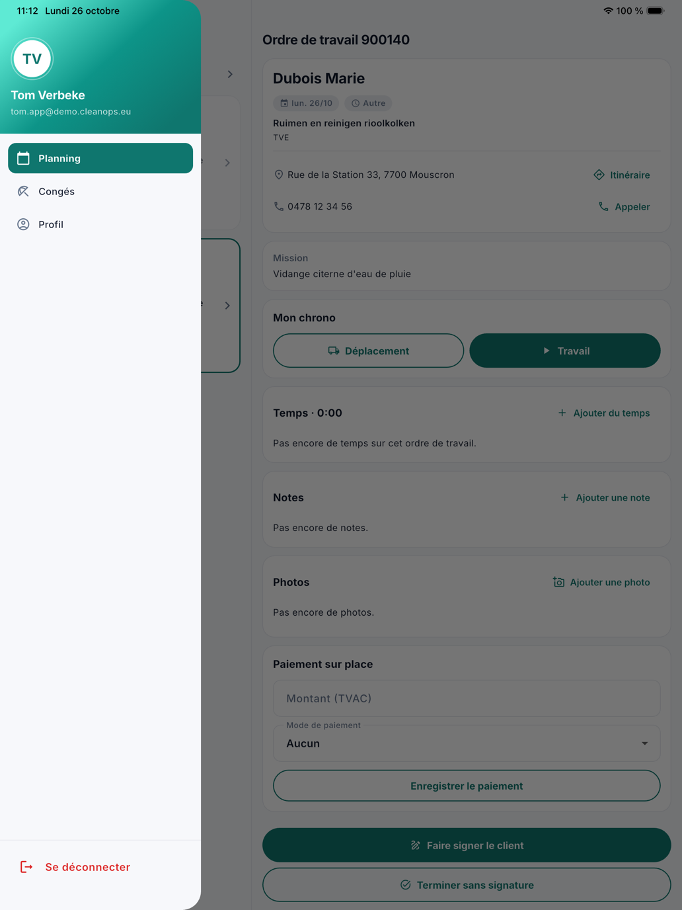
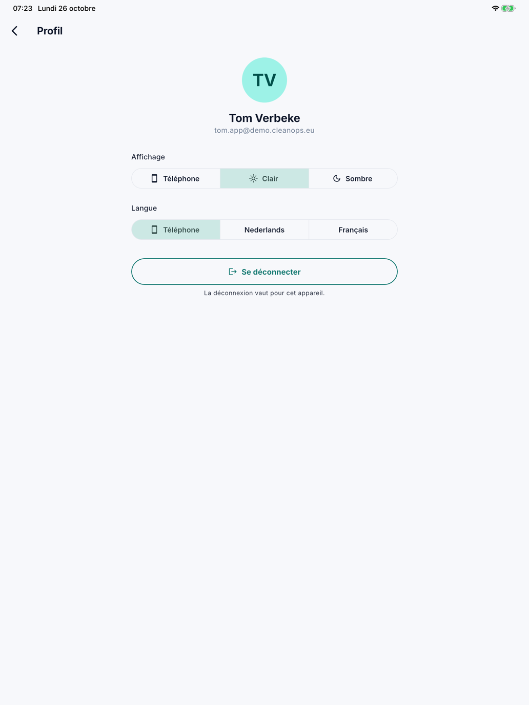

# Bien démarrer avec l'application

Avec l'application CleanOps, vos collaborateurs sur le terrain ont leur planning et leurs ordres de travail sous la
main. Ils enregistrent leurs heures avec un chrono, notent ce que le bureau doit savoir, prennent des photos, notent un
paiement sur place et font signer le bon de livraison par le client. Ils y voient aussi leurs congés et en demandent. Ce qu'ils font dans l'application, vous le voyez
immédiatement dans CleanOps au bureau.

L'application fonctionne sur un iPhone, un iPad et un appareil Android, en néerlandais et en français. Le collaborateur
ne voit que son propre travail et celui de son équipe. L'application n'utilise pas sa position.

| Quoi | Où |
|---|---|
| Le planning du jour et l'ouverture d'un ordre de travail | [Le planning](planning.fr.md) |
| Le chrono, les notes, les photos et le paiement sur place | [L'ordre de travail](werkorder.fr.md) |
| Faire signer le client, envoyer le bon signé, terminer | [Faire signer](laten-tekenen.fr.md) |
| Le solde de congés, les congés enregistrés et demander un congé | [Congés](verlof.fr.md) |

## Donner l'accès

Un collaborateur se connecte avec son adresse e-mail et un mot de passe qu'il choisit lui-même. Vous lui donnez accès
sur sa fiche, dans le bloc [Accès à l'app](../medewerkers.fr.md#acces-a-lapp) :

1. Ouvrez le collaborateur et cliquez sur **Donner l'accès…**.
2. Indiquez son adresse e-mail et cliquez sur **Inviter**.
3. Le collaborateur reçoit un e-mail. Il y choisit son mot de passe avec le lien (valable 24 heures) et trouve
   l'application dans l'[App Store](https://apps.apple.com/app/id6748907113) ou dans
   [Google Play](https://play.google.com/store/apps/details?id=com.admconcept.cleanops).
4. Il ouvre l'application et se connecte avec son adresse e-mail et son mot de passe.

S'il a oublié son mot de passe, envoyez-lui un lien pour en choisir un nouveau via **Nouveau mot de passe** sur sa
fiche.

## Le menu

Les trois traits en haut à gauche ouvrent le menu : le nom et l'adresse e-mail du collaborateur, **Planning**,
**Congés**, **Profil** et en bas **Se déconnecter**.

{ width="560" }

## Le profil

Sous **Profil**, le collaborateur choisit :

- l'**Affichage** : comme le **Téléphone**, **Clair** ou **Sombre** ;
- la **Langue** de l'application : comme le **Téléphone**, **Nederlands** ou **Français**.

**Se déconnecter** le déconnecte. Cela ne vaut que pour cet appareil.

{ width="560" }

## Questions fréquentes

**Un collaborateur ne parvient pas à se connecter.**
Regardez sur sa fiche le bloc [Accès à l'app](../medewerkers.fr.md#acces-a-lapp). S'il indique *Invité*, il n'a pas
encore choisi son mot de passe : envoyez un nouveau lien avec **Inviter à nouveau**. Si l'accès est révoqué, ou si le
collaborateur est inactif ou retraité, il ne peut pas se connecter.

**Un collaborateur ne voit pas un ordre de travail.**
L'application montre le travail du collaborateur et de son équipe. Vérifiez dans le [planning](../planning.fr.md) que
l'ordre de travail est attribué à lui ou à son équipe ce jour-là.

## Voir aussi

- [Collaborateurs](../medewerkers.fr.md), le bloc Accès à l'app
- [Ordres de travail](../werkorders.fr.md), avec les onglets Temps et Notes
