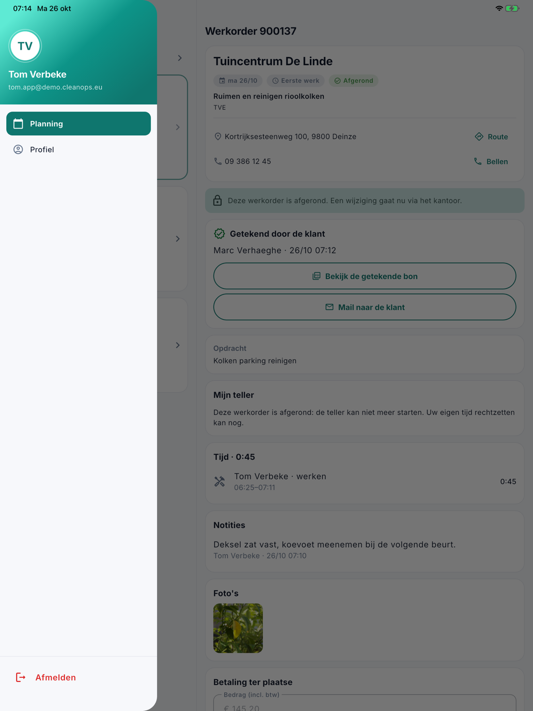
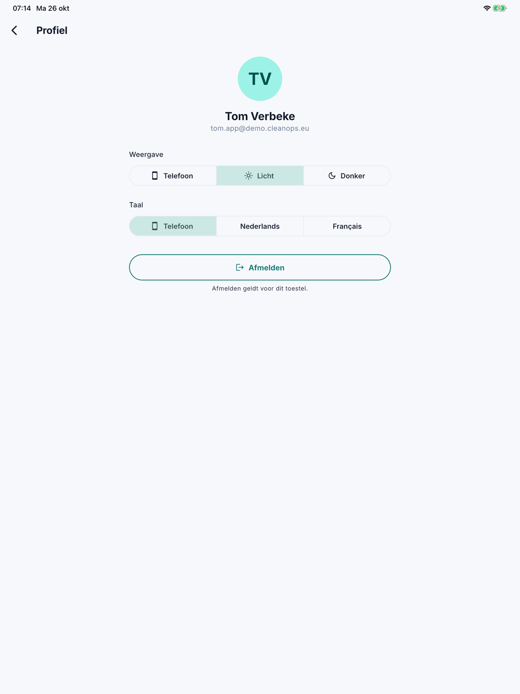

# Aan de slag met de app

Met de app CleanOps hebben uw medewerkers in het veld hun planning en hun werkorders bij de hand. Ze registreren hun
werkuren met een teller, noteren wat het kantoor moet weten, nemen foto's, noteren een betaling ter plaatse en laten de
klant de leveringsbon aftekenen. Wat ze in de app doen, ziet u meteen in CleanOps op kantoor.

De app werkt op een iPhone, een iPad en een Android-toestel, in het Nederlands en het Frans. De medewerker ziet enkel
zijn eigen werk en dat van zijn ploeg. De app gebruikt zijn locatie niet.

| Wat | Waar |
|---|---|
| De planning van de dag en de werkorder openen | [De planning](planning.md) |
| De teller, notities, foto's en de betaling ter plaatse | [De werkorder](werkorder.md) |
| De klant laten aftekenen, de getekende bon mailen, afronden | [Laten tekenen](laten-tekenen.md) |

## Toegang geven

Een medewerker meldt zich aan met zijn e-mailadres en een wachtwoord dat hij zelf kiest. U geeft hem toegang op zijn
fiche, in het blok [App-toegang](../medewerkers.md#app-toegang):

1. Open de medewerker en klik op **Toegang geven…**.
2. Vul zijn e-mailadres in en klik op **Uitnodigen**.
3. De medewerker krijgt een mail. Daarin kiest hij zijn wachtwoord met de link (24 uur geldig) en vindt hij de app in
   de [App Store](https://apps.apple.com/app/id6748907113) of in
   [Google Play](https://play.google.com/store/apps/details?id=com.admconcept.cleanops).
4. Hij opent de app en meldt zich aan met zijn e-mailadres en zijn wachtwoord.

Is hij zijn wachtwoord vergeten, dan stuurt u hem via **Nieuw wachtwoord** op zijn fiche een link om een nieuw te
kiezen.

## Het menu

Met de drie streepjes linksboven opent het menu: de naam en het e-mailadres van de medewerker, **Planning**, **Profiel**
en onderaan **Afmelden**.

{ width="560" }

## Het profiel

Onder **Profiel** kiest de medewerker:

- de **Weergave**: zoals de **Telefoon**, **Licht** of **Donker**;
- de **Taal** van de app: zoals de **Telefoon**, **Nederlands** of **Français**.

Met **Afmelden** meldt hij zich af. Dat geldt enkel voor dat toestel.

{ width="560" }

## Veelgestelde vragen

**Een medewerker kan zich niet aanmelden.**
Kijk op zijn fiche in het blok [App-toegang](../medewerkers.md#app-toegang). Staat er *Uitgenodigd*, dan koos hij zijn
wachtwoord nog niet: stuur met **Opnieuw uitnodigen** een nieuwe link. Is de toegang ingetrokken, of is de medewerker
niet actief of met pensioen, dan kan hij zich niet aanmelden.

**Een medewerker ziet een werkorder niet.**
De app toont het werk van de medewerker en zijn ploeg. Kijk in de [planning](../planning.md) of de werkorder op die dag
aan hem of aan zijn ploeg toegewezen is.

## Zie ook

- [Medewerkers](../medewerkers.md), het blok App-toegang
- [Werkorders](../werkorders.md), met de tabbladen Tijd en Notities
