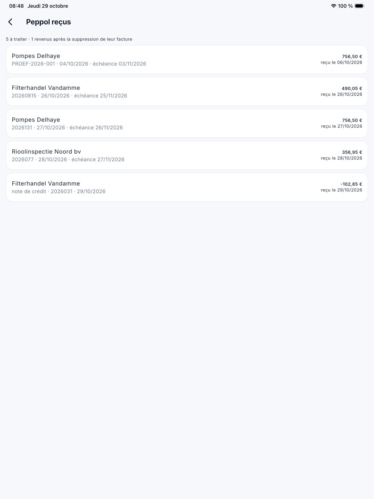
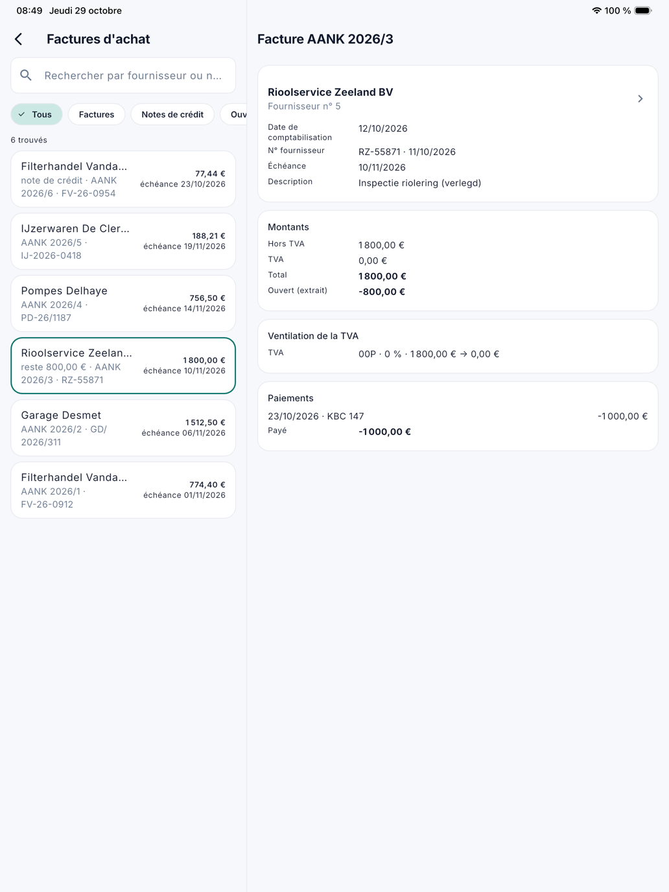

# Achats

Sous **Peppol reçus** et **Factures d'achat**, vous lisez dans l'application ce qui est arrivé de vos fournisseurs et ce
qui reste ouvert. Les deux écrans demandent le droit **Achats** (voir [L'application pour le bureau](kantoor.fr.md)). Traiter,
comptabiliser ou payer un document se fait sur l'ordinateur.

## Peppol reçus

Ouvrez le menu et touchez **Peppol reçus**. Vous voyez ce qui est arrivé via Peppol et reste **à traiter**, comme dans
[Documents reçus](../binnengekomen-documenten.fr.md) sur l'ordinateur : le fournisseur, le numéro, l'échéance et la date de
réception. Toucher un document ouvre le PDF.

Si un document est revenu parce que sa facture d'achat a été supprimée, l'application l'indique en haut.

{ width="560" }

## Factures d'achat

Ouvrez le menu et touchez **Factures d'achat**. Recherchez par **fournisseur** ou **numéro**. Sous la recherche, vous
choisissez **Tous**, **Factures** ou **Notes de crédit**, uniquement **Ouverts**, et l'**exercice** : les mêmes filtres que
la liste [Factures d'achat](../aankoopfacturen.fr.md) sur l'ordinateur.

La fiche affiche :

- le fournisseur, la **date de comptabilisation**, le **n° fournisseur**, la **description** et l'échéance ;
- les montants et la TVA ;
- les **paiements** et ce qui reste **ouvert**, comme sur l'extrait du fournisseur ;
- *marqué payé* et *en comptabilité*, le cas échéant ;
- **Reçu via Peppol** : le numéro Peppol et la date de réception, avec le PDF du document ;
- les **pièces jointes** du document.

{ width="560" }

## Questions fréquentes

**Il est écrit : *Cette entreprise n'est pas liée à ADM One*.**
Votre entreprise ne reçoit alors pas de documents Peppol dans CleanOps. Contactez ADM-Concept.

**Il est écrit : *ADM One ne répond pas*.**
Les documents Peppol arrivent via ADM One, qui ne répond pas pour le moment. Vous ne voyez que les documents déjà conservés
dans CleanOps. Réessayez plus tard.

**Les achats ne figurent pas dans le menu.**
Votre rôle n'a pas le droit Achats, ou votre entreprise a désactivé la fonction Achats (voir
[Gestion de la plateforme › Fonctions](../beheer/functies.fr.md)).

## Voir aussi

- [Documents reçus](../binnengekomen-documenten.fr.md) et [Factures d'achat](../aankoopfacturen.fr.md) sur l'ordinateur
- [Clients et fournisseurs dans l'application](kantoor-relaties.fr.md)
