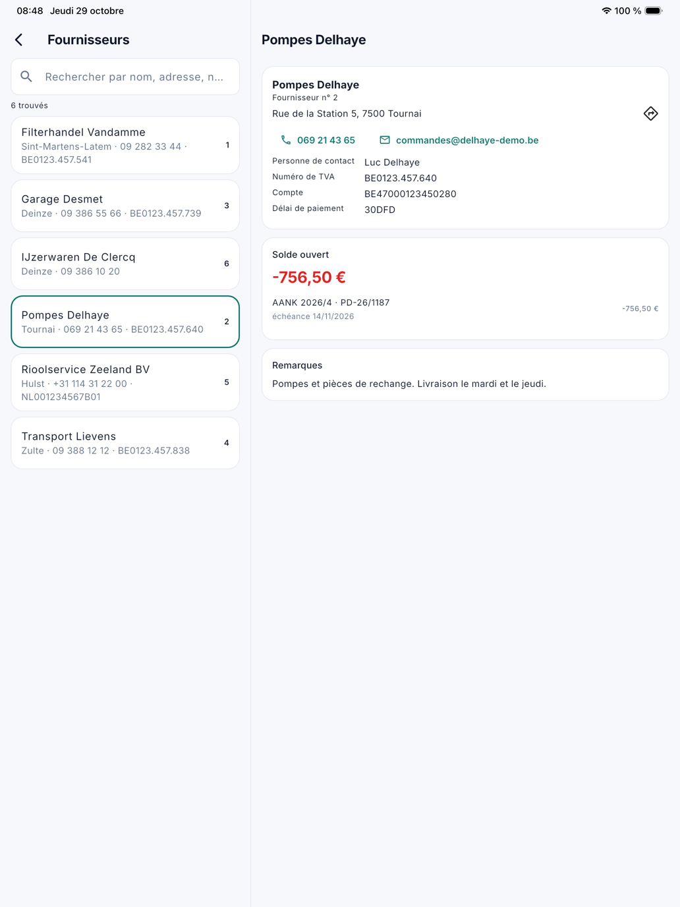

# Clients et fournisseurs

Sous **Clients** et **Fournisseurs**, vous recherchez un client ou un fournisseur dans l'application, avec ses données et,
si votre rôle a le droit, ce qui reste ouvert. Qui voit quel écran suit les droits de son rôle (voir
[L'application pour le bureau](kantoor.fr.md)). Modifier un client ou un fournisseur se fait sur l'ordinateur.

Sur une **tablette**, la fiche figure à droite de la liste ; sur un **téléphone**, elle s'ouvre comme un écran à part.

## Clients

Ouvrez le menu et touchez **Clients**. Recherchez par **nom**, **commune** ou **numéro de client** : la même recherche que la
liste des clients sur l'ordinateur.

En haut figurent le numéro de client, le téléphone et l'adresse e-mail ; les toucher appelle ou envoie un e-mail. Si le
client est bloqué ou n'accepte plus de nouvelles affaires, c'est indiqué au-dessus avec un signe d'avertissement rouge.

En dessous figure l'argent du client, chaque bloc uniquement avec le droit de son écran sur l'ordinateur :

| Bloc | Contenu | Droit |
|---|---|---|
| Solde ouvert | Ce que le client doit encore, en grand (en rouge s'il est supérieur à zéro), avec chaque poste ouvert : l'échéance, depuis quand il est échu et le prochain rappel. | Postes ouverts |
| Factures | Les factures les plus récentes, avec ce qui en reste ouvert. Les autres sont dans [Factures](kantoor-verkoop.fr.md#factures). | Factures |
| Devis | Les devis les plus récents. | Devis |

En bas suit, par adresse, la carte que l'équipe voit aussi (voir [Clients dans l'application](klanten.fr.md)) :
l'instruction de travail, le matériel, l'accessibilité et les ordres de travail à cette adresse.

Toucher une facture, un devis ou un ordre de travail ouvre sa fiche, si votre rôle a le droit sur cette liste.

{ width="560" }

!!! info
    Les collaborateurs sur le terrain ne voient **jamais** de montants, de factures ou de postes ouverts sur leur fiche
    client. L'argent figure uniquement dans l'application pour le bureau, pour qui en a le droit.

## Fournisseurs

Ouvrez le menu et touchez **Fournisseurs**. Recherchez par **nom**, **adresse**, **numéro de TVA** ou **téléphone**.

La fiche affiche le numéro du fournisseur, l'adresse avec l'itinéraire, le téléphone et l'adresse e-mail (les toucher
appelle ou envoie un e-mail), la **personne de contact**, le **numéro de TVA**, le **compte**, le **délai de paiement** et les
remarques. Avec le droit **Achats**, elle affiche aussi le **solde ouvert**, avec chaque document ouvert comme sur
l'extrait : ce que vous devez encore payer y figure en négatif, avec l'échéance, et *note de crédit* pour une note de crédit.

{ width="560" }

## Voir aussi

- [Clients](../klanten.fr.md) et [Fournisseurs](../leveranciers.fr.md) sur l'ordinateur
- [Factures, devis et postes ouverts dans l'application](kantoor-verkoop.fr.md)
- [Achats dans l'application](kantoor-aankoop.fr.md)
