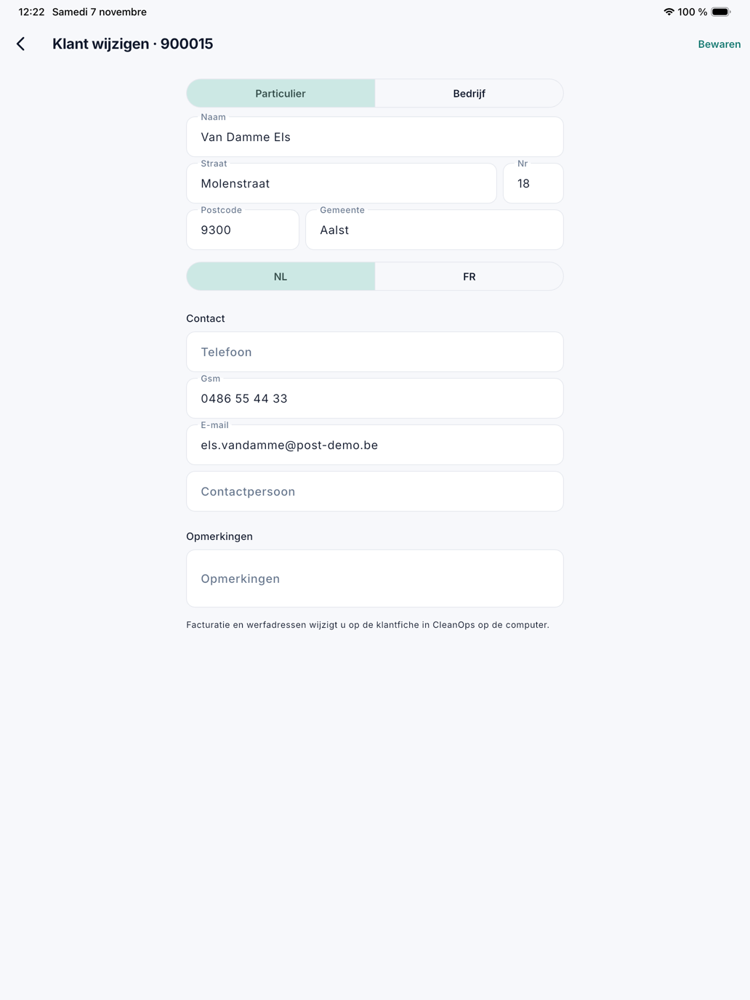
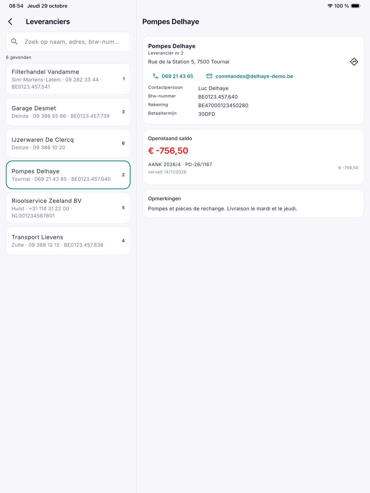

# Klanten en leveranciers

Onder **Klanten** en **Leveranciers** zoekt u in de app een klant of een leverancier op, met zijn gegevens en, als uw rol
het recht heeft, wat er openstaat. Wie welk scherm ziet, volgt de rechten van zijn rol (zie
[De app voor kantoor](kantoor.md)). Een klant aanmaken of wijzigen kan vanaf versie 1.3.3 ook in de app (zie
[Een klant aanmaken of wijzigen](#een-klant-aanmaken-of-wijzigen)); een leverancier wijzigt u op de computer.

Op een **tablet** staat de fiche rechts naast de lijst; op een **telefoon** opent ze als een eigen scherm.

## Klanten

Open het menu en tik op **Klanten**. Zoek op **naam**, **gemeente** of **klantnummer**: dezelfde zoeker als de
klantenlijst op de computer.

Bovenaan staan het klantnummer, het telefoonnummer en het e-mailadres; een tik belt of mailt. Is de klant geblokkeerd of
neemt hij geen nieuwe opdrachten, dan staat dat erboven met een rood waarschuwingsteken.

Daaronder staat het geld van de klant, elk blok enkel met het recht van zijn scherm op de computer:

| Blok | Wat erin staat | Recht |
|---|---|---|
| Openstaand saldo | Wat de klant nog schuldig is, in het groot (in het rood als het meer dan nul is), met elke openstaande post: de vervaldag, hoelang vervallen en de volgende rappel. | Openstaande posten |
| Facturen | De recentste facturen, met wat er nog van openstaat. De rest staat in [Facturen](kantoor-verkoop.md#facturen). | Facturen |
| Offertes | De recentste offertes. | Offertes |

Onderaan volgt per adres de kaart die ook de ploeg ziet (zie [Klanten in de app](klanten.md)): de werkinstructie, het
materiaal, de bereikbaarheid en de werkorders op dat adres.

Een tik op een factuur, een offerte of een werkorder opent haar fiche, als uw rol het recht op die lijst heeft.

{ width="560" }

!!! info
    De medewerkers in het veld zien op hun klantkaart **nooit** bedragen, facturen of openstaande posten. Het geld staat
    enkel in de app voor kantoor, voor wie het recht heeft.

### Een klant aanmaken of wijzigen

Vanaf versie 1.3.3, met het recht **Klanten bewerken**, zoals op de computer. U hebt een verbinding nodig: zonder bereik bewaart
de app niets.

- **Een nieuwe klant:** tik onderaan de lijst op **Nieuwe klant**. Na **Bewaren** opent zijn fiche.
- **Een klant wijzigen:** tik op de fiche rechtsboven op het potlood. Na **Bewaren** komt u terug op de fiche.

Het formulier heeft drie delen:

| Deel | Velden |
|---|---|
| Klant | **Particulier** of **Bedrijf**, de naam, het adres en de taal. Bij een bedrijf ook het **btw-nummer**: dat is verplicht, en **Ophalen** vult naam en adres in uit de KBO. |
| Contact | **Telefoon**, **gsm**, **e-mail** en **contactpersoon**. |
| Opmerkingen | Het vrije veld van de klantfiche. |

Een nieuwe klant krijgt de standaard betaaltermijn van de [bedrijfsfiche](../beheer/bedrijfsfiche.md#nieuwe-klanten); staat
daar geen, dan vraagt het formulier ze. De **facturatie** (betaaltermijn, facturen per e-mail en de e-mailadressen per soort) en
de **werfadressen** wijzigt u op de [klantfiche](../klanten.md) op de computer.

Wijzigde iemand anders hetzelfde veld terwijl u het formulier open had, dan bewaart de app niets en zegt ze het. Open de fiche
opnieuw om te zien wat er nu staat. Wat een collega in een ander veld wijzigde, blijft gewoon staan.

{ width="560" }

## Leveranciers

Open het menu en tik op **Leveranciers**. Zoek op **naam**, **adres**, **btw-nummer** of **telefoon**.

De fiche toont het leveranciersnummer, het adres met de route, het telefoonnummer en het e-mailadres (een tik belt of
mailt), de **contactpersoon**, het **btw-nummer**, de **rekening**, de **betaaltermijn** en de opmerkingen. Met het recht
**Aankoop** staat er ook het **openstaand saldo**, met elk open document zoals op het uittreksel: wat u nog moet betalen
staat er negatief, met de vervaldag, en *creditnota* bij een creditnota.

{ width="560" }

## Zie ook

- [Klanten](../klanten.md) en [Leveranciers](../leveranciers.md) op de computer
- [Facturen, offertes en openstaande posten in de app](kantoor-verkoop.md)
- [Aankoop in de app](kantoor-aankoop.md)
