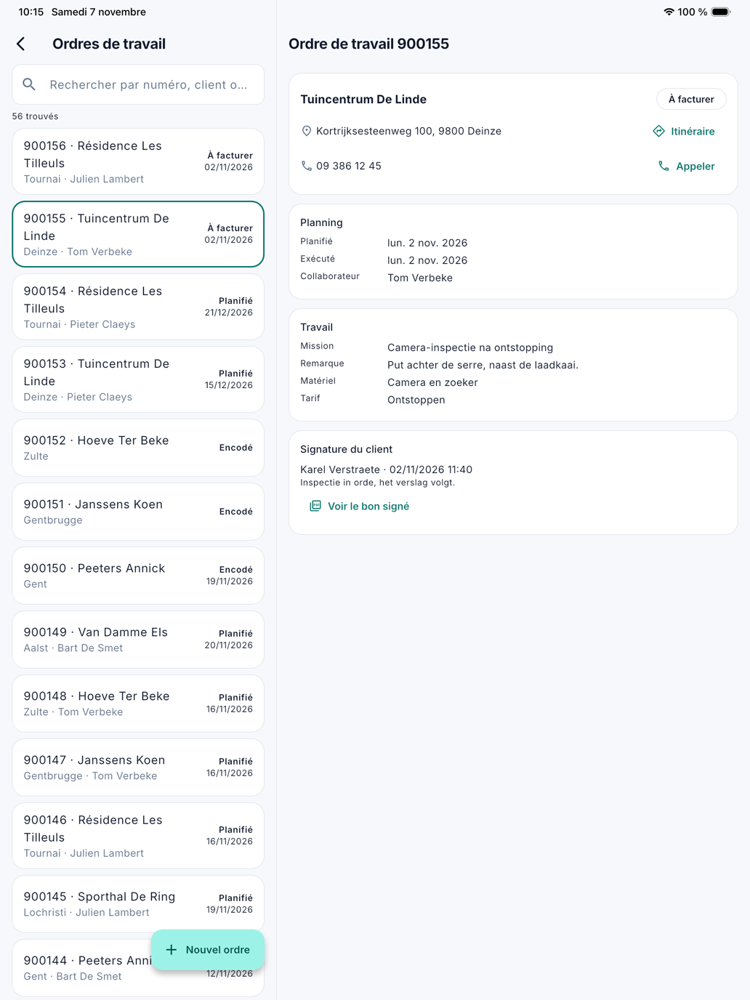

# Ordres de travail

Sous **Ordres de travail**, vous recherchez un ordre de travail dans l'application et vous lisez où il en est : planifié
ou exécuté, par qui, avec quelles notes, photos et attestations. L'écran est destiné aux personnes du bureau qui ont le
droit sur les ordres de travail (voir [L'application pour le bureau](kantoor.fr.md)). Modifier un ordre de travail se fait dans
[Ordres de travail](../werkorders.fr.md) sur l'ordinateur.

## Rechercher un ordre de travail

Ouvrez le menu et touchez **Ordres de travail**. Tapez un **numéro**, une partie du **nom du client** ou de l'**adresse**,
ou un numéro de contrat. C'est la même recherche que dans la liste Ordres de travail sur l'ordinateur.

Sans terme de recherche, la liste affiche tous les ordres de travail. Au-dessus de la liste figure le nombre d'ordres de travail trouvés. L'application en affiche 30 à la fois ; avec
**Charger plus** en bas, les suivants arrivent.

Sur une **tablette**, la fiche figure à droite de la liste ; sur un **téléphone**, elle s'ouvre comme un écran à part.

{ width="560" }

## La fiche

La fiche affiche ce que l'équipe voit sur place, et en plus comment le travail a été exécuté. Un bloc sans contenu n'est
pas affiché.

| Bloc | Contenu |
|---|---|
| En haut | Le client, le chantier et le statut. L'adresse avec **Itinéraire**, qui ouvre le trajet dans l'application de cartes ; le numéro de téléphone avec **Appeler**. |
| Planning | **Planifié** : le jour et la partie de journée. **Exécuté** : le jour où le travail a été exécuté. Le **collaborateur** et le convoyeur, le **véhicule** et le **montant sur place**. |
| Travail | L'**instruction**, la **mission**, la **remarque**, le **matériel** et le **tarif**. |
| Temps | Chaque enregistrement du chrono : **travail** ou **déplacement**, qui, de quand à quand et combien de temps. |
| Notes, Photos | Ce que l'équipe a noté et photographié. |
| Attestations, Rapport caméra, Travaux supplémentaires | Ce que l'équipe a complété sur place. |
| Signature du client | Qui a signé et quand, avec la remarque du client. **Voir le bon signé** ouvre le bon de livraison signé en PDF. |

Aucun bouton ne permet de modifier quoi que ce soit : le chrono, la clôture et la signature restent chez le collaborateur
qui fait le travail.

## Voir aussi

- [Ordres de travail](../werkorders.fr.md) sur l'ordinateur
- [Planning de la semaine dans l'application](weekplanning.fr.md)
- [L'ordre de travail](werkorder.fr.md), tel que l'équipe le voit
