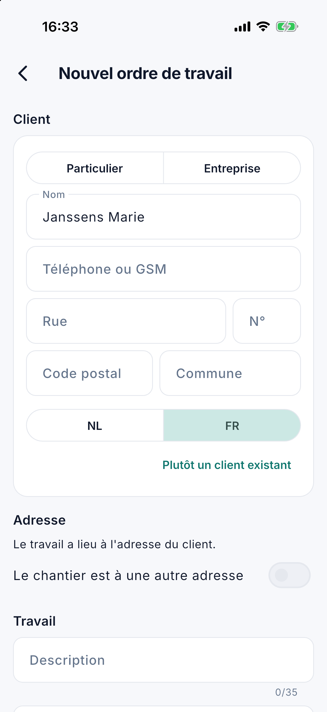

# Ordres de travail

Sous **Ordres de travail**, vous recherchez un ordre de travail dans l'application et vous lisez où il en est : planifié
ou exécuté, par qui, avec quelles notes, photos et attestations. L'écran est destiné aux personnes du bureau qui ont le
droit sur les ordres de travail (voir [L'application pour le bureau](kantoor.fr.md)). Modifier un ordre existant se fait dans
[Ordres de travail](../werkorders.fr.md) sur l'ordinateur.

## Rechercher un ordre de travail

Ouvrez le menu et touchez **Ordres de travail**. Tapez un **numéro**, une partie du **nom du client** ou de l'**adresse**,
ou un numéro de contrat. C'est la même recherche que dans la liste Ordres de travail sur l'ordinateur.

Sans terme de recherche, la liste affiche tous les ordres de travail. Au-dessus de la liste figure le nombre d'ordres de travail trouvés. L'application en affiche 30 à la fois ; avec
**Charger plus** en bas, les suivants arrivent.

Sur une **tablette**, la fiche figure à droite de la liste ; sur un **téléphone**, elle s'ouvre comme un écran à part.

{ width="560" }

## La fiche

La fiche affiche ce que l'équipe voit sur place, et en plus comment le travail a été exécuté. Un bloc sans contenu n'est
pas affiché.

| Bloc | Contenu |
|---|---|
| En haut | Le client, le chantier et le statut. L'adresse avec **Itinéraire**, qui ouvre le trajet dans l'application de cartes ; le numéro de téléphone avec **Appeler**. |
| Planning | **Planifié** : le jour et la partie de journée. **Exécuté** : le jour où le travail a été exécuté. Le **collaborateur** et le convoyeur, le **véhicule** et le **montant sur place**. |
| Travail | L'**instruction**, la **mission**, la **remarque**, le **matériel** et le **tarif**. |
| Temps | Chaque enregistrement du chrono : **travail** ou **déplacement**, qui, de quand à quand et combien de temps. |
| Notes, Photos | Ce que l'équipe a noté et photographié. |
| Attestations, Rapport caméra, Travaux supplémentaires | Ce que l'équipe a complété sur place. |
| Signature du client | Qui a signé et quand, avec la remarque du client. **Voir le bon signé** ouvre le bon de livraison signé en PDF. |

Aucun bouton ne permet de modifier quoi que ce soit : le chrono, la clôture et la signature restent chez le collaborateur
qui fait le travail.

## Un nouvel ordre de travail

Si un client est au téléphone, vous notez le travail aussitôt, même en déplacement. C'est possible à partir de la version 1.3.0, avec le droit **Modifier les ordres de
travail**, et avec le droit **Modifier les clients** aussi pour un nouveau client. Il vous faut une connexion : sans réseau, l'application n'enregistre rien.

Touchez **Nouvel ordre** en bas à droite : sur l'**Aperçu** ou le [Planning de la semaine](weekplanning.fr.md) et, à partir de la version 1.3.1, aussi sur cet écran et, si vous êtes également collaborateur, sur votre [planning](planning.fr.md). Le formulaire comporte quatre parties :

1. **Client.** Cherchez par nom, téléphone, commune ou numéro de client. Si le client n'y figure pas, touchez **Nouveau client :** suivi de ce que vous avez tapé. Un nom
   va dans le champ Nom, un numéro dans le champ **Téléphone ou GSM**. Choisissez **Particulier** ou **Entreprise** et remplissez l'adresse. Pour une entreprise,
   **Récupérer** reprend le nom et l'adresse de la BCE. Le numéro de TVA peut rester vide, mais sans numéro, CleanOps ne crée pas encore de facture.
2. **Adresse.** Pour un client existant, vous choisissez l'une de ses adresses. Si le chantier est ailleurs, activez **Le chantier est à une autre adresse**.
3. **Travail.** La **description** figure sur la facture et compte au plus 35 caractères. Ce dont il s'agit exactement va dans les **instructions**, que l'équipe lit.
4. **Quand.** Par défaut, l'ordre va dans [Encore à planifier](weekplanning.fr.md#encore-a-planifier). Avec **Planifier maintenant**, vous choisissez le jour, la partie de la journée et éventuellement le collaborateur.

Si le client existe peut-être déjà, l'application montre ces clients avant tout enregistrement : touchez le bon, ou choisissez **Quand même un nouveau client**. Le bureau
complète le tarif, la TVA et le montant plus tard sur l'ordinateur.

## Questions fréquentes

**Je ne vois pas le bouton Nouvel ordre.**
Votre rôle n'a pas le droit Modifier les ordres de travail, ou votre version de l'application est plus ancienne. Demandez à votre gestionnaire.

**Je ne vois pas Nouveau client.**
Votre rôle n'a pas le droit Modifier les clients. Vous pouvez créer un ordre de travail pour un client existant.

**L'application dit que les ordres de travail sont tenus dans l'application précédente.**
Tant que votre entreprise tient les ordres de travail dans l'application précédente, vous ne pouvez pas les créer dans l'application. Faites-le là.

## Voir aussi

- [Un client au téléphone](../planning.fr.md#un-client-au-telephone-nouvel-ordre-de-travail) sur l'ordinateur
- [Ordres de travail](../werkorders.fr.md) sur l'ordinateur
- [Planning de la semaine dans l'application](weekplanning.fr.md)
- [L'ordre de travail](werkorder.fr.md), tel que l'équipe le voit
