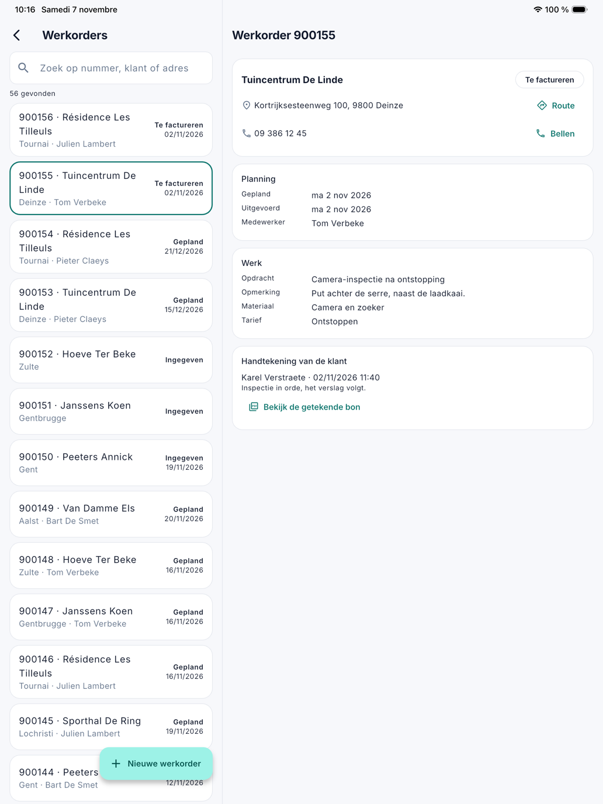
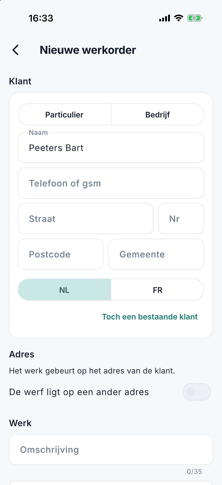

# Werkorders

Onder **Werkorders** zoekt u in de app een werkorder op en leest u hoe ze ervoor staat: gepland of uitgevoerd, door wie,
met welke notities, foto's en attesten. Het scherm is er voor wie op kantoor werkt en het recht op de werkorders heeft
(zie [De app voor kantoor](kantoor.md)). Een bestaande werkorder wijzigen doet u in [Werkorders](../werkorders.md) op de computer.

## Een werkorder zoeken

Open het menu en tik op **Werkorders**. Typ een **nummer**, een deel van de **klantnaam** of van het **adres**, of een
contractnummer. Dat is dezelfde zoeker als in de lijst Werkorders op de computer.

Zonder zoekterm toont de lijst alle werkorders. Boven de lijst staat hoeveel werkorders er gevonden zijn. De app toont er 30 tegelijk; met **Meer laden** onderaan komen
de volgende.

Op een **tablet** staat de fiche rechts naast de lijst; op een **telefoon** opent ze als een eigen scherm.

{ width="560" }

## De fiche

De fiche toont wat de ploeg ter plaatse ziet, en daarbij hoe het werk uitgevoerd werd. Een blok zonder inhoud staat er niet.

| Blok | Wat erin staat |
|---|---|
| Bovenaan | De klant, de werf en de status. Het adres met **Route**, die de weg opent in de kaartapp; het telefoonnummer met **Bellen**. |
| Planning | **Gepland**: de dag en het dagdeel. **Uitgevoerd**: de dag waarop het werk uitgevoerd werd. De **medewerker** en de bijrijder, het **voertuig** en het **bedrag ter plaatse**. |
| Werk | De **instructie**, de **opdracht**, de **opmerking**, het **materiaal** en het **tarief**. |
| Tijd | Elke registratie van de teller: **werken** of **verplaatsing**, wie, van wanneer tot wanneer en hoelang. |
| Notities, Foto's | Wat de ploeg noteerde en fotografeerde. |
| Attesten, Cameraverslag, Meerwerk | Wat de ploeg ter plaatse invulde. |
| Handtekening van de klant | Wie tekende en wanneer, met de opmerking van de klant. **Bekijk de getekende bon** opent de getekende leveringsbon als pdf. |

Er staat geen knop om iets te wijzigen: de teller, het afronden en het tekenen blijven bij de medewerker die het werk doet.

## Een nieuwe werkorder

Hebt u een klant aan de lijn, dan noteert u het werk meteen, ook onderweg. Dit kan vanaf versie 1.3.0, met het recht **Werkorders bewerken**, en
met het recht **Klanten bewerken** ook voor een nieuwe klant. U hebt een verbinding nodig: zonder bereik bewaart de app niets.

Tik rechtsonder op **Nieuwe werkorder**: op het **Overzicht** of de [Weekplanning](weekplanning.md), en vanaf versie 1.3.1 ook op dit scherm en, als u ook medewerker bent, op uw [planning](planning.md). Het formulier heeft vier delen:

1. **Klant.** Zoek op naam, telefoon, gemeente of klantnummer. Staat de klant er niet tussen, tik dan op **Nieuwe klant:** gevolgd
   door wat u typte. Een naam komt in het veld Naam, een nummer in het veld **Telefoon of gsm**. Kies **Particulier** of **Bedrijf** en vul het adres in.
   Bij een bedrijf haalt **Ophalen** de naam en het adres uit de KBO. Het btw-nummer mag leeg blijven, maar zonder nummer maakt CleanOps nog geen factuur.
2. **Adres.** Bij een bestaande klant kiest u een van zijn adressen. Ligt de werf ergens anders, zet dan **De werf ligt op een ander adres** aan.
3. **Werk.** De **omschrijving** komt op de factuur en telt hoogstens 35 tekens. Waarover het precies gaat, zet u in de **instructies**, die de ploeg leest.
4. **Wanneer.** Standaard komt de werkorder bij [Nog in te plannen](weekplanning.md#nog-in-te-plannen). Met **Meteen inplannen** kiest u de dag, het tijdsdeel en eventueel de medewerker.

Bestaat de klant misschien al, dan toont de app die klanten voor er iets bewaard wordt: tik op de juiste, of kies **Toch een nieuwe klant**. Tarief, btw en bedrag
vult kantoor later aan op de computer.

## Veelgestelde vragen

**Ik zie de knop Nieuwe werkorder niet.**
Uw rol heeft het recht Werkorders bewerken niet, of u hebt een oudere versie van de app. Vraag het aan uw beheerder.

**Ik zie Nieuwe klant niet.**
Uw rol heeft het recht Klanten bewerken niet. U kunt wel een werkorder maken voor een bestaande klant.

**De app zegt dat de werkorders in de vorige toepassing bijgehouden worden.**
Zolang uw bedrijf de werkorders nog in de vorige toepassing bijhoudt, kunt u ze in de app niet aanmaken. Doe het daar.

## Zie ook

- [Werkorders](../werkorders.md) op de computer
- [Een klant aan de lijn](../planning.md#een-klant-aan-de-lijn-nieuwe-werkorder) op de computer
- [Weekplanning in de app](weekplanning.md)
- [De werkorder](werkorder.md), zoals de ploeg ze ziet
