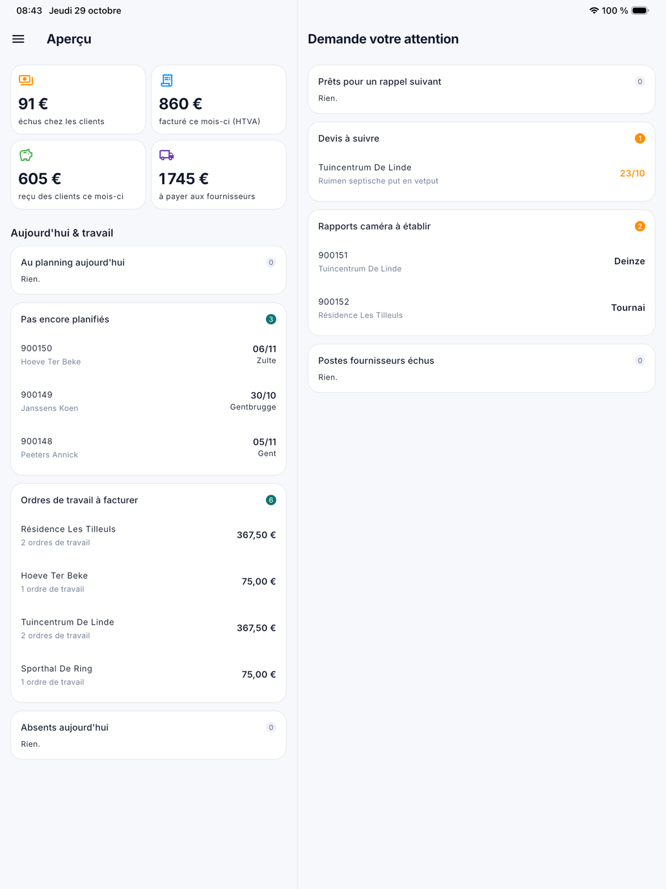

# L'application pour le bureau

Avec l'application CleanOps, les personnes du bureau suivent aussi l'entreprise en déplacement. Le devis pour un client
est-il déjà accepté ? Qui est absent aujourd'hui ? L'ordre de travail de ce matin est-il déjà exécuté ? Vous le lisez dans
l'application, avec les mêmes chiffres que dans CleanOps sur l'ordinateur.

L'application pour le bureau sert **surtout à lire**. À partir de la version 1.3.0, vous pouvez aussi y faire une chose si votre
rôle le permet : [noter et planifier un ordre de travail](kantoor-werkorders.fr.md#un-nouvel-ordre-de-travail), par exemple pendant
que le client est au téléphone. Créer une facture ou approuver une demande de congé se fait dans CleanOps sur l'ordinateur.

| Quoi | Où |
|---|---|
| Les chiffres et les listes du tableau de bord | [L'aperçu](#lapercu) sur cette page |
| Le tableau de planning par semaine | [Planning de la semaine](weekplanning.fr.md) |
| Noter un nouvel ordre de travail | [Un nouvel ordre de travail](kantoor-werkorders.fr.md#un-nouvel-ordre-de-travail) |
| Planifier le travail sans date | [Encore à planifier](weekplanning.fr.md#encore-a-planifier) |
| Rechercher et ouvrir un ordre de travail | [Ordres de travail](kantoor-werkorders.fr.md) |
| Factures, devis et postes ouverts | [Factures, devis et postes ouverts](kantoor-verkoop.fr.md) |
| Clients et fournisseurs, avec leur solde | [Clients et fournisseurs](kantoor-relaties.fr.md) |
| Documents Peppol et factures d'achat | [Achats](kantoor-aankoop.fr.md) |
| Les absents du jour et les demandes de congé | [Absences](afwezigheden.fr.md) |

## Accès

Vous vous connectez dans l'application avec **votre adresse e-mail et le même mot de passe** que dans CleanOps sur
l'ordinateur.

L'accès à l'application n'est pas ouvert d'office à chaque utilisateur : une connexion sur un téléphone est une porte plus
grande qu'une connexion au bureau. **ADM-Concept active l'accès par personne**, à votre demande. Si nous le retirons,
l'application déconnecte cette personne au prochain écran qu'elle ouvre.

Si vous travaillez vous-même aussi sur le terrain, nous lions votre connexion à votre collaborateur. L'application s'ouvre
alors sur votre planning du jour, comme pour chaque collaborateur, et l'**Aperçu** et les écrans pour le bureau
s'ajoutent au menu.

## Ce que vous voyez

L'application affiche **ce que votre rôle dans CleanOps affiche**. Si vous ne pouvez pas voir les factures sur
l'ordinateur, **Factures** ne figure pas non plus dans le menu de l'application. Il n'y a pas de droit propre à
l'application : ce que vous modifiez dans [Rôles](../beheer/rollen.fr.md) vaut dans l'application à la prochaine connexion,
et au plus tard après une heure.

Si votre entreprise a désactivé une fonction dans [Gestion de la plateforme › Fonctions](../beheer/functies.fr.md), elle
manque aussi dans l'application.

| Menu | Sur l'ordinateur | Droit |
|---|---|---|
| Aperçu | Le tableau de bord | Chaque tuile et liste suit le droit de l'écran vers lequel elle mène |
| Planning de la semaine | [Planning](../planning.fr.md) | Planning |
| Ordres de travail | [Ordres de travail](../werkorders.fr.md) | Ordres de travail |
| Factures | [Factures](../facturen.fr.md) | Factures |
| Devis | [Devis](../offertes.fr.md) | Devis |
| Postes ouverts | [Postes ouverts](../openstaande-posten.fr.md) | Postes ouverts |
| Clients | [Clients](../klanten.fr.md) | Clients (le solde et les factures avec le droit correspondant) |
| Fournisseurs | [Fournisseurs](../leveranciers.fr.md) | Fournisseurs (le solde avec le droit Achats) |
| Peppol reçus, Factures d'achat | [Documents reçus](../binnengekomen-documenten.fr.md), [Factures d'achat](../aankoopfacturen.fr.md) | Achats |
| Absences | [Demandes de congé](../verlofaanvragen.fr.md) | Demandes de congé |

En bas du menu figurent **Profil** et **Se déconnecter**, comme pour chaque collaborateur (voir
[Bien démarrer avec l'application](aan-de-slag.fr.md#le-profil)).

{ width="560" }

## L'aperçu

L'**Aperçu** est l'écran d'accueil pour le bureau. Il affiche le tableau de bord de CleanOps, avec les mêmes mots et les
mêmes chiffres. Sur une tablette, les chiffres et *Aujourd'hui & travail* sont à gauche et *Demande votre attention* à
droite ; sur un téléphone, tout est l'un sous l'autre.

{ width="560" }

- **Les tuiles financières** : *échus chez les clients*, *facturé ce mois-ci (HTVA)*, *reçu des clients ce mois-ci* et
  *à payer aux fournisseurs*. Vous ne voyez que les tuiles pour lesquelles votre rôle a le droit.
- **Aujourd'hui & travail** : *Au planning aujourd'hui*, *Encore à planifier* (avant la version 1.3.0 : *Pas encore planifiés*), *Ordres de travail à facturer* et
  *Absents aujourd'hui*.
- **Demande votre attention** : *Prêts pour un rappel suivant*, *Devis à suivre*, *Rapports caméra à établir*, *Date sans collaborateur* (à partir de la version 1.3.0),
  *Véhicules à contrôler* et *Postes fournisseurs échus*. Le nombre est en orange dès qu'il y a quelque chose, en rouge
  s'il s'agit d'argent échu.

Chaque liste affiche d'abord quelques lignes. Avec **Afficher … de plus**, elle s'ouvre davantage ; s'il y en a plus que ce
que l'application affiche, elle indique combien il en reste sur le web. Toucher un ordre de travail, un devis ou une facture
l'ouvre dans l'application, si votre rôle a le droit sur cette liste.

Tirez l'écran vers le bas pour l'actualiser.

## Questions fréquentes

**Je ne parviens pas à me connecter dans l'application.**
Pour un utilisateur du bureau, l'application n'est ouverte que si ADM-Concept a activé l'accès pour vous. Demandez-le-nous.
Si vous partagez votre adresse e-mail avec un autre utilisateur, l'application ne peut pas vous reconnaître : chaque
utilisateur a besoin de sa propre adresse.

**Un écran ne figure pas dans mon menu.**
Votre rôle n'a pas le droit sur cet écran, ou votre entreprise a désactivé la fonction. C'est la même chose dans
l'application que sur l'ordinateur.

**Je vois un chiffre qui ne correspond pas à l'ordinateur.**
Actualisez l'écran en le tirant vers le bas. Si votre entreprise tient encore les données dans l'application précédente,
l'application et CleanOps affichent tous deux l'état du dernier transfert.

**Je veux modifier une facture ou approuver une demande de congé.**
Ce n'est pas possible dans l'application. Faites-le dans CleanOps sur l'ordinateur.

## Voir aussi

- [Bien démarrer avec l'application](aan-de-slag.fr.md)
- [Rôles](../beheer/rollen.fr.md)
- [Fonctions](../beheer/functies.fr.md)
