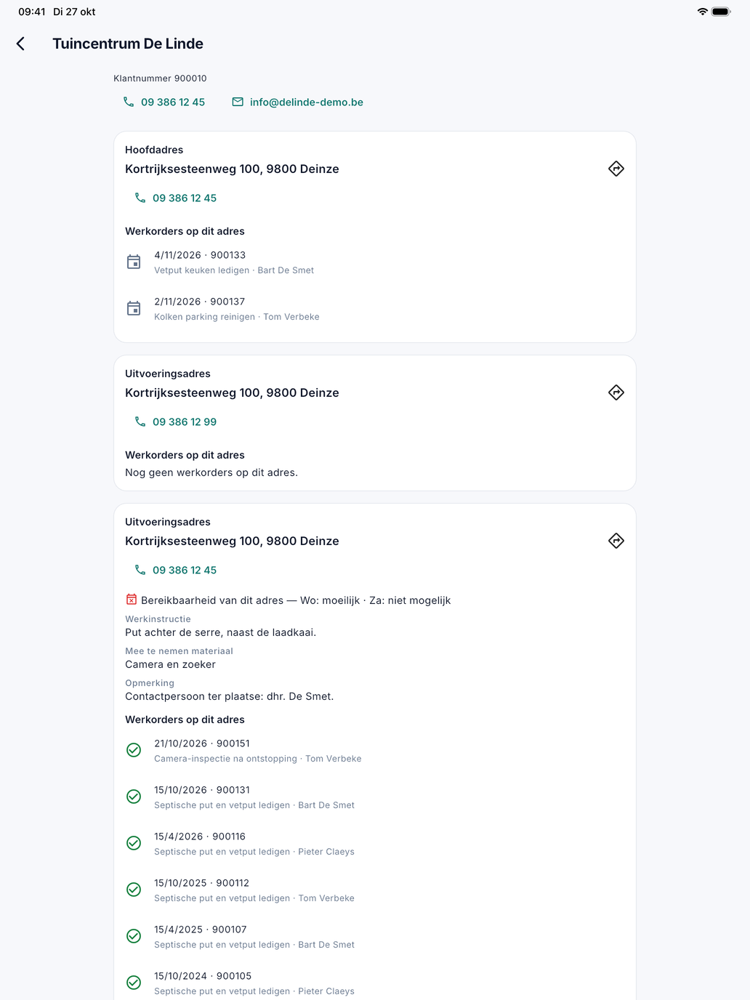

# Klanten

Onder **Klanten** in het menu zoekt de medewerker een klant op, ook een klant waarvoor hij vandaag geen werk heeft.
Hij ziet er wat hij nodig heeft om het werk te doen, maar geen bedragen, facturen of openstaande posten.

## Een klant zoeken

Typ minstens twee letters: een deel van de naam, de gemeente of het klantnummer. Dat is dezelfde zoeker als op kantoor
en als bij [een werkorder aanmaken](werkorder-aanmaken.md). Een tik op een klant opent de klantkaart.

## De klantkaart

{ width="560" }

Bovenaan staan het klantnummer, het telefoonnummer en het e-mailadres; een tik belt of mailt. Is de klant geblokkeerd of
neemt hij geen nieuwe opdrachten, dan staat dat er in een kaart, zoals het kantoor het ziet.

Daaronder volgt per adres een kaart: eerst het **hoofdadres**, dan elk **uitvoeringsadres**. Op elke kaart:

| Wat | Betekenis |
|---|---|
| Het adres | Een tik opent de weg in de kaartapp. |
| Telefoon | Het nummer op dat adres; een tik belt. |
| Bereikbaarheid | De dagen waarop het adres moeilijk of niet bereikbaar is, zoals het kantoor het op het [adres](../klanten.md) invulde. |
| Werkinstructie | Wat er op dat adres altijd geldt, bijvoorbeeld waar de put ligt. |
| Mee te nemen materiaal | Wat de ploeg voor dat adres meeneemt. |
| Opmerking | De opmerking van het kantoor bij dat adres. |
| Werkorders op dit adres | De tien recentste: de datum, het nummer, wat er gedaan werd en door wie. Een groen vinkje is uitgevoerd werk, een kalender is gepland werk. |

## Zie ook

- [Werkorder aanmaken](werkorder-aanmaken.md)
- [Klanten op kantoor](../klanten.md)
