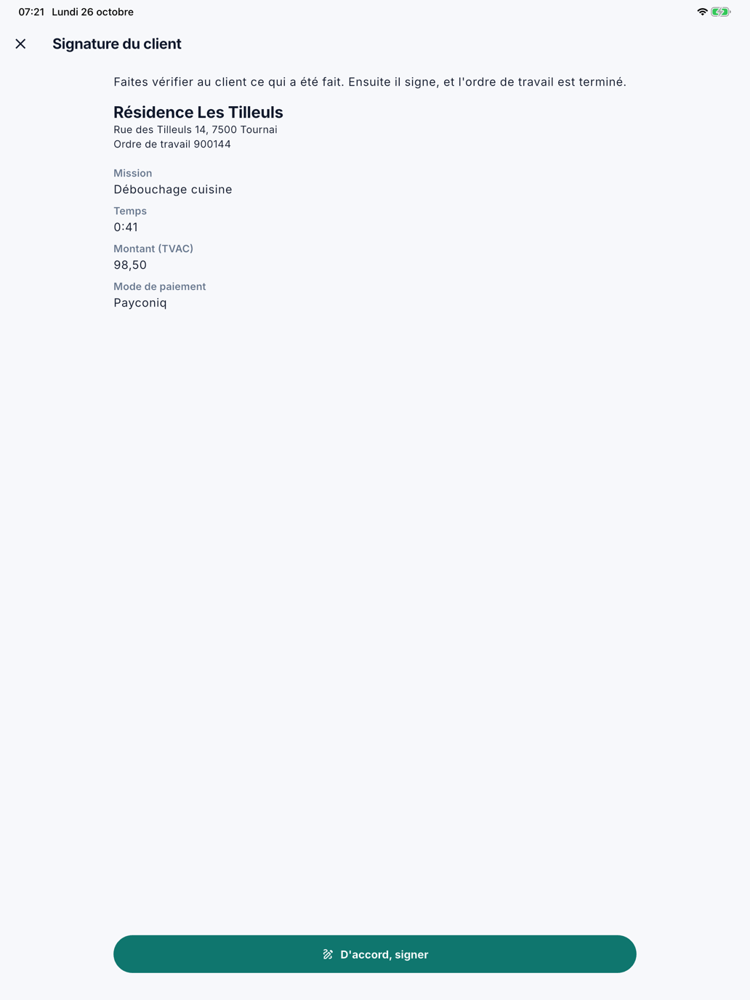
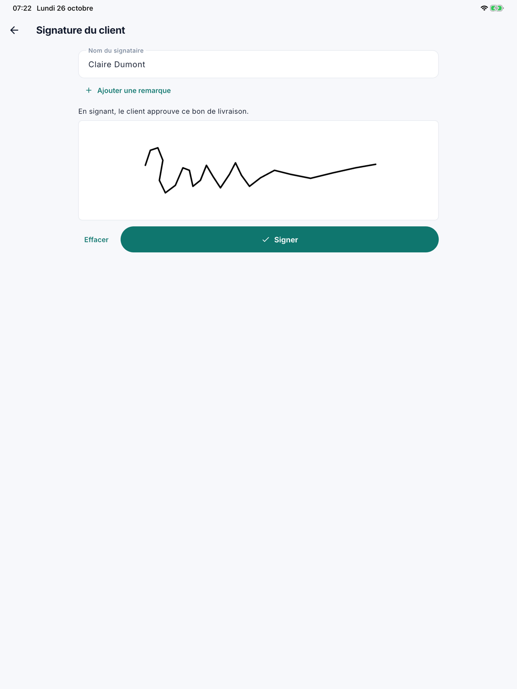
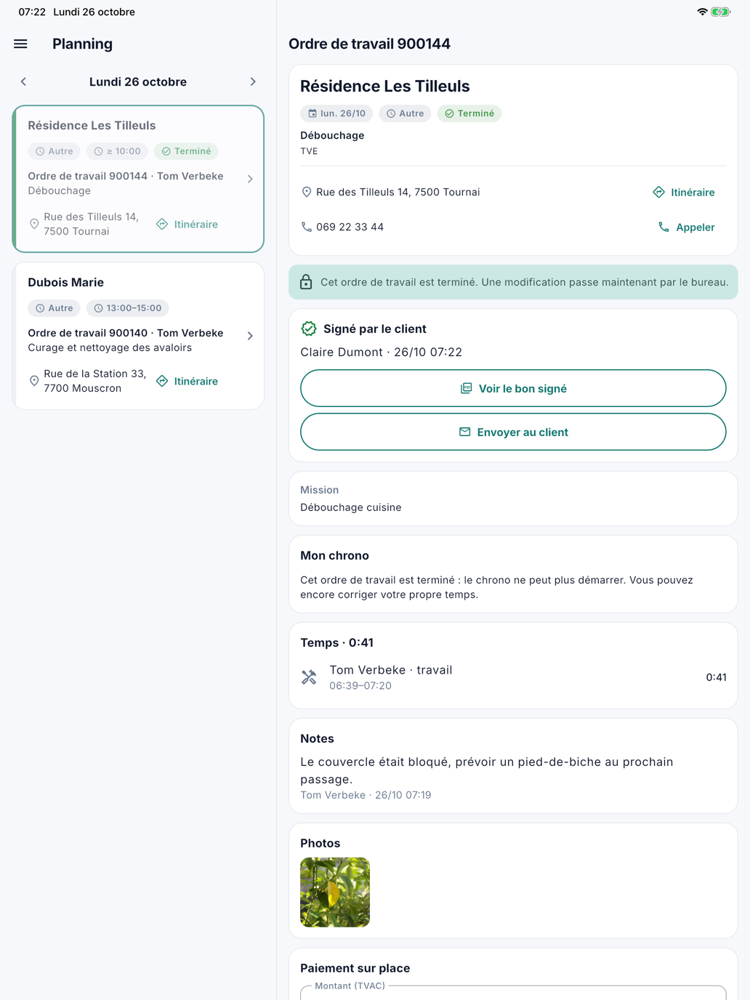
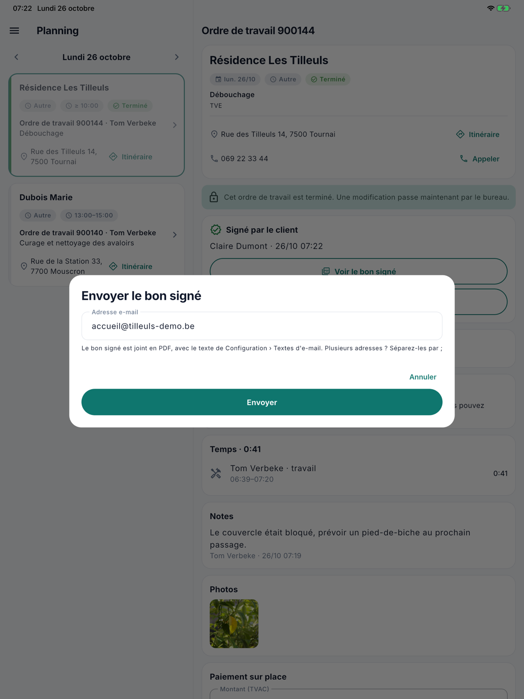

# Faire signer

!!! info "L'application est en test"
    L'application mobile n'est pas encore disponible dans l'App Store et Google Play. Cette page montre déjà ce qu'elle
    sait faire, pour que vous puissiez la découvrir. Ce que le bureau en voit, comme l'onglet **Temps** ou **Signé par le
    client** sur l'ordre de travail, arrivera avec l'application.

Quand le travail est terminé, le collaborateur fait signer le bon de livraison par le client sur son appareil. L'ordre
de travail est alors terminé, et CleanOps crée aussitôt un bon de livraison signé. Si le client est absent, il termine
sans signature.

## Faire signer le client

En bas de l'ordre de travail, le collaborateur appuie sur **Faire signer le client**. Cela se fait en deux étapes.

### 1. Vérifier

L'application montre le client, l'adresse et le numéro de l'ordre de travail, puis ce qui est rempli : le travail
demandé, la remarque, le matériel, le temps, le montant et le mode de paiement. Le client vérifie ce qui a été fait. Le
collaborateur appuie sur **D'accord, signer**.

{ width="560" }

Un montant que le collaborateur a saisi sans l'enregistrer est d'abord transmis : le client signe ce qu'il a vu à
l'écran.

### 2. Signer

Le collaborateur indique le **Nom du signataire**. Si le client veut ajouter quelque chose, il appuie sur **Ajouter une
remarque**. Le client signe avec le doigt dans le cadre blanc ; **Effacer** permet de recommencer. Enfin, le
collaborateur appuie sur **Signer**.

{ width="560" }

L'ordre de travail est alors **terminé** : il passe au statut **À facturer** et est prêt pour la
[facturation](../facturatie.fr.md). CleanOps crée un **bon de livraison signé** en PDF, dans la langue du client, et le
conserve avec l'ordre de travail.

## Après la signature

En haut de l'ordre de travail figure maintenant la carte **Signé par le client**, avec le nom et le moment. Elle porte
deux boutons :

- **Voir le bon signé** ouvre le PDF sur l'appareil.
- **Envoyer au client** envoie le bon signé par e-mail.

{ width="560" }

Avec **Envoyer au client**, l'adresse e-mail du client est déjà remplie : l'adresse principale, sinon celle de la
facturation. Le collaborateur peut la modifier. Plusieurs adresses se séparent par `;` : la première est le
destinataire, les autres reçoivent une copie. **Envoyer** fait partir l'e-mail, avec le texte des
[Textes d'e-mail](../beheer/mailteksten.fr.md). Aucun e-mail ne part jamais tout seul.

{ width="560" }

Ce qui figure sur le bon de livraison est ensuite figé, aussi au bureau. Voir
**Signé par le client**.

## Terminer sans signature

Si le client est absent, le collaborateur appuie sur **Terminer sans signature** et confirme. L'ordre de travail passe
aussi au statut **À facturer**.

Une fois l'ordre terminé, le collaborateur ne peut plus le modifier dans l'application, ni y ajouter ou supprimer des
notes ou des photos ; corriger son propre temps reste possible. **Faire signer reste possible** tant que l'ordre n'est
pas facturé : si le client passe plus tard, le collaborateur appuie encore sur **Faire signer le client**.

Un ordre de travail planifié à une date future ne peut pas être terminé ni signé.

## Questions fréquentes

**Le client était absent à la fin du travail. Peut-il encore signer plus tard ?**
Oui, tant que l'ordre de travail n'est pas facturé. Ouvrez l'ordre dans l'application et appuyez sur **Faire signer le
client**.

**Le client a signé, mais quelque chose ne va pas sur le bon.**
Demandez au bureau de retirer la signature sur l'ordre de travail (voir
**Signé par le client**). Le bureau peut ensuite corriger l'ordre, et le client
peut signer à nouveau.

**Où trouver le bon signé au bureau ?**
Sur l'ordre de travail, avec **Bon signé (PDF)** dans la carte Signé par le client, et parmi les pièces jointes. Dans la
[Facturation](../facturatie.fr.md), *signé* figure à côté de l'ordre de travail, avec un lien vers le bon.

## Voir aussi

- [L'ordre de travail](werkorder.fr.md)
- [Ordres de travail](../werkorders.fr.md), l'ordre signé au bureau
- [Textes d'e-mail](../beheer/mailteksten.fr.md), le texte de l'e-mail
