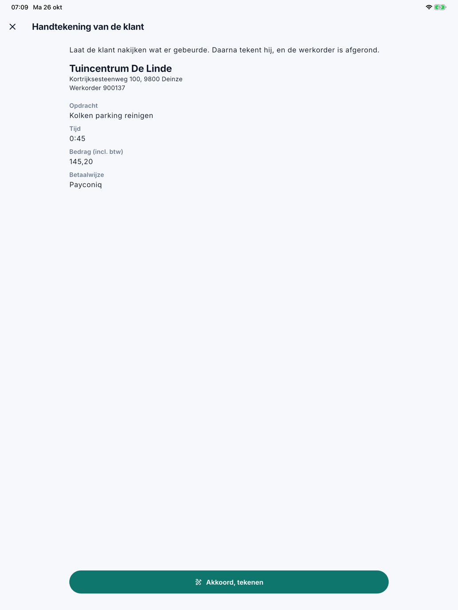
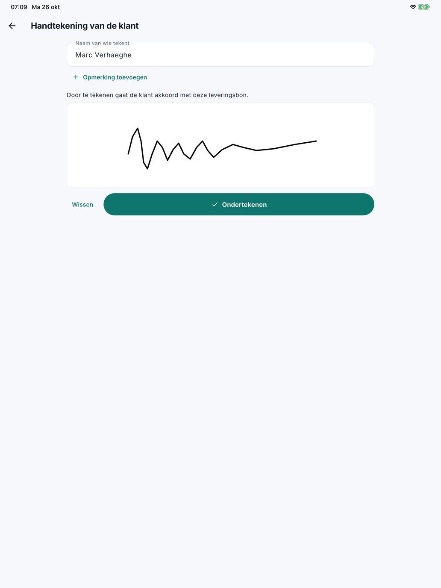
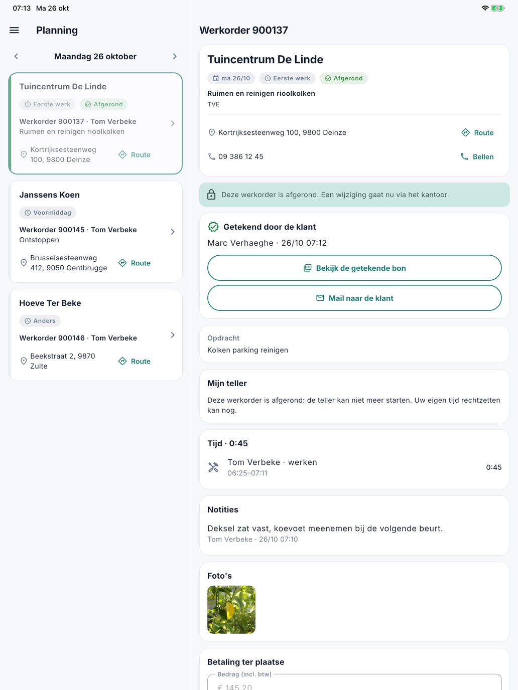
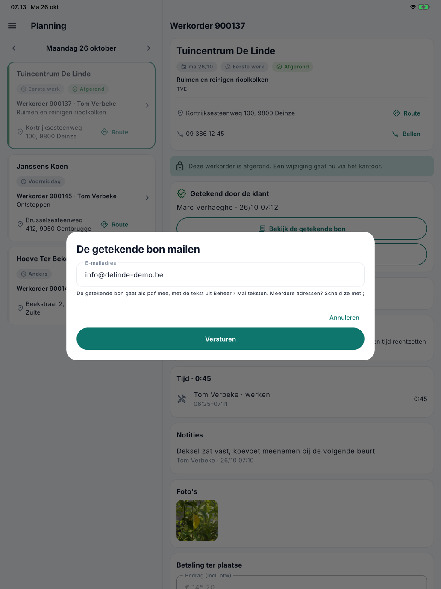

# Laten tekenen

!!! info "De app is in test"
    De mobiele app staat nog niet in de App Store en Google Play. Deze pagina toont al wat ze kan, zodat u ze kunt leren
    kennen. Wat het kantoor ervan ziet, zoals het tabblad **Tijd** of **Getekend door de klant** op de werkorder, komt
    samen met de app.

Is het werk klaar, dan laat de medewerker de klant de leveringsbon aftekenen op zijn toestel. Daarmee is de werkorder
afgerond, en CleanOps maakt meteen een getekende leveringsbon. Is de klant er niet, dan rondt hij af zonder
handtekening.

## De klant laten aftekenen

Onderaan de werkorder tikt de medewerker op **Laat de klant aftekenen**. Dat gaat in twee stappen.

### 1. Nakijken

De app toont de klant, het adres en het nummer van de werkorder, en verder wat ingevuld is: de opdracht, de opmerking,
het materiaal, de tijd, het bedrag en de betaalwijze. De klant kijkt na wat er gebeurde. De medewerker tikt op
**Akkoord, tekenen**.

{ width="560" }

Een bedrag dat de medewerker wel typte maar nog niet bewaarde, gaat eerst mee: de klant tekent voor wat hij op het
scherm zag.

### 2. Tekenen

De medewerker vult de **Naam van wie tekent** in. Wil de klant iets kwijt, dan tikt hij op **Opmerking toevoegen**.
De klant tekent met de vinger in het witte vlak; met **Wissen** begint hij opnieuw. Tot slot tikt de medewerker op
**Ondertekenen**.

{ width="560" }

Daarmee is de werkorder **afgerond**: ze krijgt de status **Te factureren** en staat klaar voor de
[facturatie](../facturatie.md). CleanOps maakt een **getekende leveringsbon** als pdf, in de taal van de klant, en
bewaart die bij de werkorder.

## Na het tekenen

Bovenaan de werkorder staat nu de kaart **Getekend door de klant**, met de naam en het moment. Daarop staan twee knoppen:

- **Bekijk de getekende bon** opent de pdf op het toestel.
- **Mail naar de klant** stuurt de getekende bon per mail.

{ width="560" }

Bij **Mail naar de klant** staat het e-mailadres van de klant al ingevuld: het hoofdadres, anders het adres voor de
facturatie. De medewerker kan het aanpassen. Meerdere adressen scheidt hij met `;`: het eerste is de ontvanger, de
andere krijgen een kopie. Met **Versturen** vertrekt de mail, met de tekst uit
[Mailteksten](../beheer/mailteksten.md). Er vertrekt nooit vanzelf een mail.

{ width="560" }

Wat op de leveringsbon staat, ligt daarna vast, ook op kantoor. Zie
**Getekend door de klant**.

## Afronden zonder handtekening

Is de klant er niet, dan tikt de medewerker op **Afronden zonder handtekening** en bevestigt hij. De werkorder krijgt
ook dan de status **Te factureren**.

Na het afronden kan de medewerker de werkorder in de app niet meer wijzigen, en ook geen notities of foto's meer
toevoegen of verwijderen; zijn eigen tijd rechtzetten kan nog wel. **Laten tekenen kan nog**, zolang de werkorder niet
gefactureerd is: komt de klant later toch, dan tikt de medewerker alsnog op **Laat de klant aftekenen**.

Een werkorder die gepland is op een dag in de toekomst, kan hij niet afronden en niet laten tekenen.

## Veelgestelde vragen

**De klant was er niet bij het afronden. Kan hij later nog tekenen?**
Ja, zolang de werkorder niet gefactureerd is. Open de werkorder in de app en tik op **Laat de klant aftekenen**.

**De klant tekende, maar er klopt iets niet op de bon.**
Laat het kantoor de handtekening intrekken op de werkorder (zie
**Getekend door de klant**). Daarna kan het kantoor de werkorder verbeteren, en
kan de klant opnieuw tekenen.

**Waar vind ik de getekende bon op kantoor?**
Op de werkorder, met **Getekende bon (pdf)** in de kaart Getekend door de klant, en bij de bijlagen. In
[Facturatie](../facturatie.md) staat *getekend* bij de werkorder, met een link naar de bon.

## Zie ook

- [De werkorder](werkorder.md)
- [Werkorders](../werkorders.md), de getekende werkorder op kantoor
- [Mailteksten](../beheer/mailteksten.md), de tekst van de mail
