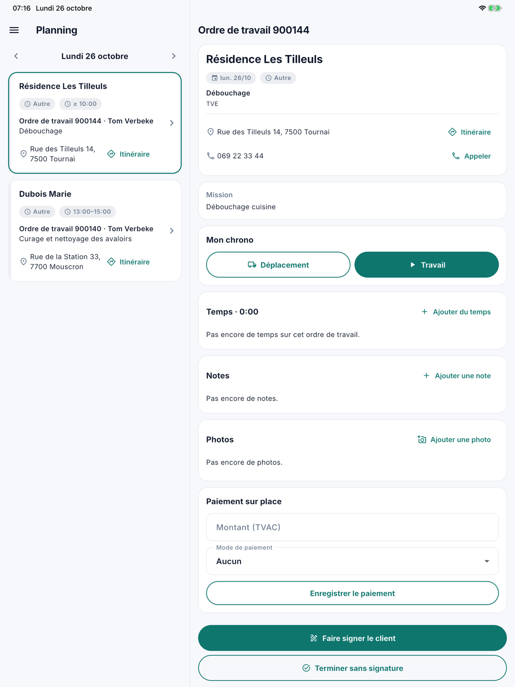

# Le planning

L'application s'ouvre sur le planning du jour : les ordres de travail du collaborateur et de son équipe, dans l'ordre
de la journée.

{ width="560" }

## Par ordre de travail

Chaque carte montre la partie de la journée, le client, le numéro de l'ordre de travail avec le collaborateur, ce qu'il
faut faire et l'adresse. **Itinéraire** ouvre le trajet dans l'application de cartes de l'appareil.

Le cas échéant, une étiquette indique où en est l'ordre de travail :

| Étiquette | Signification |
|---|---|
| **Terminé** | En vert, la carte un peu plus pâle : le travail est fait. |
| **Chrono en cours** | Le collaborateur y enregistre du temps en ce moment. |
| **Non exécuté** | Planifié sur un jour déjà passé, et pas encore terminé. |

## Un autre jour

Les flèches à côté de la date passent au jour précédent ou suivant, et **Aujourd'hui** ramène au jour même.

## Ouvrir l'ordre de travail

Un appui sur une carte ouvre l'ordre de travail. Sur une tablette, le planning et l'ordre choisi sont côte à côte ;
sur un téléphone, l'ordre s'ouvre dans un écran à part.

En haut de l'ordre figurent le client, l'adresse avec **Itinéraire**, **Appeler** pour le numéro de téléphone, et ce
qu'il faut faire : **Mission**, **Instruction**, **Matériel** et **Remarque**, s'ils sont remplis. Ce que le
collaborateur fait sur l'ordre de travail est décrit dans [L'ordre de travail](werkorder.fr.md).

## Voir aussi

- [Bien démarrer avec l'application](aan-de-slag.fr.md)
- [Planning](../planning.fr.md) au bureau : qui reçoit quel travail
