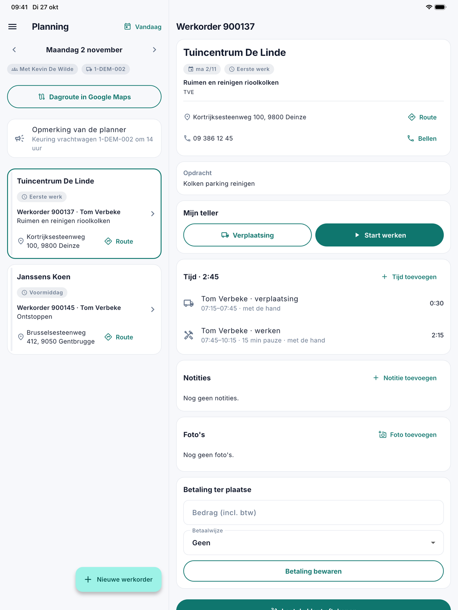

# De planning

De app opent op de planning van vandaag: de werkorders van de medewerker en zijn ploeg, in de volgorde van de dag.

{ width="560" }

## Per werkorder

Op elke kaart staan het tijdsdeel, de klant, het nummer van de werkorder met de medewerker, wat er moet gebeuren en het
adres. Met **Route** opent de weg in de kaartapp van het toestel.

Staat het er, dan zegt een label hoe de werkorder ervoor staat:

| Label | Betekenis |
|---|---|
| **Afgerond** | In het groen, de kaart iets vager: het werk is gedaan. |
| **Teller loopt** | De medewerker registreert er nu tijd op. |
| **Niet uitgevoerd** | Gepland op een dag die al voorbij is, en nog niet afgerond. |

## Ploeg, voertuig en dagroute

Bovenaan de dag staat, als het er is:

- **Met** en de namen van wie die dag mee in de ploeg zit, zoals het kantoor het op [Ploegen](../ploegen.md) samenstelde;
- het kenteken van de wagen: die van de chauffeur van de ploeg, of zonder ploeg het vaste voertuig van de medewerker zelf
  (op zijn [fiche](../medewerkers.md));
- **Chauffeur:** en een naam, als iemand anders rijdt;
- de knop **Dagroute in Google Maps**, vanaf twee adressen op die dag: de route vertrekt aan het bedrijf, volgt de
  volgorde van de planning en komt terug. Telt de dag meer stops dan Google in één route toelaat, dan staan er knoppen
  **Dagroute, deel 1**, **deel 2** enzovoort;
- de **Opmerking van de planner**: de dagopmerking die het kantoor op Ploegen bij die dag schreef.

{ width="560" }

## Blokken en verlof

Naast de werkorders toont de planning ook wat het kantoor op het [planbord](../planning.md) zette zonder werkorder:

- een **vrij blok**, zoals een opleiding of een afspraak in de garage, met het tijdsdeel of **Hele dag**;
- het **verlof** van de medewerker zelf, bovenaan in een rode kaart met **Afwezig**: de soort, "halve dag" op de
  eerste dag van een halve dag, en de omschrijving, zoals op het planbord.

Een blok of verlof opent geen werkorder. Verlof wijzigt het kantoor op de fiche van de medewerker; de medewerker vraagt
het aan via **Verlof** in het menu van de app.

## Een andere dag

Met de pijltjes naast de datum bladert de medewerker naar de vorige of de volgende dag, en met **Vandaag** keert hij
terug.

## Een nieuwe werkorder

Met **Nieuwe werkorder** onderaan maakt de medewerker zelf een werkorder aan, voor zichzelf of een collega. Zie
[Een werkorder aanmaken](werkorder-aanmaken.md).

## De werkorder openen

Een tik op een kaart opent de werkorder. Op een tablet staan de planning en de gekozen werkorder naast elkaar; op een
telefoon opent de werkorder in een eigen scherm.

Bovenaan de werkorder staan de klant, het adres met **Route**, **Bellen** voor het telefoonnummer, en wat er moet
gebeuren: **Opdracht**, **Instructie**, **Materiaal** en **Opmerking**, als ze ingevuld zijn. Wat de medewerker op de
werkorder doet, leest u in [De werkorder](werkorder.md).

## Zie ook

- [Aan de slag met de app](aan-de-slag.md)
- [Planning](../planning.md) op kantoor: wie welk werk krijgt
