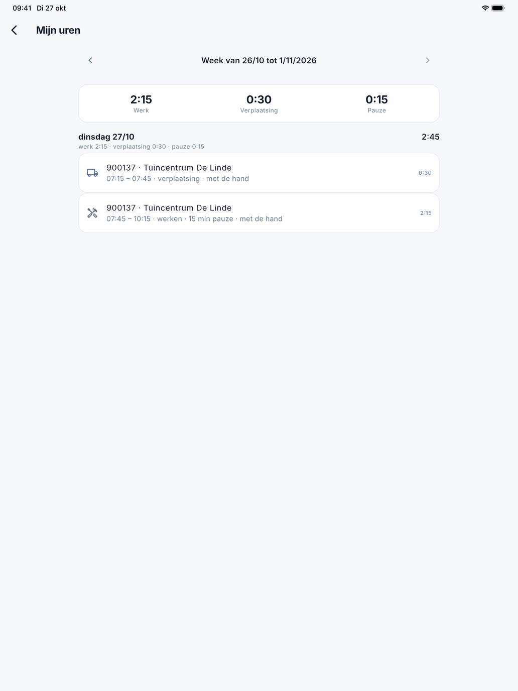

# Mijn uren

Onder **Mijn uren** in het menu ziet de medewerker zijn eigen tijd van een hele week: wat hij met de teller of met de hand
op zijn werkorders registreerde, over alle werkorders heen.

{ width="560" }

## De week

Bovenaan staat de week, van maandag tot zondag. Met de pijltjes bladert de medewerker naar de vorige week, en weer terug
tot deze week. Daaronder staan de totalen van de week: **Werk**, **Verplaatsing** en **Pauze**, in uren en minuten.

## Per dag

Elke dag waarop er tijd geregistreerd is, staat met zijn totaal (werk en verplaatsing samen). Daaronder staat per regel:

- het nummer van de werkorder en de klant;
- van wanneer tot wanneer, op de klok van het toestel;
- **werken** of **verplaatsing**, de pauze als die er was, en **met de hand** als de tijd niet met de teller liep;
- rechts de gewerkte tijd zonder pauze.

Een tik op een regel opent de werkorder.

## Veelgemaakte fouten

!!! warning "Tijd rechtzetten gebeurt op de werkorder"
    Mijn uren is enkel een overzicht. Klopt een regel niet, open dan de werkorder en zet de tijd daar recht onder
    **Tijd**, zoals in [De werkorder](werkorder.md) staat. Het kantoor ziet dezelfde tijd op het tabblad **Tijd** van de
    [werkorder](../werkorders.md).

## Zie ook

- [De werkorder](werkorder.md)
- [Aan de slag](aan-de-slag.md)
