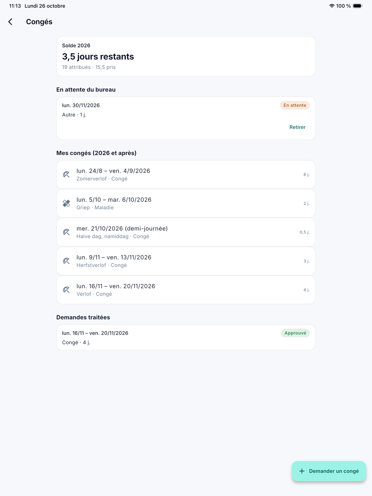
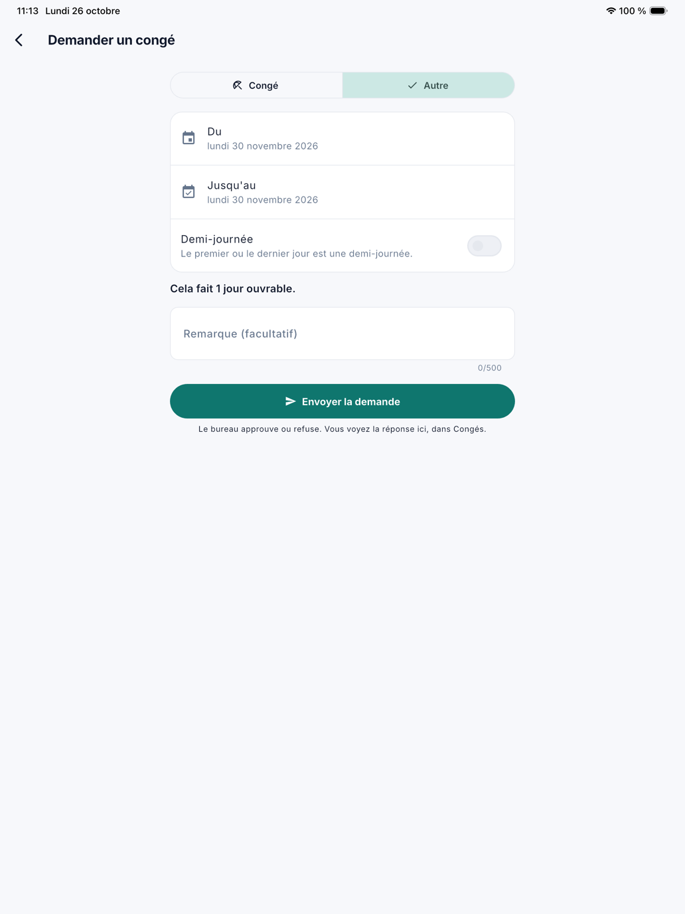

# Congés

Sous **Congés**, le collaborateur voit combien de jours de congé il lui reste, quels congés sont enregistrés pour lui et ce que
le bureau a fait de ses demandes. Il y demande aussi lui-même un congé. Le bureau décide dans CleanOps, dans
[Demandes de congé](../verlofaanvragen.fr.md).

## Ouvrir l'écran

Ouvrez le menu avec les trois traits en haut à gauche et touchez **Congés**.

{ width="560" }

## Ce que le collaborateur voit

- **Solde** : les jours de congé qui restent cette année, avec en dessous combien le bureau en a attribué et combien sont déjà
  pris. Ce sont les mêmes chiffres que dans [Soldes de congés](../verlofsaldi.fr.md). S'il y a des demandes en attente, l'application
  indique combien de jours attendent encore le bureau. Si le bureau n'a pas encore attribué de jours pour cette année,
  l'application l'indique au lieu d'un chiffre.
- **En attente du bureau** : les demandes sur lesquelles le bureau n'a pas encore décidé. Avec **Retirer**, le collaborateur
  retire une demande ; l'application lui demande d'abord confirmation.
- **Mes congés** : les congés enregistrés de cette année et après, avec le type (Congé, Maladie ou Autre), la description et
  le nombre de jours. Ce sont les congés que le bureau a enregistrés, et ceux d'une demande approuvée.
- **Demandes traitées** : les demandes sur lesquelles le bureau a décidé, avec *Approuvé* ou *Refusé*, et les demandes retirées.
  Pour une demande refusée, la raison donnée par le bureau est affichée.

## Demander un congé

1. Touchez **Demander un congé** en bas à droite.
2. Choisissez **Congé** ou **Autre**. Le collaborateur ne demande pas une maladie : il la signale au bureau.
3. Choisissez le jour sous **Du** et sous **Jusqu'au**. Un jour passé est possible aussi, pour qui demande après coup.
4. Activez **Demi-journée** si le premier ou le dernier jour est une demi-journée.
5. Sous les dates, l'application indique combien de jours ouvrables la période coûte, selon son régime de travail et les jours
   fériés. Un week-end, un jour férié ou un jour où le collaborateur ne travaille pas ne compte pas.
6. Écrivez éventuellement une **Remarque** pour le bureau, par exemple la raison.
7. Touchez **Envoyer la demande**.

{ width="560" }

La demande apparaît aussitôt sous **En attente du bureau**, et le bureau la voit dans CleanOps. Ce que le bureau décide, le
collaborateur le lit sur cet écran. Il ne reçoit ni notification ni e-mail.

## Questions fréquentes

**Le bouton Demander un congé n'apparaît pas.**
Tant que le bureau tient encore les congés dans l'application précédente, le collaborateur ne peut pas demander de congé dans
l'application. L'écran l'indique alors : *Le bureau tient encore les congés dans l'application précédente. Demandez votre
congé au bureau.* Il voit bien le solde et les congés enregistrés.

**Congés n'apparaît pas dans le menu.**
Votre entreprise ne tient alors pas les congés dans CleanOps : la fonction Congés est désactivée dans
[Gestion de la plateforme › Fonctions](../beheer/functies.fr.md).

**L'application refuse la demande : un congé ou une demande existe déjà pour cette période.**
Pour les mêmes jours, il ne peut y avoir qu'un congé ou qu'une demande en attente. Choisissez d'autres jours, ou retirez
d'abord la demande en attente.

**Le nombre de jours change après l'approbation.**
À l'approbation, CleanOps recalcule les jours. Si un jour férié, un jour de fermeture ou un autre régime de travail s'est
ajouté entre-temps, le congé enregistré en tient compte.

## Voir aussi

- [Demandes de congé](../verlofaanvragen.fr.md), où le bureau décide
- [Soldes de congés](../verlofsaldi.fr.md)
- [Bien démarrer avec l'application](aan-de-slag.fr.md)
