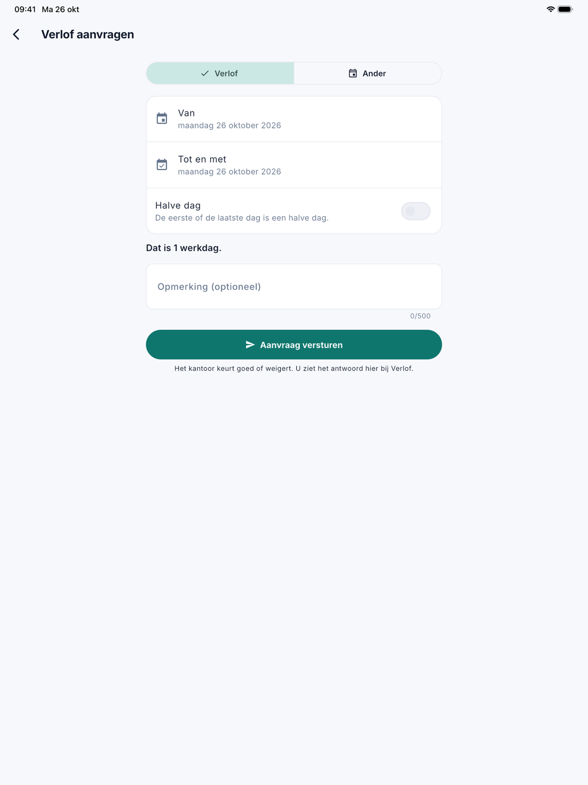

# Verlof

Onder **Verlof** ziet de medewerker hoeveel verlofdagen hij nog heeft, welk verlof er voor hem geboekt is en wat het kantoor
met zijn aanvragen deed. Hij vraagt er ook zelf verlof aan. Het kantoor beslist in CleanOps, in
[Verlofaanvragen](../verlofaanvragen.md).

## Het scherm openen

Open het menu met de drie streepjes linksboven en tik op **Verlof**.

{ width="560" }

## Wat de medewerker ziet

- **Saldo**: de verlofdagen die nog over zijn dit jaar, met daaronder hoeveel het kantoor toekende en hoeveel er al opgenomen
  is. Het zijn dezelfde getallen als in [Verlofsaldi](../verlofsaldi.md). Wachten er aanvragen, dan staat erbij hoeveel dagen
  nog op het kantoor wachten. Kende het kantoor voor dit jaar nog geen dagen toe, dan zegt de app dat in plaats van een getal.
- **Wacht op het kantoor**: de aanvragen waarover het kantoor nog niet beslist heeft. Met **Intrekken** trekt de medewerker
  een aanvraag in; de app vraagt eerst of hij het zeker is.
- **Mijn verlof**: het geboekte verlof van dit jaar en later, met de soort (Verlof, Ziekte of Ander), de omschrijving en het
  aantal dagen. Dat is het verlof dat het kantoor boekte, en het verlof uit een goedgekeurde aanvraag.
- **Behandelde aanvragen**: de aanvragen waarover het kantoor besliste, met *Goedgekeurd* of *Geweigerd*, en de ingetrokken
  aanvragen. Bij een geweigerde aanvraag staat de reden die het kantoor opgaf.

## Verlof aanvragen

1. Tik rechtsonder op **Verlof aanvragen**.
2. Kies **Verlof** of **Ander**. Ziekte vraagt de medewerker niet aan: die meldt hij aan het kantoor.
3. Kies de dag bij **Van** en bij **Tot en met**. Een dag in het verleden kan ook, voor wie achteraf aanvraagt.
4. Zet **Halve dag** aan als de eerste of de laatste dag een halve dag is.
5. Onder de datums toont de app hoeveel werkdagen de periode kost, met zijn werkregime en de feestdagen. Een weekend, een
   feestdag of een dag waarop de medewerker niet werkt, telt niet mee.
6. Schrijf eventueel een **Opmerking** voor het kantoor, bijvoorbeeld de reden.
7. Tik op **Aanvraag versturen**.

{ width="560" }

De aanvraag staat meteen bij **Wacht op het kantoor**, en het kantoor ziet ze in CleanOps. Wat het kantoor beslist, leest de
medewerker op dit scherm. Er komt geen melding of mail.

## Veelgestelde vragen

**De knop Verlof aanvragen staat er niet.**
Zolang het kantoor het verlof nog in de vorige toepassing bijhoudt, kan de medewerker in de app geen verlof aanvragen. Het
scherm zegt dat dan: *Het kantoor houdt het verlof nog in de vorige toepassing bij. Vraag uw verlof aan bij het kantoor.*
Het saldo en het geboekte verlof ziet hij wel.

**Verlof staat niet in het menu.**
Dan houdt uw bedrijf het verlof niet in CleanOps bij: de functie Verlof staat uit in
[Platformbeheer › Functies](../beheer/functies.md).

**De app weigert de aanvraag: er staat al verlof of een aanvraag in die periode.**
Voor dezelfde dagen kan er maar één verlof of één wachtende aanvraag zijn. Kies andere dagen, of trek de wachtende aanvraag
eerst in.

**Het aantal dagen verschilt na het goedkeuren.**
Bij het goedkeuren rekent CleanOps de dagen opnieuw. Is er intussen een feestdag, een sluitingsdag of een ander werkregime
bijgekomen, dan telt het geboekte verlof dat mee.

## Zie ook

- [Verlofaanvragen](../verlofaanvragen.md), waar het kantoor beslist
- [Verlofsaldi](../verlofsaldi.md)
- [Aan de slag met de app](aan-de-slag.md)
