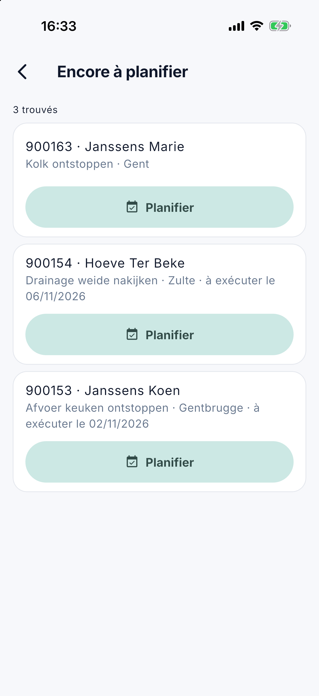

# Planning de la semaine

Sous **Planning de la semaine**, vous voyez dans l'application le [tableau de planning](../planning.fr.md) d'une semaine
entière : qui fait quoi, quel travail n'est pas encore attribué et ce qui n'a pas été exécuté. L'écran est destiné aux
personnes du bureau qui ont le droit sur le planning (voir [L'application pour le bureau](kantoor.fr.md)). Déplacer se fait sur le
tableau de planning sur l'ordinateur ; le travail sans date peut aussi être [planifié ici](#encore-a-planifier).

## Ouvrir l'écran

Ouvrez le menu avec les trois traits en haut à gauche et touchez **Planning de la semaine**. L'application s'ouvre sur la
semaine en cours.

{ width="560" }

## Choisir une semaine

En haut figure la semaine, par exemple *Semaine 45 · 2 nov. – 8 nov.*. Avec les flèches, vous passez à la **semaine
précédente** ou à la **semaine suivante** ; avec **Cette semaine** en haut à droite, vous revenez à la semaine en cours.

## Les compteurs

Sous la semaine figurent quatre compteurs pour toute la semaine :

| Compteur | Signification |
|---|---|
| ordres de travail | Tous les ordres de travail de la semaine. |
| non attribués | Les ordres de travail qui ne sont encore chez aucun collaborateur. En rouge dès qu'il y en a un. |
| non exécutés | Les ordres de travail d'un jour passé qui ne sont pas encore exécutés. En rouge dès qu'il y en a un. |
| absents | Les collaborateurs en congé au moins un jour de cette semaine. |

## La grille

Sur une **tablette**, une grille s'affiche : une ligne par collaborateur, une colonne par jour, comme le tableau de
planning, avec aussi la ligne *non attribués*. Sur un **téléphone**, les jours sont l'un sous l'autre et, par jour, les
collaborateurs avec leur travail.

Vous ne voyez que les collaborateurs qui ont quelque chose cette semaine : du travail, un congé ou un bloc. Le tableau de
planning affiche aussi les lignes vides, pour y glisser du travail ; dans l'application, elles ne feraient que vous faire
défiler.

Chaque ligne a à gauche une barre de couleur, dans les mêmes couleurs que le tableau de planning :

- **vert** : exécuté ;
- **rouge**, avec *Non exécuté* : un ordre de travail d'un jour passé qui n'est pas encore exécuté ;
- la **couleur du collaborateur** : du travail planifié ;
- les congés et les blocs figurent comme sur le tableau.

Un jour férié figure en rouge à côté du jour. Toucher un ordre de travail l'ouvre dans [Ordres de travail](kantoor-werkorders.fr.md),
si votre rôle a le droit sur les ordres de travail.

## Encore à planifier

Le travail sans date ne figure dans aucune semaine. C'est pourquoi, à partir de la version 1.3.0, la ligne **Encore à planifier** figure au-dessus de la grille, avec le nombre.
C'est la même liste que la colonne du [tableau de planning](../planning.fr.md) : le travail ouvert sans date planifiée.

Touchez la ligne pour ouvrir la liste. Si vous avez le droit **Modifier le planning**, **Planifier** figure à chaque ordre de travail. Vous choisissez le jour, la partie de la
journée et éventuellement le collaborateur. Sans collaborateur, l'ordre figure ce jour-là sur la ligne *(non attribué)*. Si le jour est passé ou si le collaborateur est en
congé ce jour-là, l'application le demande d'abord.

Si quelqu'un d'autre a entre-temps planifié l'ordre, l'application le dit et le planning de cette personne reste en place.

## Questions fréquentes

**Un collaborateur ne figure pas dans la liste.**
Il n'a ni travail, ni congé, ni bloc cette semaine. Sur le tableau de planning sur l'ordinateur, sa ligne vide figure bien.

**Il est écrit : *Les jours fériés n'ont pas pu être récupérés*.**
CleanOps n'a pas pu lire les jours fériés pour le moment. Le planning est correct, mais un jour férié peut manquer.
Actualisez l'écran plus tard en le tirant vers le bas.

## Voir aussi

- [Planning](../planning.fr.md), le tableau de planning sur l'ordinateur
- [Ordres de travail dans l'application](kantoor-werkorders.fr.md)
- [L'application pour le bureau](kantoor.fr.md)
