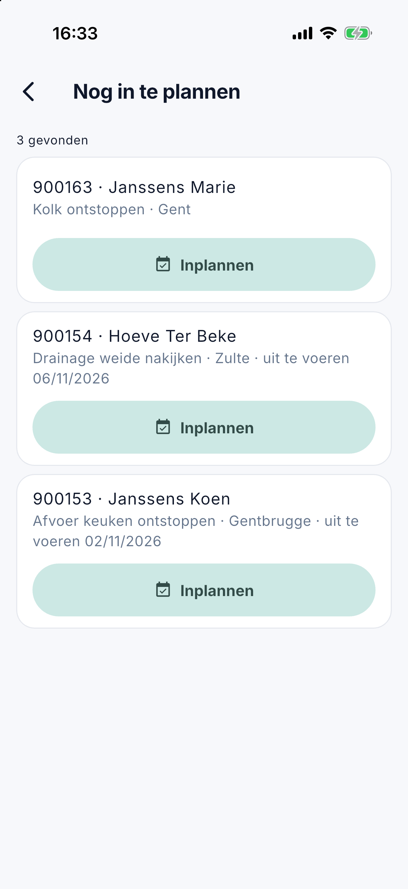

# Weekplanning

Onder **Weekplanning** ziet u in de app het [planbord](../planning.md) van een hele week: wie wat doet, welk werk nog niet
toegewezen is en wat niet uitgevoerd werd. Het scherm is er voor wie op kantoor werkt en het recht op de planning heeft
(zie [De app voor kantoor](kantoor.md)). Verplaatsen doet u op het planbord op de computer; werk zonder datum kunt u ook hier [inplannen](#nog-in-te-plannen).

## Het scherm openen

Open het menu met de drie streepjes linksboven en tik op **Weekplanning**. De app opent op de week van vandaag.

{ width="560" }

## Een week kiezen

Bovenaan staat de week, bijvoorbeeld *Week 45 · 2 nov – 8 nov*. Met de pijlen gaat u naar de **vorige** of de **volgende
week**; met **Deze week** rechtsboven keert u terug naar de week van vandaag.

## De tellers

Onder de week staan vier tellers voor de hele week:

| Teller | Betekenis |
|---|---|
| werkorders | Alle werkorders van de week. |
| niet toegewezen | Werkorders die nog bij geen medewerker staan. In het rood zodra er een is. |
| niet uitgevoerd | Werkorders van een voorbije dag die nog niet op uitgevoerd staan. In het rood zodra er een is. |
| afwezig | Medewerkers met verlof op minstens één dag van die week. |

## Het rooster

Op een **tablet** staat een rooster: een rij per medewerker, een kolom per dag, zoals het planbord, met ook de rij
*niet toegewezen*. Op een **telefoon** staan de dagen onder elkaar, en per dag de medewerkers met hun werk.

U ziet enkel de medewerkers die die week iets hebben: werk, verlof of een blok. Op het planbord staan ook de lege rijen,
om er werk naartoe te slepen; in de app zou dat enkel scrollen kosten.

Elke regel heeft links een kleurstaafje, in dezelfde kleuren als het planbord:

- **groen**: uitgevoerd;
- **rood**, met *Niet uitgevoerd*: een werkorder van een voorbije dag die nog niet uitgevoerd is;
- de **kleur van de medewerker**: gepland werk;
- verlof en blokken staan er zoals op het bord.

Een feestdag staat in het rood bij de dag. Een tik op een werkorder opent ze in [Werkorders](kantoor-werkorders.md), als uw
rol het recht op de werkorders heeft.

## Nog in te plannen

Werk zonder datum staat in geen enkele week. Daarom staat er vanaf versie 1.3.0 boven het rooster de regel **Nog in te plannen**, met het aantal. Het is dezelfde
lijst als de kolom op het [planbord](../planning.md): het open werk zonder geplande datum.

Tik op een regel om de lijst te openen. Hebt u het recht **Planning bewerken**, dan staat bij elke werkorder **Inplannen**. U kiest de dag, het tijdsdeel en eventueel de
medewerker. Zonder medewerker staat de werkorder die dag op de rij *(niet toegewezen)*. Valt de dag in het verleden of heeft de medewerker die dag verlof, dan vraagt de app het eerst.

Plande iemand anders de werkorder intussen, dan zegt de app dat en blijft de planning van die persoon staan.

## Veelgestelde vragen

**Een medewerker staat er niet bij.**
Hij heeft die week geen werk, geen verlof en geen blok. Op het planbord op de computer staat zijn lege rij wel.

**Er staat: *De feestdagen konden niet opgehaald worden*.**
CleanOps kon de feestdagen even niet lezen. De planning klopt, maar een feestdag staat er mogelijk niet bij. Ververs het
scherm later door het naar beneden te trekken.

## Zie ook

- [Planning](../planning.md), het planbord op de computer
- [Werkorders in de app](kantoor-werkorders.md)
- [De app voor kantoor](kantoor.md)
