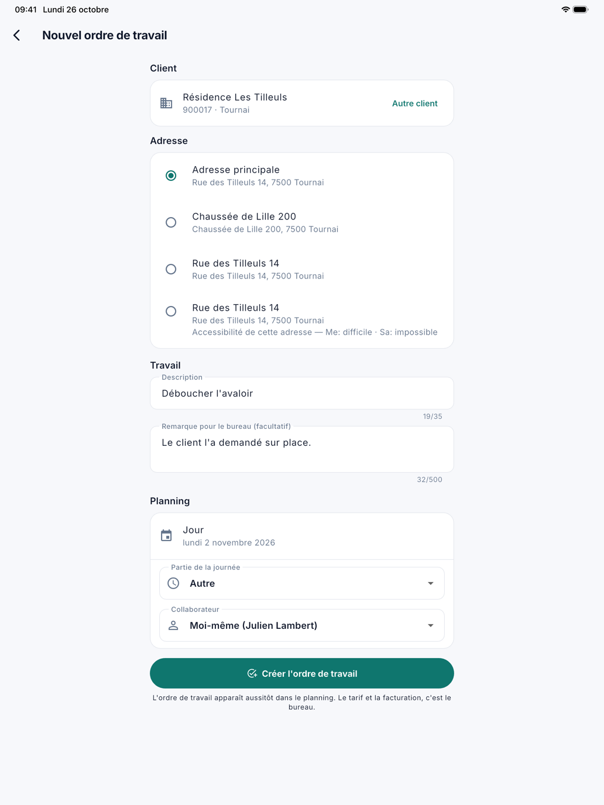

# Créer un ordre de travail

Si un client demande un travail supplémentaire sur place, le collaborateur crée lui-même un ordre de travail dans
l'application. Il apparaît aussitôt dans le planning, et le bureau le voit dans CleanOps. Le tarif, la TVA et la facturation,
c'est le bureau.

## Ouvrir l'écran

Touchez **Nouvel ordre** en bas du [planning](planning.fr.md). Le bouton n'apparaît pas tant que le bureau tient encore
les ordres de travail dans votre application précédente.

{ width="560" }

## Créer un ordre de travail

1. **Client** : tapez au moins deux lettres du nom, de la commune ou du numéro de client, et touchez le client. Avec
   **Autre client**, vous choisissez à nouveau. Le bureau crée les nouveaux clients.
2. **Adresse** : choisissez l'adresse principale ou une adresse d'exécution du client. La première de la liste est déjà
   choisie : la seule adresse d'exécution, ou sinon l'adresse principale. Ce que le bureau a noté sur l'accessibilité d'une
   adresse apparaît en dessous.
3. **Description** : ce qu'il faut faire, en 35 caractères au plus. Ce champ est obligatoire.
4. **Remarque pour le bureau** : ce que le bureau doit savoir, par exemple que le client l'a demandé sur place. Ce texte va
   dans la remarque interne et n'apparaît pas sur le bon de livraison.
5. **Planning** : le **Jour**, la **Partie de la journée** et le **Collaborateur**. Le jour est celui du planning, ou
   aujourd'hui si le planning affichait un jour passé. Le collaborateur est par défaut vous-même ; vous pouvez aussi choisir
   un collègue.
6. Touchez **Créer l'ordre de travail**.

L'application affiche le numéro du nouvel ordre de travail et passe au jour où il se trouve. Si vous l'avez créé pour
vous-même, il s'ouvre aussitôt à droite sur une tablette.

L'ordre de travail reçoit les mêmes données qu'un ordre créé par le bureau : les instructions fixes de l'adresse, la langue
et le numéro de téléphone du client, et la remarque interne de la commande précédente à cette adresse.

## Quand l'application demande d'abord

Parfois, l'application demande **Créer quand même ?** avant de créer l'ordre de travail :

- le client ou l'adresse n'accepte pas de nouvelles commandes ;
- le jour choisi est déjà passé ;
- le collaborateur choisi est en congé ce jour-là.

Avec **Créer**, vous continuez quand même ; avec **Annuler**, vous adaptez d'abord quelque chose.

## Questions fréquentes

**J'ai créé un ordre de travail pour un collègue, et il n'apparaît pas dans mon planning.**
C'est normal : il est dans le planning de votre collègue. Vous ne le voyez que si vous êtes dans la même équipe ce jour-là.

**Puis-je indiquer un tarif ou un prix ?**
Non. Le bureau complète le tarif et la TVA, comme pour tout ordre de travail. Un paiement sur place se note sur l'ordre de
travail lui-même, voir [L'ordre de travail](werkorder.fr.md).

**Comment le bureau voit-il que l'ordre vient de l'application ?**
Sur la fiche de l'ordre de travail figure **Depuis l'app** avec le nom du collaborateur, et la liste
[Ordres de travail](../werkorders.fr.md) a un filtre **Créé : Depuis l'app**.

## Voir aussi

- [Le planning](planning.fr.md)
- [L'ordre de travail](werkorder.fr.md)
- [Ordres de travail](../werkorders.fr.md) au bureau
