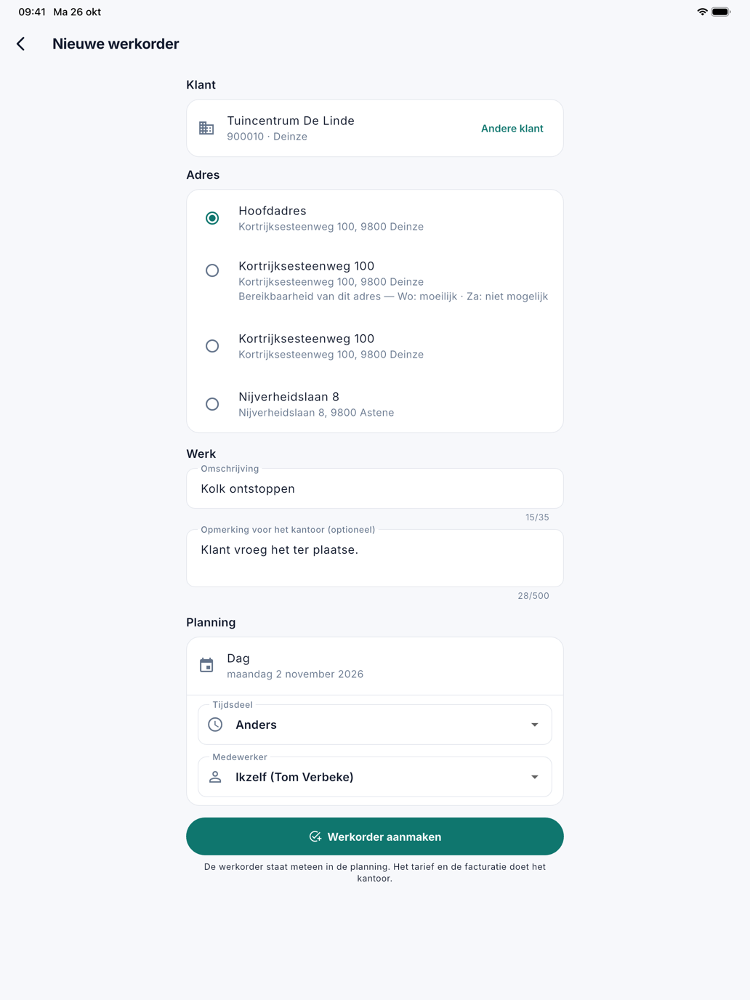

# Een werkorder aanmaken

Vraagt een klant ter plaatse om extra werk, dan maakt de medewerker zelf een werkorder aan in de app. Ze staat meteen in
de planning, en het kantoor ziet ze in CleanOps. Het tarief, de btw en de facturatie doet het kantoor.

## Het scherm openen

Tik onderaan de [planning](planning.md) op **Nieuwe werkorder**. De knop staat er niet zolang het kantoor de werkorders
nog in uw vorige toepassing bijhoudt.

{ width="560" }

## Een werkorder aanmaken

1. **Klant**: typ minstens twee letters van de naam, de gemeente of het klantnummer, en tik op de klant. Met
   **Andere klant** kiest u opnieuw. Een nieuwe klant maakt het kantoor aan.
2. **Adres**: kies het hoofdadres of een uitvoeringsadres van de klant. Het eerste in de lijst staat al gekozen: het enige
   uitvoeringsadres, of anders het hoofdadres. Wat het kantoor bij een adres noteerde over de bereikbaarheid, staat eronder.
3. **Omschrijving**: wat er moet gebeuren, in hoogstens 35 tekens. Dit veld is verplicht.
4. **Opmerking voor het kantoor**: wat het kantoor moet weten, bijvoorbeeld dat de klant het ter plaatse vroeg. Deze tekst
   komt in de interne opmerking en staat niet op de leveringsbon.
5. **Planning**: de **Dag**, het **Tijdsdeel** en de **Medewerker**. De dag is die van de planning, of vandaag als de
   planning op een dag in het verleden stond. De medewerker is standaard uzelf; u kunt ook een collega kiezen.
6. Tik op **Werkorder aanmaken**.

De app toont het nummer van de nieuwe werkorder en springt naar de dag waarop ze staat. Maakte u ze voor uzelf, dan staat
ze op een tablet meteen rechts open.

De werkorder krijgt dezelfde gegevens als een werkorder die het kantoor aanmaakt: de vaste instructies van het adres, de
taal en het telefoonnummer van de klant, en de interne opmerking van de vorige opdracht op dat adres.

## Wanneer de app eerst iets vraagt

Soms vraagt de app **Toch aanmaken?** voor ze de werkorder aanmaakt:

- de klant of het adres aanvaardt geen nieuwe opdrachten;
- de gekozen dag is al voorbij;
- de gekozen medewerker heeft die dag verlof.

Met **Aanmaken** gaat het toch door; met **Annuleren** past u eerst iets aan.

## Veelgestelde vragen

**Ik maakte een werkorder voor een collega, en ze staat niet in mijn planning.**
Dat klopt: ze staat in de planning van uw collega. U ziet ze enkel als u die dag in dezelfde ploeg zit.

**Kan ik een tarief of een prijs ingeven?**
Nee. Het kantoor vult het tarief en de btw aan, zoals bij elke werkorder. Een betaling ter plaatse noteert u op de werkorder
zelf, zie [De werkorder](werkorder.md).

**Hoe ziet het kantoor dat de werkorder uit de app komt?**
Op de werkorderfiche staat **Uit de app** met de naam van de medewerker, en de lijst
[Werkorders](../werkorders.md) heeft een filter **Aangemaakt: Uit de app**.

## Zie ook

- [De planning](planning.md)
- [De werkorder](werkorder.md)
- [Werkorders](../werkorders.md) op kantoor
