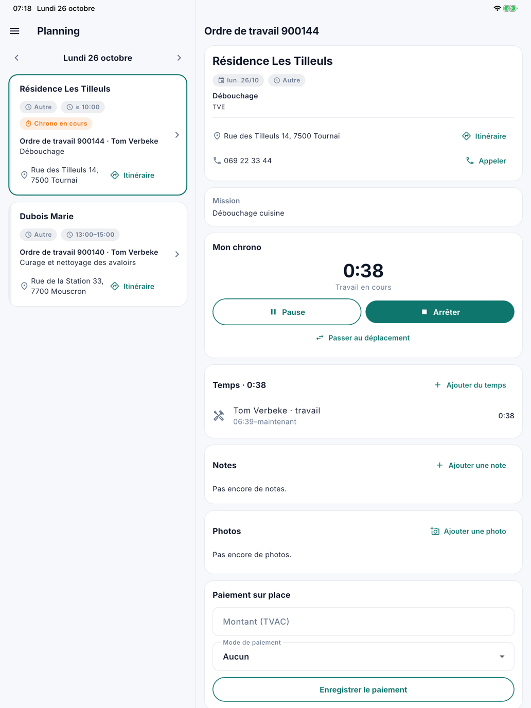
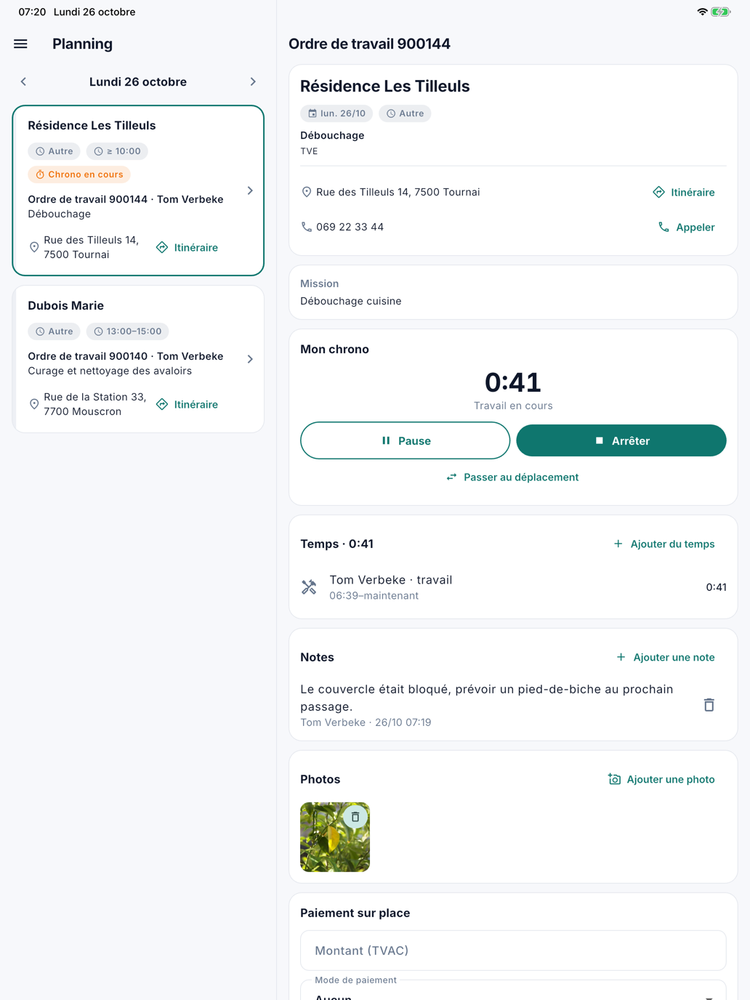
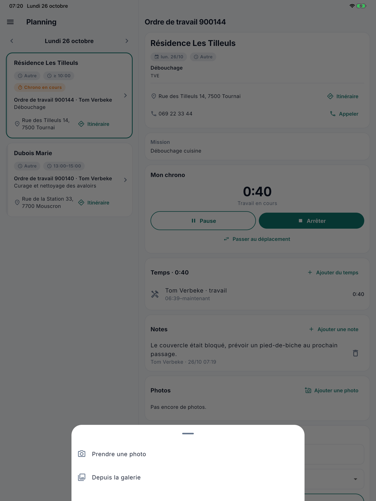
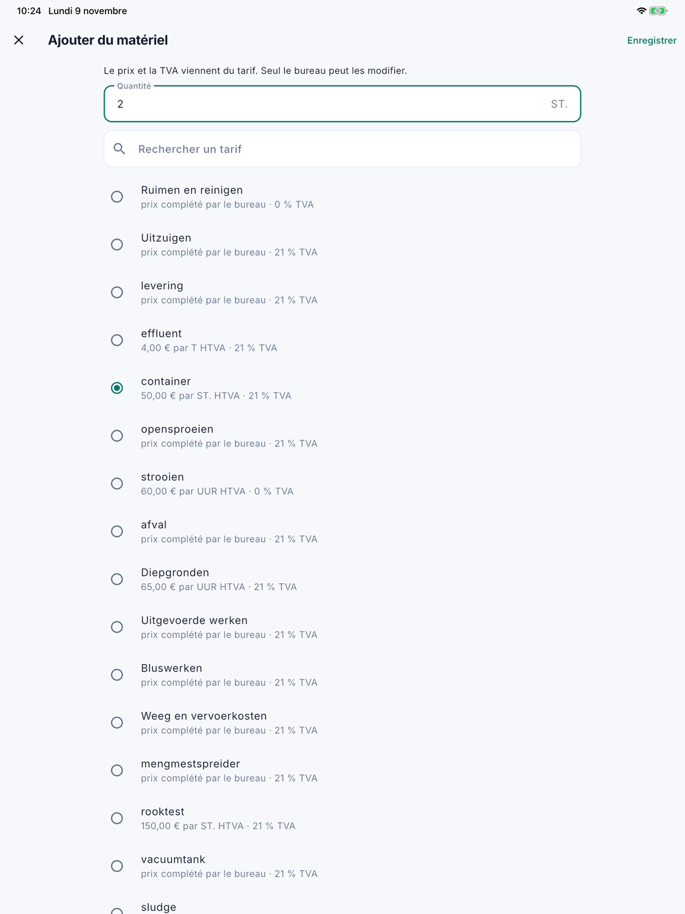
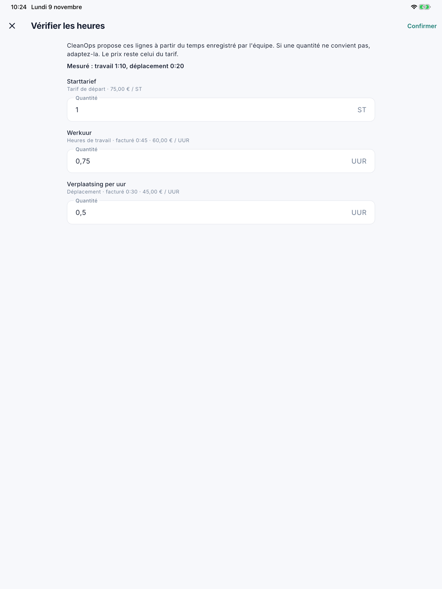
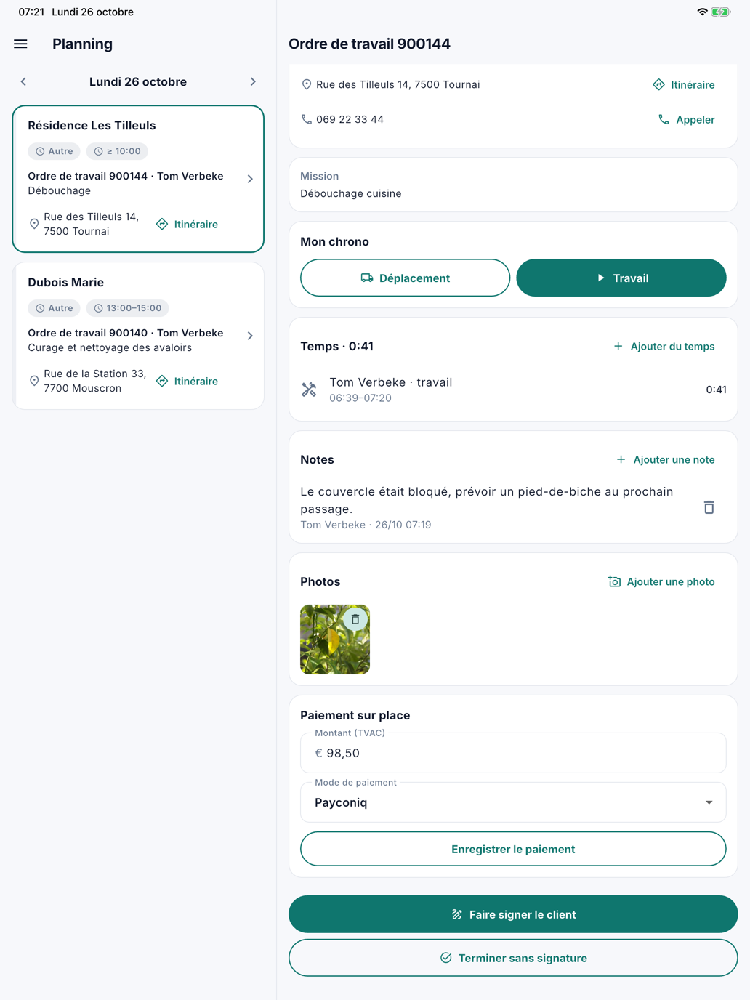
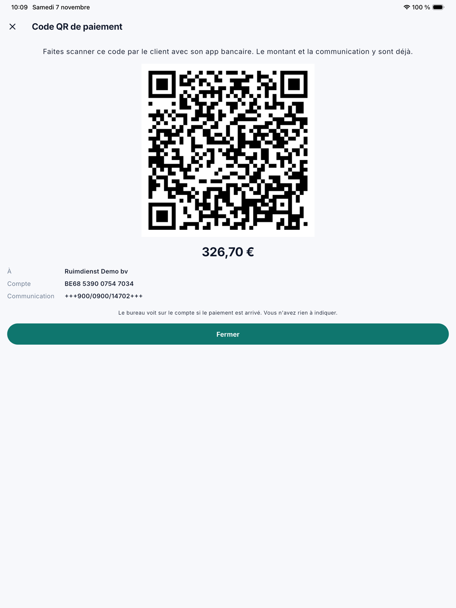

# L'ordre de travail

Sur l'ordre de travail, le collaborateur enregistre son temps, note ce que le bureau doit savoir, prend des photos et
note un paiement sur place. Comment il ouvre l'ordre de travail est décrit dans [Le planning](planning.fr.md).

## Le chrono

Sous **Mon chrono**, le collaborateur enregistre son temps sur cet ordre de travail :

- **Déplacement** ou **Travail** démarre le chrono.
- **Pause** et **Reprendre** l'interrompent.
- **Passer au travail** ou **Passer au déplacement** change le type sans arrêter.
- **Arrêter** arrête le chrono.

{ width="560" }

Un seul chrono tourne à la fois. Si le collaborateur démarre un chrono sur un autre ordre de travail, le précédent
s'arrête. S'il a oublié de démarrer ou d'arrêter, il encode le temps à la main avec **Ajouter du temps** ou **Corriger
le temps**. Au bureau, vous voyez tout dans l'onglet [Temps](../werkorders.fr.md#temps) de l'ordre de travail.

## Notes

Sous **Notes**, le collaborateur écrit ce que le bureau ou un collègue doit savoir : « couvercle bloqué, prendre un
pied-de-biche ». Il appuie sur **Ajouter une note**, tape son texte (2000 caractères au plus) et appuie sur
**Enregistrer**. Chaque note figure avec le nom de son auteur et le moment. Une note du bureau figure avec **Bureau**.

Au bureau, vous les voyez dans l'onglet [Notes](../werkorders.fr.md#notes) de l'ordre de travail, avec **par** et le
nom du collaborateur.

{ width="560" }

## Photos

Sous **Photos**, le collaborateur ajoute des photos à l'ordre de travail : une évacuation bouchée avant et après, un
couvercle abîmé. Il appuie sur **Ajouter une photo** et choisit **Prendre une photo** ou **Depuis la galerie**. La
première fois qu'il prend une photo, l'appareil demande l'accès à l'appareil photo. Depuis la galerie, l'application ne
voit que la photo qu'il choisit.

{ width="560" }

- L'application réduit la photo avant de l'envoyer. Elle passe ainsi rapidement, même avec une connexion lente.
- La position qu'un appareil enregistre dans une photo est effacée avant que la photo soit enregistrée.
- Un appui sur une photo l'affiche en grand, avec qui l'a prise et quand.

Au bureau, les photos se trouvent sur l'ordre de travail sous [**Journal**](../werkorders.fr.md#journal) › **Pièces
jointes**.

Sans réseau, par exemple dans une cave, la photo apparaît aussitôt dans l'application avec **Pas encore envoyé** en
dessous. Elle part automatiquement dès que le réseau revient (voir [Sans réseau](aan-de-slag.fr.md#sans-reseau)). Tant
qu'elle attend, le collaborateur peut encore la supprimer : elle ne partira alors jamais.

## Supprimer des notes et des photos

Avec la corbeille, le collaborateur supprime ses propres notes et photos, tant que l'ordre de travail n'est pas
terminé. Ce qu'un collègue ou le bureau a ajouté, il ne peut pas le supprimer. Au bureau, qui peut modifier les ordres
de travail supprime n'importe quelle note dans l'onglet Notes ; une photo se supprime sous Journal › Pièces jointes.

## Attestations

Sur un ordre de travail **Avec attestation**, la carte **Attestations** est affichée. Avec **Ajouter une
attestation**, le collaborateur complète l'enlèvement : la **date** (aujourd'hui par défaut), le **produit** (recherche
par nom ou code EURAL), la **quantité** et l'**unité**. L'**origine** et la **remarque chantier** sont facultatives.

Il peut choisir le **traitement** et l'**entreprise de traitement** s'il les connaît ; sinon, le bureau les complète
sur l'[attestation](../attesten.fr.md). Le bureau envoie l'attestation au client par mail, comme aujourd'hui.

Le collaborateur modifie ses propres attestations d'un appui, ou les supprime avec la corbeille, jusqu'à ce que l'ordre
de travail soit terminé. Une attestation du bureau, il peut seulement la consulter. Si la fonction Attestations est
désactivée pour votre entreprise, la carte n'apparaît pas.

Même sans réseau, il peut compléter une attestation : les listes de produits et d'unités se trouvent sur l'appareil.
L'attestation part dès que le réseau revient (voir [Sans réseau](aan-de-slag.fr.md#sans-reseau)).

## Rapport caméra

Sur un ordre de travail **Rapport caméra requis**, la carte **Rapport caméra** est affichée. Avec **Créer le
rapport**, le collaborateur écrit ce qu'il a constaté (par exemple *racines à 8 m, chambre 2 affaissée*). Le rapport
reçoit la date du jour et le collaborateur lui-même, et est rattaché à l'adresse d'exécution, comme un
[rapport caméra](../cameraverslagen.fr.md) au bureau. Il est lié immédiatement à l'ordre de travail.

Sous **Photos du rapport**, il ajoute des photos, avec l'appareil photo ou depuis la galerie. Les vidéos ne sont pas
possibles depuis l'app ; elles restent au bureau. Avec **Compléter le texte**, il met le texte à jour. Ses propres
photos, il les supprime avec la corbeille. Tout cela est possible jusqu'à ce que l'ordre de travail soit terminé. Le
bureau envoie le rapport au client par mail, comme aujourd'hui.

Un rapport du bureau ou d'un collègue, il peut seulement le consulter. Si aucun rapport ne peut être créé ici, la
carte indique pourquoi, par exemple parce que l'ordre de travail n'a pas encore d'adresse d'exécution. Si la fonction
Rapports caméra est désactivée pour votre entreprise, la carte n'apparaît pas.

Même sans réseau, il peut créer le rapport et ajouter des photos. Ils partent dans le bon ordre dès que le réseau
revient : d'abord le rapport, ensuite les photos (voir [Sans réseau](aan-de-slag.fr.md#sans-reseau)).

## Travaux supplémentaires

Si le collaborateur voit un travail qui ne figure pas dans la mission, il le propose avec **Proposer** sur la carte
**Travaux supplémentaires**. Par ligne, il indique **quoi** faire et **combien**, avec une **unité** si elle convient. Avec
**Ajouter une ligne**, une ligne s'ajoute. Il n'indique pas de prix : le bureau chiffre et envoie le
[devis](../offertes.fr.md#travaux-supplementaires-de-lapp) au client.

Après la proposition, celle-ci figure sur la carte. Avec **Ajouter une photo**, il y ajoute des photos, avec l'appareil
photo ou depuis la galerie, tant que le bureau ne l'a pas envoyée. La modifier ou la retirer passe par le bureau.

Sur la carte, il voit aussi les propositions d'un collègue sur le même ordre de travail, et où en est chaque proposition :
**Transmis, le bureau chiffre**, **Envoyé au client**, **Accepté** ou **Non accepté**. Proposer est possible jusqu'à ce que
l'ordre de travail soit terminé. Si la fonction Devis est désactivée pour votre entreprise, la carte n'apparaît pas.

Même sans réseau, il peut proposer des travaux et y ajouter des photos. Ils partent dans le bon ordre dès que le réseau
revient : d'abord la proposition, ensuite les photos (voir [Sans réseau](aan-de-slag.fr.md#sans-reseau)).

## Matériel et heures

À partir de la version 1.4.0 de l'app. La carte **Matériel et heures** montre les lignes supplémentaires de l'ordre de
travail : ce que le bureau a ajouté, le matériel ajouté dans l'app, et les heures et le tarif de démarrage. Sous chaque ligne
figure son origine, et si le collaborateur a adapté la quantité. En bas figure le total de l'ordre de travail TVAC.

{ width="560" }

### Ajouter du matériel

Avec **Ajouter du matériel**, le collaborateur choisit un tarif et indique la **Quantité**. Avec **Rechercher un tarif**, il
le retrouve vite. Chaque tarif montre le prix par unité HTVA et la TVA. **Enregistrer** ajoute la ligne à l'ordre de travail.

{ width="560" }

- Le prix et la TVA viennent du [tarif](../beheer/tarieven.fr.md). Le collaborateur ne les modifie pas ; le bureau le fait sur la
  fiche de l'ordre de travail.
- Pour un tarif sans prix figure *prix complété par le bureau* : le bureau complète le prix avant la facturation.
- Il supprime son propre matériel avec la corbeille. Une ligne du bureau, les heures et le tarif de démarrage, il ne les
  supprime pas.
- Même sans réseau, il peut ajouter du matériel. La ligne figure aussitôt, avec *Pas encore envoyé*, et part dès que le réseau
  revient (voir [Sans réseau](aan-de-slag.fr.md#sans-reseau)). Le total n'apparaît qu'ensuite.

### Heures et tarif de démarrage

Avant que le collaborateur fasse signer le client ou termine l'ordre de travail, l'app montre **Vérifier les heures** : les
lignes que CleanOps propose à partir du temps enregistré par toute l'équipe, avec les tarifs de la
[fiche d'entreprise](../beheer/bedrijfsfiche.fr.md#heures-et-tarif-de-demarrage-dans-lapp). En haut figure le temps mesuré, et
pour chaque ligne le temps facturé.

{ width="560" }

Si une quantité ne convient pas, il l'adapte ; sous le champ figure alors la proposition. Avec **Confirmer**, les lignes vont
sur l'ordre de travail, puis viennent la signature ou la clôture. Avec la croix, il revient sans terminer.

- S'il appuie plus tard encore sur signer ou terminer, CleanOps remplace les lignes des heures : elles ne viennent pas une
  seconde fois. Une quantité qu'il avait adaptée figure de nouveau.
- Sans réseau, l'app ne peut pas montrer la proposition. S'il termine alors, CleanOps calcule les heures et le tarif de
  démarrage dès qu'il reçoit l'ordre de travail, sans adaptation. Jusque-là, la carte l'indique.
- Si la fiche d'entreprise n'a pas de tarif pour les heures ni de tarif de démarrage, cet écran ne vient pas.

## Le paiement sur place

Si le client paie sur place, le collaborateur note sous **Paiement sur place** le **Montant (TVAC)** et le **Mode de
paiement**, puis appuie sur **Enregistrer le paiement**. Le montant et le mode de paiement figurent immédiatement sur
l'ordre de travail dans CleanOps.

Si l'ordre de travail porte du matériel, des heures ou un tarif de démarrage ajoutés dans l'app, le montant est déjà rempli
avec le total TVAC. Si une ligne s'ajoute, le montant suit. Si le collaborateur tape lui-même un autre montant, celui-ci reste.

{ width="560" }

En dessous figurent les boutons pour terminer : voir [Faire signer](laten-tekenen.fr.md).

### Un montant hors TVA

À partir de la version 1.3.3 de l'application. Au-dessus du montant figure la TVA de l'ordre de travail, par exemple
*TVA de cet ordre de travail : 21 % T.V.A.* Si le collaborateur connaît le montant hors TVA, il appuie sur **HTVA** et saisit ce
montant. L'application ajoute la TVA et affiche le calcul en dessous, par exemple *€ 75,00 + 21 % TVA = € 90,75*.

- C'est toujours le montant **TVA comprise** qui est enregistré. Après l'enregistrement, le champ repasse sur **TVAC**, avec ce
  montant.
- L'application calcule avec les [codes TVA](../beheer/btw-codes.fr.md) de votre entreprise, pas avec des taux fixes.
- Si l'ordre de travail n'a pas encore de code TVA, le collaborateur en choisit un sous **Code TVA**. Il est placé sur l'ordre de
  travail à l'enregistrement. Sans code TVA, l'application ne peut pas convertir un montant hors TVA : elle demande d'abord le code
  TVA.
- L'application ne modifie pas un code TVA que l'ordre de travail a déjà. C'est le bureau qui le fait sur la fiche de l'ordre de
  travail.

### Payer avec un code QR

À partir de la version 1.3.2 de l'application. Si le collaborateur choisit un mode qui affiche un
[code QR de paiement](../beheer/betaalwijzen.fr.md#payer-avec-un-code-qr-sur-place), le bouton **Afficher le code QR de paiement**
apparaît. Il appuie dessus et fait scanner le code par le client avec son app bancaire. Le montant, votre numéro de compte et la
communication y sont déjà ; sous le code, ils figurent aussi en toutes lettres, pour qui préfère les recopier.

{ width="560" }

- Le montant est le total de l'ordre **TVA comprise**, tel que le bureau l'a saisi. Le champ **Montant (TVAC)** ne joue ici aucun rôle.
- Il n'y a pas de bouton « payé » : le bureau voit sur le compte si le paiement est arrivé. Le collaborateur n'a rien à indiquer.
- Le bouton reste aussi après avoir terminé l'ordre, car le client paie souvent à la fin.
- Le code QR demande du réseau : CleanOps retient quel code le client a vu, pour que la facture reçoive la même communication.

S'il manque quelque chose, l'application le dit : par exemple *Il n'y a pas encore de montant à payer*, ou que le nom ou l'IBAN
manque sur la fiche de l'entreprise. Si l'ordre est déjà facturé, le client paie avec le code QR de la facture.

## Questions fréquentes

**Où trouver les photos d'un collaborateur ?**
Sur l'ordre de travail, sous **Journal** › **Pièces jointes**. Elles s'appellent *Photo* (ou *Foto* si l'application
du collaborateur est en néerlandais), suivi du numéro de l'ordre de travail et du moment, par exemple *Photo 900149
2026-10-25 20.58.30.jpg*.

**Un collaborateur ne peut pas prendre de photo.**
S'il n'a pas donné à l'application l'accès à l'appareil photo la première fois, il l'active dans les réglages de son
appareil, sous l'application CleanOps. Choisir une photo depuis la galerie reste possible.

**Le travail est fait aujourd'hui, mais l'ordre est planifié plus tard.**
La clôture n'est possible qu'à partir du jour planifié ; c'est indiqué au-dessus des boutons. Qui peut planifier touche
**Déplacer à aujourd'hui**. Sinon, le bureau déplace d'abord l'ordre (voir [Déplacer un ordre de travail](kantoor-werkorders.fr.md#deplacer-un-ordre-de-travail)).

**Le temps dans l'application est incorrect.**
Corrigez-le dans l'onglet [Temps](../werkorders.fr.md#temps) de l'ordre de travail, ou le collaborateur le fait
lui-même avec **Corriger le temps**.

## Voir aussi

- [Faire signer](laten-tekenen.fr.md)
- [Ordres de travail](../werkorders.fr.md), avec les onglets Temps et Notes
- [Fiche d'entreprise : heures et tarif de démarrage dans l'app](../beheer/bedrijfsfiche.fr.md#heures-et-tarif-de-demarrage-dans-lapp)
