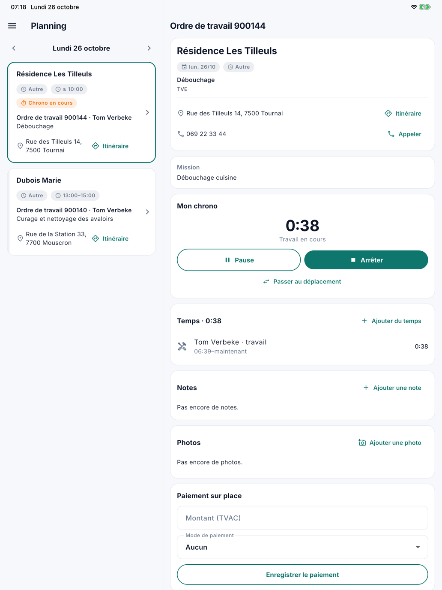
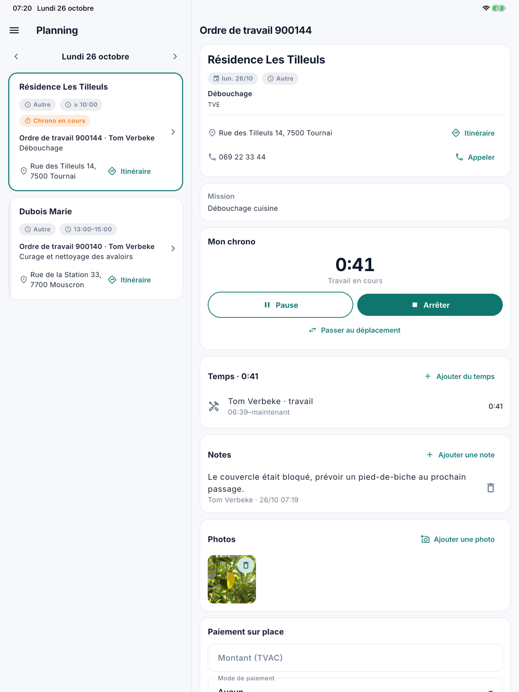
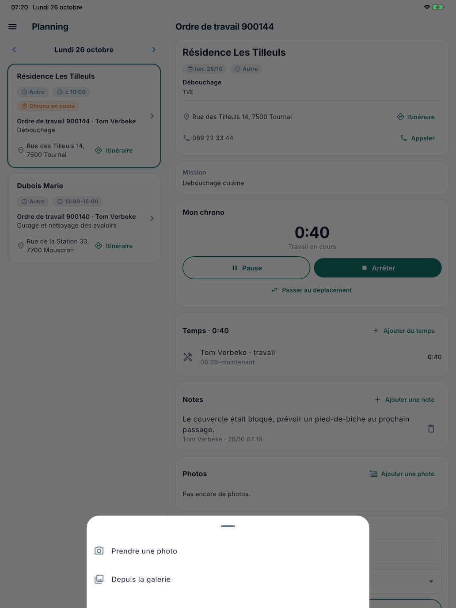
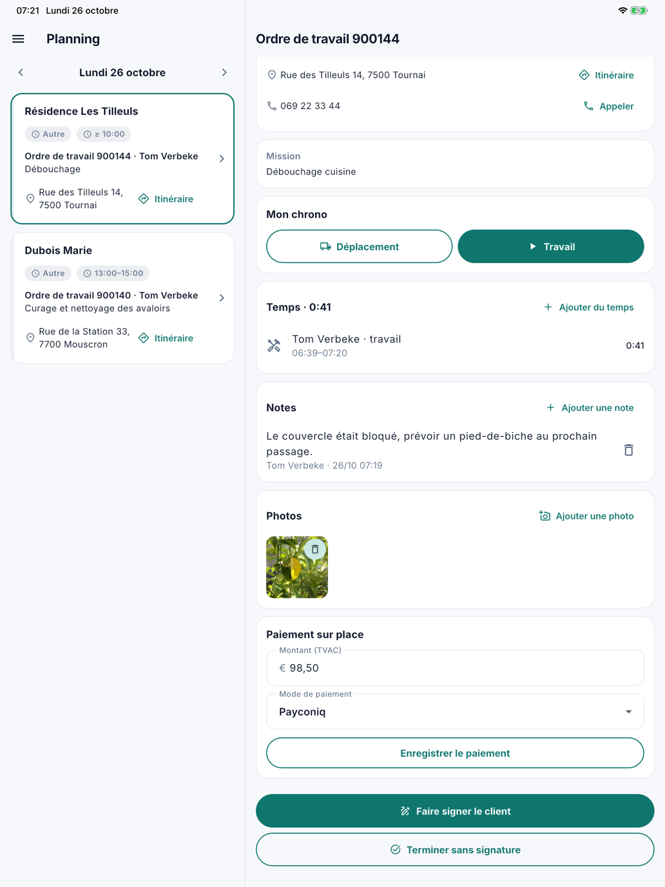

# L'ordre de travail

Sur l'ordre de travail, le collaborateur enregistre son temps, note ce que le bureau doit savoir, prend des photos et
note un paiement sur place. Comment il ouvre l'ordre de travail est décrit dans [Le planning](planning.fr.md).

## Le chrono

Sous **Mon chrono**, le collaborateur enregistre son temps sur cet ordre de travail :

- **Déplacement** ou **Travail** démarre le chrono.
- **Pause** et **Reprendre** l'interrompent.
- **Passer au travail** ou **Passer au déplacement** change le type sans arrêter.
- **Arrêter** arrête le chrono.

{ width="560" }

Un seul chrono tourne à la fois. Si le collaborateur démarre un chrono sur un autre ordre de travail, le précédent
s'arrête. S'il a oublié de démarrer ou d'arrêter, il encode le temps à la main avec **Ajouter du temps** ou **Corriger
le temps**. Au bureau, vous voyez tout dans l'onglet [Temps](../werkorders.fr.md#temps) de l'ordre de travail.

## Notes

Sous **Notes**, le collaborateur écrit ce que le bureau ou un collègue doit savoir : « couvercle bloqué, prendre un
pied-de-biche ». Il appuie sur **Ajouter une note**, tape son texte (2000 caractères au plus) et appuie sur
**Enregistrer**. Chaque note figure avec le nom de son auteur et le moment. Une note du bureau figure avec **Bureau**.

Au bureau, vous les voyez dans l'onglet [Notes](../werkorders.fr.md#notes) de l'ordre de travail, avec **par** et le
nom du collaborateur.

{ width="560" }

## Photos

Sous **Photos**, le collaborateur ajoute des photos à l'ordre de travail : une évacuation bouchée avant et après, un
couvercle abîmé. Il appuie sur **Ajouter une photo** et choisit **Prendre une photo** ou **Depuis la galerie**. La
première fois qu'il prend une photo, l'appareil demande l'accès à l'appareil photo. Depuis la galerie, l'application ne
voit que la photo qu'il choisit.

{ width="560" }

- L'application réduit la photo avant de l'envoyer. Elle passe ainsi rapidement, même avec une connexion lente.
- La position qu'un appareil enregistre dans une photo est effacée avant que la photo soit enregistrée.
- Un appui sur une photo l'affiche en grand, avec qui l'a prise et quand.

Au bureau, les photos se trouvent sur l'ordre de travail sous [**Journal**](../werkorders.fr.md#journal) › **Pièces
jointes**.

Sans réseau, par exemple dans une cave, la photo apparaît aussitôt dans l'application avec **Pas encore envoyé** en
dessous. Elle part automatiquement dès que le réseau revient (voir [Sans réseau](aan-de-slag.fr.md#sans-reseau)). Tant
qu'elle attend, le collaborateur peut encore la supprimer : elle ne partira alors jamais.

## Supprimer des notes et des photos

Avec la corbeille, le collaborateur supprime ses propres notes et photos, tant que l'ordre de travail n'est pas
terminé. Ce qu'un collègue ou le bureau a ajouté, il ne peut pas le supprimer. Au bureau, qui peut modifier les ordres
de travail supprime n'importe quelle note dans l'onglet Notes ; une photo se supprime sous Journal › Pièces jointes.

## Attestations

Sur un ordre de travail **Avec attestation**, la carte **Attestations** est affichée. Avec **Ajouter une
attestation**, le collaborateur complète l'enlèvement : la **date** (aujourd'hui par défaut), le **produit** (recherche
par nom ou code EURAL), la **quantité** et l'**unité**. L'**origine** et la **remarque chantier** sont facultatives.

Il peut choisir le **traitement** et l'**entreprise de traitement** s'il les connaît ; sinon, le bureau les complète
sur l'[attestation](../attesten.fr.md). Le bureau envoie l'attestation au client par mail, comme aujourd'hui.

Le collaborateur modifie ses propres attestations d'un appui, ou les supprime avec la corbeille, jusqu'à ce que l'ordre
de travail soit terminé. Une attestation du bureau, il peut seulement la consulter. Si la fonction Attestations est
désactivée pour votre entreprise, la carte n'apparaît pas.

Même sans réseau, il peut compléter une attestation : les listes de produits et d'unités se trouvent sur l'appareil.
L'attestation part dès que le réseau revient (voir [Sans réseau](aan-de-slag.fr.md#sans-reseau)).

## Le paiement sur place

Si le client paie sur place, le collaborateur note sous **Paiement sur place** le **Montant (TVAC)** et le **Mode de
paiement**, puis appuie sur **Enregistrer le paiement**. Le montant et le mode de paiement figurent immédiatement sur
l'ordre de travail dans CleanOps.

{ width="560" }

En dessous figurent les boutons pour terminer : voir [Faire signer](laten-tekenen.fr.md).

## Questions fréquentes

**Où trouver les photos d'un collaborateur ?**
Sur l'ordre de travail, sous **Journal** › **Pièces jointes**. Elles s'appellent *Photo* (ou *Foto* si l'application
du collaborateur est en néerlandais), suivi du numéro de l'ordre de travail et du moment, par exemple *Photo 900149
2026-10-25 20.58.30.jpg*.

**Un collaborateur ne peut pas prendre de photo.**
S'il n'a pas donné à l'application l'accès à l'appareil photo la première fois, il l'active dans les réglages de son
appareil, sous l'application CleanOps. Choisir une photo depuis la galerie reste possible.

**Le temps dans l'application est incorrect.**
Corrigez-le dans l'onglet [Temps](../werkorders.fr.md#temps) de l'ordre de travail, ou le collaborateur le fait
lui-même avec **Corriger le temps**.

## Voir aussi

- [Faire signer](laten-tekenen.fr.md)
- [Ordres de travail](../werkorders.fr.md), avec les onglets Temps et Notes
