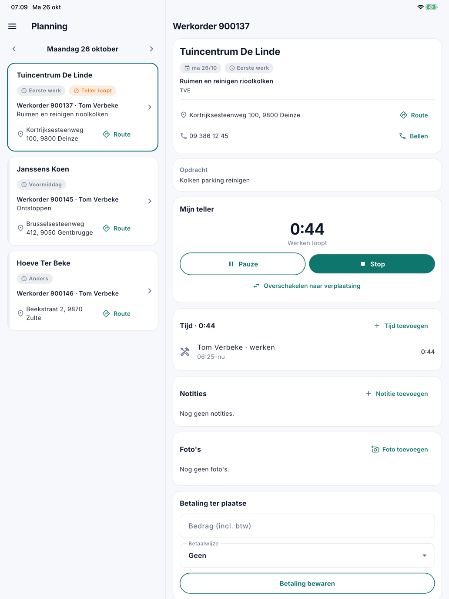
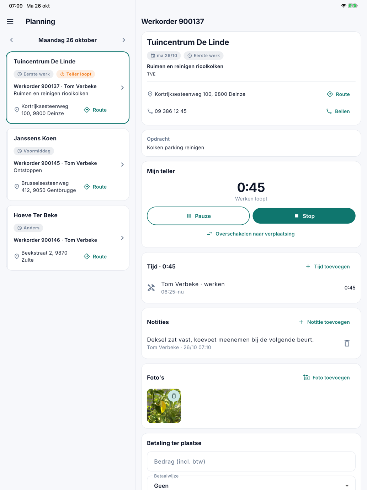
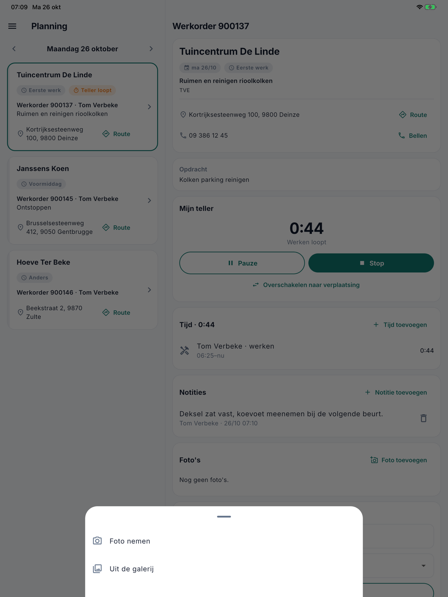
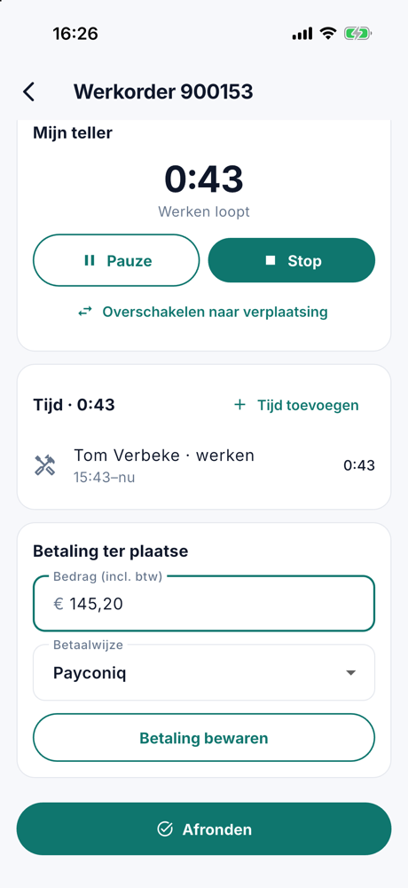

# De werkorder

Op de werkorder registreert de medewerker zijn tijd, noteert hij wat het kantoor moet weten, neemt hij foto's en noteert
hij een betaling ter plaatse. Hoe hij de werkorder opent, leest u in [De planning](planning.md).

## De teller

Onder **Mijn teller** registreert de medewerker zijn tijd op deze werkorder:

- **Verplaatsing** of **Start werken** start de teller.
- **Pauze** en **Hervatten** onderbreken hem.
- **Overschakelen naar werken** of **Overschakelen naar verplaatsing** wisselt de soort zonder te stoppen.
- **Stop** stopt de teller.

{ width="560" }

Er loopt hoogstens één teller tegelijk. Start de medewerker een teller op een andere werkorder, dan stopt de vorige.
Vergat hij te starten of te stoppen, dan geeft hij met **Tijd toevoegen** of **Tijd rechtzetten** de tijd met de hand
in. Op kantoor ziet u alles op het tabblad [Tijd](../werkorders.md#tijd) van de werkorder.

## Notities

Onder **Notities** schrijft de medewerker op wat het kantoor of een collega moet weten: "deksel zat vast, koevoet
meenemen". Hij tikt op **Notitie toevoegen**, typt zijn tekst (hoogstens 2000 tekens) en tikt op **Bewaren**. Elke
notitie staat er met de naam van wie ze schreef en het moment. Een notitie van het kantoor staat er met **Kantoor**.

Op kantoor ziet u ze op het tabblad [Notities](../werkorders.md#notities) van de werkorder, met **door** en de naam van
de medewerker.

{ width="560" }

## Foto's

Onder **Foto's** voegt de medewerker foto's toe bij de werkorder: een verstopte afvoer vóór en na, een beschadigd
deksel. Hij tikt op **Foto toevoegen** en kiest **Foto nemen** of **Uit de galerij**. De eerste keer dat hij een foto
neemt, vraagt het toestel toegang tot de camera. Uit de galerij ziet de app enkel de foto die hij kiest.

{ width="560" }

- De app verkleint de foto vóór ze vertrekt. Zo gaat ze ook over een trage verbinding snel.
- De locatie die een toestel in een foto bewaart, wordt gewist vóór de foto bewaard wordt.
- Een tik op een foto toont ze groot, met wie ze nam en wanneer.

Op kantoor staan de foto's bij de werkorder onder [**Journaal**](../werkorders.md#journaal) › **Bijlagen**.

Zonder netwerk, bijvoorbeeld in een kelder, staat de foto meteen in de app met **Nog niet verstuurd** eronder. Ze
vertrekt vanzelf zodra er weer bereik is (zie [Zonder bereik](aan-de-slag.md#zonder-bereik)). Zolang ze wacht, kan de
medewerker ze nog verwijderen: dan vertrekt ze nooit.

## Notities en foto's verwijderen

Met het vuilbakje verwijdert de medewerker zijn eigen notities en foto's, zolang de werkorder niet afgerond is. Wat een
collega of het kantoor toevoegde, kan hij niet verwijderen. Op kantoor verwijdert wie werkorders mag bewerken elke
notitie, op het tabblad Notities; een foto verwijdert u onder Journaal › Bijlagen.

## De betaling ter plaatse

Betaalt de klant ter plaatse, dan noteert de medewerker onder **Betaling ter plaatse** het **Bedrag (incl. btw)** en de
**Betaalwijze**, en tikt hij op **Betaling bewaren**. Het bedrag en de betaalwijze staan meteen op de werkorder in
CleanOps.

{ width="560" }

Daaronder staan de knoppen om af te ronden: zie [Laten tekenen](laten-tekenen.md).

## Veelgestelde vragen

**Waar vind ik de foto's van een medewerker?**
Op de werkorder, onder **Journaal** › **Bijlagen**. Ze heten *Foto* (of *Photo* als de app van de medewerker in het
Frans staat), gevolgd door het nummer van de werkorder en het moment, bijvoorbeeld *Foto 900149 2026-10-25 20.58.30.jpg*.

**Een medewerker kan geen foto nemen.**
Gaf hij de app de eerste keer geen toegang tot de camera, dan zet hij dat aan in de instellingen van zijn toestel, bij
de app CleanOps. Een foto uit de galerij kiezen kan intussen wel.

**De tijd in de app klopt niet.**
Zet ze recht op het tabblad [Tijd](../werkorders.md#tijd) van de werkorder, of laat de medewerker het zelf doen met
**Tijd rechtzetten**.

## Zie ook

- [Laten tekenen](laten-tekenen.md)
- [Werkorders](../werkorders.md), met de tabbladen Tijd en Notities
