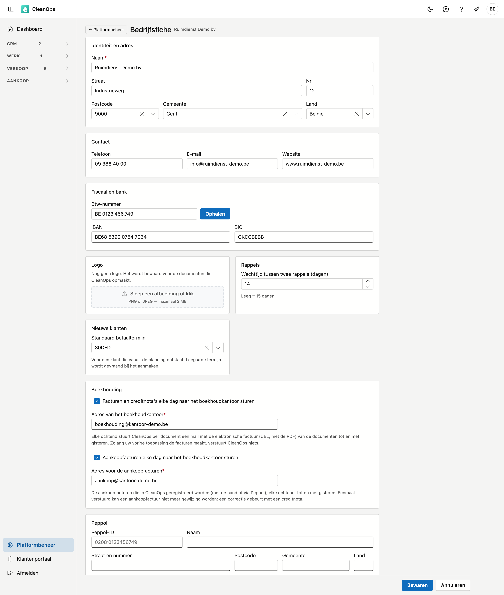
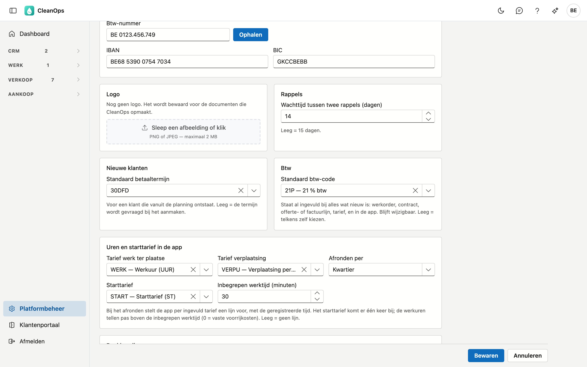
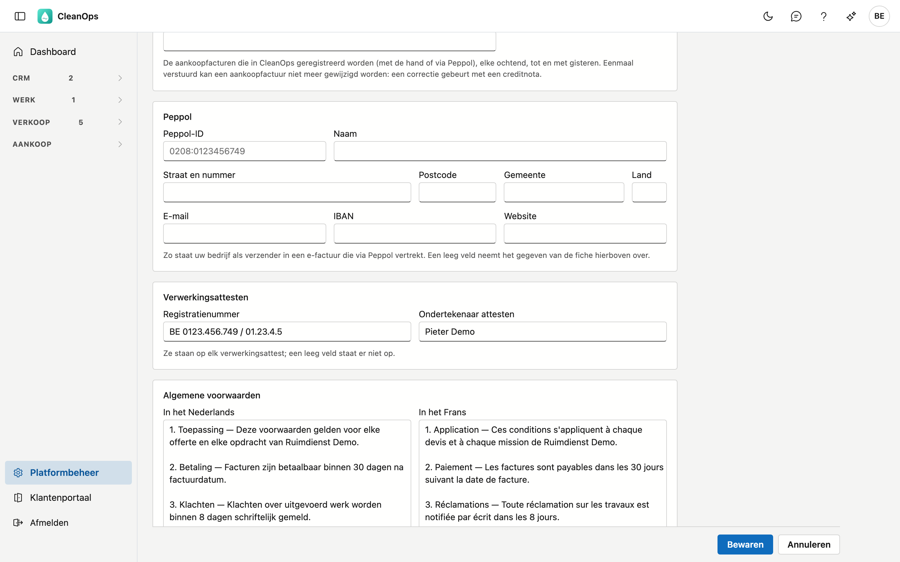

# Bedrijfsfiche

De gegevens van uw eigen bedrijf: naam, adres, contactgegevens, btw-nummer en bank, uw logo, de wachttijd
tussen twee rappels, de btw-code die al ingevuld staat, de uren die de app aanrekent, en hoe uw bedrijf in een
e-factuur via Peppol staat.

!!! note "Waar CleanOps deze gegevens vandaag gebruikt"
    De **wachttijd tussen twee rappels** bepaalt meteen welke posten in de lijst *Volgende rappel* van de
    openstaande posten staan.

    Naam, adres, contact, btw-nummer, IBAN, BIC en logo vormen het **briefhoofd** van de facturen, creditnota's,
    offertes, rappelbrieven en attesten die u in CleanOps afdrukt of mailt — zie [Facturen](../facturen.md#afdrukken).

    De **algemene voorwaarden** komen op een eigen blad achteraan elke factuur en offerte — zie
    [Algemene voorwaarden](#algemene-voorwaarden).

## Het scherm openen

Klik onderaan in het menu op **Platformbeheer** en daarna op de tegel **Bedrijfsfiche**.

## Identiteit en adres

De **naam** is verplicht, maximaal 60 tekens. Het is de naam zoals ze op uw eigen documenten hoort — uw
briefhoofd. Ze staat los van de naam waaronder ADM-Concept u kent.

Daaronder straat, nummer, postcode, gemeente en land. Postcode en gemeente vullen elkaar aan: kiest u een
postcode, dan verschijnt de gemeente vanzelf. Het veld Gemeente biedt daarna de plaatsen van die postcode aan —
voor 9800 bijvoorbeeld Deinze, Astene, Vinkt en de andere deelgemeenten. U mag ook zelf een naam typen. Het land
is een keuzelijst.

Het land van uw bedrijf is ook het land waarmee elk nieuw adres begint: bij een nieuwe klant, een nieuw adres van een
klant, een leverancier, een medewerker, een verwerkingsbedrijf en een nieuwe klant vanuit de planning staat het al
ingevuld. Per adres kiest u een ander land.

## Contact

Telefoon, e-mail en website. CleanOps controleert bij het bewaren of een ingevuld nummer en e-mailadres geldig
zijn. Leeg laten mag; half ingevuld niet.

## Fiscaal en bank

Het **btw-nummer** hoort op elke factuur. CleanOps controleert het controlecijfer van een Belgisch nummer en
bewaart het in de vaste schrijfwijze, bijvoorbeeld `BE 0123.456.749`. Naast het veld staat **Ophalen**: die knop
zoekt het nummer op in de Kruispuntbank van Ondernemingen en vult uw adres aan met wat daar geregistreerd staat.

!!! note "Komt er niets terug?"
    Het scherm zegt waarom. *"De KBO kent dit nummer niet"*: het nummer is opgezocht en staat er niet in —
    controleer het. *"De KBO-opzoeking is even niet bereikbaar"*: er is niets opgezocht; probeer het later
    opnieuw. In beide gevallen kunt u het adres ook met de hand invullen.

Uw naam wordt bij het ophalen **niet** overschreven.

De **IBAN** wordt eveneens op zijn controlecijfer nagekeken en in groepjes van vier bewaard
(`BE68 5390 0754 7034`). Daarnaast de **BIC**. Het SEPA-bestand van het [betalingsvoorstel](../betalingsvoorstel.md)
betaalt uw leveranciers vanaf deze IBAN.

## Logo

Sleep een afbeelding in het vak, of klik erop om er een te kiezen. Toegestaan zijn **PNG en JPEG**, tot 2 MB.
Om een logo te vervangen, kiest u gewoon een nieuwe afbeelding. Met **Verwijderen** haalt u het definitief weg.

## Rappels

**Wachttijd tussen twee rappels** bepaalt hoeveel dagen er minstens tussen twee herinneringen voor dezelfde post
zitten: een post komt pas opnieuw in de lijst *Volgende rappel* wanneer zijn laatste rappel zo lang geleden is.
Laat u het veld leeg, dan geldt 15 dagen.

## Nieuwe klanten

**Standaard betaaltermijn** geldt voor een klant die u [vanuit de planning](../planning.md#een-klant-aan-de-lijn-nieuwe-werkorder)
aanmaakt: aan de telefoon vraagt niemand ernaar, en zonder betaaltermijn kan CleanOps geen factuur maken. Laat u het veld leeg,
dan vraagt het paneel de betaaltermijn bij elke nieuwe klant. Op de klantfiche kiest u later een andere.

## Btw

De **Standaard btw-code** staat al ingevuld bij alles wat u nieuw maakt: een werkorder, een contract, een offerte- of
factuurlijn, een tarief, en in de [app](../app/werkorder.md#materiaal-en-uren). Daar wijzigt u ze telkens. U kiest uit
de actieve [btw-codes](btw-codes.md). Laat u het veld leeg, dan kiest u de btw-code telkens zelf.

Materiaal dat een medewerker in de app toevoegt, krijgt de btw-code van het tarief. Heeft het tarief er geen, dan krijgt
het de standaard btw-code.

## Uren en starttarief in de app

Vóór een medewerker in de app een werkorder afrondt of de klant laat tekenen, stelt de app lijnen voor uit de tijd die de
ploeg op die werkorder registreerde (zie [Materiaal en uren](../app/werkorder.md#materiaal-en-uren)). Hier kiest u welke
tarieven dat zijn en hoe er afgerond wordt.

| Veld | Wat u invult |
|---|---|
| **Tarief werk ter plaatse** | het tarief voor de werktijd, bijvoorbeeld een uurtarief. |
| **Tarief verplaatsing** | het tarief voor de verplaatsingstijd. Het mag hetzelfde tarief zijn als voor het werk, of een ander. |
| **Afronden per** | kwartier, half uur of uur. Een begonnen blok telt volledig: 61 minuten met afronden per kwartier wordt 1,25 uur. |
| **Starttarief** | een tarief dat één keer per werkorder bijkomt, bijvoorbeeld voorrijkosten of een minimumtarief. |
| **Inbegrepen werktijd (minuten)** | de werktijd die in het starttarief zit. De werkuren tellen pas boven deze tijd. Kan enkel met een starttarief. |

Een voorbeeld: Starttarief met 30 minuten inbegrepen werktijd, afronden per kwartier. De ploeg werkte 1 uur 10 en reed
20 minuten. De app stelt voor:

- **Starttarief**, 1 keer;
- **Werk ter plaatse**, 0,75 uur: 70 minuten min de 30 inbegrepen is 40 minuten, afgerond 45 minuten;
- **Verplaatsing**, 0,5 uur: 20 minuten, afgerond 30 minuten.

Prijs en btw komen uit het tarief. De medewerker kan het aantal aanpassen; de lijn draagt dan *aantal aangepast*. De prijs
past hij niet aan.

- De tijd is die van **alle medewerkers samen** op de werkorder, zoals op het tabblad [Tijd](../werkorders.md#tijd).
- Een veld leeg: die lijn komt er niet. Alle velden leeg: de app stelt niets voor.
- Met 0 minuten inbegrepen werktijd is het starttarief een vaste vergoeding bovenop de uren, zoals voorrijkosten. Kost het
  starttarief evenveel als de inbegrepen tijd aan uurtarief, dan werkt het als een minimumtijd.
- Een gearchiveerd tarief wordt niet meer voorgesteld. Kies dan hier een ander.

## Boekhouding

Met **Facturen en creditnota's elke dag naar het boekhoudkantoor sturen** gaat elk document automatisch naar uw
boekhouder. Elke ochtend stuurt CleanOps per factuur of creditnota tot en met gisteren één mail naar het **adres van
het boekhoudkantoor**, met de elektronische factuur (UBL) en de PDF erin.

| Veld | Wat u invult |
|---|---|
| **Facturen en creditnota's elke dag naar het boekhoudkantoor sturen** | aan of uit. |
| **Adres van het boekhoudkantoor** | het e-mailadres waar uw boekhouder de facturen ontvangt, bijvoorbeeld de inbox van zijn boekhoudpakket. Verplicht zodra het vinkje aan staat. |
| **Aankoopfacturen elke dag naar het boekhoudkantoor sturen** | aan of uit. |
| **Adres voor de aankoopfacturen** | het e-mailadres waar uw boekhouder de aankoopfacturen ontvangt. Verplicht zodra het vinkje aan staat; mag hetzelfde zijn als hierboven. |

Met het tweede vinkje gaan ook de aankoopfacturen en -creditnota's die u in CleanOps registreert (met de hand of via
Peppol) elke ochtend naar uw boekhouder, naar een eigen adres: veel boekhoudpakketten hebben een aparte mailbox voor
aankoop. Een verstuurde aankoopfactuur kan daarna niet meer gewijzigd worden — zie
[Aankoopfacturen](../aankoopfacturen.md#naar-de-boekhouding).

!!! note "Zolang uw vorige toepassing de facturen maakt, verstuurt CleanOps niets"
    Anders kreeg uw boekhouder elke factuur twee keer. CleanOps begint pas na de overstap, en dan precies bij de
    documenten die uw vorige toepassing nog niet verstuurde.

Lukt het versturen van een document niet, dan gaat het de volgende ochtend opnieuw mee.

## Peppol

Het blok **Peppol** zegt hoe uw bedrijf als verzender in een e-factuur staat, wanneer u een factuur via Peppol verstuurt (zie
[Facturen](../facturen.md#versturen)).

| Veld | Wat u invult |
|---|---|
| **Peppol-ID** | uw adres op het Peppol-netwerk, bijvoorbeeld `0208:0123456749` — 0208 gevolgd door uw ondernemingsnummer. |
| **Naam** | de naam in de e-factuur, bijvoorbeeld uw wettelijke naam. |
| **Straat en nummer**, **Postcode**, **Gemeente**, **Land** | het adres in de e-factuur. |
| **E-mail**, **IBAN**, **Website** | uw contact en de rekening waarop de klant betaalt. |

Een leeg veld neemt het gegeven van de fiche hierboven over. Vult u niets in, dan staat uw bedrijf in de e-factuur zoals op uw
briefhoofd. Bij een overstap neemt CleanOps deze gegevens over uit uw vorige toepassing.

## Verwerkingsattesten

Het blok **Verwerkingsattesten** draagt twee gegevens die op elk [verwerkingsattest](../attesten.md) komen:

| Veld | Wat u invult |
|---|---|
| **Registratienummer** | het registratienummer dat in het briefhoofd van het attest staat, maximaal 50 tekens. |
| **Ondertekenaar attesten** | de naam onderaan het attest, na "Voor" en de naam van uw bedrijf — bijvoorbeeld *Jan Peeters, zaakvoerder*. Maximaal 60 tekens. |

Een leeg veld staat niet op het attest. Bij een overstap neemt CleanOps ze niet over: uw vorige toepassing had ze in het
sjabloon van het attest staan. Vul ze hier één keer in.

## Algemene voorwaarden

In het blok **Algemene voorwaarden** vult u de tekst van uw algemene voorwaarden in, in twee talen:

| Veld | Wat u invult |
|---|---|
| **In het Nederlands** | de voorwaarden voor uw Nederlandstalige documenten. |
| **In het Frans** | de voorwaarden voor uw Franstalige documenten. |

De tekst komt op een **eigen blad achteraan** elke [factuur](../facturen.md#afdrukken) en elke
[offerte](../offertes.md), in de taal van het document. Een creditnota krijgt dat blad niet, en een rappelbrief ook niet.
Een witregel begint een nieuwe alinea. Laat u een veld leeg, dan komt er in die taal geen blad.

## Bewaren of annuleren

**Bewaren** bewaart uw wijzigingen. **Annuleren** gooit ze weg en brengt u terug naar het platformbeheer.

## Veelgestelde vragen

**Mijn btw-nummer wordt geweigerd.**
Het controlecijfer klopt niet: de laatste twee cijfers volgen uit de rest van het nummer. Controleer het nummer
op een officieel document, of haal het op met **Ophalen**.

**Ik heb op Ophalen geklikt en mijn adres is gewijzigd.**
Dat is de bedoeling: de knop neemt het adres over zoals het in de Kruispuntbank staat. Klopt dat niet, pas het
dan met de hand aan en sla op.

**De app stelt geen uren voor.**
Kijk of er onder *Uren en starttarief in de app* een tarief ingevuld is. Komen uw werkorders nog uit uw vorige toepassing,
dan stelt de app niets voor: de lijnen kunnen daar niet bij. De medewerker heeft versie 1.4.0 van de app of later nodig.

**Ik heb de wachttijd aangepast, maar de lijst Volgende rappel verandert niet.**
Dan liggen de laatste rappels van uw posten allemaal verder terug dan de oude én de nieuwe wachttijd. Het verschil
ziet u pas bij posten die recent herinnerd werden.
