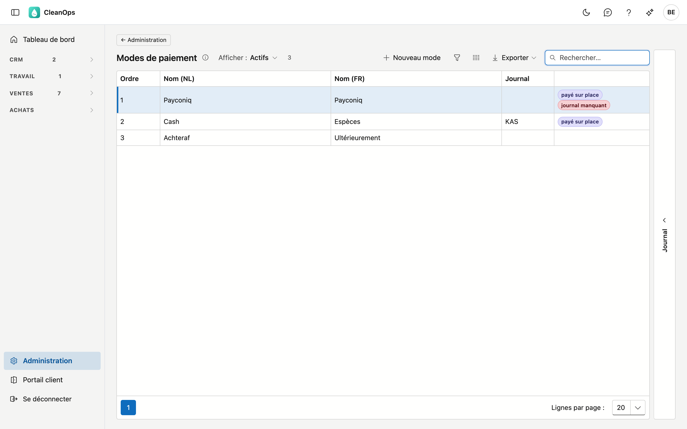
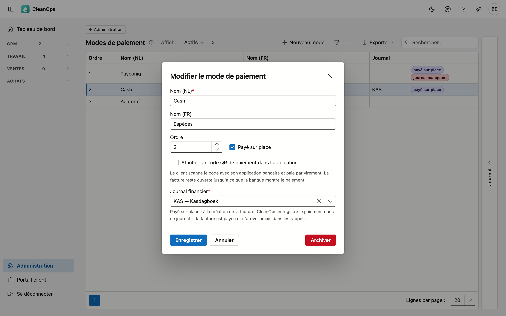

# Modes de paiement

Comment un ordre de travail est payé : Payconiq, espèces, ultérieurement ou un mode que vous ajoutez vous-même. Vous choisissez
le mode sur l'[ordre de travail](../werkorders.fr.md) ; la [facturation](../facturatie.fr.md) établit une facture distincte par
mode de paiement et l'y mentionne.

## Ouvrir l'écran

Cliquez en bas du menu sur **Administration**, puis sur la tuile **Modes de paiement**.

## La liste

| Colonne | Ce que c'est |
|---|---|
| Ordre | la place dans la liste de choix de l'ordre de travail |
| Nom (NL) / Nom (FR) | ce que vous voyez dans la liste de choix et sur la facture |
| Journal | le journal financier où est enregistré un paiement sur place |

Un mode **payé sur place** porte ce label. Si **journal manquant** figure à côté, CleanOps ne peut pas encore comptabiliser une
facture avec ce mode : choisissez d'abord le journal. Un mode qui affiche un code QR dans l'application porte le label **code QR**.

CleanOps démarre avec trois modes : **Payconiq** et **Espèces** (sur place) et **Ultérieurement**. Ils n'ont pas encore de journal.

## Ajouter ou modifier un mode de paiement

Cliquez sur **Nouveau mode**, ou double-cliquez sur une ligne existante.

| Champ | Ce que vous indiquez |
|---|---|
| **Nom (NL)** *(obligatoire)* | 40 caractères au maximum |
| **Nom (FR)** | peut rester vide ; CleanOps affiche alors le nom néerlandais |
| **Ordre** | la place dans la liste de choix |
| **Payé sur place** | à cocher si le client paie lors de l'intervention (Payconiq, espèces …) |
| **Journal financier** | obligatoire avec **payé sur place** : le journal où arrive le paiement, par exemple votre caisse |
| **Afficher un code QR de paiement dans l'application** | à cocher si le collaborateur montre au client, sur place, un code QR à payer avec son app bancaire (voir ci-dessous) ; pas avec **payé sur place** |

!!! note "Ce que fait « payé sur place »"
    À la comptabilisation de la facture, CleanOps enregistre directement le paiement dans le journal choisi, pour le montant total,
    au jour de l'intervention. La facture est alors payée : elle ne demande pas de virement et n'arrive jamais dans les rappels.
    L'impression et la facture électronique indiquent **Payé via Payconiq** (ou le nom de votre mode de paiement).

Seul un journal **financier** peut être choisi (voir [Journaux](dagboeken.fr.md)).

## Payer avec un code QR sur place

Avec **Afficher un code QR de paiement dans l'application**, le collaborateur fait payer le client sur place avec son app
bancaire. Aucune facture n'est établie sur place.

1. Le collaborateur choisit ce mode sur l'ordre de travail dans l'[application](../app/werkorder.fr.md#payer-avec-un-code-qr) et
   appuie sur **Afficher le code QR de paiement**.
2. Le client scanne le code avec son app bancaire. Le montant, votre numéro de compte et une communication structurée y sont déjà.
3. Le bureau facture l'ordre comme toujours dans la [facturation](../facturatie.fr.md#une-facture-par-mode-de-paiement). Il reçoit
   sa propre facture avec **la même communication** que le code QR : vous reconnaissez ainsi le paiement sur votre compte.

!!! note "Pourquoi pas payé sur place"
    Seule votre banque voit si le client a vraiment payé. C'est pourquoi CleanOps n'enregistre **rien** sur place avec ce mode :
    la facture reste ouverte jusqu'à ce que le paiement arrive sur votre compte. Si le client ne paie pas, la facture suit les
    rappels habituels. Il n'y a rien à annuler.

Ce dont le code QR a besoin :

- votre **nom** et un **IBAN** valable sur la [fiche de l'entreprise](bedrijfsfiche.fr.md) ;
- un **montant** et un **code TVA** sur l'ordre de travail. Le montant du code QR est le total de l'ordre **TVA comprise**, avec
  les lignes supplémentaires.

Si l'ordre est déjà facturé, l'application n'affiche pas de code QR : le client paie alors avec le code QR de la facture.

## Le journal

À droite de l'écran se trouve une bande **Journal**. Sélectionnez un mode de paiement et ouvrez la bande : le panneau montre qui
l'a créé, modifié, archivé ou rétabli, et quand.

## Archiver ou rétablir un mode de paiement

Ouvrez la ligne et utilisez **Archiver**. Le mode disparaît de la liste de choix de l'ordre de travail, mais les ordres et les
factures qui le portent déjà le gardent. Pour le récupérer : réglez **Afficher** sur **Aussi archivés**, ouvrez-le et
cliquez sur **Rétablir**.

## Questions fréquentes

**Quelle différence avec la case « Payé en espèces, sans facture » sur l'ordre de travail ?**
Cette case vient de votre application précédente : un tel ordre ne passe **pas** en facturation. Un ordre avec un mode de
paiement, même *Espèces*, est bien facturé.

**À la facturation, je reçois « n'a pas de journal financier valable ».**
Le mode est payé sur place, mais il n'a pas de journal, ou le journal est archivé ou n'est pas un journal financier. Choisissez-le
ici et recomptabilisez. Rien n'a encore été comptabilisé.

**Un mode peut-il être à la fois payé sur place et afficher un code QR ?**
Non. Payé sur place enregistre le paiement aussitôt, alors qu'avec un code QR personne ne sait encore si la banque l'exécute.
CleanOps refuse la combinaison à l'enregistrement.

**Puis-je supprimer un mode de paiement ?**
Non : des ordres et des factures le portent. L'archiver le retire de la liste de choix sans rien toucher.
