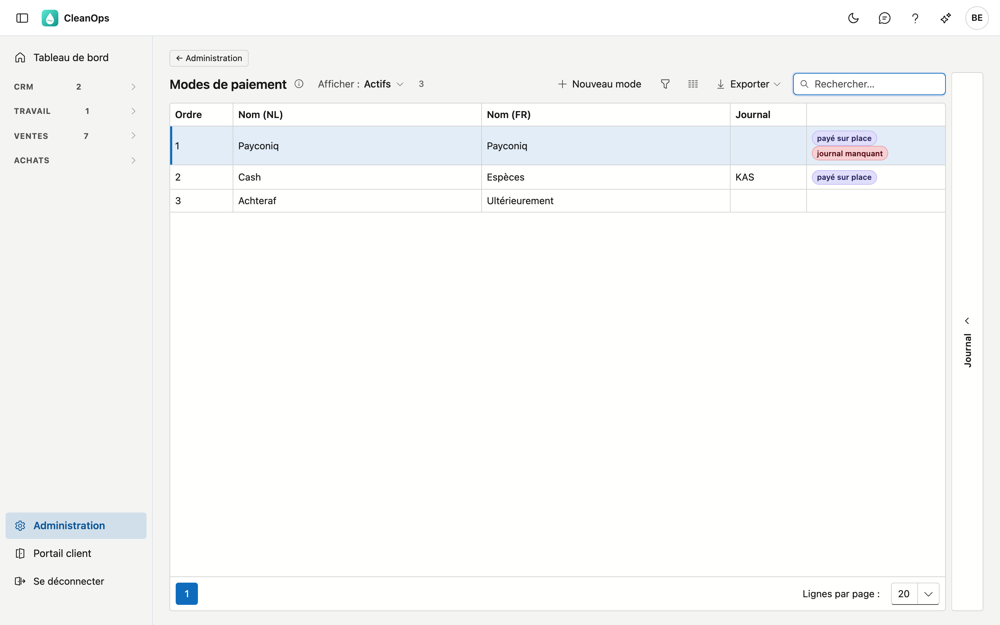
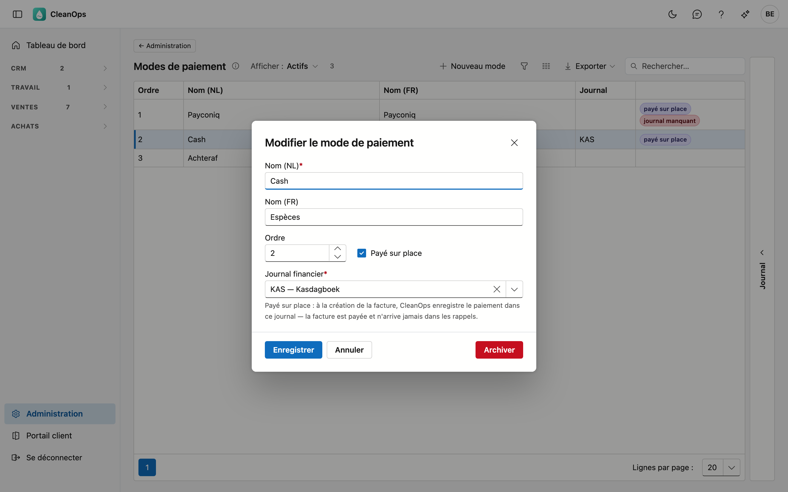

# Modes de paiement

Comment un ordre de travail est payé : Payconiq, espèces, ultérieurement ou un mode que vous ajoutez vous-même. Vous choisissez
le mode sur l'[ordre de travail](../werkorders.fr.md) ; la [facturation](../facturatie.fr.md) établit une facture distincte par
mode de paiement et l'y mentionne.

## Ouvrir l'écran

Cliquez en bas du menu sur **Administration**, puis sur la tuile **Modes de paiement**.

## La liste

| Colonne | Ce que c'est |
|---|---|
| Ordre | la place dans la liste de choix de l'ordre de travail |
| Nom (NL) / Nom (FR) | ce que vous voyez dans la liste de choix et sur la facture |
| Journal | le journal financier où est enregistré un paiement sur place |

Un mode **payé sur place** porte ce label. Si **journal manquant** figure à côté, CleanOps ne peut pas encore comptabiliser une
facture avec ce mode : choisissez d'abord le journal.

CleanOps démarre avec trois modes : **Payconiq** et **Espèces** (sur place) et **Ultérieurement**. Ils n'ont pas encore de journal.

## Ajouter ou modifier un mode de paiement

Cliquez sur **Nouveau mode**, ou double-cliquez sur une ligne existante.

| Champ | Ce que vous indiquez |
|---|---|
| **Nom (NL)** *(obligatoire)* | 40 caractères au maximum |
| **Nom (FR)** | peut rester vide ; CleanOps affiche alors le nom néerlandais |
| **Ordre** | la place dans la liste de choix |
| **Payé sur place** | à cocher si le client paie lors de l'intervention (Payconiq, espèces …) |
| **Journal financier** | obligatoire avec **payé sur place** : le journal où arrive le paiement, par exemple votre caisse |

!!! note "Ce que fait « payé sur place »"
    À la comptabilisation de la facture, CleanOps enregistre directement le paiement dans le journal choisi, pour le montant total,
    au jour de l'intervention. La facture est alors payée : elle ne demande pas de virement et n'arrive jamais dans les rappels.
    L'impression et la facture électronique indiquent **Payé via Payconiq** (ou le nom de votre mode de paiement).

Seul un journal **financier** peut être choisi (voir [Journaux](dagboeken.fr.md)).

## Le journal

À droite de l'écran se trouve une bande **Journal**. Sélectionnez un mode de paiement et ouvrez la bande : le panneau montre qui
l'a créé, modifié, archivé ou rétabli, et quand.

## Archiver ou rétablir un mode de paiement

Ouvrez la ligne et utilisez **Archiver**. Le mode disparaît de la liste de choix de l'ordre de travail, mais les ordres et les
factures qui le portent déjà le gardent. Pour le récupérer : réglez **Afficher** sur **Aussi archivés**, ouvrez-le et
cliquez sur **Rétablir**.

## Questions fréquentes

**Quelle différence avec la case « Payé en espèces, sans facture » sur l'ordre de travail ?**
Cette case vient de votre application précédente : un tel ordre ne passe **pas** en facturation. Un ordre avec un mode de
paiement, même *Espèces*, est bien facturé.

**À la facturation, je reçois « n'a pas de journal financier valable ».**
Le mode est payé sur place, mais il n'a pas de journal, ou le journal est archivé ou n'est pas un journal financier. Choisissez-le
ici et recomptabilisez. Rien n'a encore été comptabilisé.

**Puis-je supprimer un mode de paiement ?**
Non : des ordres et des factures le portent. L'archiver le retire de la liste de choix sans rien toucher.
