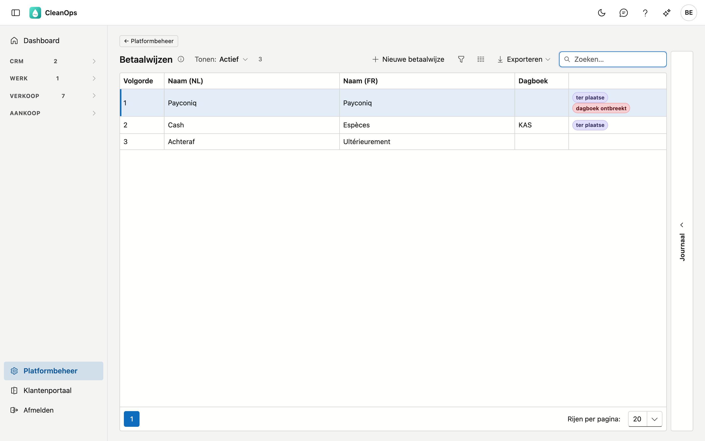
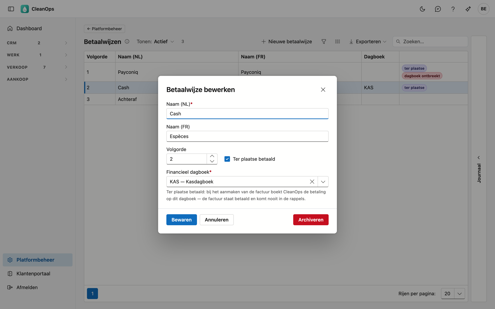

# Betaalwijzen

Hoe een werkorder betaald wordt: Payconiq, cash, achteraf of een betaalwijze die u zelf toevoegt. U kiest de betaalwijze op de
[werkorder](../werkorders.md); de [facturatie](../facturatie.md) maakt per betaalwijze een aparte factuur en vermeldt ze erop.

## Het scherm openen

Klik onderaan in het menu op **Platformbeheer** en daarna op de tegel **Betaalwijzen**.

## De lijst

| Kolom | Wat het is |
|---|---|
| Volgorde | de plaats in de keuzelijst op de werkorder |
| Naam (NL) / Naam (FR) | wat u in de keuzelijst en op de factuur ziet |
| Dagboek | het financieel dagboek waarop een betaling ter plaatse geboekt wordt |

Een betaalwijze **ter plaatse** draagt dat label. Staat er **dagboek ontbreekt** naast, dan kan CleanOps een factuur met
die betaalwijze nog niet boeken: kies eerst het dagboek.

CleanOps start met drie betaalwijzen: **Payconiq** en **Cash** (ter plaatse) en **Achteraf**. Ze hebben nog geen dagboek.

## Een betaalwijze toevoegen of wijzigen

Klik op **Nieuwe betaalwijze**, of dubbelklik op een bestaande rij.

| Veld | Wat u invult |
|---|---|
| **Naam (NL)** *(verplicht)* | maximaal 40 tekens |
| **Naam (FR)** | mag leeg blijven; dan toont CleanOps de Nederlandse naam |
| **Volgorde** | de plaats in de keuzelijst |
| **Ter plaatse betaald** | aanvinken als de klant betaalt bij het werk (Payconiq, cash …) |
| **Financieel dagboek** | verplicht bij **ter plaatse betaald**: het dagboek waarop de betaling komt, bijvoorbeeld uw kas |

!!! note "Wat ter plaatse betaald doet"
    Bij het boeken van de factuur boekt CleanOps meteen de betaling op het gekozen dagboek, voor het volle bedrag, op de dag
    van het werk. De factuur staat dan betaald: ze vraagt geen overschrijving en komt nooit in de rappels. Op de afdruk en op
    de e-factuur staat **Betaald via Payconiq** (of de naam van uw betaalwijze).

Enkel een **financieel** dagboek kan gekozen worden (zie [Dagboeken](dagboeken.md)).

## Het journaal

Rechts op het scherm zit een strook **Journaal**. Klik een betaalwijze aan en open de strook: het paneel toont wie ze wanneer
aangemaakt, gewijzigd, gearchiveerd of teruggehaald heeft.

## Een betaalwijze archiveren of terughalen

Open de rij en gebruik **Archiveren**. De betaalwijze verdwijnt uit de keuzelijst op de werkorder, maar werkorders en facturen
die ze al dragen, houden ze. Wilt u ze terug? Zet bovenaan **Tonen** op **Ook gearchiveerd**, open ze en klik op
**Terughalen**.

## Veelgestelde vragen

**Wat is het verschil met het vinkje "Contant betaald, niet factureren" op de werkorder?**
Dat vinkje komt uit uw vorige toepassing: zo'n werkorder gaat **niet** naar de facturatie. Een werkorder met een
betaalwijze, ook *Cash*, wordt wél gefactureerd.

**Bij het factureren krijg ik "heeft geen geldig financieel dagboek".**
De betaalwijze is ter plaatse betaald, maar er staat geen dagboek bij, of het dagboek is gearchiveerd of geen financieel
dagboek. Kies het hier, en boek opnieuw. Er is dan nog niets geboekt.

**Kan ik een betaalwijze verwijderen?**
Nee: werkorders en facturen dragen ze. Archiveren haalt ze uit de keuzelijst zonder iets te raken.
