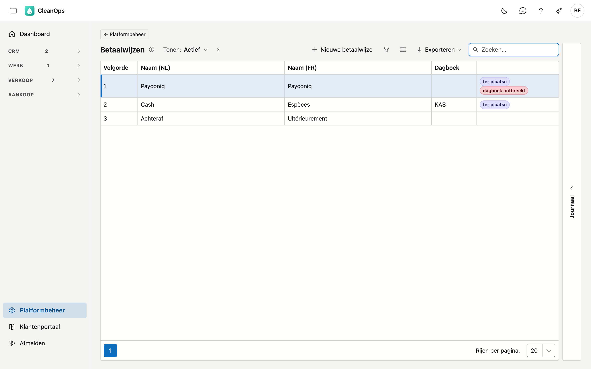
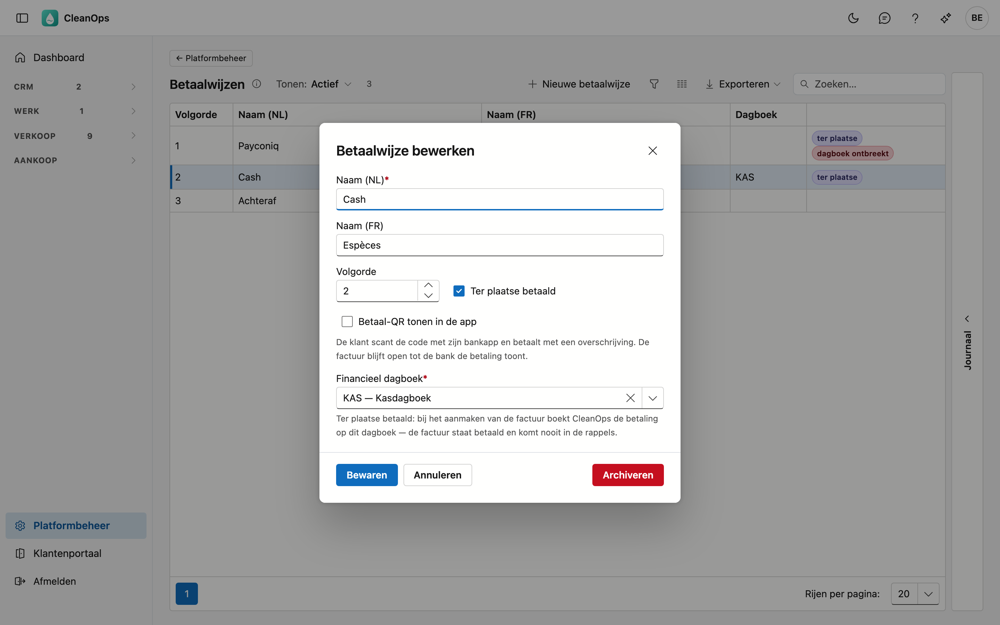

# Betaalwijzen

Hoe een werkorder betaald wordt: Payconiq, cash, achteraf of een betaalwijze die u zelf toevoegt. U kiest de betaalwijze op de
[werkorder](../werkorders.md); de [facturatie](../facturatie.md) maakt per betaalwijze een aparte factuur en vermeldt ze erop.

## Het scherm openen

Klik onderaan in het menu op **Platformbeheer** en daarna op de tegel **Betaalwijzen**.

## De lijst

| Kolom | Wat het is |
|---|---|
| Volgorde | de plaats in de keuzelijst op de werkorder |
| Naam (NL) / Naam (FR) | wat u in de keuzelijst en op de factuur ziet |
| Dagboek | het financieel dagboek waarop een betaling ter plaatse geboekt wordt |

Een betaalwijze **ter plaatse** draagt dat label. Staat er **dagboek ontbreekt** naast, dan kan CleanOps een factuur met
die betaalwijze nog niet boeken: kies eerst het dagboek. Een betaalwijze die in de app een QR toont, draagt het label **betaal-QR**.

CleanOps start met drie betaalwijzen: **Payconiq** en **Contant** (ter plaatse) en **Achteraf**. Ze hebben nog geen dagboek.
In een omgeving die vóór 6 november 2026 aangemaakt is, heet Contant nog **Cash**; de naam wijzigt u zoals hieronder.

## Een betaalwijze toevoegen of wijzigen

Klik op **Nieuwe betaalwijze**, of dubbelklik op een bestaande rij.

| Veld | Wat u invult |
|---|---|
| **Naam (NL)** *(verplicht)* | maximaal 40 tekens |
| **Naam (FR)** | mag leeg blijven; dan toont CleanOps de Nederlandse naam |
| **Volgorde** | de plaats in de keuzelijst |
| **Ter plaatse betaald** | aanvinken als de klant betaalt bij het werk (Payconiq, cash …) |
| **Financieel dagboek** | verplicht bij **ter plaatse betaald**: het dagboek waarop de betaling komt, bijvoorbeeld uw kas |
| **Betaal-QR tonen in de app** | aanvinken als de medewerker de klant op het werk een QR toont om met zijn bankapp te betalen (zie hieronder); niet samen met **ter plaatse betaald** |

!!! note "Wat ter plaatse betaald doet"
    Bij het boeken van de factuur boekt CleanOps meteen de betaling op het gekozen dagboek, voor het volle bedrag, op de dag
    van het werk. De factuur staat dan betaald: ze vraagt geen overschrijving en komt nooit in de rappels. Op de afdruk en op
    de e-factuur staat **Betaald via Payconiq** (of de naam van uw betaalwijze).

Enkel een **financieel** dagboek kan gekozen worden (zie [Dagboeken](dagboeken.md)).

## Betalen met een QR op het werk

Met **Betaal-QR tonen in de app** laat de medewerker de klant op het werk betalen met zijn bankapp. Er wordt ter plaatse geen
factuur gemaakt.

1. De medewerker kiest die betaalwijze op de werkorder in de [app](../app/werkorder.md#betalen-met-een-qr) en tikt op
   **Betaal-QR tonen**.
2. De klant scant de QR met zijn bankapp. Het bedrag, uw rekeningnummer en een gestructureerde mededeling staan er al in.
3. Kantoor factureert de werkorder zoals altijd in de [facturatie](../facturatie.md#per-betaalwijze-een-factuur). Ze krijgt een
   eigen factuur met **dezelfde mededeling** als de QR, zodat u de betaling op uw rekening aan die factuur herkent.

!!! note "Waarom niet ter plaatse betaald"
    Of de klant echt betaald heeft, ziet pas uw bank. Daarom boekt CleanOps bij zo'n betaalwijze **niets** ter plaatse: de
    factuur blijft open tot de betaling op uw rekening staat. Betaalt de klant niet, dan volgt de factuur de gewone
    herinneringen. Er hoeft niets teruggedraaid te worden.

Wat de QR nodig heeft:

- uw **naam** en een geldig **IBAN** op de [bedrijfsfiche](bedrijfsfiche.md);
- een **bedrag** en een **btw-code** op de werkorder. Het bedrag in de QR is het totaal van de werkorder **inclusief btw**, met
  de bijkomende lijnen.

Is de werkorder al gefactureerd, dan toont de app geen QR: de klant betaalt dan met de QR op de factuur.

## Het journaal

Rechts op het scherm zit een strook **Journaal**. Klik een betaalwijze aan en open de strook: het paneel toont wie ze wanneer
aangemaakt, gewijzigd, gearchiveerd of teruggehaald heeft.

## Een betaalwijze archiveren of terughalen

Open de rij en gebruik **Archiveren**. De betaalwijze verdwijnt uit de keuzelijst op de werkorder, maar werkorders en facturen
die ze al dragen, houden ze. Wilt u ze terug? Zet bovenaan **Tonen** op **Ook gearchiveerd**, open ze en klik op
**Terughalen**.

## Veelgestelde vragen

**Wat is het verschil met het vinkje "Contant betaald, niet factureren" op de werkorder?**
Dat vinkje komt uit uw vorige toepassing: zo'n werkorder gaat **niet** naar de facturatie. Een werkorder met een
betaalwijze, ook *Contant*, wordt wél gefactureerd.

**Bij het factureren krijg ik "heeft geen geldig financieel dagboek".**
De betaalwijze is ter plaatse betaald, maar er staat geen dagboek bij, of het dagboek is gearchiveerd of geen financieel
dagboek. Kies het hier, en boek opnieuw. Er is dan nog niets geboekt.

**Kan een betaalwijze tegelijk ter plaatse betaald zijn en een betaal-QR tonen?**
Nee. Ter plaatse betaald boekt de betaling meteen, terwijl bij een betaal-QR nog niemand weet of de bank ze uitvoert. CleanOps
weigert de combinatie bij het bewaren.

**Kan ik een betaalwijze verwijderen?**
Nee: werkorders en facturen dragen ze. Archiveren haalt ze uit de keuzelijst zonder iets te raken.
