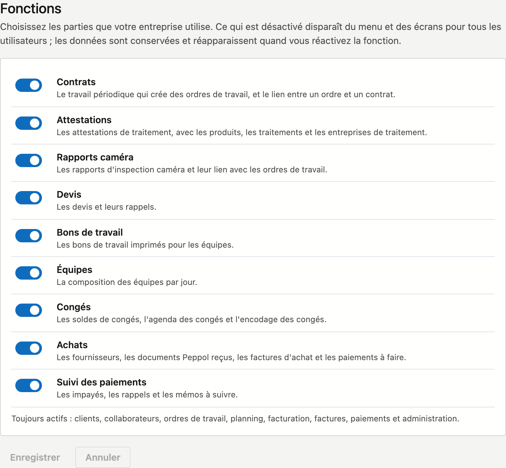

# Fonctions

Toutes les entreprises n'utilisent pas tout ce que CleanOps propose. Si vous ne travaillez pas avec des attestations ou
des devis, vous les désactivez ici. Ils disparaissent alors du menu pour toute votre entreprise, et vos collègues ne
voient que ce dont ils ont besoin.

## Ouvrir l'écran

Dans la barre latérale, cliquez sur **Administration**, puis, sous **Accès**, sur la tuile **Fonctions**. Vous ne voyez
cette tuile qu'avec le droit **Gérer les données de base**.

## Désactiver ou activer une fonction

1. Cliquez sur l'interrupteur à côté de la fonction. Sous chaque nom figure ce qui fait partie de cette fonction.
2. Cliquez sur **Enregistrer**. L'écran se recharge et affiche **Enregistré. Le menu suit vos choix.**

**Annuler** remet les interrupteurs tels qu'ils sont enregistrés.

Vous pouvez désactiver ces parties :

| Fonction | Ce qui en fait partie |
|---|---|
| Contrats | Le travail périodique qui crée des ordres de travail |
| Attestations | Les attestations de traitement, avec les produits, les traitements et les entreprises de traitement |
| Rapports caméra | Les rapports d'inspection caméra |
| Devis | Les devis et leurs rappels |
| Bons de travail | Les bons de travail imprimés pour les équipes |
| Équipes | La composition des équipes par jour |
| Congés | Les soldes de congés et l'agenda des congés |
| Achats | Les fournisseurs, les documents Peppol reçus, les factures d'achat, les impayés fournisseurs et la proposition de paiement |
| Suivi des paiements | Les impayés, les rappels et les mémos à suivre |

Les clients, les collaborateurs, les ordres de travail, le planning, la facturation, les factures, les paiements et
l'administration restent **toujours actifs**.

## Ce qui se passe quand une fonction est désactivée

- Les écrans de cette fonction disparaissent du **menu**, et leurs tuiles de l'**Administration**.
- Sur les autres écrans aussi, ce qui fait partie de la fonction disparaît. Quelques exemples :
    - **Contrats** désactivé : pas d'onglet Contrats sur la fiche client, pas de ligne Contrat sur l'ordre de travail et pas
      de filtre Contrat dans la liste du planning.
    - **Attestations** désactivé : pas de cases à cocher d'attestation sur l'ordre de travail, pas de signaux d'attestation
      dans la Facturation et pas d'attestations à joindre au mail d'une facture.
    - **Congés** désactivé : pas d'onglet Congés sur la fiche du collaborateur et pas de bouton **Réserver un congé** dans
      Équipes.
    - **Achats** désactivé : Paiements n'affiche que les paiements des clients.
    - Le **tableau de bord** n'affiche plus les tuiles et les cartes d'une fonction désactivée.
- Si quelqu'un ouvre malgré tout un ancien lien ou un favori vers un tel écran, il voit **Cette fonction est désactivée**.
- **Rien n'est effacé.** Si vous réactivez la fonction, tout réapparaît tel quel.
- Un collègue déjà au travail voit le changement dès qu'il actualise son écran.
- Chaque modification est inscrite au [Journal des actions](actielogboek.md), avec son auteur.

!!! note "Masquer, pas une règle d'accès"
    Les fonctions valent pour **toute l'entreprise**. Ce qu'un collègue peut voir ou modifier se règle dans
    [Rôles](rollen.md). Une fonction active n'est donc visible que pour qui en a aussi le droit.

!!! warning "Ce qui tourne continue de tourner"
    Désactiver ne fait que masquer. Un contrat en cours crée toujours ses ordres de travail. Pour qu'un contrat
    s'arrête, cochez **En pause** sur la fiche du contrat ou indiquez une **Fin**, avant de désactiver **Contrats**.

## Voir aussi

- [Rôles](rollen.md)
- [Administration](../platformbeheer.md)
