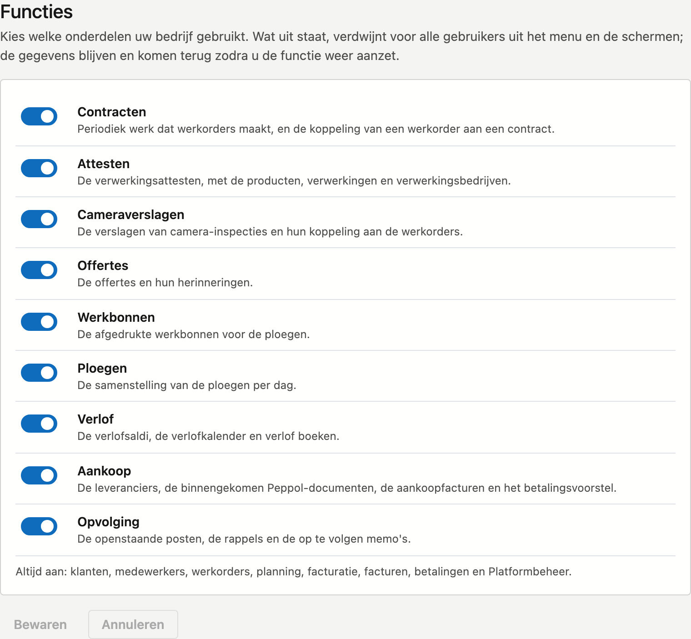

# Functies

Niet elk bedrijf gebruikt alles wat CleanOps kan. Werkt u niet met attesten of offertes, dan zet u die hier uit.
Ze verdwijnen dan voor iedereen in uw bedrijf uit het menu, zodat uw collega's enkel zien wat ze nodig hebben.

## Het scherm openen

Klik in de zijbalk op **Platformbeheer** en daarna, onder **Toegang**, op de tegel **Functies**. U ziet de tegel
enkel met het recht **Stamgegevens beheren**.

## Een functie uit- of aanzetten

1. Klik op de schakelaar naast de functie. Onder elke naam staat wat er bij die functie hoort.
2. Klik op **Bewaren**. Het scherm laadt opnieuw en meldt **Bewaard. Het menu volgt uw keuzes.**

Met **Annuleren** zet u de schakelaars terug zoals ze bewaard zijn.

U kunt deze onderdelen uitzetten:

| Functie | Wat erbij hoort |
|---|---|
| Contracten | Het periodieke werk dat werkorders maakt |
| Attesten | De verwerkingsattesten, met de producten, verwerkingen en verwerkingsbedrijven |
| Cameraverslagen | De verslagen van camera-inspecties |
| Offertes | De offertes en hun herinneringen |
| Werkbonnen | De afgedrukte werkbonnen voor de ploegen |
| Ploegen | De samenstelling van de ploegen per dag |
| Verlof | De verlofsaldi en de verlofkalender |
| Aankoop | De leveranciers, de binnengekomen Peppol-documenten, de aankoopfacturen, het openstaande bij leveranciers en het betalingsvoorstel |
| Opvolging | De openstaande posten, de rappels en de op te volgen memo's |

Klanten, medewerkers, werkorders, planning, facturatie, facturen, betalingen en Platformbeheer staan **altijd aan**.

## Wat er gebeurt als een functie uit staat

- De schermen van die functie verdwijnen uit het **menu** en hun tegels uit **Platformbeheer**.
- Opent iemand toch een oude link of bladwijzer naar zo'n scherm, dan ziet hij **Deze functie staat uit**.
- **Er wordt niets gewist.** Zet u de functie weer aan, dan staat alles er terug zoals het was.
- Een collega die al aan het werk is, ziet de wijziging zodra hij zijn scherm vernieuwt.
- Elke wijziging komt in het [Actielogboek](actielogboek.md), met wie ze deed.

!!! note "Verbergen, geen toegangsregel"
    Functies gelden voor **het hele bedrijf**. Wat één collega mag zien of bewerken, regelt u in
    [Rollen](rollen.md). Een functie die aan staat, ziet iemand dus pas als hij er ook het recht voor heeft.

!!! warning "Wat al loopt, loopt door"
    Uitzetten verbergt enkel. Een contract dat al loopt, maakt nog altijd zijn werkorders. Wilt u dat een contract
    stopt, vink dan op de contractfiche **On hold** aan of vul een **Einde** in, vóór u **Contracten** uitzet.

## Zie ook

- [Rollen](rollen.md)
- [Platformbeheer](../platformbeheer.md)
