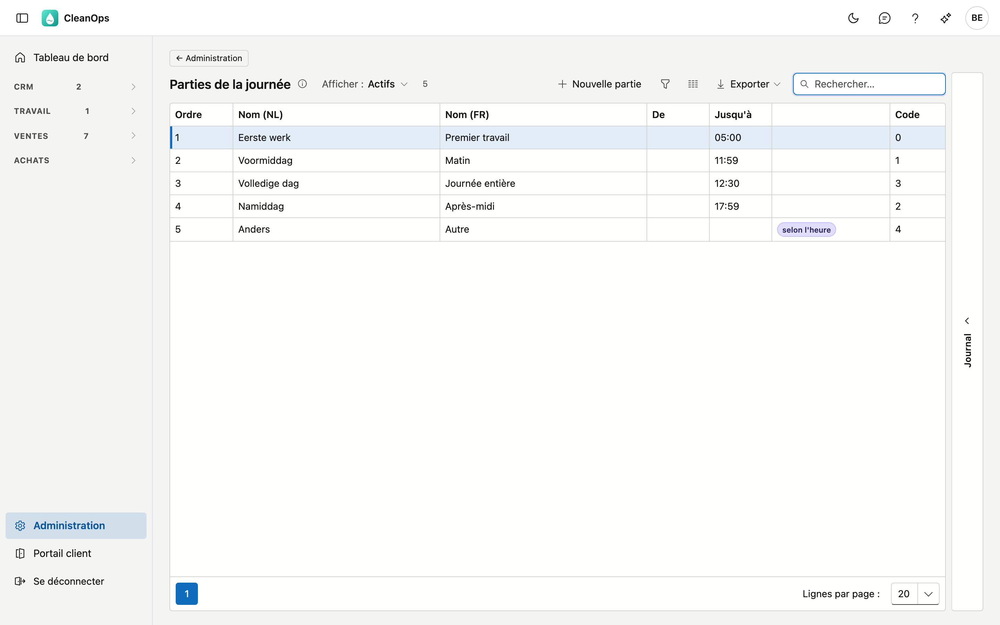
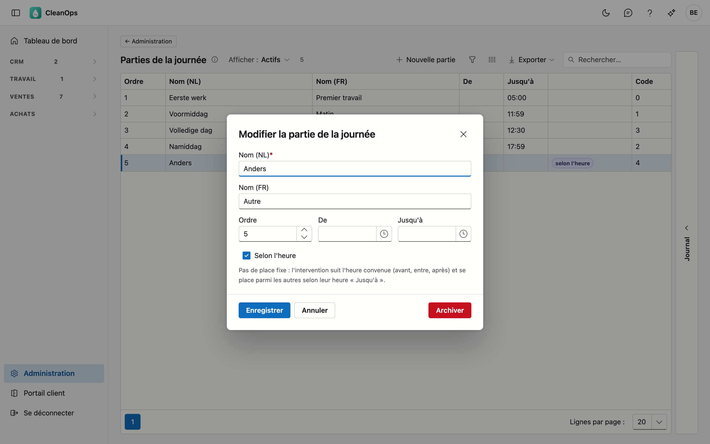

# Parties de la journée

Quand une intervention a lieu dans la journée : premier travail, matin, journée entière, après-midi … Vous choisissez la partie de
la journée sur l'[ordre de travail](../werkorders.fr.md#planification-et-execution) ou sur un [contrat](../contracten.fr.md). Le
[planning](../planning.fr.md) et le [bon de travail](../werkbonnen.fr.md) placent les ordres d'une journée dans l'ordre de cette
liste.

## Ouvrir l'écran

Cliquez sur **Administration** en bas du menu, puis sur la tuile **Parties de la journée**.

## La liste

| Colonne | Ce que c'est |
|---|---|
| Ordre | la place sur le planning, sur le bon de travail et dans la liste de choix de l'ordre de travail |
| Nom (NL) / Nom (FR) | ce que vous voyez sur le planning, le bon de travail et l'ordre de travail |
| De / Jusqu'à | à partir de quand et jusqu'à quand court la partie de la journée |
| Code | le numéro que porte un ordre de travail ; il ne change jamais |

Une partie **selon l'heure** porte ce label (voir plus loin). Une partie archivée porte **archivé**.

CleanOps démarre avec cinq parties de la journée : **Premier travail**, **Matin**, **Journée entière**, **Après-midi** et
**Autre**, qui fonctionne selon l'heure. Vous pouvez les renommer, changer leur ordre ou en ajouter, par exemple *8–10* et
*10–12*.

## Ajouter ou modifier une partie de la journée

Cliquez sur **Nouvelle partie**, ou double-cliquez sur une ligne existante. Une nouvelle partie vient en dernier ;
pour la placer entre deux autres, adaptez l'ordre.

| Champ | Ce que vous indiquez |
|---|---|
| **Nom (NL)** *(obligatoire)* | 40 caractères au maximum. Pour voir les heures sur le planning, mettez-les dans le nom : *Matin 8–10* |
| **Nom (FR)** | peut rester vide ; CleanOps affiche alors le nom néerlandais |
| **Ordre** | la place sur le planning, le bon de travail et dans la liste de choix |
| **De** | à partir de quand ; à titre d'information |
| **Jusqu'à** | jusqu'à quand ; doit être après **De**. Détermine aussi où vient une intervention **selon l'heure** |
| **Selon l'heure** | à cocher pour la partie des rendez-vous à heure fixe |

!!! note "Ce que fait « selon l'heure »"
    Une partie selon l'heure n'a pas de place fixe dans la journée. Un ordre de travail avec cette partie suit l'heure convenue
    (*avant*, *entre* ou *après*) et vient avant la première partie fixe dont l'heure **Jusqu'à** est plus tardive. Un
    rendez-vous *Avant 11:00* vient ainsi avant **Matin** (jusqu'à 11:59). Sans heure convenue, midi compte. Sur le bon de
    travail, un tel ordre affiche l'accord d'heure, pas le nom de la partie.

## Le journal

À droite de l'écran se trouve une bande **Journal**. Sélectionnez une partie de la journée et ouvrez la bande : le panneau montre
qui l'a créée, modifiée, archivée ou rétablie, et quand.

## Archiver ou rétablir une partie de la journée

Ouvrez la ligne et utilisez **Archiver**. La partie disparaît de la liste de choix, mais les ordres de travail qui la portent déjà
la gardent et affichent toujours son nom. Vous la voulez de retour ? Réglez en haut **Afficher** sur **Aussi les parties
archivées**, ouvrez-la et cliquez sur **Rétablir**.

## Questions fréquentes

**Pourquoi y a-t-il des heures comme 11:59 et 12:30 sous Jusqu'à ?**
Pour les cinq parties avec lesquelles CleanOps démarre, ce sont des limites et non des heures de travail : elles déterminent
seulement où un ordre selon l'heure vient se placer parmi les autres.

**Je modifie un nom ou l'ordre. Qu'arrive-t-il aux ordres de travail existants ?**
Un ordre de travail porte le code de la partie de la journée. Il affiche donc tout de suite le nouveau nom, et le planning suit
tout de suite le nouvel ordre. Ce que le planificateur a placé à la main (⇅) reste en place.

**Puis-je supprimer une partie de la journée ?**
Non : des ordres de travail la portent. Archiver la retire de la liste de choix sans rien toucher.
