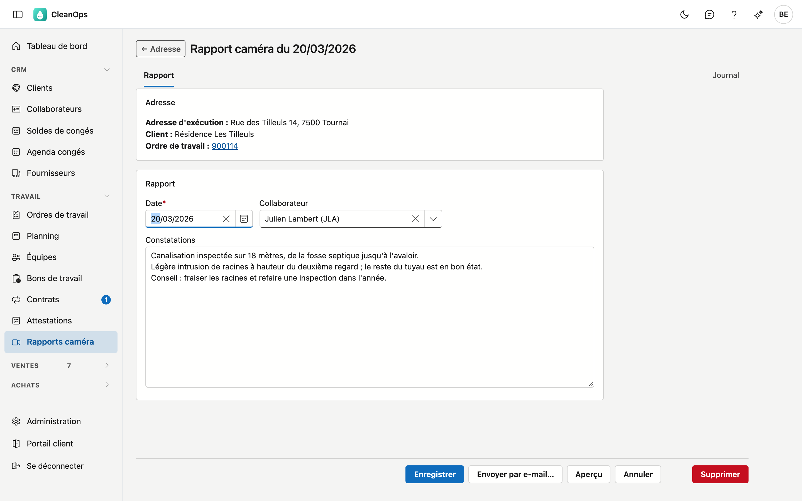
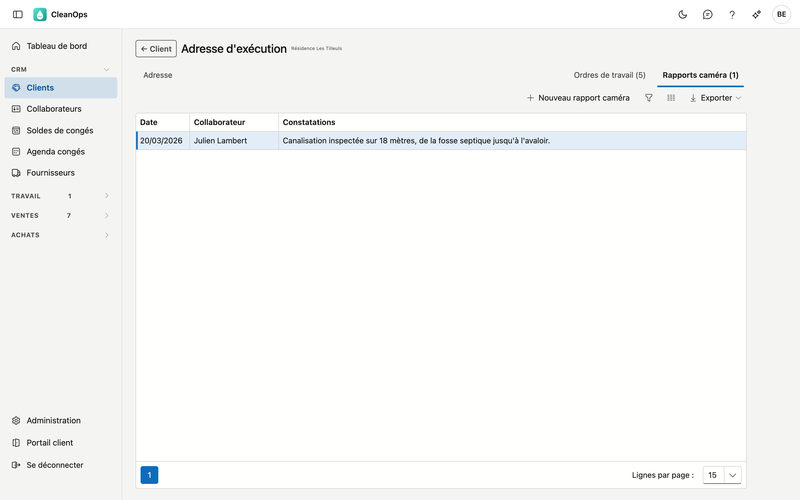
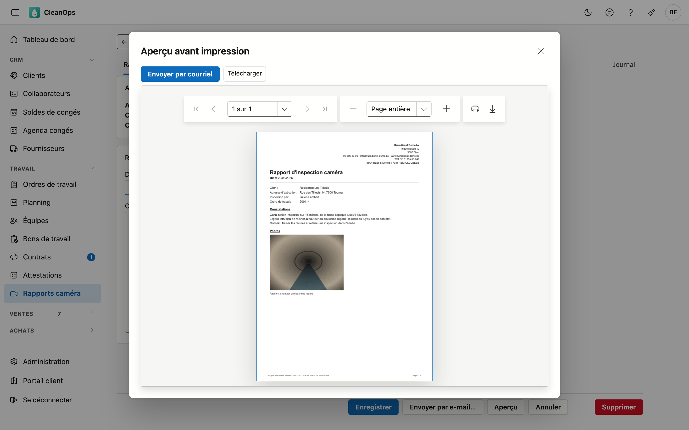
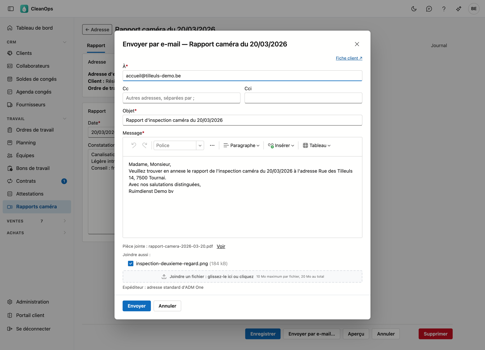
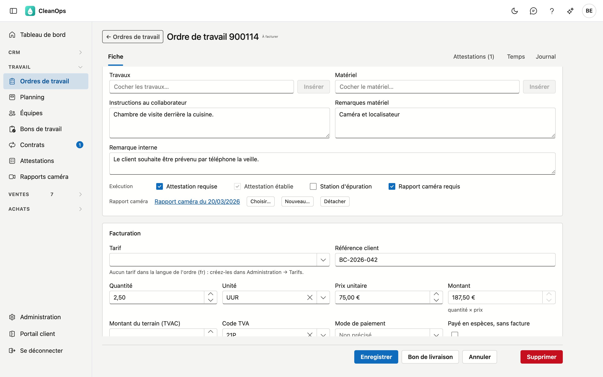
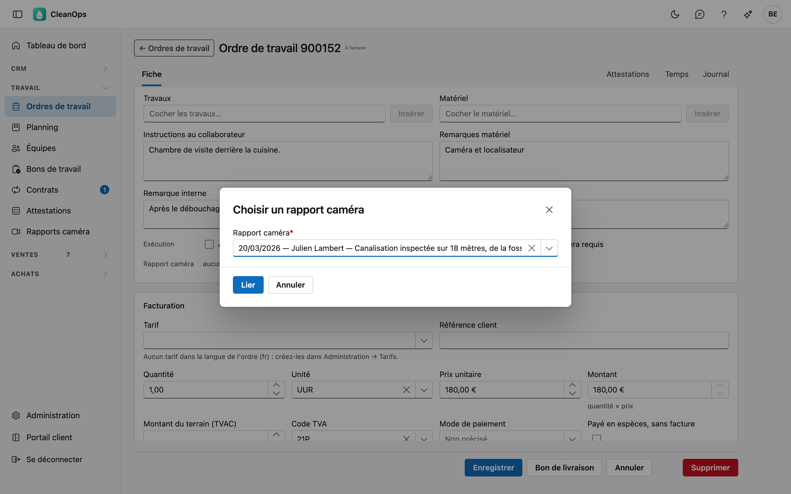
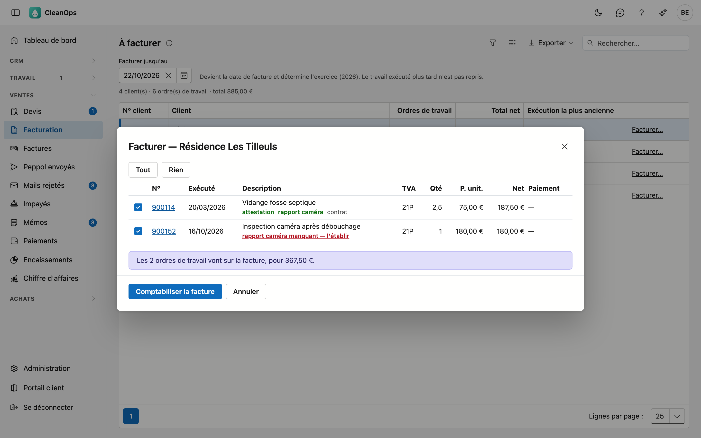

# Rapports caméra

Un rapport caméra consigne ce qu'une inspection caméra a constaté : la date, qui a fait l'inspection, les constatations et
les photos. Un rapport appartient à une **adresse d'exécution** — l'endroit inspecté — et peut être lié à un ou plusieurs
ordres de travail. Vous l'imprimez ou vous l'envoyez par e-mail à votre client sous forme de document.

## Ouvrir ou établir un rapport

Vous arrivez à un rapport par l'adresse ou par le travail auquel il appartient, ou par la liste Rapports caméra.

| D'où | Comment |
|---|---|
| **La liste Rapports caméra** | Dans le menu, sous **Travail**, cliquez sur **Rapports caméra**. Double-cliquez sur un ordre de travail pour ouvrir son rapport, ou pour l'établir s'il manque (voir [La liste](#la-liste)). |
| **Le tableau de bord** | La carte **Rapports caméra à établir** montre les premiers ordres de travail sans rapport ; **Afficher les …** ouvre la liste Rapports caméra sur ces ordres (voir [Sur le tableau de bord](#sur-le-tableau-de-bord)). |
| **L'adresse d'exécution** | Ouvrez le [client](klanten.fr.md), l'onglet **Adresses**, l'adresse, puis l'onglet **Rapports caméra**. Double-cliquez sur un rapport pour l'ouvrir ; **Nouveau rapport caméra** en établit un. |
| **L'ordre de travail** | Sur la ligne **Rapport caméra** de la fiche de l'ordre de travail : cliquez sur le rapport pour l'ouvrir, ou sur **Nouveau…** pour en établir un qui est lié d'office à l'ordre de travail (voir [Sur l'ordre de travail](#sur-lordre-de-travail)). |
| **La Facturation** | Dans la fenêtre **Facturer…**, le **rapport caméra** en vert ouvre le rapport ; **rapport caméra manquant — l'établir** en rouge en établit un pour cet ordre de travail (voir [Dans la facturation](#dans-la-facturation)). |

L'onglet montre les rapports de l'adresse, du plus récent au plus ancien, avec la date, le collaborateur et la première ligne
des constatations. **← Adresse** sur le rapport vous ramène à cet onglet.

## La liste

Dans le menu, sous **Travail**, cliquez sur **Rapports caméra**. La liste montre les ordres de travail qui demandent un
rapport caméra ou en ont un, avec leur rapport.

<!-- AFBEELDING: la liste Rapports caméra sur À facturer et Rapport manquant, avec les colonnes N°, Exécuté, Statut, Rapport, Client, Adresse d'exécution et Description -->

| Colonne | Contenu |
|---|---|
| **N°** | le numéro de l'ordre de travail. |
| **Exécuté** | le jour où le travail a été exécuté. |
| **Statut** | le statut de l'ordre de travail. |
| **Rapport** | la date du rapport en vert, ou *manquant* en rouge. Un rapport dans la corbeille compte comme manquant. |
| **Client**, **Adresse d'exécution**, **Description** | pour qui, où et quoi. |
| **Facture** | le numéro de facture, si l'ordre de travail est facturé. |

En haut, vous filtrez :

- **Facturation** — **Pas encore facturés** (par défaut), **À facturer**, **Facturés** ou **Tous**.
- **Rapport** — **Avec ou sans rapport**, ou uniquement **Rapport manquant**.
- **Période** — sur le jour d'exécution.

Avec **À facturer** et **Rapport manquant**, la liste montre le même chiffre que la carte du tableau de bord.

Un double-clic fait ceci, et sous la liste figure ce qu'il fait pour l'ordre de travail sélectionné :

- si l'ordre de travail a un rapport, le rapport s'ouvre ;
- si le rapport manque, un nouveau rapport s'ouvre à l'adresse d'exécution de l'ordre, lié d'office à l'ordre de travail à
  l'enregistrement ;
- si aucun rapport ne peut être établi — l'ordre n'a pas d'adresse d'exécution, ou vous ne pouvez pas modifier les ordres
  de travail —, l'ordre de travail s'ouvre.

À droite se trouve le volet **Journal** : l'historique du rapport de l'ordre de travail sélectionné.

## La fiche

La fiche est répartie en deux blocs. Le bloc **Adresse** montre l'**adresse d'exécution**, le **client** et les **ordres de
travail** liés au rapport ; cliquez sur un numéro pour ouvrir l'ordre de travail. Dans le bloc **Rapport**, vous indiquez :

| Champ | Ce que vous indiquez |
|---|---|
| **Date** *(obligatoire)* | le jour de l'inspection. Un nouveau rapport reçoit la date du jour. |
| **Collaborateur** | qui a fait l'inspection. |
| **Constatations** | ce que la caméra a montré, avec vos mots. La première ligne figure dans la liste de l'adresse et dans la fenêtre de choix de l'ordre de travail : commencez donc par l'essentiel. |

Cliquez sur **Enregistrer**. Le rapport reste ensuite ouvert, pour que vous puissiez tout de suite y ajouter des photos,
l'imprimer ou l'envoyer par e-mail.

### Photos et images

Ouvrez l'onglet **Journal** › **Pièces jointes** et cliquez sur **Pièce jointe**. Glissez les fichiers dans la zone ou cliquez pour les
choisir (25 Mo au maximum par fichier). Dans **Description**, indiquez ce que l'on y voit.

- Une **photo** (jpg, png, gif ou webp) figure dans le document, avec sa description en dessous — ou le nom du fichier s'il
  n'y a pas de description.
- Un **autre fichier**, comme une vidéo ou un pdf, est mentionné par son nom dans le document.

Vous pouvez ajouter des pièces jointes dès que le rapport a été enregistré une première fois.

## Imprimer

Cliquez sur **Aperçu**. Le document montre l'en-tête de votre entreprise, la date, le client, l'adresse
d'exécution, qui a fait l'inspection, les ordres de travail, les constatations et les photos, dans l'ordre où vous les avez
ajoutées. S'il y a plus de 24 photos, le document montre les 24 premières et indique combien il en reste.

Le document est rédigé dans la langue du client : néerlandais ou français. L'aperçu montre ce qui est enregistré : si vous
avez modifié quelque chose, la mention *enregistrez d'abord* figure à côté du bouton.

## Envoyer par e-mail

Cliquez sur **Envoyer par e-mail…**, ou sur **Envoyer par courriel** dans l'aperçu avant impression. La fenêtre propose
l'**adresse principale** du client comme destinataire — ou l'adresse de facturation s'il n'y a pas d'adresse principale. Ses
autres adresses peuvent être cochées en **Cc**.

- Le texte vient des [Textes d'e-mail](beheer/mailteksten.fr.md), type **Rapport caméra**, dans la langue du client. Vous
  pouvez encore adapter le destinataire, l'objet et le texte.
- Le rapport est joint en PDF ; **Voir** à côté de la pièce jointe vous le montre d'abord.
- Sous **Joindre aussi** figurent les pièces jointes du rapport. Les photos sont cochées, tant que l'e-mail ne devient pas
  trop lourd ; un autre fichier, vous le cochez vous-même. Un fichier de plus de 10 Mo ne peut pas être joint. Si une pièce
  cochée disparaît pendant que la fenêtre est ouverte, l'e-mail ne part pas et CleanOps dit pourquoi.
- Avec **Joindre un fichier**, vous ajoutez vous-même un fichier (10 Mo au maximum par fichier, 20 Mo au total).

Après l'envoi, vous retrouvez l'e-mail sous **Journal** › **E-mails** du rapport.

Un rapport caméra est un document à part : il ne part pas avec l'e-mail de la facture, ni via Peppol.

## Sur l'ordre de travail

La case **Rapport caméra requis** sur la [fiche de l'ordre de travail](werkorders.fr.md#les-cases-a-cocher) indique que ce
travail demande un rapport. Sur la ligne **Rapport caméra** en dessous, vous liez le rapport à l'ordre de travail.

| Bouton | Ce qu'il fait |
|---|---|
| **Choisir…** | montre les rapports de l'adresse d'exécution de l'ordre de travail, du plus récent au plus ancien. Choisissez-en un et cliquez sur **Lier**. |
| **Nouveau…** | ouvre un nouveau rapport à cette adresse. À l'enregistrement, il est lié d'office à l'ordre de travail. |
| **Détacher** | défait le lien. Le rapport lui-même reste à l'adresse. |

- **Choisir…** et **Détacher** agissent tout de suite : vous ne devez pas enregistrer l'ordre de travail ensuite.
- Si vous avez modifié l'ordre de travail, **Nouveau…** est désactivé : enregistrez d'abord l'ordre de travail.
- Si vous lisez *pas d'adresse d'exécution sur cet ordre*, choisissez ou créez d'abord une adresse d'exécution : un rapport
  appartient à une adresse.
- Si vous mettez une autre adresse d'exécution sur l'ordre de travail, le lien disparaît : le rapport appartenait à l'adresse
  précédente.
- Un même rapport peut être lié à plusieurs ordres de travail, par exemple quand l'inspection et la réparation sont des
  ordres de travail distincts.

## Dans la facturation

Dans la fenêtre **Facturer…** de la [Facturation](facturatie.fr.md), vous lisez sous la description d'un ordre de travail
ce qu'il en est de son rapport caméra :

| Ce que vous lisez | Ce que cela signifie |
|---|---|
| **rapport caméra** (vert) | un rapport est lié à l'ordre de travail. Un clic l'ouvre dans un nouvel onglet. |
| **rapport caméra manquant — l'établir** (rouge) | l'ordre de travail demande un rapport et n'en a pas. Un clic ouvre un nouveau rapport dans un nouvel onglet ; à l'enregistrement, il est lié à l'ordre de travail. |
| **rapport caméra manquant (pas d'adresse d'exécution)** (rouge) | l'ordre de travail demande un rapport, mais n'a pas d'adresse d'exécution. Ouvrez l'ordre de travail et mettez-y d'abord une adresse. |

Votre sélection dans la fenêtre reste en place pendant que vous établissez le rapport. Le signal ne bloque rien : vous
pouvez facturer sans rapport.

## Sur le tableau de bord

La carte **Rapports caméra à établir** du [tableau de bord](dashboard.fr.md) compte les ordres de travail exécutés qui sont
encore à facturer, qui demandent un rapport et qui n'en ont pas, et montre les cinq premiers avec leur numéro, leur client et
leur commune. Un clic sur une ligne ouvre l'ordre de travail ; **Afficher les …** ouvre [la liste](#la-liste) Rapports
caméra sur **À facturer** et **Rapport manquant**.

## Supprimer un rapport

**Supprimer** met le rapport dans la [corbeille](beheer/prullenbak.fr.md), après une confirmation. Un ordre de travail qui y
était lié montre alors le rapport avec la mention *dans la corbeille*, et compte de nouveau comme sans rapport dans la
facturation et sur le tableau de bord. Si vous restaurez le rapport depuis la corbeille, il est de nouveau lié à l'ordre de
travail.

## Si l'adresse change

Un rapport suit son adresse d'exécution. Si vous fusionnez des adresses, les rapports vont à l'adresse qui reste. Si vous
déplacez une adresse vers un autre client, ses rapports la suivent (voir [Clients](klanten.fr.md#longlet-adresses)).

## L'historique

Sous **Journal** › **Historique**, le rapport montre qui l'a établi et modifié. Ce qui a été envoyé par e-mail figure sous
**Journal** › **E-mails**.

## Droits

Un rapport caméra suit les droits des ordres de travail.

| Droit | Ce qu'il permet |
|---|---|
| **Voir les ordres de travail** | ouvrir les rapports, voir l'aperçu avant impression et les pièces jointes. |
| **Modifier les ordres de travail** | établir, modifier, supprimer et envoyer des rapports, ajouter des pièces jointes, et lier un rapport à un ordre de travail. |

Vous les attribuez dans les [Rôles](beheer/rollen.fr.md). Qui ne peut pas modifier les ordres de travail lit dans la
facturation **rapport caméra manquant** sans le lien pour en établir un ; qui ne peut pas les voir n'y lit que la mention
*rapport caméra requis*.

## Questions fréquentes

**Pourquoi le bouton Nouveau… est-il désactivé sur l'ordre de travail ?**
L'ordre de travail comporte des modifications qui ne sont pas encore enregistrées. Enregistrez-les d'abord.

**Puis-je établir un rapport pour un ordre de travail sans adresse d'exécution ?**
Non. Un rapport appartient à une adresse d'exécution. Choisissez ou créez d'abord une adresse sur l'ordre de travail.

**Le rapport caméra part-il avec la facture ?**
Non. Vous l'envoyez à part, depuis le rapport lui-même.

**J'ai envoyé le rapport par e-mail ; où le vois-je ?**
Sous **Journal** › **E-mails** du rapport.

## Voir aussi

- [Ordres de travail](werkorders.fr.md)
- [Facturation](facturatie.fr.md)
- [Clients](klanten.fr.md) — les adresses d'exécution
- [Textes d'e-mail](beheer/mailteksten.fr.md) — le texte de l'e-mail
- [Tableau de bord](dashboard.fr.md)
