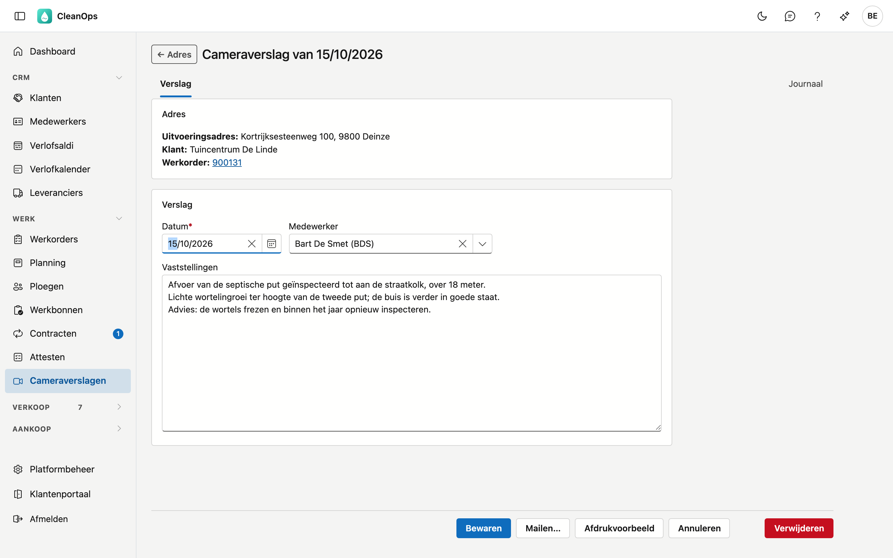
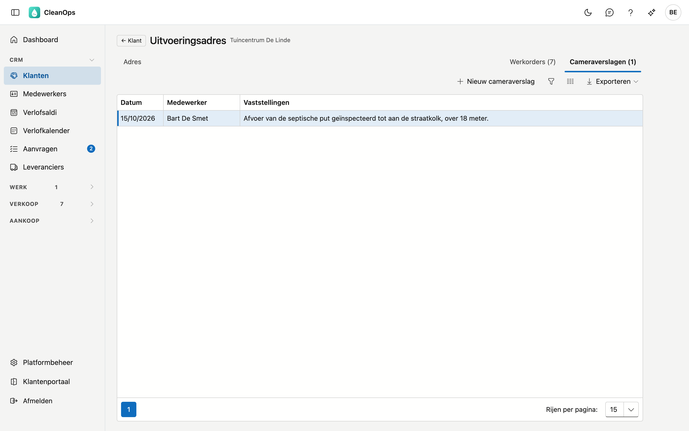
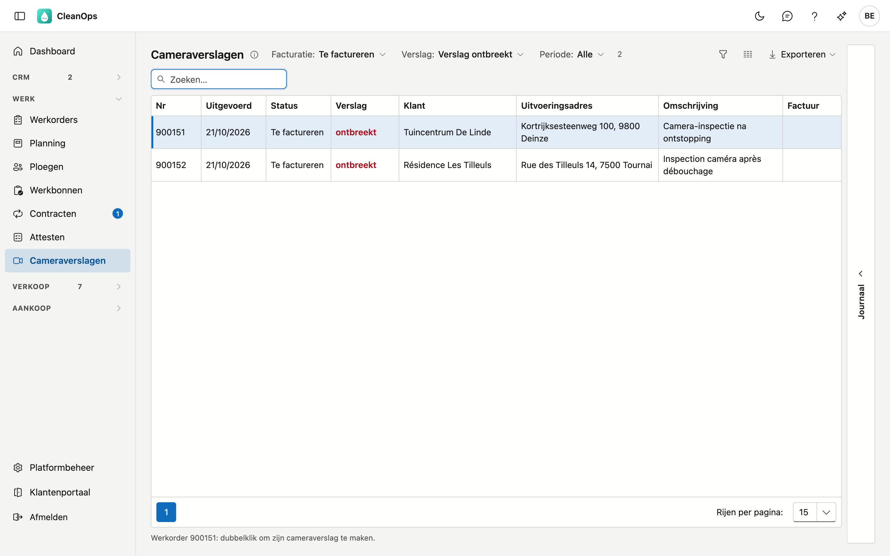
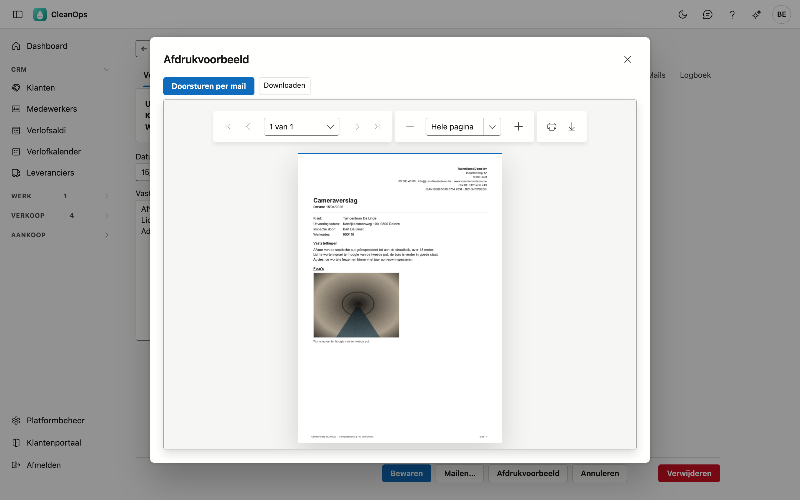
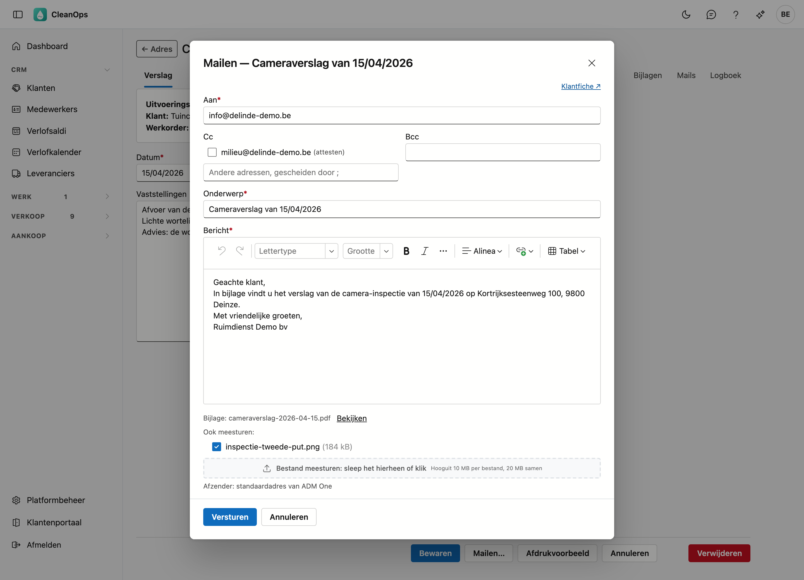
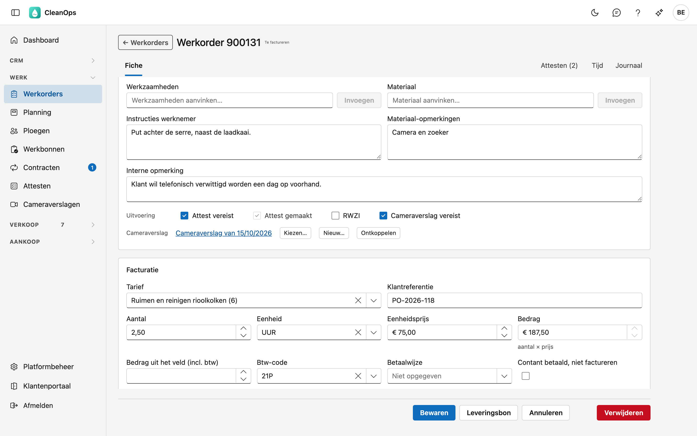
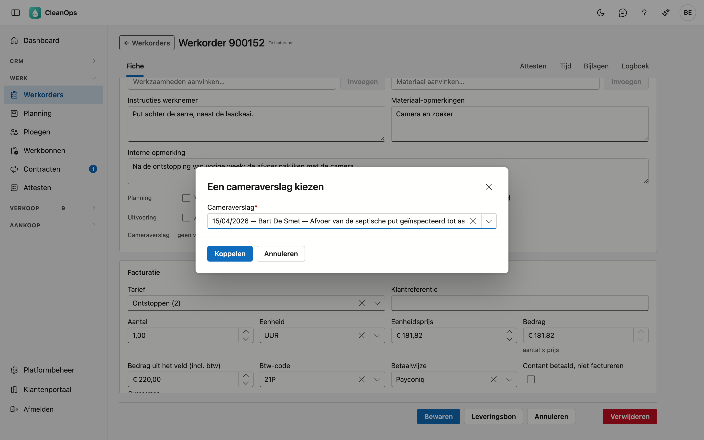
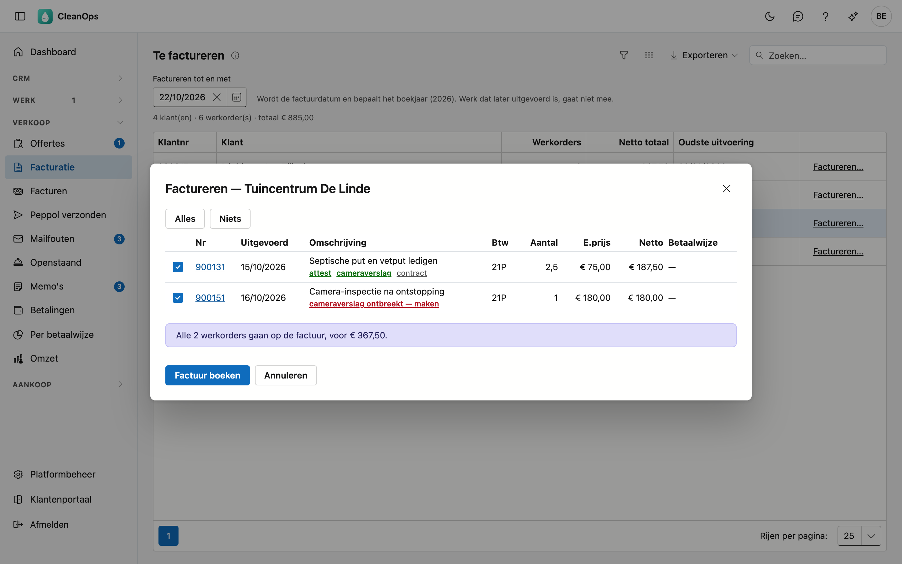

# Cameraverslagen

Een cameraverslag legt vast wat een camera-inspectie vaststelde: de datum, wie de inspectie deed, de vaststellingen en de
foto's. Een verslag hoort bij een **uitvoeringsadres** — de plaats die geïnspecteerd werd — en kan aan een of meer
werkorders hangen. U drukt het af of mailt het als document naar uw klant.

## Een verslag openen of maken

Een verslag bereikt u langs het adres of het werk waar het bij hoort, of via de lijst Cameraverslagen.

| Vanwaar | Hoe |
|---|---|
| **De lijst Cameraverslagen** | Klik in het menu onder **Werk** op **Cameraverslagen**. Dubbelklik op een werkorder om haar verslag te openen, of om het te maken als het ontbreekt (zie [De lijst](#de-lijst)). |
| **Het dashboard** | De kaart **Cameraverslagen te maken** toont de eerste werkorders zonder verslag; **Alle … tonen** opent de lijst Cameraverslagen op die werkorders (zie [Op het dashboard](#op-het-dashboard)). |
| **Het uitvoeringsadres** | Open de [klant](klanten.md), het tabblad **Adressen**, het adres, en daar het tabblad **Cameraverslagen**. Dubbelklik op een verslag om het te openen; **Nieuw cameraverslag** maakt er een. |
| **De werkorder** | Op de regel **Cameraverslag** van de werkorderfiche: klik op het verslag om het te openen, of op **Nieuw…** om er een te maken dat meteen aan de werkorder hangt (zie [Op de werkorder](#op-de-werkorder)). |
| **Facturatie** | In het venster **Factureren…** opent het groene **cameraverslag** het verslag; het rode **cameraverslag ontbreekt — maken** maakt er een voor die werkorder (zie [In de facturatie](#in-de-facturatie)). |

Het tabblad toont de verslagen van het adres, de nieuwste eerst, met de datum, de medewerker en de eerste regel van de
vaststellingen. **← Adres** op het verslag brengt u terug naar dit tabblad.

## De lijst

Klik in het menu onder **Werk** op **Cameraverslagen**. De lijst toont de werkorders die een cameraverslag vragen of er een
hebben, met hun verslag.

| Kolom | Wat erin staat |
|---|---|
| **Nr** | het nummer van de werkorder. |
| **Uitgevoerd** | de dag waarop het werk uitgevoerd werd. |
| **Status** | de status van de werkorder. |
| **Verslag** | de datum van het verslag in het groen, of *ontbreekt* in het rood. Een verslag in de prullenbak telt als ontbrekend. |
| **Klant**, **Uitvoeringsadres**, **Omschrijving** | voor wie, waar en wat. |
| **Factuur** | het factuurnummer, als de werkorder gefactureerd is. |

Bovenaan filtert u:

- **Facturatie** — **Nog niet gefactureerd** (de standaard), **Te factureren**, **Gefactureerd** of **Alle**.
- **Verslag** — **Met of zonder verslag**, of enkel **Verslag ontbreekt**.
- **Periode** — op de dag van uitvoering.

Met **Te factureren** en **Verslag ontbreekt** toont de lijst hetzelfde getal als de kaart op het dashboard.

Een dubbelklik doet het volgende, en onder de lijst staat wat hij doet voor de werkorder die u aanklikte:

- heeft de werkorder een verslag, dan opent het verslag;
- ontbreekt het verslag, dan opent een nieuw verslag op het uitvoeringsadres van de werkorder, dat bij het bewaren meteen
  aan de werkorder hangt;
- kan er geen verslag gemaakt worden — de werkorder heeft geen uitvoeringsadres, of u mag de werkorders niet wijzigen —,
  dan opent de werkorder.

Rechts staat de strook **Journaal**: het logboek van het verslag van de werkorder die u aanklikt.

## De fiche

De fiche staat in twee blokken. Het blok **Adres** toont het **uitvoeringsadres**, de **klant** en de **werkorders** die aan
het verslag hangen; klik op een nummer om de werkorder te openen. In het blok **Verslag** vult u in:

| Veld | Wat u invult |
|---|---|
| **Datum** *(verplicht)* | de dag van de inspectie. Een nieuw verslag krijgt de datum van vandaag. |
| **Medewerker** | wie de inspectie deed. |
| **Vaststellingen** | wat de camera toonde, in uw eigen woorden. De eerste regel staat in de lijst van het adres en in het keuzevenster van de werkorder: begin dus met de kern. |

Klik op **Bewaren**. Daarna blijft het verslag open, zodat u er meteen foto's aan kunt toevoegen, het kunt afdrukken of
mailen.

### Foto's en beelden

Open het tabblad **Journaal** › **Bijlagen** en klik op **Bijlage**. Sleep de bestanden naar het vak of klik om ze te kiezen (hooguit
25 MB per bestand). In **Omschrijving** zet u wat erop te zien is.

- Een **foto** (jpg, png, gif of webp) komt in het document te staan, met haar omschrijving eronder — of de bestandsnaam
  als er geen omschrijving is.
- Een **ander bestand**, zoals een film of een pdf, staat in het document bij naam vermeld.

Bijlagen toevoegen kan zodra het verslag een eerste keer bewaard is.

## Afdrukken

Klik op **Afdrukvoorbeeld**. Het document toont het briefhoofd van uw bedrijf, de datum, de klant, het uitvoeringsadres,
wie de inspectie deed, de werkorders, de vaststellingen en de foto's, in de volgorde waarin u ze toevoegde. Zijn er meer
dan 24 foto's, dan toont het document de eerste 24 en zegt het hoeveel er nog zijn.

Het document staat in de taal van de klant: Nederlands of Frans. Het voorbeeld toont wat bewaard is: hebt u iets
gewijzigd, dan staat naast de knop *eerst bewaren*.

## Mailen

Klik op **Mailen…**, of op **Doorsturen per mail** in het afdrukvoorbeeld. Het venster stelt het **hoofdadres** van de
klant voor als ontvanger — of het facturatieadres als er geen hoofdadres is. Zijn andere adressen kunt u aanvinken in
**Cc**.

- De tekst komt uit [Mailteksten](beheer/mailteksten.md), soort **Cameraverslag**, in de taal van de klant. U kunt de
  ontvanger, het onderwerp en de tekst nog aanpassen.
- Het verslag gaat als PDF mee; met **Bekijken** naast de bijlage ziet u het eerst.
- Onder **Ook meesturen** staan de bijlagen van het verslag. De foto's staan aangevinkt, zolang de mail niet te groot
  wordt; een ander bestand vinkt u zelf aan. Een bestand groter dan 10 MB kan niet mee. Verdwijnt een aangevinkte bijlage
  terwijl het venster openstaat, dan vertrekt de mail niet en zegt CleanOps waarom.
- Met **Bestand meesturen** voegt u er zelf een bestand aan toe (hooguit 10 MB per bestand, 20 MB samen).

Na het versturen vindt u de mail onder **Journaal** › **Mails** van het verslag.

Een cameraverslag is een apart document: het gaat niet mee met de factuurmail en niet via Peppol.

## Op de werkorder

Het vinkje **Cameraverslag vereist** op de [werkorderfiche](werkorders.md#de-vinkjes) zegt dat er bij dit werk een verslag
hoort. Op de regel **Cameraverslag** eronder hangt u het verslag aan de werkorder.

| Knop | Wat hij doet |
|---|---|
| **Kiezen…** | toont de verslagen van het uitvoeringsadres van de werkorder, de nieuwste eerst. Kies er een en klik **Koppelen**. |
| **Nieuw…** | opent een nieuw verslag op dat adres. Bij het bewaren hangt het meteen aan de werkorder. |
| **Ontkoppelen** | maakt de koppeling los. Het verslag zelf blijft op het adres staan. |

- **Kiezen…** en **Ontkoppelen** werken meteen: u hoeft de werkorder daarna niet te bewaren.
- Hebt u de werkorder gewijzigd, dan staat **Nieuw…** uit: bewaar de werkorder eerst.
- Staat er *geen uitvoeringsadres op deze werkorder*, kies of maak dan eerst een uitvoeringsadres: een verslag hoort bij
  een adres.
- Zet u een ander uitvoeringsadres op de werkorder, dan valt de koppeling weg: het verslag hoorde bij het vorige adres.
- Eén verslag kan aan meerdere werkorders hangen, bijvoorbeeld als de inspectie en de herstelling aparte werkorders zijn.

## In de facturatie

In het venster **Factureren…** van [Facturatie](facturatie.md) staat onder de omschrijving van een werkorder wat er met
haar cameraverslag is:

| Wat er staat | Wat het betekent |
|---|---|
| **cameraverslag** (groen) | er hangt een verslag aan de werkorder. Een klik opent het in een nieuw tabblad. |
| **cameraverslag ontbreekt — maken** (rood) | de werkorder vraagt een verslag en heeft er geen. Een klik opent een nieuw verslag in een nieuw tabblad; bij het bewaren hangt het aan de werkorder. |
| **cameraverslag ontbreekt (geen uitvoeringsadres)** (rood) | de werkorder vraagt een verslag, maar heeft geen uitvoeringsadres. Open de werkorder en zet er eerst een adres op. |

Uw keuze in het venster blijft staan terwijl u het verslag maakt. Het signaal houdt niets tegen: factureren kan ook zonder
verslag.

## Op het dashboard

De kaart **Cameraverslagen te maken** op het [dashboard](dashboard.md) telt de uitgevoerde werkorders die nog te
factureren zijn, een verslag vragen en er geen hebben, en toont de eerste vijf met hun nummer, klant en gemeente. Een klik
op een regel opent de werkorder; **Alle … tonen** opent [de lijst](#de-lijst) Cameraverslagen op **Te factureren** en
**Verslag ontbreekt**.

## Een verslag verwijderen

**Verwijderen** zet het verslag in de [prullenbak](beheer/prullenbak.md), na een bevestiging. Een werkorder die eraan
hing, toont het verslag dan met *in de prullenbak*, en telt in de facturatie en op het dashboard weer als zonder verslag.
Haalt u het verslag terug uit de prullenbak, dan hangt het weer aan de werkorder.

## Als het adres verandert

Een verslag volgt zijn uitvoeringsadres. Voegt u adressen samen, dan gaan de verslagen naar het adres dat blijft.
Verplaatst u een adres naar een andere klant, dan gaan zijn verslagen mee (zie [Klanten](klanten.md#het-tabblad-adressen)).

## Het logboek

Onder **Journaal** › **Logboek** van het verslag ziet u wie het maakte en wijzigde. Wat er gemaild werd, staat onder
**Journaal** › **Mails**.

## Rechten

Een cameraverslag volgt de rechten van de werkorders.

| Recht | Wat het toelaat |
|---|---|
| **Werkorders bekijken** | verslagen openen, het afdrukvoorbeeld en de bijlagen bekijken. |
| **Werkorders bewerken** | verslagen maken, wijzigen, verwijderen en mailen, bijlagen toevoegen, en een verslag aan een werkorder hangen. |

U kent ze toe in [Rollen](beheer/rollen.md). Wie de werkorders niet mag wijzigen, ziet in de facturatie
**cameraverslag ontbreekt** zonder de link om er een te maken; wie ze niet mag bekijken, ziet er enkel de vermelding
*cameraverslag vereist*.

## Veelgestelde vragen

**Waarom staat de knop Nieuw… op de werkorder uit?**
De werkorder heeft wijzigingen die nog niet bewaard zijn. Bewaar ze eerst.

**Kan ik een verslag maken voor een werkorder zonder uitvoeringsadres?**
Nee. Een verslag hoort bij een uitvoeringsadres. Kies of maak eerst een adres op de werkorder.

**Gaat het cameraverslag mee met de factuur?**
Nee. U mailt het apart, vanop het verslag zelf.

**Ik heb het verslag gemaild; waar zie ik dat?**
Onder **Journaal** › **Mails** van het verslag.

## Zie ook

- [Werkorders](werkorders.md)
- [Facturatie](facturatie.md)
- [Klanten](klanten.md) — de uitvoeringsadressen
- [Mailteksten](beheer/mailteksten.md) — de tekst van de mail
- [Dashboard](dashboard.md)
