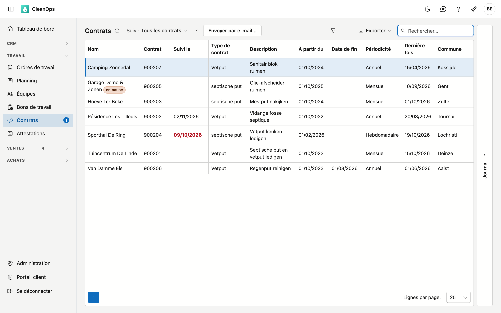
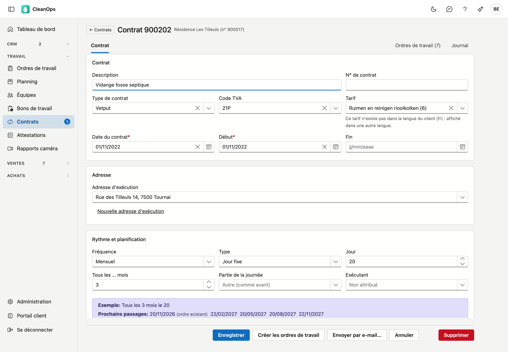
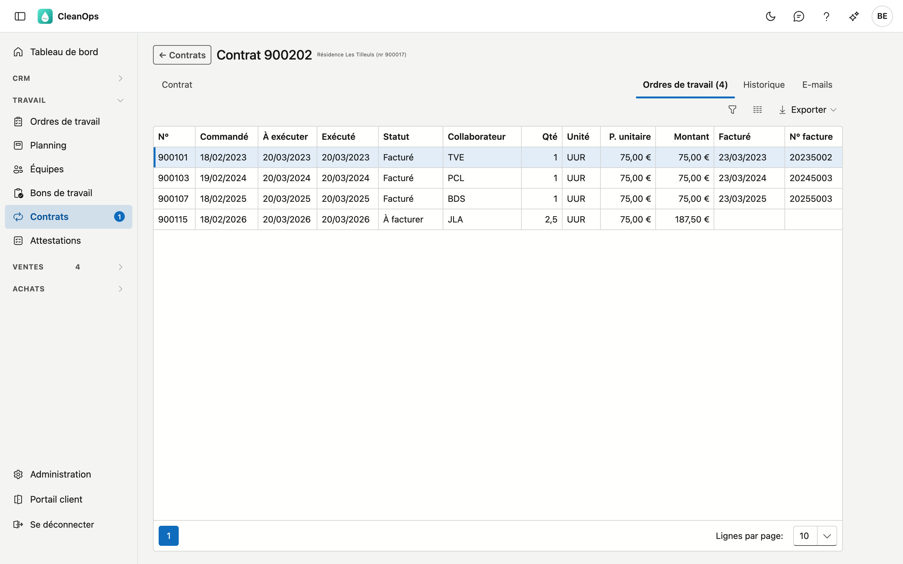
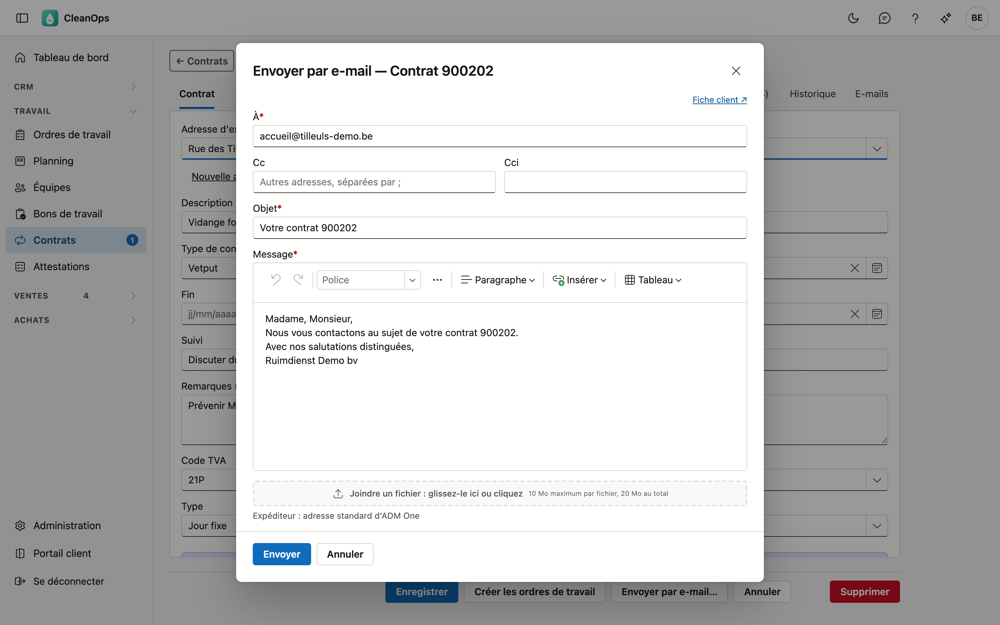

# Contrats

Un contrat fixe la fréquence à laquelle vous revenez chez un client : vider une fosse tous les six mois, un dégraisseur
toutes les deux semaines. D'un contrat en cours naissent les [ordres de travail](werkorders.fr.md) des prochains
passages ; vous n'avez pas à les créer vous-même. CleanOps les crée chaque nuit pour les 90 prochains jours, et aussitôt
que vous enregistrez un nouveau contrat.

## Ouvrir l'écran

Dans le menu de gauche, sous **Travail**, cliquez sur **Contrats**.

## La liste

Pour chaque contrat, vous voyez le client, le numéro du contrat (**Contrat**), **Suivi le**, le **Type**, la description, la
date de début (**Début**), la **Périodicité**, **Dernière**, l'**Exécutant** et la commune. Si un contrat est en pause,
**en pause** figure à côté du client. La liste est triée par nom de client. La **Date du contrat**, la **Date de fin**, la
note **Suivi** et **En pause** s'ajoutent avec le sélecteur de colonnes.

- **Suivi le** — la date à laquelle vous voulez revenir sur le contrat. Une fois ce jour atteint, la date s'affiche en
  rouge et en gras. Passez la souris dessus pour lire la note. Voir [Suivre un contrat](#suivre-un-contrat).
- **Type** — le type de contrat.
- **Périodicité** — le rythme en bref. Si l'intervalle est de un, le mot figure : *Quotidien*, *Hebdomadaire*, *Mensuel*
  ou *Annuel*. S'il est plus grand, la fréquence figure : *Tous les 6 mois*, *Toutes les 2 semaines*, *Tous les 3 jours*.
  Le même rythme court figure dans le choix du contrat sur la [fiche de l'ordre de travail](werkorders.fr.md).
- **Suivi** — le filtre en haut. Choisissez *À suivre* pour ne voir que les contrats dont la date de suivi est atteinte.
- **Exécutant** — le filtre à côté. Choisissez un collaborateur pour ne voir que ses contrats, ou *Non attribué* pour
  les contrats dont les ordres de travail arrivent sans exécutant.
- **Envoyer par e-mail…** — ouvre un e-mail au client du contrat sélectionné. Vous voyez le bouton si vous pouvez
  modifier les contrats.
- **Dernière** — la date planifiée du dernier ordre de travail du contrat.
- **Rechercher** — le curseur est directement dans le champ de recherche. La recherche porte sur ce que montre la
  liste, y compris la périodicité : *Annuel* trouve tous les contrats annuels. Vous trouvez aussi un contrat par la rue,
  la commune, le GSM et le numéro fixe du client, même s'ils ne figurent pas dans la liste.
- **Trier** — cliquez sur un titre de colonne ; un second clic inverse l'ordre.
- **Exporter** — le bouton en haut à droite vous donne la liste, telle qu'elle est filtrée, sous forme de fichier.
- **Ouvrir** — double-cliquez sur une ligne pour ouvrir le contrat.
- **Journal** — le volet de droite montre l'historique et les e-mails du contrat sélectionné dans la liste.

Un contrat terminé reste dans la liste. Sa date de fin s'affiche avec la colonne **Date de fin**, que vous ajoutez avec le
sélecteur de colonnes.

## Un nouveau contrat

Un nouveau contrat se crée depuis la fiche du [client](klanten.fr.md) : ouvrez l'onglet **Contrats** et cliquez sur
**Nouveau contrat**. Le contrat commence avec aujourd'hui comme date du contrat et date de début, et un rythme
mensuel le premier du mois. Après **Enregistrer**, le nouveau contrat s'ouvre.

## La fiche du contrat

En haut figurent le numéro du contrat et le client ; si le contrat est en pause, c'est indiqué. En dessous, trois
onglets : **Contrat**, **Ordres de travail** et **Journal**. Sous Journal figurent **Historique** et **E-mails**.

### L'onglet Contrat

Les champs sont répartis en cinq blocs : **Contrat**, **Adresse**, **Rythme et planification**, **Suivi** et **Remarques**.

**Contrat**

| Champ | Explication |
|---|---|
| Description | Ce qui est fait, 35 caractères au maximum. Si le contrat n'a pas de remarques, ce texte devient la description et l'instruction de ses ordres de travail. |
| N° de contrat | Un numéro ou une référence propre, 30 caractères au maximum. |
| Type de contrat | Un choix dans la liste *Types de contrat* des [tables de base](beheer/basistabellen.fr.md). |
| Code TVA, Tarif | Figurent sur les ordres de travail de ce contrat. La liste Tarif montre les tarifs dans la langue du client. |
| Date du contrat * | La date du contrat. Ne peut pas se situer dans le futur. |
| Début * | À partir de quand le rythme court. Ne peut pas précéder la date du contrat. |
| Fin | À partir de cette date, plus aucun passage ne s'ajoute. Ne peut pas précéder le début. |

**Adresse**

| Champ | Explication |
|---|---|
| Adresse d'exécution | L'adresse du client ou l'une de ses adresses d'exécution. **Nouvelle adresse d'exécution** en crée une ; vous revenez ensuite au contrat. |

**Rythme et planification**

| Champ | Explication |
|---|---|
| Fréquence | Le rythme — voir ci-dessous. |
| Partie de la journée | La partie de la journée où les ordres de travail de ce contrat arrivent sur le planning. Vide : *Autre*, comme avant. |
| Exécutant | Le collaborateur qui reçoit les ordres de travail de ce contrat : ils arrivent directement dans sa ligne du planning. Vide : non attribué. S'il est en congé le jour d'un passage, il le reçoit quand même — le congé figure dans la même case du planning. S'il n'est plus actif, la fiche le signale et les nouveaux ordres arrivent sans exécutant. |

Sous les champs figurent l'**Exemple** et les **Prochains passages** (voir [Le rythme](#le-rythme)).

**Suivi**

| Champ | Explication |
|---|---|
| En pause | Suspend le contrat : aucun ordre de travail ne s'ajoute tant que la case est cochée. |
| Suivi le | La date à laquelle vous voulez revenir sur ce contrat. Vide : pas de suivi. |
| Suivi | De quoi il s'agit, 500 caractères au maximum. Cette note est pour vous : elle ne figure ni sur un bon de travail ni dans un e-mail. |

**Remarques**

| Champ | Explication |
|---|---|
| Figurent sur chaque bon de travail | Un texte fixe pour chaque ordre de travail de ce contrat, comme *demander la clé à l'accueil*. Il devient l'instruction pour l'équipe, et ses 35 premiers caractères la description de l'ordre. |

### Le rythme

Choisissez sous **Fréquence** à quelle fréquence les passages reviennent. Selon le choix, d'autres champs apparaissent :

| Fréquence | Champs |
|---|---|
| Quotidien | **Tous les … jours**. |
| Hebdomadaire | **Toutes les … semaines**, et les jours : **Lu** à **Di**. |
| Mensuel | **Type** : un **Jour fixe** (par exemple le 15) ou un **Rang** (par exemple le deuxième mardi), et **Tous les … mois**. |
| Annuel | **Type** : un **Jour fixe** ou un **Rang**, et le **Mois**. |

Le cadre en dessous dit en mots, après **Exemple**, ce que vous avez réglé, par exemple *Chaque année le 20 mars*. En dessous figurent les
**Prochains passages** : les cinq dates suivantes. Si une date a déjà un ordre de travail, *(ordre existant)* est
indiqué.

Voici comment CleanOps calcule les passages :

- Le rythme part du **dernier passage** du contrat — la dernière ligne du cadre indique lequel.
- Un passage le **week-end** glisse au lundi. Pour un contrat hebdomadaire, ce sont les jours cochés qui comptent,
  y compris un samedi.
- Un passage un **jour férié** ou un **jour de fermeture** glisse au jour ouvrable suivant. Les jours fériés et de
  fermeture se trouvent sous [Jours fériés](beheer/feestdagen.fr.md).
- Un jour fixe qui n'existe pas dans un mois — le 31 en avril — devient le dernier jour de ce mois.
- Aucun passage n'est créé avant la date de début.
- Un passage passé sans ordre de travail n'est pas rattrapé.

!!! info "Jours fériés inconnus"
    Si CleanOps ne peut momentanément pas récupérer les jours fériés, le cadre indique que les dates ne tiennent
    compte que des jours de fermeture. Réessayez plus tard.

### Si vous modifiez l'exécutant ou la partie de la journée

Si vous modifiez l'exécutant ou la partie de la journée d'un contrat, CleanOps demande après l'enregistrement si les
ordres de travail à venir doivent suivre : **Adapter** ou **Laisser**. Cela ne vaut que pour les ordres d'aujourd'hui
ou plus tard, pas encore exécutés ni facturés, qui ont encore l'ancien exécutant ou l'ancienne partie de la journée.
Si quelqu'un a confié un ordre à un autre collaborateur, celui-ci le garde ; si quelqu'un l'a déplacé vers une autre
partie de la journée, celle-ci reste. Si vous avez aussi modifié le rythme, la question sur le rythme suit.

### Si vous modifiez le rythme

Si vous modifiez le rythme d'un contrat qui a déjà des ordres de travail pour les prochains temps, CleanOps demande
après l'enregistrement s'il faut les recalculer : **Recalculer** ou **Laisser**. Seuls les ordres auxquels personne
n'a touché entrent en ligne de compte. Un ordre exécuté, ou que quelqu'un a planifié ou modifié, reste toujours. Un
ordre que le contrat a lui-même confié à son exécutant est bien recalculé.

### L'onglet Ordres de travail

Tous les ordres de travail de ce contrat, avec leurs dates, leur statut, le collaborateur, la quantité, l'unité, le
prix unitaire, le montant, la date de facturation et le numéro de facture. Le **tarif** (code et description), la date planifiée, le convoyeur,
les instructions, le matériel et la remarque interne s'activent via **Choisir les colonnes** ; ils sont masqués par
défaut, car le tableau deviendrait plus large que la fiche.
Double-cliquez sur une ligne pour ouvrir l'ordre. Un ordre de travail isolé que quelqu'un a lié à la main à ce contrat y figure aussi ; il ne compte pas comme un passage
(voir [Ordres de travail](werkorders.fr.md)).

Avec **Créer les ordres de travail** en bas de l'onglet Contrat, CleanOps crée aussitôt les ordres de travail de ce contrat pour les 90
prochains jours, avec les mêmes règles que la nuit. L'onglet Ordres de travail montre ensuite la liste, avec au-dessus le nombre d'ordres ajoutés. Tant que
votre application précédente crée encore les ordres de travail, CleanOps n'en crée pas, et c'est indiqué.

### L'onglet Journal

**Historique** — qui a modifié quel champ de ce contrat, quand, et de quelle valeur à quelle valeur.

**E-mails** — ce qui a été envoyé par e-mail au sujet de ce contrat : quand, à qui, si l'e-mail a été délivré (et sinon, pourquoi),
et le texte tel qu'il est parti (**Afficher le texte**).

## Suivre un contrat

Vous voulez revenir plus tard sur un contrat — revoir un prix, discuter d'un renouvellement — ? Sur la fiche, indiquez
**Suivi le**, avec sous **Suivi** de quoi il s'agit, et cliquez sur **Enregistrer**.

À partir de ce jour :

- la date s'affiche **en rouge et en gras** dans la liste ;
- le contrat compte dans le **chiffre à côté de Contrats** dans le menu ;
- le filtre **Suivi** sur *À suivre* montre le contrat.

Un contrat en pause ou terminé compte aussi tant que la date y figure.

### Écrire au client

**Envoyer par e-mail…**, dans la liste et en bas de la fiche, ouvre un e-mail au client du contrat.

- **À** — l'adresse e-mail du client (voir [Clients](klanten.fr.md)). Ses autres adresses figurent comme case à cocher
  sous **Cc**.
- **Objet** et **Message** — le texte d'e-mail *Suivi de contrat*, dans la langue du client, avec le numéro du contrat
  complété. Vous réglez ce texte dans [Textes d'e-mail](beheer/mailteksten.fr.md) ; ici, vous écrivez ce que vous
  voulez dire au client.
- **Aucune pièce jointe** n'accompagne l'e-mail. Avec **Joindre un fichier**, vous en ajoutez une vous-même : 10 Mo au
  maximum par fichier et 20 Mo au total.
- En haut à droite, **Fiche client ↗** ouvre la fiche du client dans un nouvel onglet.

Cliquez sur **Envoyer**. L'e-mail part réellement chez le client et figure ensuite sous **Journal** › **E-mails** du
contrat. Si le client n'a pas d'adresse e-mail, la fenêtre l'indique : saisissez vous-même une adresse.

### Clôturer

Quand c'est réglé, videz **Suivi le** avec la croix dans le champ, ou indiquez une nouvelle date, et cliquez sur
**Enregistrer**. Envoyer un e-mail ne vide pas la date.

## Supprimer un contrat

**Supprimer**, en bas de la fiche, place le contrat dans la [corbeille](beheer/prullenbak.fr.md). Si le contrat a
encore des ordres de travail pour les prochains temps auxquels personne n'a touché, CleanOps demande s'il faut les
supprimer : **Supprimer** ou **Laisser**.

## Questions fréquentes

**Le prochain passage ne tombe pas le jour attendu.**
Le rythme part du dernier passage, pas de la date de début. Si un passage tombe un week-end ou un jour férié, il
glisse au jour ouvrable suivant. Le cadre sur la fiche montre quel passage compte comme dernier.

**Je veux suspendre temporairement un contrat.**
Cochez **En pause**. Pour l'arrêter définitivement, indiquez une **Fin**.

**Un chiffre figure à côté de Contrats dans le menu.**
Autant de contrats ont une date de suivi atteinte. Dans la liste, choisissez *À suivre* sous **Suivi** pour les voir.

**Je ne retrouve pas un contrat.**
Cherchez sur le nom du client, la description ou le numéro de contrat. S'il n'y est vraiment plus, consultez la
[corbeille](beheer/prullenbak.fr.md).
