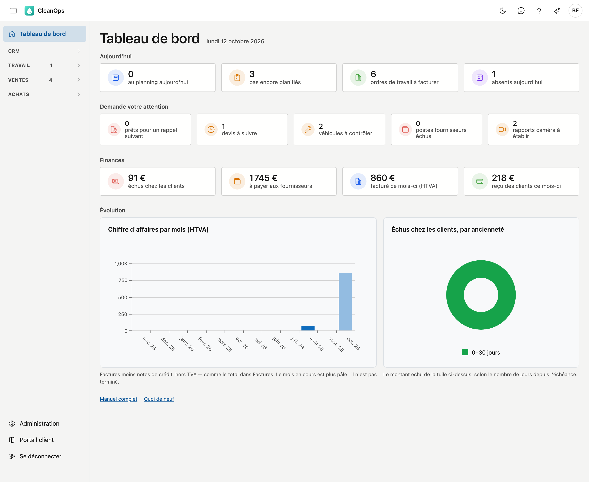

# Tableau de bord

Le tableau de bord est le premier écran après la connexion. En haut figurent les quatre montants qui comptent. En dessous,
des cartes montrent quels ordres de travail, clients ou véhicules demandent quelque chose aujourd'hui, et en bas comment se
sont passés les douze derniers mois. Chaque tuile et chaque carte est un raccourci : un clic ouvre la liste qui affiche
exactement ce chiffre.

## Ouvrir l'écran

Le tableau de bord s'ouvre de lui-même après la connexion. Ailleurs, vous le retrouvez via **Tableau de bord**, en haut du
menu de gauche.

En haut figure la date du jour. Tous les chiffres portent sur ce jour-là.

## Les tuiles des finances

En haut figurent quatre tuiles avec un montant.

| Tuile | Ce qu'elle compte | Un clic ouvre |
|---|---|---|
| échus chez les clients | le montant ouvert des postes sur **Échus** | les [postes ouverts](openstaande-posten.fr.md) sur **Échus** |
| facturé ce mois-ci (HTVA) | les factures moins les notes de crédit du mois en cours, hors TVA | les [factures](facturen.fr.md) sur **Ce mois-ci** |
| reçu des clients ce mois-ci | les paiements des clients du mois en cours, moins les remboursements | les [paiements](betalingen.fr.md) sur **Ce mois-ci**, uniquement les clients |
| à payer aux fournisseurs | ce que vous devez encore à vos fournisseurs, moins les notes de crédit qu'ils doivent encore vous rembourser | les [postes ouverts fournisseurs](openstaande-posten-leveranciers.fr.md) |

Sur le tableau de bord, les montants sont arrondis à l'euro. La liste affiche le même montant au centime près.

!!! note "À payer figure dans la liste avec un signe moins"
    Dans les postes ouverts fournisseurs, les montants figurent comme sur votre extrait bancaire : une facture que vous
    devez encore payer est négative. Le solde en bas est donc un montant négatif. Sur le tableau de bord, le même montant
    s'appelle *à payer*, sans signe moins.

## Les cartes

Sous les tuiles figurent des cartes. Chaque carte a un titre avec le nombre à côté, et montre les cinq premières lignes :
quel ordre de travail, quel client ou quel collaborateur. Chaque ligne est un lien vers cet enregistrement. En bas de la
carte, **Afficher les … →** (ou **Ouvrir la liste →** si tout figure déjà sur la carte) ouvre la liste filtrée.

S'il n'y a rien, la carte reste affichée avec une phrase comme *Rien de planifié aujourd'hui.* : « rien à faire » est aussi
une réponse.

### Aujourd'hui & travail

| Carte | Ce qu'elle montre | Afficher les … ouvre |
|---|---|---|
| Au planning aujourd'hui | les ordres de travail planifiés aujourd'hui et pas encore exécutés : le numéro, le client et la commune | la [liste du planning](planning.fr.md#la-liste-du-planning) sur le jour même |
| Pas encore planifiés | les ordres de travail au statut **Encodé**, les plus récents d'abord : le numéro, le client, le jour où le travail doit être fait et la commune | les [ordres de travail](werkorders.fr.md) au statut **Encodé** |
| Ordres de travail à facturer | le travail exécuté qui attend une facture, jusqu'à aujourd'hui inclus — sans ce qui a été payé comptant. Par client, avec le nombre d'ordres de travail et le montant ; le client qui attend depuis le plus longtemps figure en premier | [Facturation](facturatie.fr.md) |

### Demande votre attention

| Carte | Ce qu'elle montre | Afficher les … ouvre |
|---|---|---|
| Prêts pour un rappel suivant | les postes qui ont déjà reçu un rappel et sont prêts pour le suivant — le même chiffre que dans le menu. Par poste le client, le document, le montant ouvert et l'échéance | les [postes ouverts](openstaande-posten.fr.md) sur **Prochain rappel** |
| Devis à suivre | les devis envoyés dont la date de suivi est aujourd'hui ou passée : le client, la description et la date de suivi (en rouge si elle est passée) | les [devis](offertes.fr.md) sur **À suivre** |
| Rapports caméra à établir | les ordres de travail exécutés qui sont encore à facturer, qui demandent un [rapport caméra](cameraverslagen.fr.md) et n'en ont pas : le numéro, le client et la commune | la liste [Rapports caméra](cameraverslagen.fr.md#la-liste) sur **À facturer** et **Rapport manquant** |
| Véhicules à contrôler | les véhicules dont le contrôle technique est échu ou tombe dans les 30 jours, avec la date du contrôle (en rouge si elle est échue) | les [véhicules](beheer/voertuigen.fr.md) sur **À contrôler** |
| Postes fournisseurs échus | les documents d'achat dont l'échéance est passée et qui sont encore ouverts : le fournisseur, son numéro de document, le montant et l'échéance | les [postes ouverts fournisseurs](openstaande-posten-leveranciers.fr.md) sur **Échus** |
| Absents aujourd'hui | les collaborateurs en congé aujourd'hui, avec la description du congé | l'[agenda des congés](verlofkalender.fr.md) |

## Évolution

Deux graphiques sur les douze derniers mois. Le mois en cours est **plus pâle** : il n'est pas terminé.

- **Chiffre d'affaires par mois (HTVA)** — par mois les factures moins les notes de crédit, hors TVA. La dernière barre est
  le montant de la tuile *facturé ce mois-ci*.
- **Échus chez les clients, par ancienneté** — le montant de la tuile *échus chez les clients*, réparti selon le nombre de
  jours depuis l'échéance : 0–30 jours, 31–60, 61–90, 91–365 et plus d'un an. Du vert au rouge foncé : plus c'est ancien,
  plus c'est grave.

Si vous ne pouvez pas voir la facturation mais bien les ordres de travail, vous voyez à gauche **Ordres de travail par
mois** : les ordres de travail dont la date de planification tombe dans ce mois, quel que soit leur statut.

En bas du tableau de bord figurent les liens **Manuel complet** et **Quoi de neuf**.

## Ce que vous voyez dépend de vos droits

Vous ne voyez que les tuiles, cartes et graphiques des listes que vous pouvez ouvrir. Une tuile ou une carte affichée peut
donc toujours être cliquée. Un bloc sans aucune carte n'apparaît pas. Si vous n'avez de droit pour aucun bloc, vous ne
voyez qu'une phrase de bienvenue ; le menu de gauche affiche les écrans que vous pouvez ouvrir.

## Erreurs fréquentes

!!! warning "Le chiffre de la tuile ou de la carte diffère de la liste"
    Le lien ouvre la liste avec le bon filtre. Si vous modifiez ensuite un filtre ou le champ de recherche, la liste
    affiche autre chose. Cliquez à nouveau sur la tuile ou sur **Afficher les …** pour repartir de la même sélection.

!!! warning "Il y a … au lieu d'un chiffre"
    Ce chiffre n'a pas pu être calculé, et la mention *peut-être incomplet* apparaît. CleanOps n'affiche alors
    volontairement pas 0 : un 0 promettrait une journée calme qui n'en est peut-être pas une. Rechargez l'écran dans un
    instant.

!!! warning "Le mois en cours semble faible"
    Il n'est pas terminé. C'est pourquoi il est plus pâle dans le graphique. Ne le comparez à un mois précédent qu'une
    fois qu'il est passé.

## Voir aussi

- [Ordres de travail](werkorders.fr.md)
- [Planning](planning.fr.md)
- [Postes ouverts](openstaande-posten.fr.md)
- [Postes ouverts fournisseurs](openstaande-posten-leveranciers.fr.md)
- [Rapports caméra](cameraverslagen.fr.md)
- [Factures](facturen.fr.md)
- [Paiements](betalingen.fr.md)
