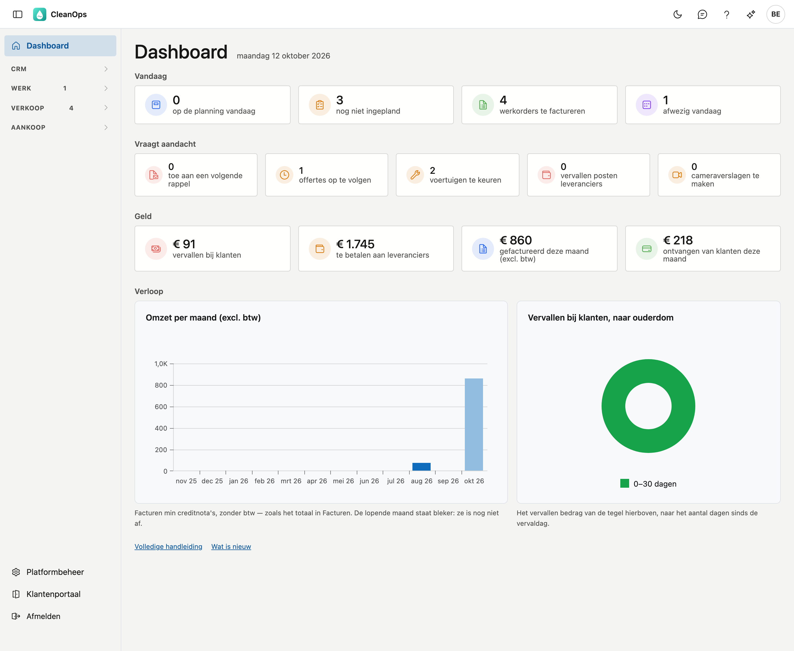

# Dashboard

Het dashboard is het eerste scherm na het aanmelden. Bovenaan staan de vier bedragen die tellen. Daaronder ziet u op
kaarten wélke werkorders, klanten of voertuigen vandaag iets vragen, en onderaan hoe de laatste twaalf maanden verliepen.
Elke tegel en elke kaart is een snelkoppeling: één klik opent de lijst die precies dat getal toont.

## Het scherm openen

Het dashboard opent vanzelf na het aanmelden. Van elders bereikt u het via **Dashboard**, bovenaan het menu links.

Bovenaan staat de datum van vandaag. Alle cijfers gaan over die dag.

## De geldtegels

Bovenaan staan vier tegels met een bedrag.

| Tegel | Wat het telt | Een klik opent |
|---|---|---|
| vervallen bij klanten | het openstaande bedrag van de posten op **Vervallen** | de [openstaande posten](openstaande-posten.md) op **Vervallen** |
| gefactureerd deze maand (excl. btw) | de facturen min de creditnota's van de lopende maand, zonder btw | de [facturen](facturen.md) op **Deze maand** |
| ontvangen van klanten deze maand | de betalingen van klanten in de lopende maand, min de terugbetalingen | de [betalingen](betalingen.md) op **Deze maand**, enkel de klanten |
| te betalen aan leveranciers | wat u uw leveranciers nog verschuldigd bent, min de creditnota's die zij u nog moeten terugbetalen | de [openstaande posten leveranciers](openstaande-posten-leveranciers.md) |

Bedragen staan op het dashboard in hele euro's. De lijst toont hetzelfde bedrag tot op de cent.

!!! note "Te betalen staat in de lijst met een min"
    In de openstaande posten leveranciers staan de bedragen zoals op uw bankuittreksel: een factuur die u nog moet
    betalen, is negatief. Het saldo onderaan is dus een negatief bedrag. Op het dashboard heet hetzelfde bedrag
    *te betalen*, zonder min.

## De kaarten

Onder de geldtegels staan kaarten. Elke kaart heeft een titel met het aantal ernaast, en toont de eerste vijf regels: wélke
werkorder, klant of medewerker het is. Elke regel is een link naar dat record. Onderaan de kaart opent **Alle … tonen →**
(of **Naar de lijst →** als alles al op de kaart staat) de gefilterde lijst.

Ligt er niets, dan blijft de kaart staan met een zin als *Niets gepland vandaag.*: ook "niets te doen" is een antwoord.

### Vandaag & werk

| Kaart | Wat ze toont | Alle … tonen opent |
|---|---|---|
| Op de planning vandaag | de werkorders die vandaag gepland staan en nog niet uitgevoerd zijn: het nummer, de klant en de gemeente | de [planningslijst](planning.md#de-planningslijst) op de dag van vandaag |
| Nog niet ingepland | de werkorders met de status **Ingegeven**, de nieuwste eerst: het nummer, de klant, de dag waarop het werk moet gebeuren en de gemeente | de [werkorders](werkorders.md) op de status **Ingegeven** |
| Werkorders te factureren | het uitgevoerde werk dat op een factuur wacht, tot en met vandaag — zonder wat contant betaald werd. Per klant, met het aantal werkorders en het bedrag; de klant die al het langst wacht, staat eerst | [Facturatie](facturatie.md) |

### Vraagt aandacht

| Kaart | Wat ze toont | Alle … tonen opent |
|---|---|---|
| Toe aan een volgende rappel | de posten die al een rappel kregen en aan de volgende toe zijn — hetzelfde getal als in het menu. Per post de klant, het document, het openstaande bedrag en de vervaldag | de [openstaande posten](openstaande-posten.md) op **Volgende rappel** |
| Offertes op te volgen | de verstuurde offertes waarvan de opvolgdatum vandaag is of voorbij: de klant, de omschrijving en de opvolgdatum (in het rood als ze voorbij is) | de [offertes](offertes.md) op **Op te volgen** |
| Cameraverslagen te maken | de uitgevoerde werkorders die nog te factureren zijn, een [cameraverslag](cameraverslagen.md) vragen en er geen hebben: het nummer, de klant en de gemeente | de lijst [Cameraverslagen](cameraverslagen.md#de-lijst) op **Te factureren** en **Verslag ontbreekt** |
| Voertuigen te keuren | de voertuigen waarvan de keuring verlopen is of binnen 30 dagen valt, met de keuringsdatum (in het rood als ze verlopen is) | de [voertuigen](beheer/voertuigen.md) op **Te keuren** |
| Vervallen posten leveranciers | de aankoopdocumenten waarvan de vervaldag voorbij is en die nog open staan: de leverancier, zijn documentnummer, het bedrag en de vervaldag | de [openstaande posten leveranciers](openstaande-posten-leveranciers.md) op **Vervallen** |
| Afwezig vandaag | de medewerkers die vandaag verlof hebben, met de omschrijving van het verlof | de [verlofkalender](verlofkalender.md) |

## Verloop

Twee grafieken over de laatste twaalf maanden. De lopende maand staat **bleker**: ze is nog niet af.

- **Omzet per maand (excl. btw)** — per maand de facturen min de creditnota's, zonder btw. De laatste staaf is het bedrag
  van de tegel *gefactureerd deze maand*.
- **Vervallen bij klanten, naar ouderdom** — het bedrag van de tegel *vervallen bij klanten*, verdeeld naar het aantal
  dagen sinds de vervaldag: 0–30 dagen, 31–60, 61–90, 91–365 en meer dan een jaar. Van groen naar donkerrood: hoe
  langer vervallen, hoe ernstiger.

Mag u geen facturatie zien maar wel de werkorders, dan staat links **Werkorders per maand**: de werkorders met een
planningsdatum in die maand, ongeacht hun status.

Onderaan het dashboard staan de links **Volledige handleiding** en **Wat is nieuw**.

## Wat u ziet, hangt af van uw rechten

U ziet enkel de tegels, kaarten en grafieken van de lijsten die u mag openen. Een tegel of kaart die u ziet, kunt u dus
altijd aanklikken. Een blok zonder één kaart verschijnt niet. Hebt u voor geen enkel blok een recht, dan ziet u enkel een
welkomstzin; het menu links toont de schermen die u wél mag openen.

## Veelgemaakte fouten

!!! warning "Het getal op de tegel of de kaart verschilt van de lijst"
    De link opent de lijst met de juiste filter. Wijzigt u daarna een filter of het zoekveld, dan toont de lijst iets
    anders. Klik opnieuw op de tegel of op **Alle … tonen** om met dezelfde selectie te beginnen.

!!! warning "Er staat … in plaats van een getal"
    Dat cijfer kon niet berekend worden, en dan staat er de melding *mogelijk onvolledig*. CleanOps toont dan bewust
    geen 0, want een 0 zou een rustige dag beloven die misschien geen rustige dag is. Laad het scherm na een ogenblik
    opnieuw.

!!! warning "De lopende maand lijkt laag"
    Ze is nog niet af. Daarom staat ze bleker in de grafiek. Vergelijk ze pas met een vorige maand als ze voorbij is.

## Zie ook

- [Werkorders](werkorders.md)
- [Planning](planning.md)
- [Openstaande posten](openstaande-posten.md)
- [Openstaande posten leveranciers](openstaande-posten-leveranciers.md)
- [Cameraverslagen](cameraverslagen.md)
- [Facturen](facturen.md)
- [Betalingen](betalingen.md)
