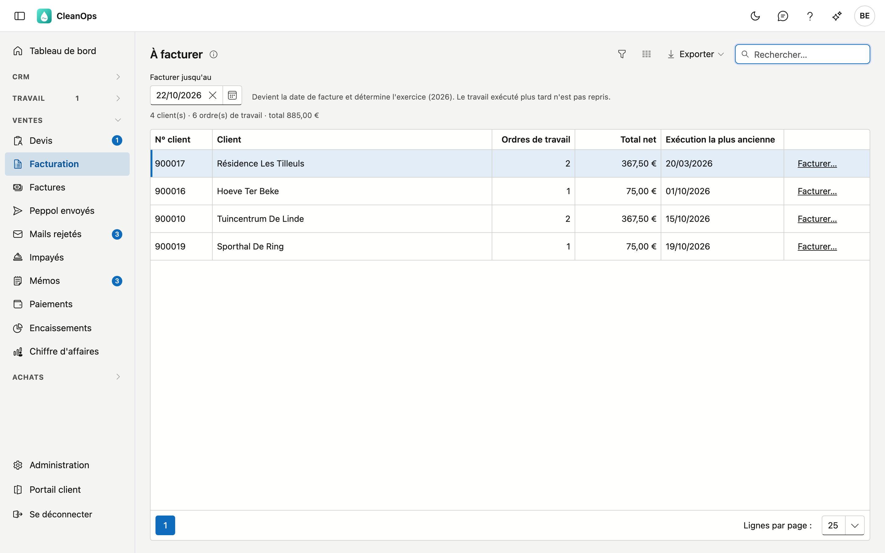
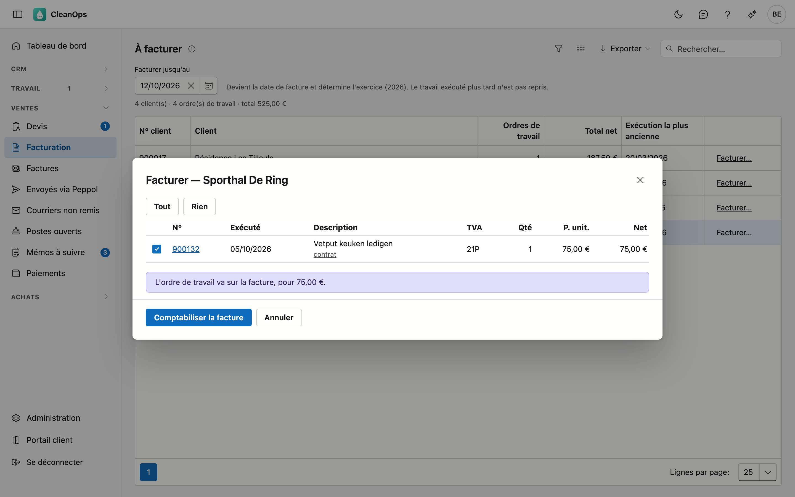

# Facturation

Sur Facturation, vous facturez le travail exécuté. Vous voyez par client les ordres de travail à facturer, vous choisissez ce
qui va sur la facture et vous la comptabilisez. La facture reçoit immédiatement son numéro, son échéance et sa communication
structurée.

## Ouvrir l'écran

Dans le menu de gauche, sous **Ventes**, cliquez sur **Facturation**. Vous le voyez avec le rôle **Financieel** ou en tant
qu'administrateur. Comptabiliser des factures demande en plus le droit *Établir des factures* ; par défaut, seul l'administrateur
l'a.

## Ce qu'il y a à facturer

La liste affiche par client les ordres de travail au statut **À facturer** : du travail avec une date d'exécution qui ne figure
pas encore sur une facture. Le travail coché **Payé en espèces, sans facture** n'y figure pas. Le travail avec un mode de paiement (même *Espèces*) bien.

| Colonne | Contenu |
|---|---|
| N° client, Client | Pour qui. Double-cliquez pour ouvrir la fiche client. |
| Ordres de travail | Le nombre d'ordres de travail à facturer pour ce client. |
| Total net | Leur montant hors TVA. |
| Exécution la plus ancienne | Le travail qui attend depuis le plus longtemps. |

### Facturer jusqu'au

En haut figure la date **Facturer jusqu'au**, par défaut aujourd'hui. Elle fait trois choses :

- elle devient la **date de facture** ;
- elle détermine l'**exercice** ;
- le travail exécuté **plus tard** n'est pas repris.

Une date à plus de 50 jours dans le futur est refusée. Plus de 51 jours dans le passé est possible, mais CleanOps vous avertit.

## Comptabiliser une facture

Cliquez sur **Facturer…** à côté du client. La fenêtre affiche ses ordres de travail à facturer, tous cochés.

- Décochez ce qui ne doit pas (encore) aller sur la facture ; **Tout** et **Rien** cochent ou décochent tout en une fois. Ce
  que vous décochez reste à facturer.
- Sous la description figure en rouge ce qui manque : **attestation manquante**, **sans montant**, **sans code TVA**. Un ordre
  de travail sans montant ou sans code TVA ne peut pas être comptabilisé.
- Cliquez sur **attestation manquante**, ou sur **attestation** en vert s'il y en a déjà une, pour ouvrir les
  [attestations](attesten.fr.md) de cet ordre de travail dans un nouvel onglet. Votre choix dans la fenêtre reste tel quel.
- Le **rapport caméra** figure en vert lorsqu'un rapport est lié à l'ordre de travail, et en rouge sous la forme **rapport caméra
  manquant — l'établir** lorsque l'ordre de travail en demande un et n'en a pas. Un clic ouvre le rapport, ou un nouveau rapport
  pour cet ordre de travail, dans un nouvel onglet (voir [Rapports caméra](cameraverslagen.fr.md#dans-la-facturation)). Vous
  pouvez facturer sans.
- **signé** figure en vert lorsque le client a signé le bon de livraison dans l'[application mobile](mobiele-app.fr.md#faire-signer-le-client).
  Un clic ouvre le bon signé dans un nouvel onglet : vous facturez ce que le client a signé.
- **contrat** ouvre le contrat dans un nouvel onglet.
- Cliquez sur le numéro pour ouvrir l'ordre de travail dans un nouvel onglet et le corriger.
- Pour chaque ordre, vous voyez aussi le **code TVA**, la **quantité** et le **prix unitaire** (vides s'ils valent 0). Attention
  au 6 % : une attestation est alors requise.

Cliquez sur **Comptabiliser la facture** et confirmez. La facture reçoit le numéro suivant ; elle ne peut ensuite être corrigée
que par une note de crédit. La facture s'ouvre aussitôt avec l'aperçu avant impression (voir
[Factures](facturen.fr.md#imprimer)). Si aucun ordre de travail n'est coché, la fenêtre l'indique en haut et rien n'est
comptabilisé.

### Ce qui se passe à la comptabilisation

- Chaque ordre de travail devient une ligne, avec le tarif, la quantité et le prix de l'ordre de travail.
- La **TVA** est additionnée par code TVA.
- L'**échéance** découle du délai de paiement du client. Une note de crédit échoit à sa propre date.
- La facture reçoit une **communication structurée** et un poste ouvert.
- Si une ligne porte **6 % de TVA**, la phrase d'attestation figure sur la facture, dans la langue du client. S'il n'y a
  pas de phrase d'attestation dans cette langue, rien n'est comptabilisé (voir [Textes de facture](beheer/factuurteksten.fr.md)).
  À **0 %**, la mention d'autoliquidation figure sur l'impression.
- Les ordres de travail passent à **Facturé**, avec le numéro de facture.

### Une facture par mode de paiement

Si les ordres cochés portent des [modes de paiement](beheer/betaalwijzen.fr.md) différents, CleanOps établit **une facture par mode
de paiement**. La fenêtre montre le mode par ordre et indique d'avance combien de factures il y aura ; le bouton s'appelle alors
**Comptabiliser les factures**. Après la comptabilisation, un message donne les numéros.

- La facture mentionne son mode de paiement.
- Si le mode est **payé sur place**, CleanOps enregistre directement le paiement dans le journal de ce mode. La facture est payée,
  ne demande pas de virement et n'arrive pas dans les rappels. L'impression et la facture électronique indiquent **Payé via …**.
- Si un mode payé sur place n'a pas de journal valable, **rien** n'est comptabilisé, pas non plus les autres factures.
- Avec un acompte, un seul mode de paiement est possible : la déduction figure sur une seule facture.

Si le total net est négatif, le document devient une **note de crédit**. La fenêtre le dit d'avance : la phrase sous la liste
parle de la note de crédit et le bouton s'appelle **Comptabiliser la note de crédit**. Si des ordres avec un montant positif et
négatif sont cochés, la fenêtre signale qu'ils sont compensés sur un seul document ; pour une note de crédit séparée, décochez
les ordres négatifs et comptabilisez-les ensuite à part.

## Acomptes

Vous établissez une facture d'acompte sur la [fiche client](klanten.fr.md#les-boutons-en-bas) avec **Facture d'acompte** :
indiquez le **Montant net** et le **Code TVA**, puis cliquez sur **Créer**. S'il en manque un, la fenêtre indique lequel. Si
vous facturez ensuite le travail de ce client, la fenêtre de choix montre l'acompte ouvert avec une case **Déduire…**. Cochée,
CleanOps déduit l'acompte et la facture devient une **facture de solde**. La case est cochée d'office si le travail choisi couvre
l'acompte, et décochée pour un travail plus petit. Si vous la cochez quand même alors que l'acompte est plus élevé, la fenêtre
indique que la facture de solde devient une note de crédit et que l'acompte est épuisé. La confirmation mentionne aussi la déduction.

### Un acompte sur un devis

Sur un devis **accepté**, vous établissez un acompte avec **Facture d'acompte** — voir [Devis](offertes.fr.md#les-autres-boutons).
Indiquez un **pourcentage** ou un **montant** hors TVA ; la fenêtre montre aussitôt comment CleanOps le répartit sur les taux de
TVA du devis. La TVA est ainsi correcte : si le devis a des lignes à 21 % et à 6 %, l'acompte reçoit une ligne par taux, dans la
même proportion. Il ne peut y avoir qu'un acompte ouvert par devis.

L'acompte que propose la fenêtre de choix :

- Si le travail choisi provient d'un devis avec un acompte ouvert, **cet** acompte-là.
- Sinon un acompte établi sur la fiche client, sans devis.
- CleanOps ne propose jamais l'acompte d'un **autre** devis.

La déduction sur la facture de solde se fait par taux de TVA, comme l'acompte a été payé.

## Questions fréquentes

**Un ordre de travail ne figure pas dans la liste.**
Il n'a pas le statut À facturer, il porte la case Payé en espèces, sans facture, ou il a été exécuté après la date Facturer jusqu'au.

**La comptabilisation est refusée.**
CleanOps dit pourquoi : un ordre de travail sans montant ou sans code TVA, un délai de paiement inconnu sur la fiche client, ou
un ordre de travail qui figure entre-temps déjà sur une facture. Corrigez-le et comptabilisez à nouveau.

**Je ne vois pas le bouton Facturer….**
Il faut pour cela le droit *Établir des factures*. Demandez-le à votre administrateur.

## Voir aussi

- [Factures](facturen.fr.md)
- [Ordres de travail](werkorders.fr.md)
- [Clients](klanten.fr.md)
