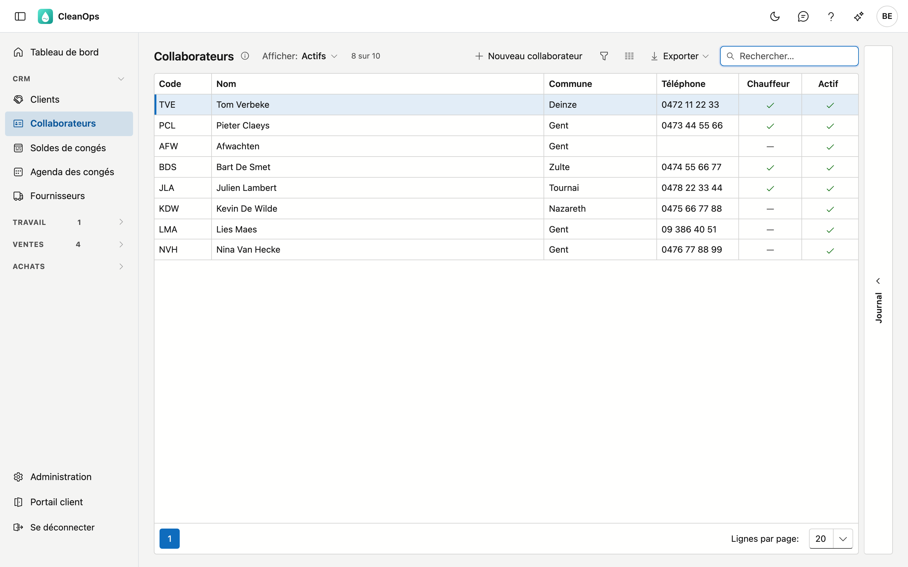
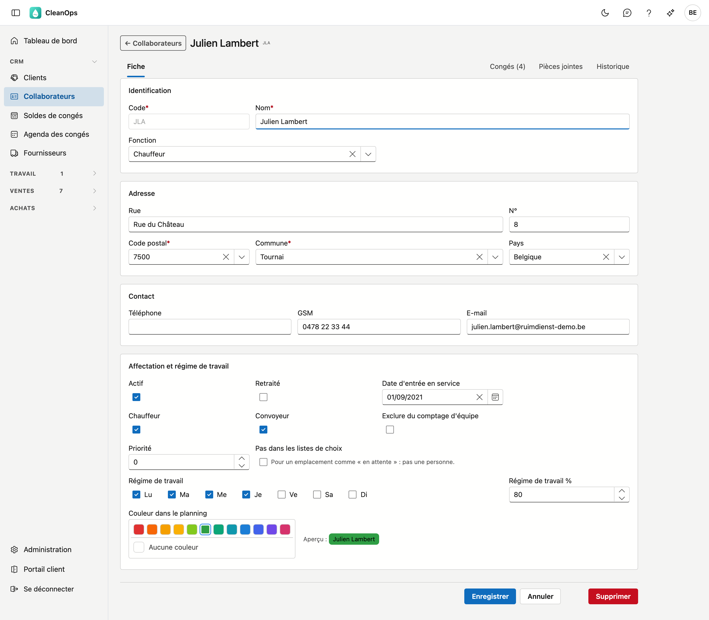
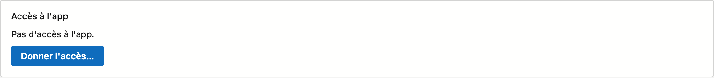
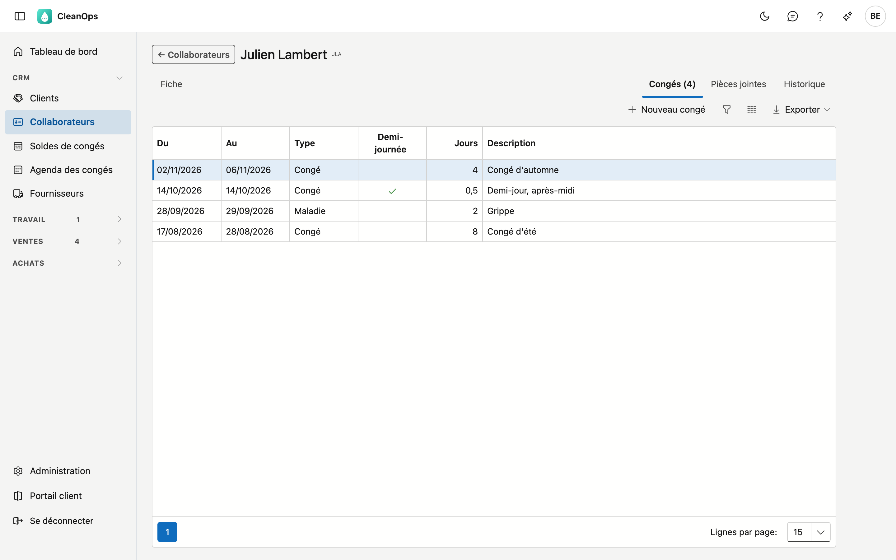
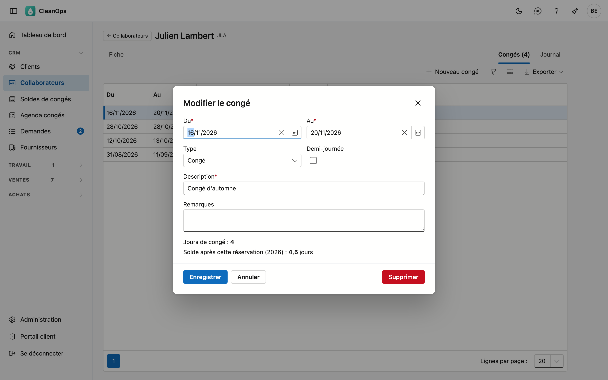

# Collaborateurs

Les personnes que vous planifiez en équipes et sur les ordres de travail. Pour chaque collaborateur, CleanOps
conserve les coordonnées, indique qui est chauffeur ou convoyeur, quels jours la personne travaille, et ses
congés.

## Ouvrir l'écran

Dans le menu de gauche, sous **CRM**, cliquez sur **Collaborateurs**.

## La liste

Pour chaque collaborateur, vous voyez le code, le nom, la commune, un numéro de téléphone (le GSM, sinon le fixe),
avec quel compte il se connecte (colonne **Accès app**, voir [Compte bureau et compte app](#compte-bureau-et-compte-app)),
et si la personne est chauffeur et active. En tête figurent les collaborateurs avec la **priorité** la plus élevée,
puis les autres par nom.

- **Rechercher** — le curseur est déjà dans le champ de recherche. La recherche porte sur le code, le nom, la
  commune et le numéro de téléphone.
- **Afficher** — est réglé sur **Actifs**. Choisissez **Pensionnés** pour les retraités, ou **Tous** pour
  retrouver aussi ceux qui ne sont plus actifs. Le compteur à côté indique combien de collaborateurs sont affichés
  sur le total.
- **Trier** — cliquez sur un titre de colonne ; un second clic inverse l'ordre.
- **Exporter** — le bouton en haut à droite vous donne la liste, telle qu'elle est filtrée, sous forme de fichier.
- **Ouvrir** — double-cliquez sur une ligne pour ouvrir la fiche de ce collaborateur.
- **Journal** — le volet à droite montre les pièces jointes et l'historique du collaborateur que vous sélectionnez
  dans la liste, sans ouvrir la fiche.

## Un nouveau collaborateur

Cliquez sur **Nouveau collaborateur**. Vous obtenez une fiche vide ; les champs marqués d'un astérisque sont
obligatoires. Après **Enregistrer**, la fiche du nouveau collaborateur s'ouvre, avec ses onglets.

### Vous rendre planifiable

Un identifiant n'est pas encore un collaborateur : qui se connecte sans fiche collaborateur ne figure pas sur le
[planning](planning.fr.md#le-tableau-de-planning) et ne peut pas s'attribuer de travail. Si c'est votre cas, un cadre
**Vous ne figurez pas parmi les collaborateurs** apparaît en haut du planning et de cette liste.

Vous travaillez aussi sur le terrain ? Cliquez sur **Me rendre planifiable…**. Le code, le nom, le code postal et la
commune sont déjà remplis ; adaptez-les si nécessaire et cliquez sur **Créer ma fiche**. CleanOps crée votre fiche et
la lie à votre identifiant. Vous arrivez sur votre nouvelle fiche et la complétez comme toute autre.

Vous ne travaillez pas sur le terrain ? Cliquez sur la croix : cet ordinateur n'affiche plus le cadre.

## La fiche collaborateur

En haut figurent le nom et le code, puis les onglets **Fiche**, **Congés** et **Journal**. Sous Journal figurent
**Pièces jointes** et **Historique**.
Le nombre de périodes de congé figure entre parenthèses dans le titre : « Congés (4) ».

### L'onglet Fiche

La fiche se compose de quatre blocs.

**Identification**

| Champ | Explication |
|---|---|
| Code * | La clé courte par laquelle le collaborateur est reconnu partout : sur un ordre de travail, dans une équipe, sur un bon de travail. 5 caractères au maximum. |
| Nom * | 30 caractères au maximum. |
| Fonction | Dans la liste « Fonctions collaborateur » des [tables de base](beheer/basistabellen.fr.md). |

!!! note "Le code est figé après la création"
    Sur un collaborateur existant, le champ du code est grisé. Tous les ordres de travail, équipes et bons de
    travail de la personne sont rattachés à ce code ; le modifier ensuite détacherait ces références. Si un code
    est erroné, créez un nouveau collaborateur et mettez l'ancien sur inactif.

**Adresse** — rue, numéro, code postal, commune et pays ; le code postal et la commune sont obligatoires. Après le
code postal, Commune propose les localités de ce code (9800 : Deinze, Astene, Vinkt…) ; vous pouvez aussi taper
vous-même.

**Contact** — téléphone, GSM et e-mail. Un numéro ou une adresse e-mail saisi doit être valide ; les laisser vides
est permis.

**Affectation et régime de travail**

| Champ | Explication |
|---|---|
| Actif | Si la personne fait partie de l'effectif. Celui qui ne travaille plus est mis sur inactif ; la fiche et tout l'historique subsistent. |
| Retraité | Une mention distincte d'Actif, pour afficher les retraités séparément. |
| Date d'entrée en service | Le premier jour de travail. Avant ce jour, le collaborateur n'est pas compté lors de la composition des équipes. |
| Chauffeur, Convoyeur | Le rôle lors d'une mission. Une personne peut être les deux. |
| Exclure du comptage d'équipe | Le collaborateur n'est pas compté dans les totaux des [Équipes](ploegen.fr.md#lapercu) (Planifiés, Disponibles, Libre (régime)). Il peut quand même faire partie d'une équipe. |
| Véhicule | Le véhicule fixe du collaborateur. Quand un ordre de travail reçoit ce collaborateur, son véhicule y figure automatiquement — voir [Ordres de travail](werkorders.fr.md). Sur le planning, la plaque figure sous son nom. Un véhicule mis hors service n'arrive plus sur du nouveau travail. |
| Priorité | Détermine l'ordre : plus elle est élevée, plus la personne figure haut, dans cette liste et partout où vous choisissez un collaborateur. Vos chauffeurs habituels se retrouvent ainsi en tête. |
| Pas dans les listes de choix | Pour un emplacement comme *En attente* : une ligne du planning qui n'est pas une personne. |
| Régime de travail | Les jours où la personne travaille, avec à côté le pourcentage d'une semaine à temps plein. Les congés ne comptent que ces jours-là. |
| Couleur dans le planning | La couleur avec laquelle le planning affiche ce collaborateur : sa ligne sur le [tableau de planning](planning.fr.md#le-tableau-de-planning) et son code dans la [liste du planning](planning.fr.md#la-liste-du-planning). Choisissez une couleur dans la palette, ou **Aucune couleur**. L'**Aperçu** à côté montre le nom tel que le planning l'affiche. |

Cliquez sur **Enregistrer** pour sauvegarder. S'il manque un champ obligatoire, CleanOps indique lequel.
**Annuler** vous ramène à la liste sans enregistrer.

### Accès à l'app

Sous les blocs figure **Accès à l'app** : le collaborateur peut-il se connecter à l'[application mobile](app/aan-de-slag.fr.md)
? Vous voyez ce bloc si vous pouvez modifier les collaborateurs.

#### Compte bureau et compte app

Il y a deux sortes de compte, et le bloc indique lequel est lié au collaborateur :

| Compte | Pour quoi | Qui le crée |
|---|---|---|
| **Compte bureau** | L'identifiant pour CleanOps sur l'ordinateur. Lié à un collaborateur, le même identifiant fonctionne aussi dans l'application. | ADM-Concept, à votre demande. |
| **Compte app** | Uniquement l'application mobile. Il ne donne pas accès à CleanOps sur l'ordinateur. | Vous, avec **Donner l'accès…** |

Si le collaborateur a déjà un compte bureau, ne lui donnez **pas** de compte app, mais liez son compte bureau : il
garde un seul identifiant. Si vous indiquez malgré tout l'adresse d'un compte bureau dans **Donner l'accès…**, CleanOps
propose lui-même de lier ce compte.

Quelqu'un qui travaille au bureau sans être planifié n'a pas besoin de fiche collaborateur : donnez l'accès à son
compte bureau sous [Accès à l'app](#acces-a-lapp-pour-le-bureau).

#### Donner un compte app

Le collaborateur se connecte avec son adresse e-mail et un mot de passe qu'il choisit lui-même. Pour lui donner accès :

1. Cliquez sur **Donner l'accès…**.
2. Indiquez son **E-mail**. Si la fiche porte une seule adresse, elle est déjà remplie.
3. Cliquez sur **Inviter**.

Le collaborateur reçoit un e-mail avec un lien pour choisir son mot de passe. Le lien reste valable 24 heures et ne
fonctionne qu'une seule fois. L'e-mail indique aussi où trouver l'application, et avec quelle adresse se connecter.

Dans une version d'essai ou un environnement qui n'est pas encore libéré, aucun e-mail ne part. Le lien apparaît alors dans le bloc, avec le bouton
**Copier le lien** : transmettez-le vous-même au collaborateur, par exemple par un message sur son GSM. Disparu ? **Inviter à nouveau** en crée un nouveau.

#### Lier un compte bureau

1. Cliquez sur **Lier un compte bureau…**.
2. Choisissez le **Compte bureau**. La liste ne montre que ceux qui peuvent être liés : pas ceux déjà liés à un autre
   collaborateur, pas ceux qui sont désactivés, ni ceux qui partagent leur adresse e-mail avec un autre utilisateur.
3. Cliquez sur **Lier**.

Aucun e-mail ne part : le collaborateur se connecte dans l'application avec le même identifiant que sur l'ordinateur,
et y voit son travail ainsi que les écrans que montre son rôle.

Quelqu'un a reçu un compte app alors qu'il a un compte bureau ? Cliquez sur **Remplacer par un compte bureau…** et
choisissez son compte bureau. Le compte app est supprimé : il ne peut plus se connecter avec.

#### Les états

Ce que le bloc affiche et les boutons présents dépendent de l'état :

| État | Boutons |
|---|---|
| Pas d'accès à l'app. | **Donner l'accès…** crée un compte app. **Lier un compte bureau…** |
| Compte bureau : le collaborateur se connecte avec le même identifiant sur l'ordinateur et dans l'application. | **Délier**. Son identifiant sur l'ordinateur reste. |
| Compte app, invité : le mot de passe n'a pas encore été choisi. | **Inviter à nouveau** envoie un nouvel e-mail, par exemple si le lien a expiré. **Révoquer**. **Remplacer par un compte bureau…** |
| Compte app : le collaborateur se connecte avec l'adresse affichée. | **Nouveau mot de passe** envoie un lien pour choisir un nouveau mot de passe ; l'actuel reste valable jusque-là. **Révoquer**. **Remplacer par un compte bureau…** |
| Compte app, accès révoqué. | **Rétablir l'accès**. Si le collaborateur n'avait pas encore de mot de passe, il reçoit une nouvelle invitation. **Remplacer par un compte bureau…** |

**Révoquer** exclut immédiatement le collaborateur. Une session déjà ouverte dans l'application reste valable au plus
une heure.

!!! info "Qui n'obtient pas d'accès"
    Un collaborateur supprimé, inactif ou retraité ne peut pas se connecter : le bloc l'indique, et **Donner
    l'accès…** ne fonctionne pas. Une adresse e-mail qui appartient déjà à un autre utilisateur est refusée, sauf
    s'il s'agit d'un compte bureau que vous pouvez lier : CleanOps le propose alors.

### Accès à l'app pour le bureau

Sous **Administration › Accès à l'app** figurent les comptes bureau de votre entreprise. À qui n'a pas de fiche
collaborateur, vous donnez ici l'accès à l'application avec **Donner l'accès** ; **Révoquer** le retire. Il se connecte
dans l'application avec le même identifiant que sur l'ordinateur et y voit ce que montre son rôle (voir
[L'application pour le bureau](app/kantoor.fr.md)). Qui est lié à un collaborateur y figure avec le nom de ce
collaborateur : il entre déjà par sa fiche.

Vous voyez la tuile si vous pouvez modifier les collaborateurs. Un nouveau compte bureau se demande à ADM-Concept.

### L'onglet Congés

Les congés, maladies et autres absences du collaborateur, les plus récents en tête : du, au, type, demi-journée,
le nombre de jours et la description.

**Nouveau congé** encode une période ; double-cliquez sur une ligne pour la modifier.

| Champ | Explication |
|---|---|
| Du *, Au * | Le premier et le dernier jour. Au ne peut pas précéder Du. |
| Type | **Congé**, **Maladie** ou **Autre**. |
| Demi-journée | La période compte une demi-journée de moins. |
| Description * | 50 caractères au maximum, par exemple *Congé d'été*. |
| Remarques | Texte libre. |

Sous les champs figure le nombre de **jours de congé** de la période. CleanOps les calcule lui-même : les jours où
le collaborateur travaille selon son régime de travail, sans les [jours fériés et jours de fermeture](beheer/feestdagen.fr.md). Une personne qui travaille du lundi
au jeudi compte donc 4 jours pour une semaine complète.

Pour le type **Congé**, le **solde après cette réservation** figure en dessous : ce qu'il reste au collaborateur cette
année-là si vous enregistrez. Seul celui qui a le droit de consulter les [soldes de congés](verlofsaldi.fr.md) le voit.
S'il n'y a pas encore d'attribution pour cette année, la fenêtre le signale.

Si le collaborateur figure déjà sur des ordres de travail ouverts ou dans une équipe durant cette période, la
fenêtre le signale. Le congé peut être encodé normalement ; le message vous indique où vérifier le planning.

**Supprimer** dans la fenêtre retire la période définitivement, après confirmation. Le
[journal des actions](beheer/actielogboek.fr.md) garde la trace de qui l'a encodée, modifiée ou supprimée.

### L'onglet Journal

**Pièces jointes** — les documents de ce collaborateur, comme une attestation ou un certificat médical. **Pièce jointe** ajoute un
fichier, jusqu'à 25 Mo ; pour chacune, vous modifiez la description ou la retirez. Pour un certificat médical,
indiquez la période dans la description : vous le retrouverez ainsi avec le bon congé.

**Historique** — qui a modifié quel champ de ce collaborateur, quand, et de quelle valeur vers quelle autre. Le plus récent figure
en tête.

## Supprimer un collaborateur

**Supprimer**, en bas de la fiche, place le collaborateur dans la [corbeille](beheer/prullenbak.fr.md), d'où vous le
restaurez.

La question avant la suppression indique ce que cela entraîne : qu'il s'agit de votre propre fiche (vous ne figurez
alors plus dans le planning), que le collaborateur ne peut plus se connecter dans l'app, qu'il ne reste ensuite plus
aucun collaborateur actif, ou combien d'ordres de travail sont encore à faire à son nom.

Mieux vaut ne pas supprimer une personne qui a figuré sur un ordre de travail : mettez-la sur inactif. Tout ce qui
s'y rattache reste alors lisible.

## Questions fréquentes

**Un collaborateur ne figure pas dans la liste.**
Regardez **Afficher** en haut : ce champ est réglé sur les collaborateurs actifs. Choisissez **Tous**. Si la
personne n'y figure toujours pas, consultez la [corbeille](beheer/prullenbak.fr.md).

**Un collaborateur actif n'apparaît pas lors de la composition d'une équipe.**
Vérifiez sur sa fiche **Exclure du comptage d'équipe** et la **Date d'entrée en service**.

**Une semaine de congé compte moins de 5 jours.**
CleanOps ne compte que les jours du régime de travail, et pas les jours fériés. Consultez le régime de travail sur
la fiche du collaborateur.
