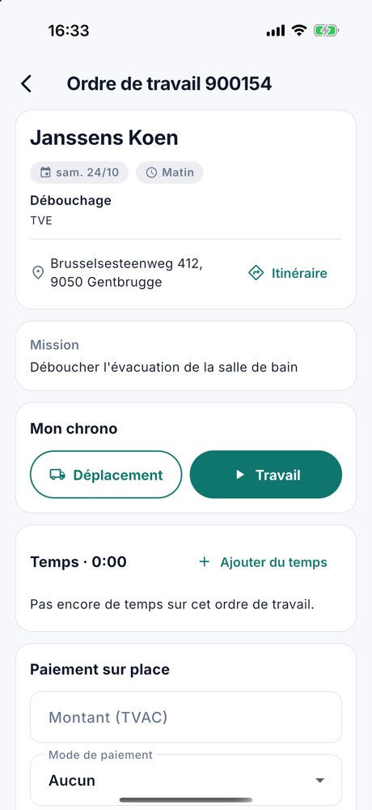

# L'application mobile

Avec l'application CleanOps, vos collaborateurs sur le terrain ont leur planning et leurs ordres de travail sous la
main. Ils enregistrent leurs heures avec un chrono, notent un paiement sur place et terminent le travail. Ce qu'ils
font dans l'application, vous le voyez immédiatement dans CleanOps au bureau.

L'application fonctionne sur un iPhone, un iPad et un appareil Android, en néerlandais et en français.

## Donner l'accès

Un collaborateur se connecte avec son adresse e-mail et un mot de passe qu'il choisit lui-même. Vous lui donnez accès
sur sa fiche, dans le bloc [Accès à l'app](medewerkers.fr.md#acces-a-lapp) :

1. Ouvrez le collaborateur et cliquez sur **Donner l'accès…**.
2. Indiquez son adresse e-mail et cliquez sur **Inviter**.
3. Le collaborateur reçoit un e-mail. Il y choisit son mot de passe avec le lien (valable 24 heures) et trouve
   l'application dans l'[App Store](https://apps.apple.com/app/id6748907113) ou dans
   [Google Play](https://play.google.com/store/apps/details?id=com.admconcept.cleanops).
4. Il ouvre l'application et se connecte avec son adresse e-mail et son mot de passe.

S'il a oublié son mot de passe, envoyez-lui un lien pour en choisir un nouveau via **Nouveau mot de passe** sur sa
fiche.

## Ce que voit le collaborateur

Le collaborateur ne voit que son propre travail et celui de son équipe. L'application n'utilise pas sa position.

### Le planning

L'application s'ouvre sur le planning du jour : les ordres de travail du collaborateur et de son équipe, dans l'ordre
de la journée. Pour chaque ordre de travail figurent la partie de la journée, le client et l'adresse, avec
**Itinéraire** pour ouvrir le trajet dans l'application de cartes de l'appareil. **Terminé** (en vert, la carte un peu
plus pâle), **Chrono en cours** ou **Non exécuté** (planifié sur un jour déjà passé) s'affiche le cas échéant.

Les flèches passent au jour précédent ou suivant, et **Aujourd'hui** ramène au jour même.

{ width="300" }

Sur une tablette, le planning et l'ordre de travail choisi sont côte à côte.

### L'ordre de travail

Un appui sur un ordre de travail l'ouvre : le client, l'adresse avec **Itinéraire**, **Appeler** pour le numéro de
téléphone, et ce qu'il faut faire (**Mission**, **Instruction**, **Matériel** et **Remarque**, s'ils sont remplis).

{ width="300" }

### Le chrono

Sous **Mon chrono**, le collaborateur enregistre son temps sur cet ordre de travail :

- **Déplacement** ou **Travail** démarre le chrono.
- **Pause** et **Reprendre** l'interrompent.
- **Passer au travail** ou **Passer au déplacement** change le type sans arrêter.
- **Arrêter** arrête le chrono.

Un seul chrono tourne à la fois. Si le collaborateur démarre un chrono sur un autre ordre de travail, le précédent
s'arrête. S'il a oublié de démarrer ou d'arrêter, il encode le temps à la main avec **Ajouter du temps** ou **Corriger
le temps**. Au bureau, vous voyez tout dans l'onglet [Temps](werkorders.fr.md#temps) de l'ordre de travail.

{ width="300" }

### Notes

Sous **Notes**, le collaborateur écrit ce que le bureau ou un collègue doit savoir : « couvercle bloqué, prendre un
pied-de-biche ». Il appuie sur **Ajouter une note**, tape son texte (2000 caractères au plus) et appuie sur
**Enregistrer**. Chaque note figure avec le nom de son auteur et le moment. Une note du bureau figure avec **Bureau**.

Au bureau, vous les voyez dans l'onglet [Notes](werkorders.fr.md#notes) de l'ordre de travail, avec **par** et le nom du
collaborateur.

<!-- AFBEELDING: app-notities-fr — la carte Notes dans l'application avec une note de Tom Verbeke et le bouton Ajouter une note -->

### Photos

Sous **Photos**, le collaborateur ajoute des photos à l'ordre de travail : une évacuation bouchée avant et après, un
couvercle abîmé. Il appuie sur **Ajouter une photo** et choisit **Prendre une photo** ou **Depuis la galerie**. La
première fois qu'il prend une photo, l'appareil demande l'accès à l'appareil photo. Depuis la galerie, l'application ne
voit que la photo qu'il choisit.

- L'application réduit la photo avant de l'envoyer. Elle passe ainsi rapidement, même avec une connexion lente.
- La position qu'un appareil enregistre dans une photo est effacée avant que la photo soit enregistrée.
- Un appui sur une photo l'affiche en grand, avec qui l'a prise et quand.

Au bureau, les photos se trouvent sur l'ordre de travail sous [**Journal**](werkorders.fr.md#journal) › **Pièces
jointes**.

Si l'envoi échoue, par exemple sans réseau dans une cave, la photo reste dans l'application avec **Pas envoyée** et
**Réessayer**. Elle n'est pas envoyée plus tard d'elle-même : le collaborateur appuie lui-même sur **Réessayer** dès
qu'il a de nouveau une connexion.

<!-- AFBEELDING: app-fotos-fr — la carte Photos dans l'application avec une miniature et le bouton Ajouter une photo -->

### Supprimer des notes et des photos

Avec la corbeille, le collaborateur supprime ses propres notes et photos, tant que l'ordre de travail n'est pas
terminé. Ce qu'un collègue ou le bureau a ajouté, il ne peut pas le supprimer. Au bureau, qui peut modifier les ordres
de travail supprime n'importe quelle note dans l'onglet Notes ; une photo se supprime sous Journal › Pièces jointes.

### Le paiement sur place

Si le client paie sur place, le collaborateur note sous **Paiement sur place** le **Montant (TVAC)** et le **Mode de
paiement**, puis appuie sur **Enregistrer le paiement**. Le montant et le mode de paiement figurent immédiatement sur
l'ordre de travail dans CleanOps.

{ width="300" }

### Terminer

Quand le travail est terminé, le collaborateur appuie sur **Terminer** et confirme. L'ordre de travail passe au statut
**À facturer** et est prêt pour la [facturation](facturatie.fr.md). Ensuite, il ne peut plus le modifier dans
l'application, ni y ajouter ou supprimer des notes ou des photos ; corriger son propre temps reste possible.

Un ordre de travail planifié à une date future ne peut pas être terminé.

### Le profil

Le menu contient **Profil** : le nom et l'adresse e-mail du collaborateur, la **Langue** de l'application (comme le
téléphone, Nederlands ou Français), l'**Affichage** (clair ou sombre) et **Se déconnecter**. La déconnexion ne vaut que
pour cet appareil.

## Questions fréquentes

**Un collaborateur ne parvient pas à se connecter.**
Regardez sur sa fiche le bloc [Accès à l'app](medewerkers.fr.md#acces-a-lapp). S'il indique *Invité*, il n'a pas encore
choisi son mot de passe : envoyez un nouveau lien avec **Inviter à nouveau**. Si l'accès est révoqué, ou si le
collaborateur est inactif ou retraité, il ne peut pas se connecter.

**Un collaborateur ne voit pas un ordre de travail.**
L'application montre le travail du collaborateur et de son équipe. Vérifiez dans le [planning](planning.fr.md) que
l'ordre de travail est attribué à lui ou à son équipe ce jour-là.

**Où trouver les photos d'un collaborateur ?**
Sur l'ordre de travail, sous **Journal** › **Pièces jointes**. Elles s'appellent *Photo* (ou *Foto* si l'application
du collaborateur est en néerlandais), suivi du numéro de l'ordre de travail et du moment, par exemple *Photo 900149
2026-10-25 20.58.30.jpg*.

**Un collaborateur ne peut pas prendre de photo.**
S'il n'a pas donné à l'application l'accès à l'appareil photo la première fois, il l'active dans les réglages de son
appareil, sous l'application CleanOps. Choisir une photo depuis la galerie reste possible.

**Le temps dans l'application est incorrect.**
Corrigez-le dans l'onglet [Temps](werkorders.fr.md#temps) de l'ordre de travail, ou le collaborateur le fait lui-même
avec **Corriger le temps**.
