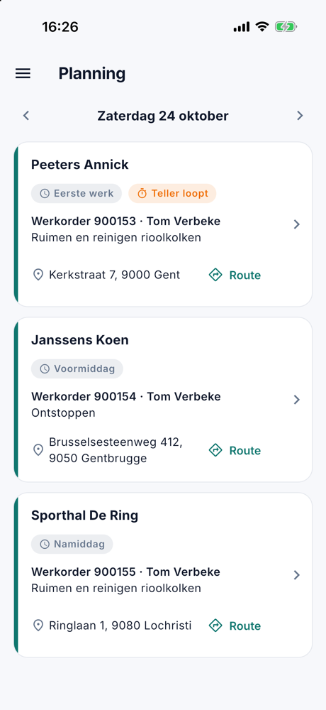
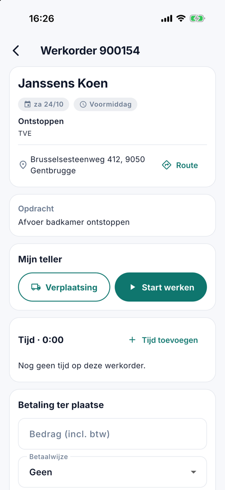

# De mobiele app

Met de app CleanOps hebben uw medewerkers in het veld hun planning en hun werkorders bij de hand. Ze registreren hun
werkuren met een teller, noteren een betaling ter plaatse en ronden het werk af. Wat ze in de app doen, ziet u meteen
in CleanOps op kantoor.

De app werkt op een iPhone, een iPad en een Android-toestel, in het Nederlands en het Frans.

## Toegang geven

Een medewerker meldt zich aan met zijn e-mailadres en een wachtwoord dat hij zelf kiest. U geeft hem toegang op zijn
fiche, in het blok [App-toegang](medewerkers.md#app-toegang):

1. Open de medewerker en klik op **Toegang geven…**.
2. Vul zijn e-mailadres in en klik op **Uitnodigen**.
3. De medewerker krijgt een mail. Daarin kiest hij zijn wachtwoord met de link (24 uur geldig) en vindt hij de app in
   de [App Store](https://apps.apple.com/app/id6748907113) of in
   [Google Play](https://play.google.com/store/apps/details?id=com.admconcept.cleanops).
4. Hij opent de app en meldt zich aan met zijn e-mailadres en zijn wachtwoord.

Is hij zijn wachtwoord vergeten, dan stuurt u hem via **Nieuw wachtwoord** op zijn fiche een link om een nieuw te
kiezen.

## Wat de medewerker ziet

De medewerker ziet enkel het werk van zichzelf en van zijn ploeg. De app gebruikt zijn locatie niet.

### De planning

De app opent op de planning van vandaag: de werkorders van de medewerker en zijn ploeg, in de volgorde van de dag. Per
werkorder staan het tijdsdeel, de klant en het adres, met **Route** om de weg te openen in de kaartapp van het
toestel. **Afgerond** (in het groen, de kaart iets vager), **Teller loopt** of **Niet uitgevoerd** (gepland op een dag
die al voorbij is) staat erbij als dat zo is.

Met de pijltjes bladert hij naar de vorige of de volgende dag, en met **Vandaag** keert hij terug.

{ width="300" }

Op een tablet staan de planning en de gekozen werkorder naast elkaar.

### De werkorder

Een tik op een werkorder opent ze: de klant, het adres met **Route**, **Bellen** voor het telefoonnummer, en wat er
moet gebeuren (**Opdracht**, **Instructie**, **Materiaal** en **Opmerking**, als ze ingevuld zijn).

{ width="300" }

### De teller

Onder **Mijn teller** registreert de medewerker zijn tijd op deze werkorder:

- **Verplaatsing** of **Start werken** start de teller.
- **Pauze** en **Hervatten** onderbreken hem.
- **Overschakelen naar werken** of **Overschakelen naar verplaatsing** wisselt de soort zonder te stoppen.
- **Stop** stopt de teller.

Er loopt hoogstens één teller tegelijk. Start de medewerker een teller op een andere werkorder, dan stopt de vorige.
Vergat hij te starten of te stoppen, dan geeft hij met **Tijd toevoegen** of **Tijd rechtzetten** de tijd met de hand
in. Op kantoor ziet u alles op het tabblad [Tijd](werkorders.md#tijd) van de werkorder.

{ width="300" }

### Notities

Onder **Notities** schrijft de medewerker op wat het kantoor of een collega moet weten: "deksel zat vast, koevoet
meenemen". Hij tikt op **Notitie toevoegen**, typt zijn tekst (hoogstens 2000 tekens) en tikt op **Bewaren**. Elke
notitie staat er met de naam van wie ze schreef en het moment. Een notitie van het kantoor staat er met **Kantoor**.

Op kantoor ziet u ze op het tabblad [Notities](werkorders.md#notities) van de werkorder, met **door** en de naam van de
medewerker.

<!-- AFBEELDING: app-notities — de kaart Notities in de app met een notitie van Tom Verbeke en de knop Notitie toevoegen -->

### Foto's

Onder **Foto's** voegt de medewerker foto's toe bij de werkorder: een verstopte afvoer vóór en na, een beschadigd
deksel. Hij tikt op **Foto toevoegen** en kiest **Foto nemen** of **Uit de galerij**. De eerste keer dat hij een foto
neemt, vraagt het toestel toegang tot de camera. Uit de galerij ziet de app enkel de foto die hij kiest.

- De app verkleint de foto vóór ze vertrekt. Zo gaat ze ook over een trage verbinding snel.
- De locatie die een toestel in een foto bewaart, wordt gewist vóór de foto bewaard wordt.
- Een tik op een foto toont ze groot, met wie ze nam en wanneer.

Op kantoor staan de foto's bij de werkorder onder [**Journaal**](werkorders.md#journaal) › **Bijlagen**.

Lukt het versturen niet, bijvoorbeeld zonder netwerk in een kelder, dan blijft de foto in de app staan met **Niet
verstuurd** en **Opnieuw proberen**. Ze wordt niet later vanzelf verstuurd: de medewerker tikt zelf op **Opnieuw
proberen** zodra hij weer verbinding heeft.

<!-- AFBEELDING: app-fotos — de kaart Foto's in de app met een miniatuur en de knop Foto toevoegen -->

### Notities en foto's verwijderen

Met het vuilbakje verwijdert de medewerker zijn eigen notities en foto's, zolang de werkorder niet afgerond is. Wat een
collega of het kantoor toevoegde, kan hij niet verwijderen. Op kantoor verwijdert wie werkorders mag bewerken elke
notitie, op het tabblad Notities; een foto verwijdert u onder Journaal › Bijlagen.

### De betaling ter plaatse

Betaalt de klant ter plaatse, dan noteert de medewerker onder **Betaling ter plaatse** het **Bedrag (incl. btw)** en de
**Betaalwijze**, en tikt hij op **Betaling bewaren**. Het bedrag en de betaalwijze staan meteen op de werkorder in
CleanOps.

{ width="300" }

### Afronden

Is het werk klaar, dan tikt de medewerker op **Afronden** en bevestigt hij. De werkorder krijgt de status **Te
factureren** en staat klaar voor de [facturatie](facturatie.md). Daarna kan hij ze in de app niet meer wijzigen, en ook
geen notities of foto's meer toevoegen of verwijderen; zijn eigen tijd rechtzetten kan nog wel.

Een werkorder die gepland is op een dag in de toekomst, kan hij niet afronden.

### Het profiel

In het menu staat **Profiel**: de naam en het e-mailadres van de medewerker, de **Taal** van de app (zoals de telefoon,
Nederlands of Français), de **Weergave** (licht of donker) en **Afmelden**. Afmelden geldt enkel voor dat toestel.

## Veelgestelde vragen

**Een medewerker kan zich niet aanmelden.**
Kijk op zijn fiche in het blok [App-toegang](medewerkers.md#app-toegang). Staat er *Uitgenodigd*, dan koos hij zijn
wachtwoord nog niet: stuur met **Opnieuw uitnodigen** een nieuwe link. Is de toegang ingetrokken, of is de medewerker
niet actief of met pensioen, dan kan hij zich niet aanmelden.

**Een medewerker ziet een werkorder niet.**
De app toont het werk van de medewerker en zijn ploeg. Kijk in de [planning](planning.md) of de werkorder op die dag
aan hem of aan zijn ploeg toegewezen is.

**Waar vind ik de foto's van een medewerker?**
Op de werkorder, onder **Journaal** › **Bijlagen**. Ze heten *Foto* (of *Photo* als de app van de medewerker in het
Frans staat), gevolgd door het nummer van de werkorder en het moment, bijvoorbeeld *Foto 900149 2026-10-25 20.58.30.jpg*.

**Een medewerker kan geen foto nemen.**
Gaf hij de app de eerste keer geen toegang tot de camera, dan zet hij dat aan in de instellingen van zijn toestel, bij
de app CleanOps. Een foto uit de galerij kiezen kan intussen wel.

**De tijd in de app klopt niet.**
U zet ze recht op het tabblad [Tijd](werkorders.md#tijd) van de werkorder, of de medewerker doet het zelf met **Tijd
rechtzetten**.
