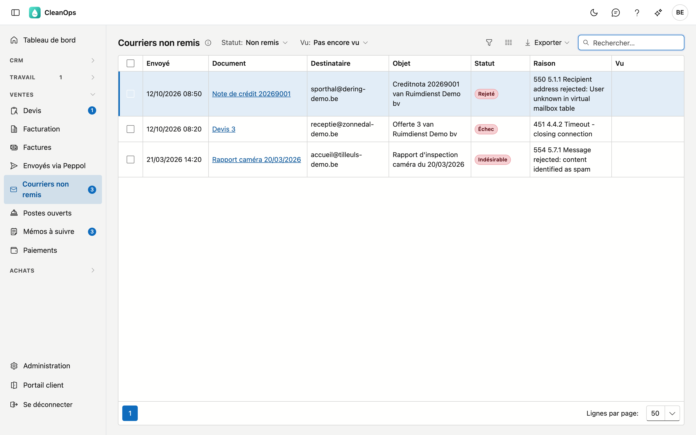
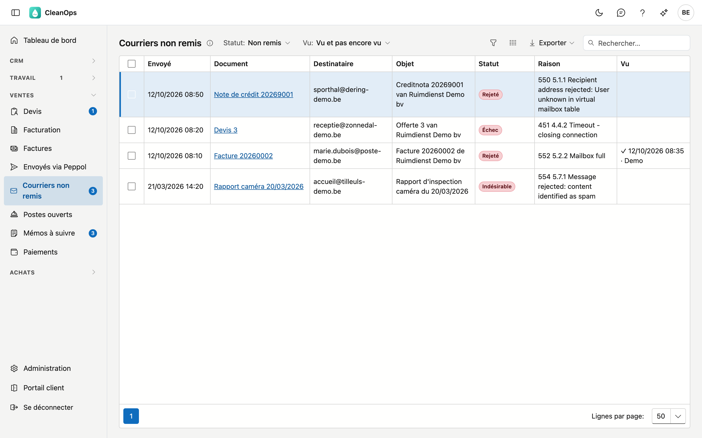

# Courriers non remis

Courriers non remis montre les e-mails que CleanOps a envoyés pour vous et qui ne sont pas arrivés : rejetés par le serveur
de messagerie du destinataire, retenus comme indésirables, ou jamais partis. Utilisez cet écran pour les suivre — une
facture que votre client n'a jamais reçue ne sera pas payée non plus.

## Ouvrir l'écran

Cliquez à gauche dans le menu, sous **Ventes**, sur **Courriers non remis**. Le chiffre à côté indique combien d'e-mails ne
sont pas arrivés et n'ont encore été cochés par personne. S'il n'y a pas de chiffre, il n'y a rien à suivre — ou CleanOps
n'a pas pu demander le nombre ; la liste dit alors pourquoi.

## La liste

La liste s'ouvre sur ce que vous devez encore suivre : **Statut** sur *Non remis* et **Vu** sur *Pas encore vu*.

| Colonne | Ce qu'elle contient |
|---|---|
| Envoyé | Quand l'e-mail est parti. |
| Document | La facture, la note de crédit, le devis, le rappel, l'attestation, le rapport caméra ou le contrat dont parlait l'e-mail. Cliquez dessus pour l'ouvrir. |
| Destinataire | L'adresse à laquelle l'e-mail est parti. |
| Objet | L'objet de l'e-mail, dans la langue du client. |
| Statut | Ce qui s'est mal passé (voir ci-dessous). |
| Raison | Pourquoi l'e-mail n'est pas arrivé. Le texte vient du serveur de messagerie ou d'ADM One et n'est pas traduit ; il est souvent en anglais. |
| Vu | Qui a coché le message, et quand. Vide tant que personne ne l'a fait. |

| Statut | Ce que cela signifie |
|---|---|
| Rejeté | Le serveur de messagerie du destinataire a refusé l'e-mail, par exemple parce que l'adresse n'existe pas ou que la boîte est pleine. |
| Indésirable | L'e-mail a été retenu comme courrier indésirable. |
| Échec | L'e-mail n'a pas pu être envoyé. |
| Remis | L'e-mail est arrivé. Vous ne voyez ces e-mails que si vous filtrez vous-même sur ce statut. |

Si vous mettez **Statut** sur *Tous*, vous voyez chaque e-mail avec son propre statut — aussi ce qui est encore en cours
d'envoi, ou ce qui a été retenu et n'est donc pas parti.

Le champ de recherche cherche sur le destinataire, l'objet ou le document. **Exporter** place la liste dans un fichier.

### Filtrer

| Filtre | Choix |
|---|---|
| **Statut** | *Non remis* (tout ce qui n'est pas arrivé) · *Rejeté / indésirable* · *Échec* · *Remis* · *Tous* |
| **Vu** | *Pas encore vu* · *Vu* · *Vu et pas encore vu* |

Si la liste affiche *Les 2 000 e-mails les plus récents*, choisissez une sélection plus stricte pour voir les plus anciens.

## Suivre un e-mail

1. Lisez la **Raison**. Le plus souvent, l'adresse n'est pas (plus) correcte, ou la boîte du client est pleine.
2. Cliquez sur le **document**. Son onglet **E-mails** montre l'e-mail lui-même, avec le même statut et la même raison.
3. Corrigez : adaptez l'adresse e-mail sur la [fiche client](klanten.fr.md), ou prenez contact avec le client.
4. Renvoyez le document, depuis sa propre fiche.
5. Cochez le message (voir ci-dessous).

Si la colonne Document ne contient pas de lien, l'e-mail n'appartient pas à un document qui a sa propre fiche.

## Cocher

Cochez un ou plusieurs e-mails et cliquez sur **Vu**. Ils disparaissent de la liste, et le chiffre dans le menu baisse lui
aussi.

- **Vu vaut pour toute l'entreprise** : ce que vous cochez l'est aussi pour vos collègues.
- Avec le filtre **Vu** sur *Vu* ou *Vu et pas encore vu*, vous retrouvez les messages cochés, avec qui l'a fait et
  quand.
- Si vous avez coché trop tôt, sélectionnez l'e-mail et cliquez sur **Pas encore vu**.

Cocher indique seulement que le message a été suivi. Rien ne change à l'e-mail ni au document.

## Si la liste ne se charge pas

| Message | Ce que cela signifie |
|---|---|
| *ADM One n'a pas répondu* | La liste n'a pas pu être chargée. Ce n'est pas la même chose qu'« aucun e-mail » : réessayez plus tard. |
| *Cette entreprise n'est pas (encore) liée comme client à ADM One* | CleanOps ne peut pas demander vos e-mails envoyés. Signalez-le à ADM-Concept. |

## Droits

| Droit | Ce qu'il permet |
|---|---|
| **Suivre les courriers non remis** | ouvrir l'écran, voir le chiffre dans le menu et cocher des messages. |

Le rôle **Administrateur** a ce droit d'office. Pour les autres rôles, vous l'attribuez dans les [Rôles](beheer/rollen.fr.md).

## Questions fréquentes

**Le chiffre dans le menu n'est pas tout de suite correct après avoir coché.**
Le chiffre est rafraîchi toutes les quelques minutes. Rechargez la page pour le voir tout de suite.

**Je vois un e-mail que je n'ai pas envoyé moi-même.**
La liste montre les e-mails de toute votre entreprise, pas seulement les vôtres.

**Où vois-je les e-mails qui sont bien arrivés ?**
Mettez **Statut** sur *Remis* ou *Tous*. Par document, ils figurent aussi dans l'onglet **E-mails** de ce document.

**Les factures électroniques via Peppol figurent-elles ici aussi ?**
Non. Vous les trouvez dans [Envoyés via Peppol](verzonden-via-peppol.fr.md).

## Voir aussi

- [Factures](facturen.fr.md) — l'onglet E-mails d'une facture
- [Postes ouverts](openstaande-posten.fr.md) — envoyer des rappels par e-mail
- [Envoyés via Peppol](verzonden-via-peppol.fr.md)
- [Textes d'e-mail](beheer/mailteksten.fr.md)
