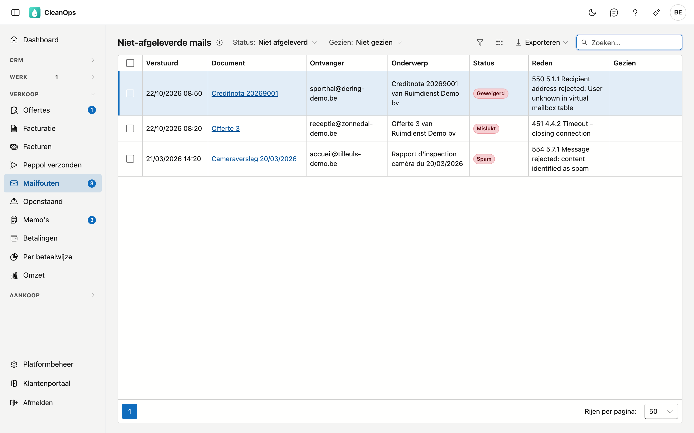
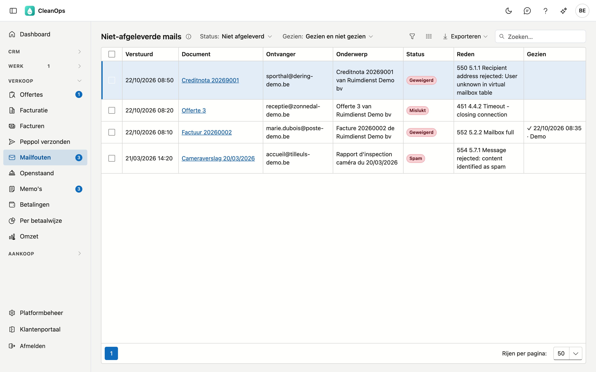

# Niet-afgeleverde mails

Niet-afgeleverde mails toont de mails die CleanOps voor u verstuurde en die niet aankwamen: geweigerd door de mailserver
van de ontvanger, als spam tegengehouden, of nooit vertrokken. Gebruik het scherm om ze op te volgen — een factuur die uw
klant nooit kreeg, wordt ook niet betaald.

## Het scherm openen

Klik links in het menu, onder **Verkoop**, op **Mailfouten**. Het scherm heet Niet-afgeleverde mails. Het getal ernaast zegt hoeveel mails niet
aankwamen en nog door niemand afgevinkt zijn. Staat er geen getal, dan is er niets op te volgen — of kon CleanOps het
aantal niet opvragen; de lijst zegt dan waarom.

## De lijst

De lijst opent op wat u nog moet opvolgen: **Status** op *Niet afgeleverd* en **Gezien** op *Niet gezien*.

| Kolom | Wat erin staat |
|---|---|
| Verstuurd | Wanneer de mail vertrok. |
| Document | De factuur, creditnota, offerte, rappel, het attest, cameraverslag of contract waarover de mail ging. Klik erop om het te openen. |
| Ontvanger | Het adres waarnaar de mail vertrok. |
| Onderwerp | Het onderwerp van de mail, in de taal van de klant. |
| Status | Wat er misliep (zie hieronder). |
| Reden | Waarom de mail niet aankwam. De tekst komt van de mailserver of van ADM One en is niet vertaald; vaak is ze Engels. |
| Gezien | Wie de melding afvinkte, en wanneer. Leeg zolang niemand dat deed. |

| Status | Wat het betekent |
|---|---|
| Geweigerd | De mailserver van de ontvanger weigerde de mail, bijvoorbeeld omdat het adres niet bestaat of het postvak vol is. |
| Spam | De mail werd als ongewenst tegengehouden. |
| Mislukt | De mail raakte niet verstuurd. |
| Afgeleverd | De mail kwam aan. U ziet deze mails enkel als u er zelf op filtert. |

Zet u **Status** op *Alle*, dan ziet u elke mail met haar eigen status — ook wat nog onderweg is, of wat tegengehouden werd
en dus niet vertrok.

Met het zoekveld zoekt u op de ontvanger, het onderwerp of het document. **Exporteren** zet de lijst in een bestand.

### Filteren

| Filter | Keuzes |
|---|---|
| **Status** | *Niet afgeleverd* (alles wat niet aankwam) · *Geweigerd / spam* · *Mislukt* · *Afgeleverd* · *Alle* |
| **Gezien** | *Niet gezien* · *Gezien* · *Gezien en niet gezien* |

Toont de lijst *De nieuwste 2.000 mails*, kies dan een strengere selectie om oudere te zien.

## Een mail opvolgen

1. Lees de **Reden**. Meestal klopt het adres niet (meer), of zit het postvak van de klant vol.
2. Klik op het **document**. Onder **Journaal** › **Mails** van dat document staat de mail zelf, met dezelfde status en reden.
3. Zet het recht: verbeter het e-mailadres op de [klantfiche](klanten.md), of neem contact op met de klant.
4. Mail het document opnieuw, vanop zijn eigen fiche.
5. Vink de melding af (zie hieronder).

Staat er bij een mail geen link in de kolom Document, dan hoort ze niet bij een document met een eigen fiche.

## Afvinken

Vink een of meer mails aan en klik op **Gezien**. Ze verdwijnen uit de lijst, en het getal in het menu daalt mee.

- **Gezien geldt voor het hele bedrijf**: wat u afvinkt, is ook voor uw collega's afgevinkt.
- Met het filter **Gezien** op *Gezien* of *Gezien en niet gezien* vindt u de afgevinkte meldingen terug, met wie het deed
  en wanneer.
- Vinkte u te vroeg af, vink de mail dan aan en klik op **Niet gezien**.

Afvinken zegt enkel dat de melding opgevolgd is. Aan de mail of het document verandert er niets.

## Als de lijst niet laadt

| Melding | Wat het betekent |
|---|---|
| *ADM One antwoordde niet* | De lijst kon niet opgehaald worden. Dat is iets anders dan "geen mails": probeer later opnieuw. |
| *Dit bedrijf is (nog) niet als klant gekoppeld aan ADM One* | CleanOps kan uw verstuurde mails niet opvragen. Meld het aan ADM-Concept. |

## Rechten

| Recht | Wat het toelaat |
|---|---|
| **Niet-afgeleverde mails opvolgen** | het scherm openen, het getal in het menu zien en meldingen afvinken. |

De rol **Beheerder** heeft dit recht vanzelf. Andere rollen kent u het toe in [Rollen](beheer/rollen.md).

## Veelgestelde vragen

**Het getal in het menu klopt niet meteen na het afvinken.**
Het getal wordt om de paar minuten ververst. Laad de pagina opnieuw om het meteen te zien.

**Ik zie een mail die ik niet zelf verstuurde.**
De lijst toont de mails van uw hele bedrijf, niet enkel die van u.

**Waar zie ik de mails die wél aankwamen?**
Zet **Status** op *Afgeleverd* of *Alle*. Per document staan ze ook onder **Journaal** › **Mails** van dat document.

**Staan e-facturen via Peppol hier ook?**
Nee. Die vindt u in [Verzonden via Peppol](verzonden-via-peppol.md).

## Zie ook

- [Facturen](facturen.md#het-tabblad-mails) — het tabblad Mails van een factuur
- [Openstaande posten](openstaande-posten.md) — rappels mailen
- [Verzonden via Peppol](verzonden-via-peppol.md)
- [Mailteksten](beheer/mailteksten.md)
