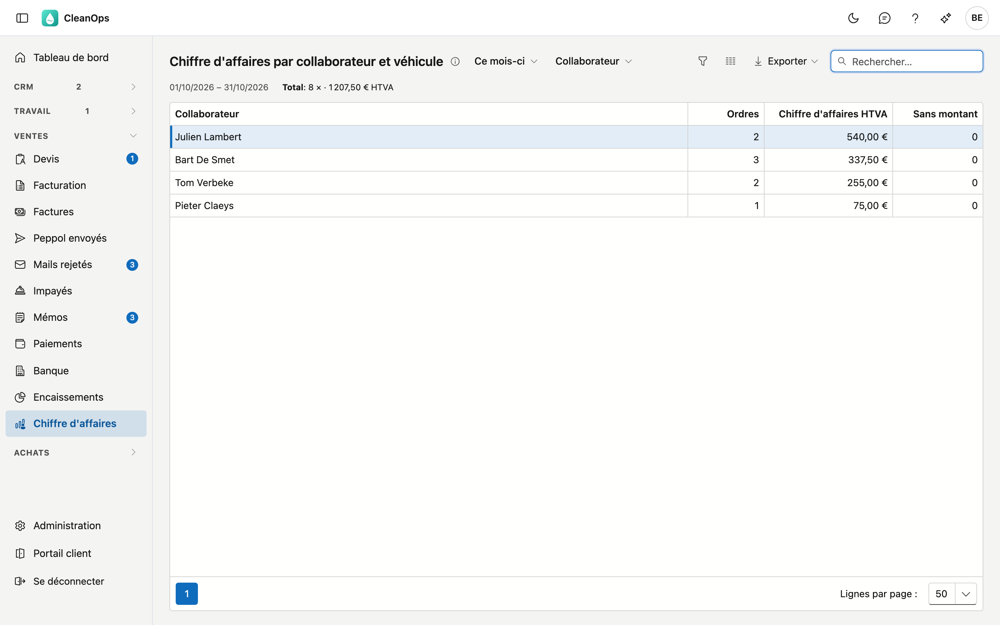

# Chiffre d'affaires par collaborateur et véhicule

Combien de travail a été exécuté sur une période et pour quel montant, par collaborateur ou par véhicule. L'aperçu compte le
travail **exécuté**, même ce qui n'est pas encore facturé.

## Ouvrir l'écran

Dans le menu, sous **Ventes**, cliquez sur **Chiffre d'affaires**. L'écran s'intitule Chiffre d'affaires par collaborateur et véhicule.

## Période et répartition

En haut, vous choisissez la **période** : cette semaine, la semaine passée, ce mois-ci, le mois passé ou cette année. Une
semaine va du lundi au dimanche. Les dates de la période figurent sous les listes, suivies du total.

Avec la deuxième liste, vous choisissez la répartition :

- **Collaborateur** — par exécutant de l'ordre de travail. Un convoyeur ne compte pas. Le travail sans exécutant figure sous
  *(non attribué)*.
- **Véhicule** — par véhicule de l'**ordre de travail**. Le travail sans véhicule figure sous *(sans véhicule)*.

Le véhicule vient de l'ordre de travail et non du collaborateur. Si un collaborateur change de véhicule, le chiffre d'affaires
passé reste au véhicule avec lequel le travail a été fait. Comment un ordre reçoit son véhicule : voir
[Ordres de travail](werkorders.fr.md).

Sous la barre d'outils figure le **total** : le nombre d'ordres et le chiffre d'affaires, identique pour les deux répartitions.

## La liste

| Colonne | Ce que c'est |
|---|---|
| Collaborateur ou Véhicule | qui a fait le travail ou avec quoi |
| Ordres | combien d'ordres de travail ont été exécutés sur la période |
| Chiffre d'affaires HTVA | la somme des montants de ces ordres, hors TVA |
| Sans montant | combien de ces ordres n'ont pas de montant — ils comptent pour 0 |

La liste est triée par chiffre d'affaires, le plus élevé d'abord.

!!! note "Ordres sans montant"
    Un ordre exécuté sans montant compte dans le nombre, avec 0 dans le chiffre d'affaires. La colonne **Sans montant** et le
    message sous la barre d'outils indiquent combien il y en a, pour qu'un chiffre plus bas ne reste pas inexpliqué.

## Exporter vers Excel

Cliquez sur **Exporter** en haut à droite. Vous obtenez les lignes telles qu'elles sont affichées, avec la période et la
répartition choisies.

## Questions fréquentes

**Un ordre de la semaine passée n'y figure pas.**
Il n'a pas encore de date d'exécution, ou elle tombe hors de la période choisie. L'aperçu compte au jour de l'exécution, pas au
jour planifié ni à la date de facture.

**Le total diffère des factures du mois.**
L'aperçu compte le travail exécuté, même ce qui n'est pas encore facturé, et hors TVA. Une facture peut regrouper du travail
d'un autre mois.

## Voir aussi

- [Collaborateurs](medewerkers.fr.md) — le véhicule fixe d'un collaborateur
- [Ordres de travail](werkorders.fr.md)
- [Facturation](facturatie.fr.md)
