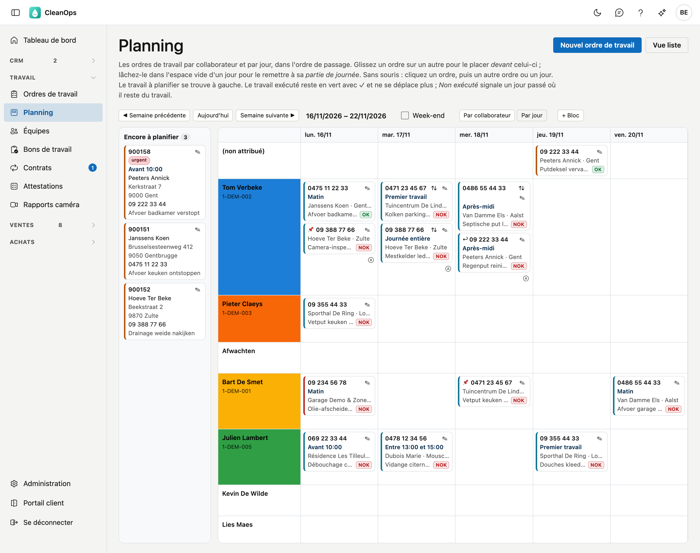
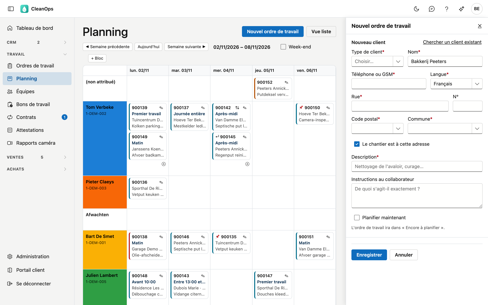
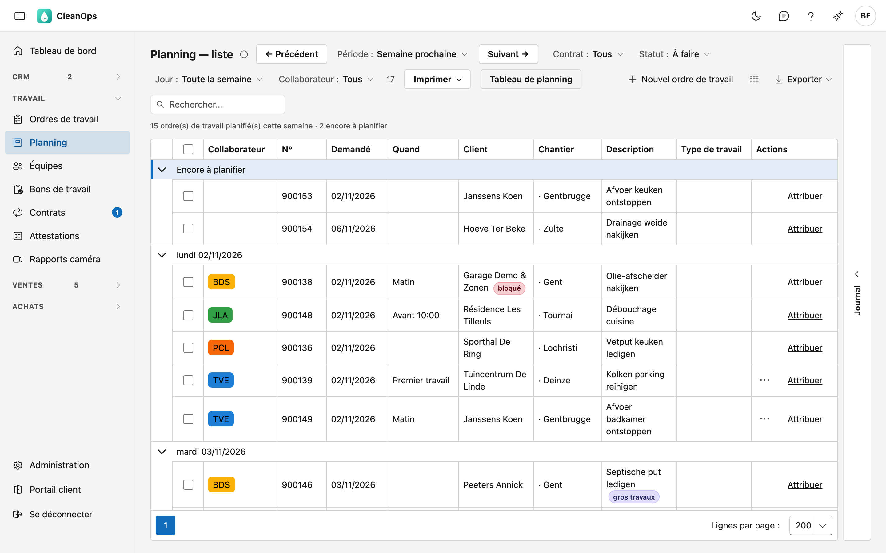
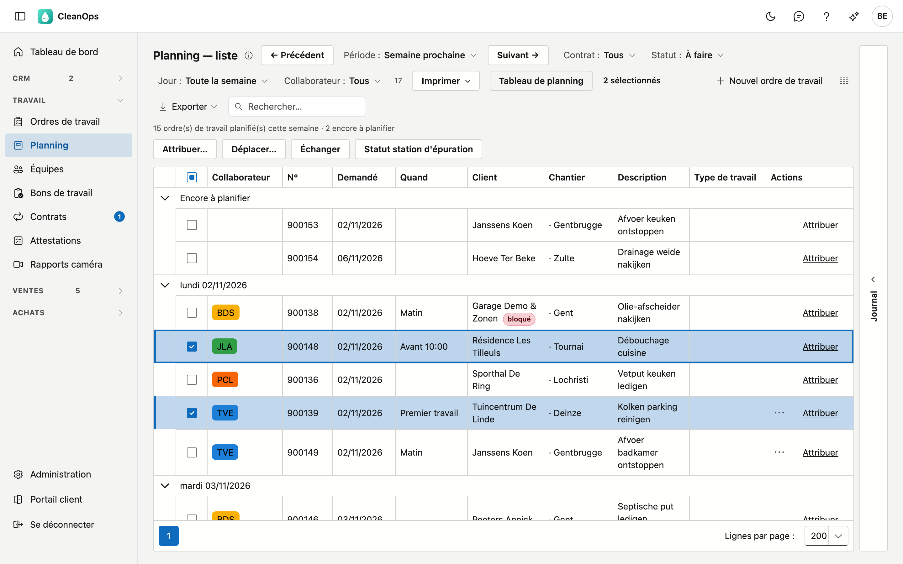
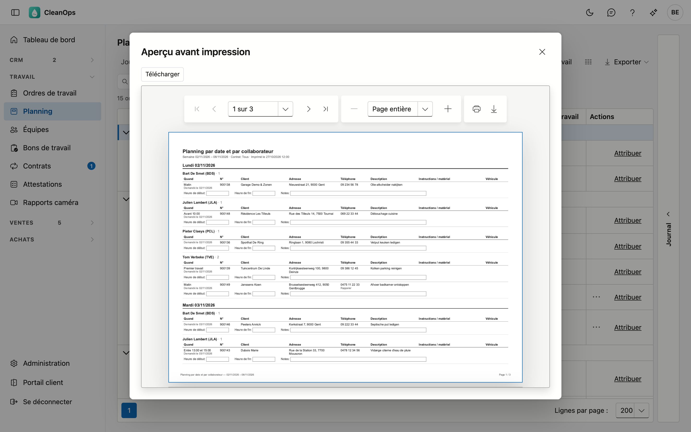

# Planning

Dans le planning, vous répartissez le travail entre vos collaborateurs et sur les jours de la semaine. Vous voyez les
mêmes ordres de travail de deux façons : sur le **tableau de planning**, vous les glissez vers un autre jour ou un
autre collaborateur, et dans la **liste du planning**, vous en attribuez plusieurs à la fois, vous ouvrez l'itinéraire
du jour d'un chauffeur et vous imprimez le planning.

## Ouvrir l'écran

Dans le menu de gauche, sous **Travail**, cliquez sur **Planning**. Le tableau de planning s'ouvre sur la semaine en
cours, le samedi et le dimanche sur la semaine suivante. Avec **Vue liste** en haut à droite, vous passez à la liste
du planning, avec **Tableau de planning** vous revenez.

Le tableau de planning montre d'un coup d'œil ce qui reste à faire : le travail exécuté reste sur son jour, en vert et
avec un ✓, et le travail ouvert sur un jour déjà passé porte **Non exécuté**. La liste du planning ne montre par défaut
que le travail encore à faire ; avec le filtre **Statut**, vous voyez aussi le travail exécuté et facturé.

## Un client au téléphone : Nouvel ordre de travail

Lorsqu'un client vous appelle, vous notez la demande tout en gardant le tableau de planning sous les yeux. Cliquez en haut à
droite sur **Nouvel ordre de travail**. Un panneau s'ouvre à droite, la semaine reste à côté et le curseur est déjà dans le
champ de recherche. Vous pouvez changer de semaine entre-temps pour voir ce qui convient. Sur un écran de 1700 pixels de large
au maximum, la colonne **Encore à planifier** et l'explication du haut disparaissent pendant ce temps, pour que la semaine reste lisible.

1. **Le client** — tapez un nom, un numéro de téléphone ou un numéro de client et cliquez sur **choisir**. Un numéro se trouve
   quelle que soit sa notation : *0478 12 34 56* et *+32 478 12 34 56* trouvent le même client. Si le client n'existe pas encore,
   cliquez sur **Nouveau client :** suivi de ce que vous avez tapé (voir [Un nouveau client](#un-nouveau-client)).
2. **Où** — l'adresse est déjà choisie : la seule adresse d'exécution du client, sinon son adresse principale. Choisissez-en une
   autre, ou ajoutez-en une avec **Nouvelle adresse d'exécution**. S'il s'agit d'un nouveau client et que le chantier se trouve
   ailleurs, décochez **Le chantier est à cette adresse** et remplissez l'adresse du chantier. Le client garde sa propre adresse.
3. **Travail** — la **Description** est obligatoire et compte 35 caractères au maximum : elle figure sur la facture. De quoi il
   s'agit exactement, vous l'écrivez dans **Instructions au collaborateur**. C'est ce que lit le chauffeur.
4. **Quand** — cochez **Urgent** si le travail doit se faire au plus vite : l'ordre reçoit alors une étiquette rouge et figure
   en haut de **Encore à planifier**. Si vous avez convenu d'une heure avec le client, choisissez *Avant*, *Entre* ou *Après*
   dans **Heure convenue** et indiquez l'heure (pour *Entre*, aussi la seconde s'il y en a une). L'ordre reçoit alors la partie
   de journée *selon l'heure*. Par défaut, l'ordre va dans **Encore à planifier**. Cochez **Planifier maintenant** pour choisir le **Jour**, la
   **Partie de la journée** et le **Collaborateur**. Le jour est celui d'aujourd'hui, ou le premier jour de la semaine affichée
   sur le tableau si elle est encore à venir. Si vous laissez le collaborateur vide, l'ordre figure ce jour-là sur la ligne
   **(non attribué)**.
5. **Enregistrer** — le panneau se ferme, vous restez sur le planning et un message indique où se trouve l'ordre. S'il se trouve
   dans une autre semaine, le tableau va à cette semaine.

Pendant que vous remplissez, CleanOps indique ce que vous devez savoir :

- le client est **bloqué** : vous pouvez continuer normalement ;
- le client ou l'adresse n'accepte **pas de nouvelles missions**, le jour est **déjà passé**, ou le collaborateur est **en congé**
  ce jour-là : à l'enregistrement, CleanOps demande d'abord *Enregistrer quand même ?* ;
- l'adresse est **difficilement ou pas accessible** certains jours ;
- des **contrats sont en cours** à cette adresse, avec un lien vers chaque contrat.

Si vous avez besoin du tarif, de la TVA ou d'un autre champ, cliquez chez un client existant sur **Tous les champs…**. Vous passez à
l'[écran complet](werkorders.fr.md#un-nouvel-ordre-de-travail), et ce que vous avez déjà rempli vous suit.

Si vous quittez l'écran alors que le panneau contient du texte, CleanOps demande d'abord confirmation. **Nouvel ordre de travail**
n'apparaît qu'avec le droit de modifier les ordres de travail, et un nouveau client ou une nouvelle adresse demande aussi le droit de
modifier les clients.

### Un nouveau client

| Champ | Explication |
|---|---|
| Type de client * | **Particulier** ou **Entreprise**. |
| Nom * | Ce que vous avez tapé dans le champ de recherche s'y trouve déjà. |
| Téléphone ou GSM * | Un seul numéro : un numéro de GSM va dans **GSM**, un autre dans **Téléphone**. |
| Langue * | La langue des documents pour ce client. |
| E-mail | Peut rester vide. Une adresse invalide empêche l'enregistrement. |
| Numéro de TVA | Uniquement pour une entreprise, et il peut rester vide. Avec **Rechercher**, CleanOps montre ce que la BCE sait, et vous reprenez le nom et l'adresse. |
| Rue *, N°, Code postal *, Commune * | L'adresse du client. Le pays est la Belgique ; vous choisissez un autre pays sur la fiche client. |
| Délai de paiement * | N'apparaît que si la [fiche d'entreprise](beheer/bedrijfsfiche.fr.md#nouveaux-clients) n'a pas de délai de paiement par défaut. |

À l'enregistrement, CleanOps vérifie si le client existe peut-être déjà : d'après son téléphone, son numéro de TVA, et son nom avec le
code postal. Si un message apparaît, cliquez sur **Utiliser celui-ci**, ou sur **Non, créer un nouveau client**. Ce que vous avez
rempli sur le travail reste en place.

!!! warning "Une entreprise sans numéro de TVA"
    Un tel client reçoit sur sa fiche l'étiquette **Fiche à compléter**. CleanOps ne crée de facture pour lui qu'une fois le numéro
    rempli.

## Le tableau de planning

- **La semaine** — choisissez une semaine avec **◀ Semaine précédente** et **Semaine suivante ▶** ;
  **Aujourd'hui** vous ramène à la semaine en cours. La case **Week-end** affiche le samedi et le dimanche. Si du
  travail est planifié un jour de week-end, ce jour est toujours affiché.
- **Les lignes** — en haut, **(non attribué)** : le travail avec une date mais sans collaborateur. En dessous, une
  ligne par collaborateur, dans l'ordre de la [liste des collaborateurs](medewerkers.fr.md). Un collaborateur qui n'est
  plus actif ou qui est pensionné n'a une ligne que si du travail est planifié pour lui cette semaine-là.
- **La couleur** — le nom du collaborateur apparaît dans sa couleur de planning. Vous la choisissez sur la
  [fiche collaborateur](medewerkers.fr.md#longlet-fiche).
- **Le véhicule** — si le collaborateur a un véhicule fixe, sa plaque figure sous son nom. Vous le choisissez aussi
  sur la fiche collaborateur.
- **Encore à planifier** — à gauche se trouve le travail qui n'a pas encore de date planifiée, avec leur nombre. Chaque carte
  montre le numéro, l'étiquette **urgent** et l'heure convenue s'il y en a, le client, l'adresse, le numéro de téléphone ou de
  GSM et la description. Les ordres urgents figurent en haut. Le crayon ✎ à côté du numéro ouvre la fiche de l'ordre de
  travail, comme sur le tableau ; un clic sur la carte elle-même la choisit pour la planifier.
- **L'affichage** — avec **Par collaborateur** et **Par jour**, à côté de la case Week-end, vous choisissez la disposition
  du tableau. Votre navigateur retient ce choix.
- **Le défilement** — seul le tableau défile, vers le bas et sur le côté. Les boutons de semaine et **Encore à planifier**
  restent en place, et dans le tableau, les jours restent en haut et les noms à gauche. Vous glissez ainsi une carte depuis
  **Encore à planifier** jusqu'en bas d'une longue colonne ; arrivé au bord du tableau avec la carte, le tableau suit. **Encore à
  planifier** défile lui-même si la liste est longue.

### Par jour

Dans l'affichage **Par jour**, les jours figurent en haut et, en dessous, une colonne par collaborateur pour chaque jour, avec
le travail l'un sous l'autre. Ce sont les mêmes cases que dans **Par collaborateur** : glisser, choisir et cliquer, **À la fin**,
les congés, les blocs et l'itinéraire du jour fonctionnent de la même façon. Chaque jour commence par une ligne plus épaisse.

La colonne **(non attribué)** n'apparaît que s'il y a cette semaine du travail sans collaborateur. Si les colonnes ne tiennent
pas à l'écran, le tableau défile sur le côté ; en décochant **Week-end**, il y a moins de colonnes.

### Un ordre de travail sur le tableau

Chaque carte montre le numéro, la partie de journée et le rendez-vous horaire (par exemple *Matin* ou
*Entre 13:00 et 15:00*), le client et la commune, la description et le type de travail (par exemple *vetput +/- 3 T*)
— ce dernier seulement s'il dit autre chose que la description. Un ordre urgent porte l'étiquette rouge **urgent**,
jusqu'à son exécution. Si vous pointez une carte, vous voyez aussi le chantier, le type de travail et les signaux.

| Signe | Signification |
|---|---|
| 📌 | Date fixe — ne pas déplacer. |
| ↩ | Peut être exécuté plus tôt. |
| ⇅ | Placé à la main : l'ordre reste là où le planificateur l'a mis, même devant une partie de journée plus tôt. Cliquez dessus pour le remettre sur sa partie de journée. |
| ✎ | Ouvre la fiche de l'ordre de travail. Avec **← Planning**, vous revenez à la même semaine. |
| ✓ | Exécuté : l'ordre de travail est à facturer ou facturé. |
| OK / NOK | Le client connaît-il le rendez-vous ? Cliquez pour changer. Voir [Client averti](#client-averti). |

Le bord gauche de la carte en dit plus sur l'ordre :

- **bleu-vert** — planifié ;
- **orange** — le statut est encore *Encodé* ;
- **rouge** — le client est bloqué ;
- **vert** — exécuté. La carte est aussi un peu plus pâle et reste en place : vous ne pouvez pas la déplacer, et si
  vous lâchez un autre ordre dessus, celui-ci va sur sa partie de journée ce jour-là.

Une carte qui porte un **Non exécuté** rouge est planifiée sur un jour déjà passé et pas encore exécutée. Déplacez-la
vers un nouveau jour, ou indiquez la date sous **Exécuté** sur la fiche de l'ordre si le travail a bien été fait.

Si un ordre porte le code d'un collaborateur qui ne figure plus dans la liste, il se trouve sous **(non attribué)**,
avec ce code en italique en dessous.

### Client averti

En bas à droite de chaque carte planifiée figure **NOK** (rouge) ou **OK** (vert) : le client sait-il quand l'équipe passe ?
Si vous avez téléphoné ou écrit au client, cliquez sur **NOK** et il devient **OK**. Un clic sur **OK** le remet sur **NOK**.
Vous voyez ainsi d'un coup d'œil qui vous devez encore prévenir.

- Si vous déplacez l'ordre vers un autre jour, ou si la partie de journée ou l'heure convenue change, l'étiquette repasse
  d'elle-même sur **NOK** : le client ne connaît alors que l'ancien rendez-vous. Un autre collaborateur le même jour ne
  change rien.
- Sur la fiche de l'ordre de travail, c'est la case **Client averti**. Si vous y changez le jour et cochez la case en même
  temps, elle reste cochée : vous avez annoncé le nouveau rendez-vous au client.
- Le travail sans jour (**Encore à planifier**) et le travail exécuté ne portent pas d'étiquette.
- Qui peut seulement consulter le tableau voit l'étiquette mais ne peut pas cliquer dessus.

### L'ordre dans une journée

Dans une journée, les ordres d'un collaborateur figurent dans l'ordre où ils seront exécutés :

- **par partie de journée**, dans l'ordre des [Parties de la journée](beheer/tijdsdelen.md) (par exemple **Premier travail**,
  **Matin**, **Journée entière**, **Après-midi**). Pour une partie **selon l'heure** (par exemple **Autre**), c'est l'heure
  du rendez-vous qui compte, et sans rendez-vous midi ;
- **pour la même partie de journée**, par code postal ;
- **ce qui est placé à la main** (⇅) reste à l'endroit où le planificateur l'a mis. Un nouvel ordre vient après le
  dernier ordre placé à la main dont la partie de journée est plus tôt ou la même.

Vous choisissez la partie de journée sur la [fiche de l'ordre de travail](werkorders.fr.md#planification-et-execution). Vous modifiez aussi l'ordre d'une journée dans l'[application](app/weekplanning.fr.md#modifier-lordre-dune-journee).

### Déplacer du travail

- **Vers un autre jour ou un autre collaborateur** — glissez la carte vers cette case. Le statut suit comme sur la
  fiche : avec une date et un collaborateur, l'ordre devient *Planifié*.
- **Devant un autre ordre** — lâchez la carte *sur* cette autre carte. Il est alors placé à la main (⇅).
- **Remettre à sa partie de journée** — lâchez la carte dans l'espace vide du jour, ou cliquez sur ⇅ sur la carte. La place manuelle disparaît.
- **À la fin de la journée** — pendant que vous glissez (ou après avoir choisi une carte), la case **↓ À la fin** figure
  sous le travail de chaque jour. Lâchez-y la carte, ou cliquez dessus : l'ordre vient après le dernier ordre de ce jour.
- **Sans souris** — cliquez une carte : en haut apparaît *Ordre … choisi*. Cliquez ensuite une autre carte ou un
  endroit vide d'un jour. **Annuler** ne choisit rien.
- **Planifier du travail sans date** — glissez la carte de la gauche vers un jour.
- **Retour à Encore à planifier** — glissez une carte du tableau vers la colonne **Encore à planifier** à gauche. Tant que
  vous glissez ou avez choisi un ordre du tableau, une zone apparaît en haut de cette colonne pour le lâcher ou le cliquer.
  L'ordre perd sa date et son collaborateur, et redevient *Encodé*. Le travail exécuté ne peut pas revenir.
- **Vers une autre semaine** — pendant que vous glissez, une bande *Semaine précédente* et *Semaine suivante* apparaît à
  gauche et à droite du tableau. Restez-y un instant et le tableau saute d’une semaine, aussi longtemps que vous y
  restez. Lâchez ensuite la carte sur un jour de cette semaine. Si vous ne la lâchez nulle part, elle reste choisie :
  cliquez un jour pour la placer, ou **Annuler**.

Si l'ordre porte une **date fixe**, CleanOps demande *Le déplacer quand même ?* dès que vous le glissez vers un autre
jour, et *Le retirer quand même du planning ?* si vous le remettez dans **Encore à planifier**. Une autre place le même
jour ne demande rien.

Si vous glissez un ordre de travail vers un collaborateur un jour où il est absent (congé, maladie), l'ordre reste à cette
place et CleanOps vous avertit.

### Blocs libres et congés

Un **bloc libre** réserve une journée ou une partie de journée d’un collaborateur sans ordre de travail : une formation,
le véhicule au garage, une journée au dépôt.

- Avec **+ Bloc** en haut, vous choisissez vous-même le collaborateur et le jour. Plus rapide : pointez une case et
  cliquez sur le **+** qui y apparaît ; le collaborateur et le jour sont alors déjà remplis.
- Saisissez la **description** et choisissez éventuellement une **partie de journée**. Sans partie de journée, le bloc
  vaut pour toute la journée et figure en haut de la case ; avec une partie de journée, il se place entre les ordres,
  avant le travail de cette partie de journée.
- Un clic sur un bloc le rouvre, pour le modifier ou le **supprimer**.
- **Glissez** un bloc vers un autre jour ou un autre collaborateur ; la partie de journée et la description restent.
  Vers une autre semaine, passez par les bandes *Semaine précédente* et *Semaine suivante*, comme pour un ordre. Un
  bloc ne peut pas aller dans **(non attribué)** : il appartient toujours à un collaborateur.

Un bloc figure aussi sur le planning imprimé.

Les **congés** du module congés apparaissent d’eux-mêmes comme un bloc rouge en haut de la case, avec le type,
« demi-journée » le premier jour d’une demi-journée, et la description. Vous ne les modifiez pas sur le tableau de
planning mais sur la fiche du collaborateur (voir [Collaborateurs](medewerkers.md)).

## La liste du planning

Les mêmes ordres sous forme de liste, groupés par jour — par défaut ceux de cette semaine. Le travail sans date se
trouve sous **Encore à planifier**. **Nouvel ordre de travail** en haut à droite vous amène au tableau de planning, avec [le panneau](#un-client-au-telephone-nouvel-ordre-de-travail) ouvert.

Pour chaque ordre, vous voyez les signaux (*Urgent*, *Date fixe — ne pas déplacer*, *Peut être exécuté plus tôt*,
*Gros travaux*, *Client bloqué*), le collaborateur dans sa couleur, le numéro (avec ⇅ si l'ordre est placé à la main), la
date demandée par le client (**Demandé**), **Quand** (la partie de journée et l'heure convenue), le client, le chantier, la
description et le type de travail. Avec le sélecteur de colonnes (l'icône à côté d'**Exporter**), vous ajoutez **Commandé**,
**Rue + n°**, **Code postal**, **Localité**, **Statut** et **Station d'épuration** ; un clic sur une colonne trie sur celle-ci, par exemple sur la
localité.

À droite se trouve le volet **Journal**. Dépliez-le pour voir l'ordre sélectionné sans quitter la liste : le client,
l'adresse et le téléphone, la date demandée et les heures, qui et avec quel véhicule, la description, les instructions
pour le collaborateur, le matériel et la remarque interne — et en dessous les pièces jointes et l'historique. Il reste
ouvert quand vous choisissez une autre ligne.

- **Période** — choisissez **Aujourd'hui**, **Semaine passée**, **Cette semaine** (par défaut), **Semaine
  prochaine**, **Ce mois-ci** ou **Mois prochain**, ou indiquez sous *Période libre* un **Du** et un **Au** puis cliquez
  sur **Appliquer**. Une période dure au maximum trois mois. **← Précédent** et **Suivant →** avancent de la longueur de
  la période : une semaine à la fois, un mois à la fois. Sous les boutons figurent le nombre d'ordres planifiés sur
  cette période et le nombre encore à planifier.
- **Statut** — **À faire** (par défaut) : le travail encodé ou planifié. **Exécuté, à facturer** et **Facturé** montrent le
  travail de la période qui est déjà fait. Planifier n'est possible qu'avec **À faire** : avec les deux autres, **Attribuer**,
  le menu de l'ordre et les boutons d'une sélection n'apparaissent pas.
- **Contrat** — **Tous**, **Sans contrat** ou **Avec contrat** : le travail issu d'un [contrat](contracten.fr.md), ou
  les missions ponctuelles.
- **Jour** — **Toute la semaine** (ou **Toute la période**), ou un seul jour de la période. Sous les boutons figure
  alors le nombre d'ordres planifiés ce jour-là, et **Imprimer** n'imprime que ce jour. Si vous choisissez une autre
  période, **Jour** revient sur toute la période. La tuile *au planning aujourd'hui* du [tableau de bord](dashboard.md) ouvre la liste sur le jour même.
- **Collaborateur** — **Tous**, **Tous les attribués** (avec une date et un collaborateur), **Non attribués**, ou un
  seul collaborateur : vous ne voyez alors que son travail.
- **Rechercher** — le curseur est tout de suite dans le champ de recherche. La recherche porte sur le numéro, le client,
  la rue, le numéro de maison, le code postal, la localité, le téléphone, le collaborateur, le véhicule, les travaux, la
  description, le contrat et la remarque interne, ainsi que sur le jour (par exemple *06/10*), le chantier, le type de
  travail, le statut et les autres colonnes — même si la colonne n'est pas affichée. Majuscules, accents et espaces ne
  comptent pas ; chaque mot doit figurer quelque part. Les compteurs et **Imprimer** suivent la recherche.
- **Ouvrir** — double-cliquez sur une ligne pour ouvrir la fiche de l'ordre de travail. Avec **← Planning**, vous revenez
  à la même période, avec les mêmes filtres.

### Attribuer un ordre

Cliquez sur **Attribuer** dans la ligne. Choisissez le **Collaborateur** et le **Jour planifié**, puis cliquez sur
**Enregistrer**. Si vous videz le jour planifié, l'ordre retourne au travail sans date.

### L'ordre dans la liste

Dans un jour et pour un collaborateur, la liste suit le même ordre que le tableau de planning (voir
[L'ordre dans une journée](#lordre-dans-une-journee)). La colonne **Quand** montre sur quoi cet ordre repose : la partie de
journée et l'heure convenue.

Pour déplacer un ordre, ouvrez le menu **⋯** à côté d'**Attribuer** dans sa ligne :

- **Monter** et **Descendre** — une place plus haut ou plus bas dans le jour et chez le collaborateur. L'ordre est alors
  placé à la main : ⇅ figure à côté du numéro.
- **Remettre sur sa partie de la journée** — seulement pour un ordre placé à la main : la place manuelle disparaît.

Le menu n'apparaît que s'il y a quelque chose à choisir, par exemple pas pour un ordre seul dans sa journée.

### Plusieurs ordres à la fois

Cochez les ordres de travail. Au-dessus de la liste apparaît ce que vous pouvez faire avec cette sélection. La case de
l'en-tête coche tout ce qui figure sur la page ; une page compte 200 ordres, de sorte qu'une semaine chargée y tient en une fois.

| Bouton | Ce qui se passe |
|---|---|
| Attribuer… | Choisissez un collaborateur ; tous les ordres cochés vont à lui. Si vous laissez le champ vide, ils ne vont à personne. |
| Déplacer… | Choisissez un jour planifié ; tous les ordres cochés vont à ce jour, chez le même collaborateur. |
| Échanger | Le travail de deux collaborateurs est échangé. Ce n'est possible que si la sélection contient le travail d'exactement deux collaborateurs. CleanOps demande d'abord une confirmation. |
| Statut station d'épuration | Active la station d'épuration (RWZI) là où elle était désactivée et la désactive là où elle était active. CleanOps indique combien ont été activés et désactivés. |

Avec **Attribuer** et **Déplacer**, la place manuelle dans la journée disparaît : l'ordre vient à sa partie de
journée. Avec **Échanger**, l'ordre dans la journée reste.

Si vous choisissez une autre période, un autre filtre ou une autre recherche, la sélection disparaît. Ainsi, un bouton ne touche jamais du travail
que vous ne voyez plus.

### L'itinéraire du jour

Le signe d'itinéraire à côté de **Attribuer** dans la liste, ou le petit signe d'itinéraire dans une case du tableau de
planning (à partir de deux adresses), ouvre l'itinéraire de ce collaborateur ce jour-là : depuis l'adresse de la
[fiche d'entreprise](beheer/bedrijfsfiche.fr.md), par les adresses, et retour.

- **Ordre du planning** montre les adresses dans l'ordre du planning, avec pour chaque trajet la distance et le temps
  de route, et le total.
- **Itinéraire optimal** met les mêmes adresses dans l'ordre le plus court. Le total du planning figure à côté, pour
  voir la différence.
- **Ouvrir dans Google Maps** montre l'itinéraire sur la carte, dans l'ordre affiché. Google Maps accepte au plus 9
  arrêts par itinéraire ; si la journée en compte plus, vous recevez l'itinéraire en parties qui se suivent.
- **Reprendre cet ordre** (avec l'itinéraire optimal affiché) met les ordres de travail de ce jour dans cet ordre dans
  le planning, placés à la main (⇅). Le travail exécuté ne bouge pas. Le bouton n'apparaît que si vous pouvez modifier
  le planning et si l'ordre change vraiment.

Le travail exécuté figure avec ✓ dans l'itinéraire : il compte dans les kilomètres. Un ordre sans adresse n'y figure
pas.

<!-- AFBEELDING: la fenêtre Itinéraire avec les boutons Ordre du planning et Itinéraire optimal, les arrêts avec km et minutes, le Total, Ouvrir dans Google Maps et Reprendre cet ordre -->

!!! info "Quand l'itinéraire n'est pas calculé"
    Sans adresse sur la fiche d'entreprise, ou avec plus de 25 adresses le même jour, CleanOps ne calcule pas
    d'itinéraire : Google n'en accepte pas plus. La liste et le lien vers Google Maps restent disponibles.

### Imprimer

**Imprimer** ouvre un menu avec trois choix :

- **Planning par date et collaborateur** — l'aperçu de ce que la liste montre (voir ci-dessous).
- **Bons de travail par collaborateur et date** — les [bons de travail](werkbonnen.fr.md) pour la même période (ou le jour
  choisi) et, si vous en avez choisi un, le même collaborateur. Ils s'ouvrent dans le même **Aperçu avant impression** que
  sur l'écran Bons de travail. Ce choix n'est possible qu'avec le statut **À faire**, et pas avec **Non attribués** : un bon
  de travail est du travail encore à faire, pour un chauffeur.
- **Excel avec tous les champs** — un fichier Excel de ce que la liste montre, avec tous les champs de chaque ordre, aussi
  ceux des colonnes masquées : entre autres le jour, le nom du collaborateur, les heures, les cases à cocher, le téléphone,
  les instructions, le matériel, les remarques internes, le véhicule, le contrat et la facture.

**Planning par date et collaborateur** crée l'aperçu *Planning par date et par collaborateur* : ce que la liste montre maintenant, donc la même
période, le même jour, contrat, collaborateur et la même recherche. L'en-tête mentionne le collaborateur et la recherche
si vous en avez choisi. Par jour et par collaborateur figurent la partie de journée avec la date demandée par le client
(*Demandé le*), le numéro, le
client et le chantier, l'adresse, le téléphone de l'adresse (sinon celui du client, et celui de l'ordre en plus s'il est différent — avec
*Rappeler* tant que le client doit encore être rappelé), la description,
les instructions et le matériel (précédé de *Matériel :*), et le véhicule — cette colonne n'apparaît que si au moins un
ordre de la feuille a un véhicule. Sous chaque ordre figurent des cases vides **Heure de début**,
**Heure de fin** et **Notes**, que l'équipe remplit à la main. Le travail sans date se trouve à la fin sous *À planifier*.
Un jour ou un collaborateur ne reste jamais seul en bas d'une page : l'en-tête passe à la page suivante, avec ses ordres.

L'aperçu s'ouvre dans une fenêtre **Aperçu avant impression**. **Télécharger** l'enregistre en PDF ; avec l'icône
d'imprimante de la visionneuse, vous l'imprimez.

## Carte et itinéraire

Sur la [fiche de l'ordre de travail](werkorders.fr.md#planification-et-execution), deux liens vers Google Maps
figurent sous l'adresse d'exécution : **Carte** montre l'adresse, **Itinéraire** le chemin pour y aller depuis
l'endroit où vous êtes.

## Questions fréquentes

**Je ne peux rien glisser, et je ne vois pas de bouton Attribuer.**
Vous pouvez seulement consulter le planning. Demandez à votre gestionnaire le droit de modifier le planning.

**Un ordre de travail ne figure pas sur le planning.**
Vérifiez qu'il a une date planifiée : sans date, il se trouve sous **Encore à planifier**, à gauche sur le tableau ou en
haut de la liste. Le travail exécuté figure en vert sur le tableau de planning ; dans la liste, choisissez
**Exécuté, à facturer** ou **Facturé** sous **Statut**.

**Comment remettre un ordre sans date ?**
Dans la liste du planning : **Attribuer**, videz le **Jour planifié** et cliquez sur **Enregistrer**.

**Je ne vois pas Nouveau client dans le panneau.**
Vous pouvez seulement consulter les clients. Demandez à votre gestionnaire le droit de modifier les clients.

**Le bouton Échanger est grisé.**
Les ordres cochés appartiennent à un seul collaborateur, ou à plus de deux. Cochez le travail d'exactement deux
collaborateurs.

**Un collaborateur n'a pas de couleur.**
Choisissez une couleur sur sa [fiche collaborateur](medewerkers.fr.md#longlet-fiche).

**L'itinéraire dans Google Maps va au mauvais endroit.**
L'itinéraire utilise l'adresse de l'ordre de travail. Corrigez l'adresse d'exécution sur la fiche de l'ordre.

## Voir aussi

- [Ordres de travail](werkorders.fr.md)
- [Collaborateurs](medewerkers.fr.md)
- [Contrats](contracten.fr.md)
