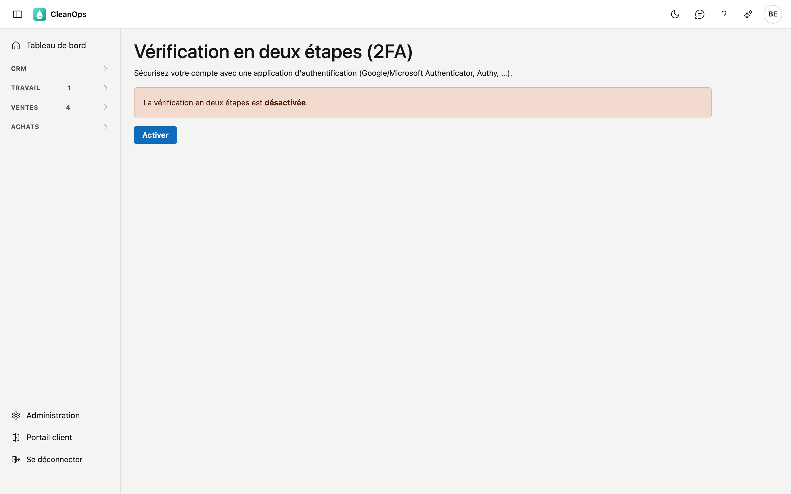

# Vérification en deux étapes et clés d'accès

La **vérification en deux étapes** sécurise davantage votre compte. En plus de votre mot de passe, CleanOps demande à
la connexion un **code à usage unique** issu d'une application d'authentification, par exemple Google Authenticator,
Microsoft Authenticator ou Authy. Ainsi, personne n'entre avec votre seul mot de passe. Une fois activée, vous pouvez
aussi vous connecter avec une **clé d'accès** (passkey) : l'empreinte digitale, le visage ou le code PIN de votre
appareil.

## Ouvrir l'écran

En haut à droite, cliquez sur vos **initiales** et choisissez **Vérification en deux étapes**.

## Activer

1. Cliquez sur **Activer**.
2. **Scannez le code QR** avec votre application d'authentification. Si le scan échoue, recopiez la **clé** affichée
   dans l'application.
3. L'application affiche un code à six chiffres. Saisissez-le sous **Code de l'application** et cliquez sur
   **Vérifier et activer**.

La vérification en deux étapes est maintenant active.

## Codes de récupération

Après l'activation, vous recevez une série de **codes de récupération**. Conservez-les en lieu sûr, ailleurs que sur
votre téléphone. Chaque code sert **une seule fois** et est votre issue si vous n'avez pas votre application
d'authentification sous la main.

Avec **Nouveaux codes de récupération**, sur le même écran, vous créez une nouvelle série ; les anciens sont alors
annulés.

## Se connecter avec la vérification en deux étapes

Après votre nom d'utilisateur et votre mot de passe, CleanOps demande une étape de plus : saisissez le code de votre
application d'authentification et cliquez sur **Vérifier**.

Vous n'avez pas votre application sous la main ? Cliquez sur **Application indisponible ? Utilisez un code de
récupération** et saisissez l'un de vos codes de récupération.

## Se connecter avec une clé d'accès

Avec une **clé d'accès**, vous vous connectez avec l'empreinte digitale, le visage ou le code PIN de votre appareil,
sans mot de passe ni code. Ce n'est possible que si la vérification en deux étapes est **activée** : la clé d'accès
remplace alors les deux étapes à la fois.

### Ajouter une clé d'accès

1. Ouvrez **Vérification en deux étapes**. Sous **Clés d'accès** figurent celles que vous avez déjà.
2. Sous **Nom de cet appareil**, saisissez un nom reconnaissable, par exemple *Portable bureau*.
3. Cliquez sur **Ajouter une clé d'accès** et suivez la demande de votre appareil : empreinte, visage ou code PIN.

Avec **Renommer** et **Supprimer**, vous gérez vos clés d'accès. Une clé d'accès est liée à l'adresse de CleanOps et
à l'appareil sur lequel vous l'avez créée : sur un autre appareil, vous en ajoutez une nouvelle.

### Se connecter

Sur l'écran de connexion, cliquez sur **Se connecter avec une clé d'accès** et confirmez sur votre appareil. Votre mot
de passe et le code restent valables, par exemple sur un appareil sans clé d'accès.

## Désactiver

Ouvrez **Vérification en deux étapes**, cliquez sur **Désactiver** et confirmez avec votre mot de passe.

!!! warning "Vos clés d'accès disparaissent aussi"
    Sans vérification en deux étapes, vous ne pouvez pas vous connecter avec une clé d'accès. Si vous la désactivez,
    vos clés d'accès sont supprimées.

## Questions fréquentes

**J'ai perdu mon téléphone.**
Connectez-vous avec un code de récupération. Si vous ne les avez plus, demandez de l'aide à votre administrateur.

**Le bouton Se connecter avec une clé d'accès ne fait rien sur mon appareil.**
Tous les navigateurs ne prennent pas en charge les clés d'accès ; CleanOps l'indique alors. Connectez-vous avec votre
mot de passe et votre code.

## Voir aussi

- [Rôles](beheer/rollen.fr.md)
