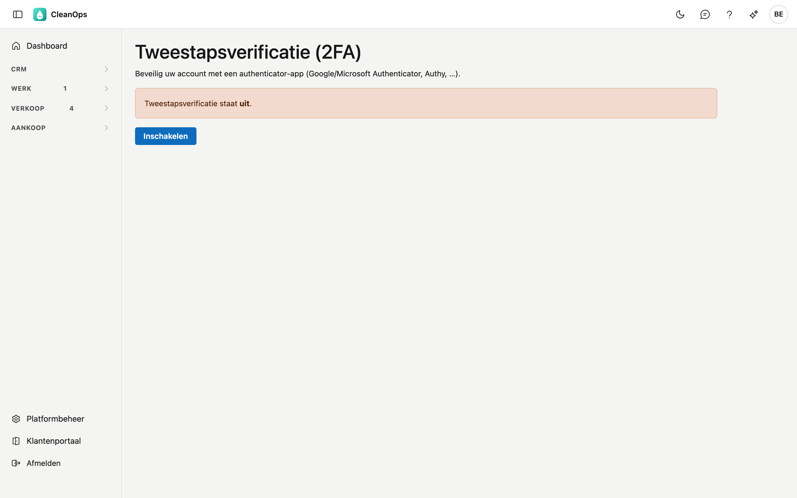

# Tweestapsverificatie en passkeys

Met **tweestapsverificatie** beveiligt u uw account extra. Naast uw wachtwoord vraagt CleanOps bij het aanmelden een
**eenmalige code** uit een authenticator-app, bijvoorbeeld Google Authenticator, Microsoft Authenticator of Authy. Zo
raakt niemand binnen met alleen uw wachtwoord. Staat ze aan, dan kunt u zich ook aanmelden met een **passkey**: de
vingerafdruk, het gezicht of de pincode van uw toestel.

## Het scherm openen

Klik rechtsboven op uw **initialen** en kies **Tweestapsverificatie**.

## Inschakelen

1. Klik op **Inschakelen**.
2. **Scan de QR-code** met uw authenticator-app. Lukt scannen niet, typ dan de getoonde **sleutel** over in de app.
3. De app toont een code van zes cijfers. Vul die in bij **Code uit de app** en klik op **Verifiëren en inschakelen**.

Tweestapsverificatie staat nu aan.

## Herstelcodes

Na het inschakelen krijgt u een reeks **herstelcodes**. Bewaar ze op een veilige plaats, buiten uw telefoon. Elke
code werkt **één keer** en is uw uitweg als u uw authenticator-app niet bij de hand hebt.

Met **Nieuwe herstelcodes** op hetzelfde scherm maakt u een nieuwe reeks; de oude vervallen dan.

## Aanmelden met tweestapsverificatie

Na uw gebruikersnaam en wachtwoord vraagt CleanOps een extra stap: vul de code uit uw authenticator-app in en klik op
**Verifiëren**.

Hebt u uw app niet bij de hand, klik dan op **App niet beschikbaar? Gebruik een herstelcode** en vul een van uw
herstelcodes in.

## Aanmelden met een passkey

Met een **passkey** meldt u zich aan met de vingerafdruk, het gezicht of de pincode van uw toestel, zonder wachtwoord
en zonder code. Dat kan enkel als tweestapsverificatie **aan** staat: de passkey vervangt dan beide stappen tegelijk.

### Een passkey toevoegen

1. Open **Tweestapsverificatie**. Onder **Passkeys** staat welke passkeys u al hebt.
2. Vul bij **Naam van dit toestel** een herkenbare naam in, bijvoorbeeld *Laptop kantoor*.
3. Klik op **Passkey toevoegen** en volg de vraag van uw toestel: vingerafdruk, gezicht of pincode.

Met **Hernoemen** en **Verwijderen** beheert u uw passkeys. Een passkey hoort bij het adres van CleanOps en bij het
toestel waarop u hem maakte: op een ander toestel voegt u er een nieuwe toe.

### Aanmelden

Klik op het aanmeldscherm op **Aanmelden met een passkey** en bevestig op uw toestel. Uw wachtwoord en de code blijven
werken, bijvoorbeeld op een toestel waar u geen passkey hebt.

## Uitschakelen

Open **Tweestapsverificatie**, klik op **Uitschakelen** en bevestig met uw wachtwoord.

!!! warning "Uw passkeys verdwijnen mee"
    Zonder tweestapsverificatie kunt u zich niet met een passkey aanmelden. Zet u ze uit, dan worden uw passkeys
    verwijderd.

## Veelgestelde vragen

**Ik ben mijn telefoon kwijt.**
Meld u aan met een herstelcode. Hebt u die niet meer, vraag dan uw beheerder om hulp.

**De knop Aanmelden met een passkey doet niets op mijn toestel.**
Niet elke browser ondersteunt passkeys; CleanOps zegt dat dan. Meld u aan met uw wachtwoord en uw code.

## Zie ook

- [Rollen](beheer/rollen.md)
