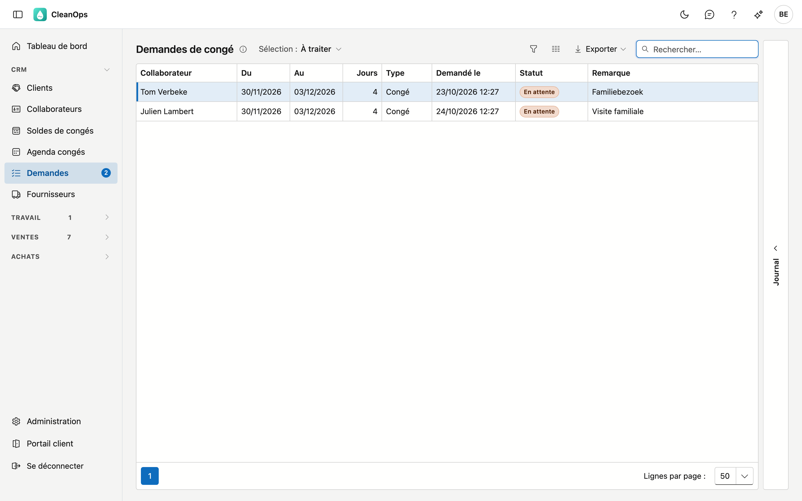
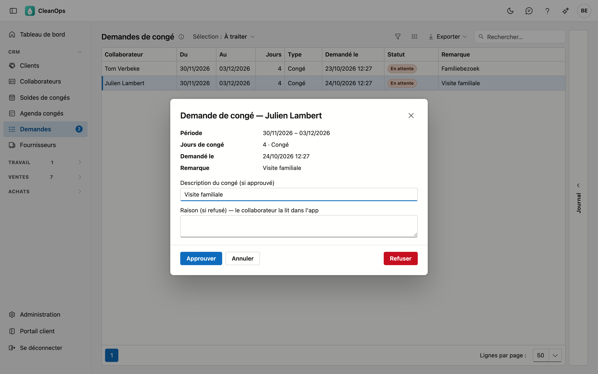

# Demandes de congé

Les collaborateurs demandent leurs congés dans l'[application](app/verlof.fr.md). Dans **Demandes de congé**, vous voyez ces
demandes et vous décidez : approuver enregistre aussitôt le congé, refuser envoie au collaborateur une raison qu'il lit dans
l'application.

## Ouvrir l'écran

Cliquez à gauche dans le menu, sous **CRM**, sur **Demandes**. Le chiffre à côté de l'élément de menu est le nombre de
demandes qui vous attendent. Vous voyez l'écran avec le droit de consulter les collaborateurs. Approuver et refuser demandent
le droit de modifier les collaborateurs.

## La liste

Choisissez la **Sélection** en haut :

| Sélection | Ce que vous voyez |
|---|---|
| À traiter | Les demandes sur lesquelles personne n'a encore décidé. L'écran s'ouvre ainsi. |
| Toutes (aussi traitées) | Aussi les demandes approuvées, refusées et retirées. |

Pour chaque demande, vous voyez le collaborateur, la période, le nombre de jours ouvrables, le type (*Congé* ou *Autre*),
quand il l'a demandée, le statut et sa remarque. Le volet **Journal** à droite montre qui a introduit la demande cliquée et
qui a décidé.

## Traiter une demande

Double-cliquez sur une demande. La fenêtre montre la période, les jours de congé, le type et la remarque du collaborateur.

- **Approuver** enregistre le congé, comme dans l'onglet [Congés](medewerkers.fr.md#longlet-conges) du collaborateur. Il
  apparaît aussitôt dans le [planning](planning.fr.md), les [Équipes](ploegen.fr.md), l'[agenda des congés](verlofkalender.fr.md)
  et les [Soldes de congés](verlofsaldi.fr.md). Sous **Description du congé**, vous trouvez la remarque du collaborateur, ou
  sinon le type ; adaptez-la si vous le souhaitez. CleanOps recalcule les jours de congé, avec les jours fériés et le régime
  de travail d'aujourd'hui.
- **Refuser** demande une **Raison**. Écrivez-la pour le collaborateur : il la lit dans l'application.

La demande disparaît de À traiter et le chiffre dans le menu diminue. Le collaborateur voit votre décision dans l'application ;
il ne reçoit ni e-mail ni notification.

Une demande traitée peut encore être ouverte, mais plus modifiée. Si un congé approuvé doit malgré tout changer, adaptez-le sur
la fiche du collaborateur ou dans l'agenda des congés.

## Erreurs fréquentes

!!! warning "Un congé est déjà enregistré pour cette période"
    Si quelqu'un au bureau a entre-temps déjà enregistré un congé pour les mêmes jours, CleanOps refuse l'approbation : sinon
    le congé figurerait deux fois. Vérifiez les congés du collaborateur, puis refusez la demande ou adaptez d'abord le congé
    enregistré.

## Questions fréquentes

**La liste reste vide, alors qu'un collaborateur a demandé un congé.**
Tant que les congés sont encore tenus dans votre application précédente, un collaborateur ne peut pas demander de congé dans
l'application. Celle-ci lui dit alors de le demander au bureau.

**Un collaborateur peut-il encore modifier une demande ?**
Non. Tant que vous n'avez pas décidé, il peut la retirer dans l'application et en introduire une nouvelle. Une demande retirée
apparaît sous **Toutes (aussi traitées)**.

## Voir aussi

- [Les congés dans l'application](app/verlof.fr.md)
- [Agenda des congés](verlofkalender.fr.md)
- [Soldes de congés](verlofsaldi.fr.md)
- [Collaborateurs](medewerkers.fr.md)
