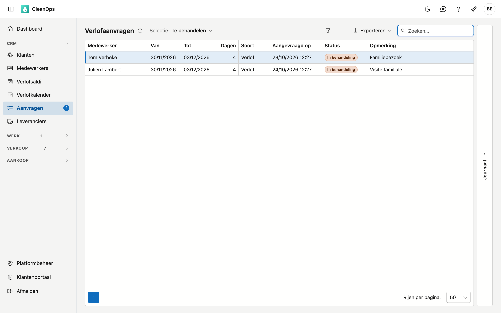
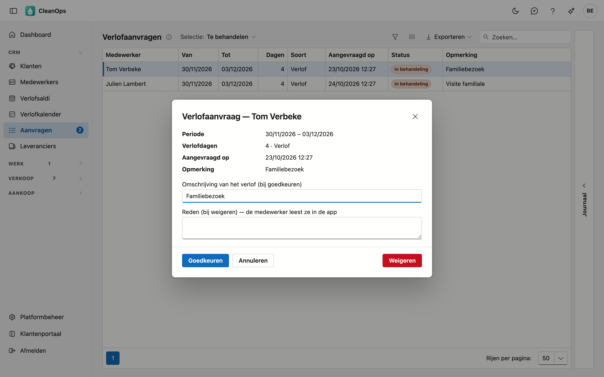

# Verlofaanvragen

Medewerkers vragen hun verlof aan in de [app](app/verlof.md). In **Verlofaanvragen** ziet u die aanvragen en beslist u:
goedkeuren boekt het verlof meteen, weigeren stuurt de medewerker een reden die hij in de app leest.

## Het scherm openen

Klik links in het menu, onder **CRM**, op **Aanvragen**. Het getal naast het menu-item is het aantal aanvragen dat op u
wacht. U ziet het scherm met het recht om medewerkers te bekijken. Goedkeuren en weigeren vraagt het recht om medewerkers
te bewerken.

## De lijst

Kies bovenaan de **Selectie**:

| Selectie | Wat u ziet |
|---|---|
| Te behandelen | De aanvragen waarover nog niemand besliste. Zo opent het scherm. |
| Alles (ook behandeld) | Ook de goedgekeurde, geweigerde en ingetrokken aanvragen. |

Per aanvraag ziet u de medewerker, de periode, het aantal werkdagen, de soort (*Verlof* of *Ander*), wanneer hij ze
aanvroeg, de status en zijn opmerking. De strook **Journaal** rechts toont wie de aangeklikte aanvraag indiende en wie
erover besliste.

## Een aanvraag behandelen

Dubbelklik op een aanvraag. Het venster toont de periode, de verlofdagen, de soort en de opmerking van de medewerker.

- **Goedkeuren** boekt het verlof, net zoals op het tabblad [Verlof](medewerkers.md#het-tabblad-verlof) van de medewerker.
  Het staat meteen in de [planning](planning.md), [Ploegen](ploegen.md), de [verlofkalender](verlofkalender.md) en
  [Verlofsaldi](verlofsaldi.md). Bij **Omschrijving van het verlof** staat de opmerking van de medewerker, of anders de soort;
  pas ze gerust aan. CleanOps rekent de verlofdagen opnieuw, met de feestdagen en het werkregime van vandaag.
- **Weigeren** vraagt een **Reden**. Schrijf ze voor de medewerker: hij leest ze in de app.

De aanvraag verdwijnt uit Te behandelen en het getal in het menu daalt. De medewerker ziet uw beslissing in de app; hij
krijgt geen mail of melding.

Een behandelde aanvraag kunt u nog openen, maar niet meer wijzigen. Moet een goedgekeurd verlof toch anders, pas het dan aan
op de fiche van de medewerker of in de verlofkalender.

## Veelgemaakte fouten

!!! warning "Er staat al verlof in die periode"
    Boekte iemand op kantoor intussen al verlof voor dezelfde dagen, dan weigert CleanOps het goedkeuren: anders stond het
    verlof er twee keer. Kijk het verlof van de medewerker na, en weiger de aanvraag of pas het geboekte verlof eerst aan.

## Veelgestelde vragen

**De lijst blijft leeg, ook al vroeg een medewerker verlof aan.**
Zolang het verlof nog in uw vorige toepassing bijgehouden wordt, kan een medewerker in de app geen verlof aanvragen. De app
zegt hem dan dat hij het aan het kantoor moet vragen.

**Kan een medewerker een aanvraag nog wijzigen?**
Nee. Zolang u niet beslist hebt, kan hij ze in de app intrekken en een nieuwe indienen. Een ingetrokken aanvraag staat bij
**Alles (ook behandeld)**.

## Zie ook

- [Verlof in de app](app/verlof.md)
- [Verlofkalender](verlofkalender.md)
- [Verlofsaldi](verlofsaldi.md)
- [Medewerkers](medewerkers.md)
